# Admin Guide

This guide walks an admin through every tab of the admin panel. A few
destructive operations and platform-wide overrides are reserved for
**superadmins** and covered in the [Superadmin guide](superadmin.md).

Sign in as an admin and the admin panel opens automatically. Type your work
email on the sign-in card and press **Continue**. An administrator's account
signs in with a **password** by default, so a password box then appears on the
card: enter your password and press **Sign in**. **Email me a code instead**,
under it, always works as well — it emails you a short one-time code — so a
forgotten password never locks you out.

**If you have not set a password yet** — a new administrator account has
none — the card says so. Choose **Email me a code instead**, enter the code
from your inbox, and you are asked to **Set your password** — or press **Keep
using emailed codes** to sign in with a code every time instead. Until you
choose one or the other, you are asked again at each sign-in.

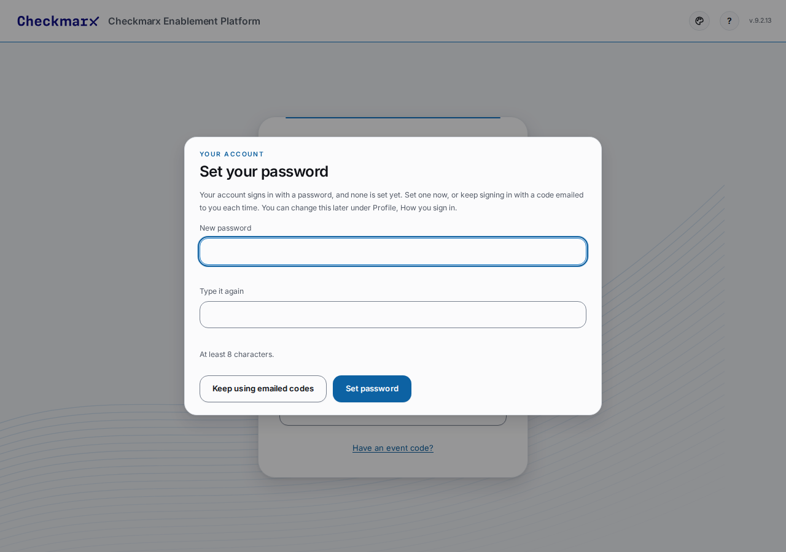

To change your password, or to switch between a password and emailed codes,
open **Profile** from your account menu and press **Change how you sign in**
under **How you sign in**. Changing an existing password needs the current one,
unless you signed in with a code in the last ten minutes: that is how a
forgotten password is replaced — sign in with **Email me a code instead**, then
set a new one straight away. Setting or changing a password emails a notice to
your sign-in address, and a changed password signs out any other browser that
was signed in to your account. Nobody else — not even a superadmin — can see,
set or reset your password.

Your password and your emailed codes share one guard against guessing: ten
wrong attempts within five minutes lock the account for an hour, and the right
password or a correct emailed code still signs you in and lifts the lock. If
mail is down, an administrator who signs in with a password signs in with it
as usual; a superadmin can also get in through the built-in break-glass account
(see the [Superadmin guide](superadmin.md)).

### Your account menu

Signed in, the header keeps only two controls at its far right: **Search** (see
[Search](#search)) and one round **account button** showing your initials or
picture. The account button opens your **account menu** — a short list in a
small panel under the button on a wide screen, a sheet from the bottom of the
screen on a phone. It holds:

- your name, address and role;
- **Switch to Participant View** (or **Switch to Admin View** when you are in
  participant view) — see [Switching to participant view](#switching-to-participant-view);
- **Appearance**, which shows what this browser is set to (for example
  *Ambient · Auto*) and opens the Appearance page — Auto, Light or Dark, the
  two looks and, on Ambient, its accent colour
  (see [Looks and the Appearance page](#looks-and-the-appearance-page));
- **Profile**, to edit your own details and choose how you sign in;
- **Help**, the guide for your role;
- **What's new**, the release notes (see [Release notes](#release-notes));
- the version number and **Sign out**.

**Esc**, or a press anywhere outside the menu, closes it. That is true of
**Search** too, but not of a dialog window that holds a form or asks you to
confirm something: a press outside one does nothing, so that nothing you have
typed is lost.

### Search

**Search** in the header, or **Ctrl+K** (**⌘K** on a Mac) anywhere, opens one
box that reaches everything you may do. Type a few letters; the results come in
four groups:

- **Go to** — every page in your sidebar and, inside an event, that event's
  sections (Overview, Participants, Challenges, Rankings and the rest);
- **Actions** — what you can do from here: **New event**, **New challenge**,
  **Invite people**, **Sign up at the desk**, **New template** and the exports,
  and inside an event the doors of its **⋯** menu (Add challenges, Clone,
  Export everything, Join-link settings, Edit settings, History, …). Only what
  your role may use is listed. The irreversible doors — **End now**, **Close
  late entries now**, **Delete** — stay in the **⋯** menu, behind their confirm;
- **Events** — any event by name, which opens its workspace;
- **Help** — the headings of your guide; picking one opens the help drawer at
  that section.

**↑** and **↓** move through the results, **Enter** opens one, and **Esc** or a
press outside the box closes it. With nothing typed it lists what you opened last, then the pages and
actions. On a phone it fills the screen.

### Looks and the Appearance page

{{platformName}} comes in two **looks**, both flat: **Ambient** (the house
default, following each device's light or dark setting) and **Signature**
(Checkmarx violet, ivory by day), each in day and night. A look changes colours
and corner shapes, never what anything does. The **Appearance page** (account
menu → **Appearance**) shows each look with a live day and night preview, the
**Mode** (Auto follows your device, Light and Dark pin one), Ambient's **accent
colour**, and **Show all tips** (see below). Every choice applies at once and is
kept in this browser only. A browser still holding a look that is not offered
(Heritage, Command, Hyperscreen or Checkmarx) gets the default until it picks
again. An organisation default or event look set to one of those shows
Signature, or for Hyperscreen Ambient (at night for an organisation default;
an event look has no mode of its own).

Every page uses one typeface: Inter, the same on every device.

**Help tips.** A small **?** beside a control that needs explaining — a filter,
a setting, a header button — opens a one- or two-sentence note. Tick **Show all
tips** on the Appearance page to open every note on every page at once.

### Switching to participant view

**Switch to Participant View** in your account menu drops you into the exact
experience a participant sees, so you can dry-run an event as if you were an
attendee. **Switch to Admin View**, in the same menu, flips you back. Your admin
session isn't affected either way, and the switch is logged.

Participant view uses **your own profile**. If a required detail on it is missing
— your company, work title, country, timezone, or a company
email address — you are asked to complete it first rather than dropped into a
view where nothing loads, and you stay in the admin panel until you do.

This shows you the participant experience *as yourself*. To see the platform
through one **specific** participant's eyes — their events, their
challenges, their score — use
[Impersonating a participant](#impersonating-a-participant) instead.

All the tabs of one browser share one session, so the switch applies to all of
them. Another tab still showing the admin panel says *This tab is out of date*
and sends nothing more; **Reload** opens the view now in force. The same happens
when you sign in as someone else, or start or end an impersonation, in another
tab. Signing in again as yourself in another tab
leaves your other tabs working. Signing out in one tab signs them all out, and
the others say you signed out in another tab of this browser. In participant
view the browser is in one event at a time: open a different event in another
tab and a tab still showing the first says *This tab is out of date* too, and
records nothing more until you reload it.

### Release notes

**What's new** in your account menu opens the **release notes**: what changed in
each released version of {{platformName}}, newest first, written for the person
running events rather than for whoever builds the platform. Each entry is a
short list of what is new or now behaves differently, and any visible breakage
that was fixed. A version that changed nothing you or a participant would notice
is not listed at all, so the version in the menu is sometimes newer than the top
entry.

The item and the notes themselves are admin-only — a participant sees neither.
While you are in participant view the item is hidden, along with everything
else that is yours rather than theirs.

### Tables: columns, sorting and filtering

Every admin table (Events, Challenges, Participants, Groups, Live rankings,
Analytics, Activity, Audit, Logs, Roles & permissions, the tables in
**Team & reports**, issued certificates and the Checkmarx One removals list)
fits the window without scrolling sideways. Each shows a small default
set of columns; **Columns** above the table adds or removes any of the others,
and **Reset to default** brings the default set back. A row's actions (and the
Audit table's **Details**) are always shown. Your choice is kept per table, in
this browser. A table inside a dialog is not one of these: **History**, for one,
keeps its own search, sorting and pages.

Every column heading has a small filter button beside its name. It opens
**Sort ascending** / **Sort descending** and a filter that fits the column: a
text box ("contains"), a list of the values in it, or a date range. Clicking the
heading's name still sorts as before. On Events, Challenges, Participants,
Analytics and Live rankings a filter narrows the whole list before it is paged
(on a rankings board, before its top 50), and on Participants, Analytics and
Live rankings **Export CSV** follows it too; on the other tables it narrows
the rows on screen, and the line above the table says so ("… on this page
shown"). On Activity, **Sort ascending** / **Sort descending** ask the server
for that order from the first page, exactly as clicking the heading does. On
Logs they do the same once a search or a group narrows the log; with nothing
narrowed they reorder the page in front of you, as clicking the heading does
there, and ask the server nothing. Either way the pager says whether every
match was ranked. The Events list keeps
its usual order (live first, then upcoming, then ended, latest finish first)
until you choose a heading; Duration, Tags, Challenges and Sessions are under
**Columns** there, and Session is under **Columns** on Activity. On Logs, First,
Last and Groups are under **Columns**, and switching between the audit and
request logs clears the heading filters. **Clear column filters** removes them
all. A column the list did not sort by before (Tags, for one) sorts too, by its
name or its filter button: it shows an arrow beside its name while it orders the
list, and the same button above the table then reads **Clear sort** (or **Clear
sort and filters**), which puts the rows back in the list's own order. A list that
belongs to one event (its issued certificates, its **Team & reports** tables)
starts with no sort or filter when you open another event. On a phone each row is a card and the headings are not shown, so
**Sort & filter** sits above the cards: it lists the same columns, says which
one sorts or filters the list now, and opens the same **Sort ascending** /
**Sort descending** and filter for the column you pick (**All columns** goes
back to the list). **Select all**, where a table has it, sits above the cards
too. Groups, Live rankings and Analytics keep their headings on a phone
instead: each scrolls sideways inside its own box. On a tablet, or a phone held
sideways, the headings show and **Sort & filter** sits above every table as
well: it is the bigger target to tap there.

---

## Events

The **Events** tab lists every event — Booth Events, Competitions and
Programs alike — with status badges, and each row carries a chip naming its
type. Above the table sit **+ New Event**, a search box and one
**Filters** button. **Filters** opens a panel with two groups of chips: **Status**
(All / Live / Upcoming / Late entry / Ended) and **Type**, which narrows the list
to one event type when you have several running at once. While any filter is
active the button reads **Filters · N** and each active filter shows beside it as
a chip you can press to remove; **Clear all** in the panel removes them all. The
panel stays open or closed as you left it in this browser. On a phone it opens
as a sheet over the page, only when you press **Filters**: **Done** or **Esc**
closes it and you are back on the **Filters** button. The People page and
the Challenge library use the same **Filters** button.

**The list opens showing live, upcoming and late-entry events.** The **Ended**
filter starts switched off, so a finished event is not missing — turn on
**Ended**, or **All**, to bring it into view.

**Late entry** is its own status, with its own badge colour, and it is on by
default because those events are still running for the people arriving at them.
A Booth Event that has passed its end time but is still inside its late-entry
window reads **Late entry open** rather than **Ended** — it is still accepting
walk-ups through the join link and still taking their submissions, and you can
still add people to it yourself (they join as late entrants). It answers the
**Late entry** filter and *not* the **Ended** filter, so the two are genuinely
separate views. Once the window closes the event becomes an ordinary ended event
and drops out of the default list. See [Late entries](#late-entries).

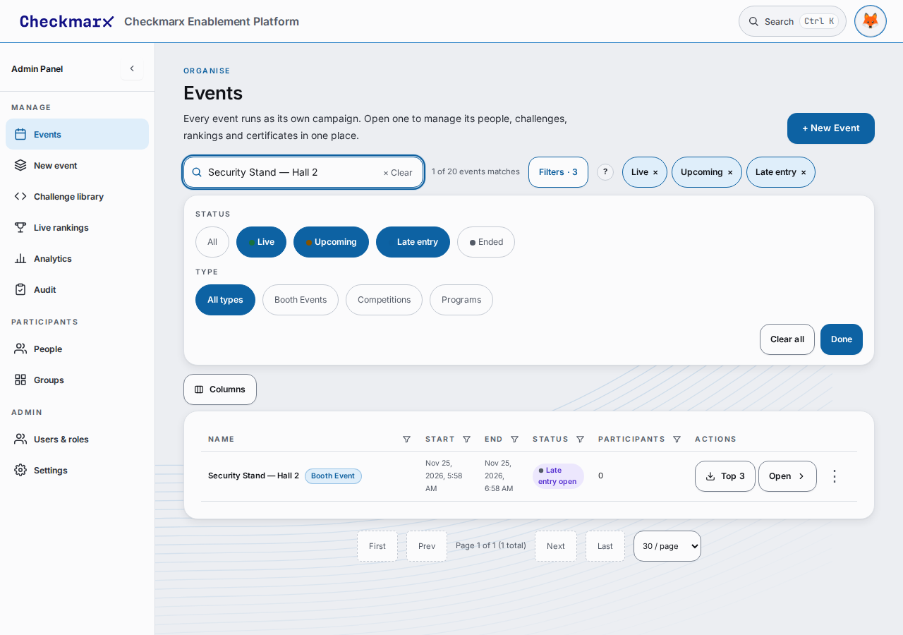

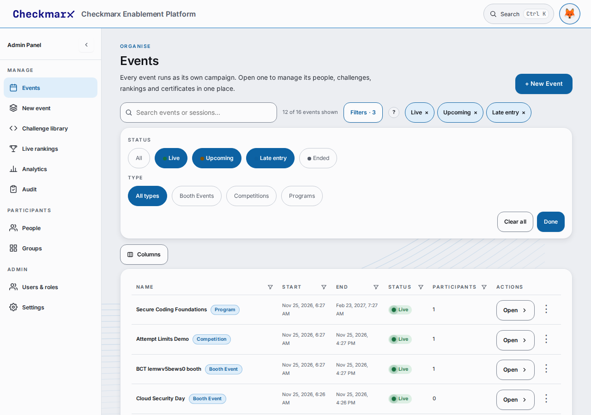

**How the list is ordered.** By default: **live** events first, then
**upcoming**, then **ended** — and within each of those, by **finishing time,
latest first**, so the most recent work is always at the top of its group. For a
multi-session event the finishing time is its *last* session's end, which
is the same figure the **End** column shows. Click any column heading to sort by
it instead, and click again to reverse.

From here you can:
- Create an event and its sessions.
- Edit an event's name, start time, and duration.
- **Mark an event as a test / dry run** — tick **"Mark as test / dry run"**
  near the bottom of the event create/edit dialog.
  These are left out of Analytics by default and cannot mint achievement badges
  — use them for rehearsals and test runs. They are flagged with a yellow edge
  and a **test/dry run** badge wherever they appear. This is backed by the
  built-in **test/dry run** tag, so you can also add or remove it directly.
- **Tag events** — tags show as searchable badges (the **test/dry run**
  tag above is the built-in one).
- **Let staff compete** — tick **Staff can compete** on the event form and
  the organisers you enrol are on the board like anyone else, at the price of
  not being able to edit the event while they are in it. Off by default; see
  [Letting staff compete](#letting-staff-compete).
- **CxOne integration (per event)** — the event create/edit
  dialog has a **CxOne Integration** section where you can:
  - tick **"Don't create CxOne accounts for this event"** to skip CxOne
    (Checkmarx One) account provisioning for that event entirely. Where
    it starts depends on the event type — already ticked for a Program,
    unticked for a Competition — and you can toggle it any time. A **Booth
    Event never creates Checkmarx One accounts** (its walk-ups do not use the
    product), so its form has no CxOne section at all, and changing an event
    to a Booth Event turns its accounts off.
    Ticking it also stops any account still being set up for this event at
    that moment — as does removing that participant from the event — while
    accounts already created in Checkmarx One are not removed; and
  - set a per-event **API key** and/or **group name** override to point
    that event at a different CxOne configuration than the platform
    default (ticking the opt-out above disables these fields). For the
    platform to remove a deleted participant's account from that tenant by
    itself, the key must also be able to view the tenant's clients;
    otherwise each removal waits for a superadmin's decision.

  Both are available to any admin. Only the **global** default CxOne
  credentials — in the superadmin **Settings** tab — are restricted to
  superadmins.

  **The group name is matched exactly first, then ignoring case.** If you
  type `hackathon-2026` and the group in Checkmarx One is called
  `Hackathon-2026`, participants are added to it and the event's History
  records that the spelling had to be corrected for you — worth fixing in
  the override so it stays exact. If Checkmarx One holds **two** groups
  whose names differ only in case, nothing is guessed: type one of them
  exactly, or participants get an account with no group access and the
  History says so.

  **"Not set up yet" in a participant's History** means their Checkmarx One
  account was not linked because the account with their address was being
  removed by the platform at that moment (it had been made for someone deleted
  since). The platform tries again by itself once the removal has finished: a
  new account, or the old one if the tenant refused to remove it. If the row says
  it was not retried automatically, assign them to the event again while it
  still accepts participants. A row saying a link to a Checkmarx One account was
  cleared means the platform removed that account; a new one is set up for them
  unless the event no longer creates one for them (the row says why).
- **Trusted network IPs** — stop a roomful of people on the venue's Wi-Fi
  tripping the platform's traffic limits (see
  [Trusted network IPs](#trusted-network-ips)).
- **Open** an event (click its name or its **Open** button) to run it from its
  own workspace — see [The event workspace](#the-event-workspace).
- **Top 3** — on an ended, ranked event, this button beside **Open**
  downloads a ZIP of the issued 1st, 2nd and 3rd place certificates (a top-three
  place earns one only with points above zero) of every leaderboard the event has: one top three per session when each session is
  ranked on its own (each session's files in a folder named after it), and the
  late entrants' own top three beside the main one (in `late-entrants`). Each
  file is named after its place and its holder, as the certificate prints the
  name (for example `1-josé-garcía-certificate.pdf`), so you can tell whose it
  is without opening it. Each leaderboard gives at most three: two people level on score are told apart by
  the tie-break, so only one of them is third. If they are still being issued,
  if the event's certificates are not issued automatically (it ended before
  automatic certificates began, or its congratulations email is off) and none
  of its top three collected theirs, or if nobody placed, it says which instead
  of handing you an empty file. A ZIP that leaves out a place still waiting for
  its certificate says how many are missing and why, and a certificate revoked
  while the file is being prepared is left out, and the message says so.
- The three-dot menu carries the rest of a row's actions: **Edit**, **History**,
  **Organisers** (see [Making somebody an event
  admin](#making-somebody-an-event-admin)), **Email Delivery** (see [Email
  delivery](#email-delivery)), **Export Activity (CSV)** (see [Export challenge
  activity](#export-challenge-activity)), **Assign Challenges**, **Manage
  Participants** (opens this event's workspace on its Participants section, with
  everyone listed, ready to invite or remove people), **Join Link** (see [Self-enrollment
  links](#self-enrollment-links)), **Close late entries now** (see [Closing late
  entries early](#closing-late-entries-early)), **Start Now** (see [Starting an
  event early](#starting-an-event-early)) and **End Now**. Which of them appear
  depends on where the event is in its life: Assign Challenges only until it
  ends, Manage Participants and Join Link until it ends too — except on a Booth
  Event still taking late entries, where both stay until late entry closes (see
  [Late entries](#late-entries)) — Close late entries now only on such an event,
  Export Activity only once it is live or ended, Start Now only on an upcoming
  single-session event, End Now only while it is live, and Edit only until the
  end time has passed (after that, only a superadmin). **Delete** is there too,
  for a superadmin. And if you are enrolled in the event yourself, on an event
  that lets staff compete, the menu withholds everything that would change it —
  see [The competitor lock](#the-competitor-lock).

### Email delivery

**Email Delivery** on an event's three-dot menu reports three numbers for
the people enrolled in *that* event:

- **Enrolled** — everyone in the event. It moves the moment somebody joins
  through the link.
- **Verified** — how many of them have confirmed an email address. Read it as a
  gap from *Enrolled*: the difference is the people who may not receive anything
  you send.
- **Email failed** — how many of them have had at least one message fail. It
  counts **people, not messages**, so three bounces to one attendee is one
  person to go and help.

It is offered whatever the event's status, deliberately: the moment you most
want these numbers is the night before, while people are still registering.

### Event team and lead reports

An event's **Team & reports** section names the people its reports go to: one or
more Solutions Engineers, Marketing, Sales and SDRs, plus an SE, Marketing and
Sales manager. They need no account; a name and an address are enough, and the
address must be at a domain a superadmin allowed under **Settings**, **Email (SMTP)**.
You can change the team of any event, and an event admin of their own events;
nobody competing in the event can. A team member is emailed participants' details,
so a custom role adds members and uses **Send now** only if it may also see
participants (and, for the Marketing and SDR roles, whose emails carry a lead
file, export data); otherwise the section says why in place of the control. Only
a member whose address is an account able to open this event (an administrator,
or one of its organisers) gets each email's button; everyone else is told the
next step in words they can act on (Marketing to load the attached file into the
CRM, an SE to ask you to edit a challenge), with no link to a page they could not
open. Set an optional lead target and hot-lead target beside them.

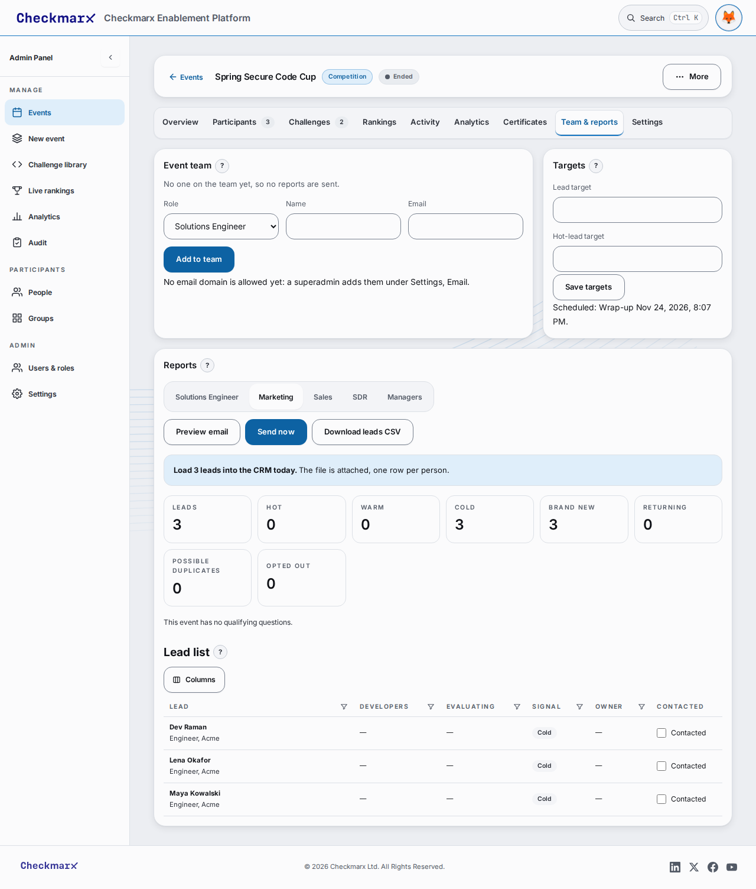

**Qualifying questions.** A Booth Event gets four by default, from the
**Add the qualifying questions** tick when you create it, from a template too
(off for the other types, but available; an event where staff compete asks none,
because it holds sealed challenges only and a qualifying question can never be
sealed): team size, current scanner, evaluation timeline, and
whether they want a follow-up. They are ordinary challenges you can edit or remove
for this event. Tagging a challenge `qualifying:<key>` makes it one too, as long
as it is a pick-one question (**Any answer**, with two or more options), like the
four built-in ones: the event team's reports read which option each person picked,
so the tag is refused on any other kind of challenge, and so is a change that
would turn a qualifying question into one. A qualifying challenge scores nothing (the exports list it at 0
points) and never counts toward finishing, ranking or a Program's completion, so
answering one never ends an event, and adding or removing that tag (or restoring
a version of the challenge that does) re-scores at once the answers already
given in every event using the challenge — with the tag they earn nothing and
its hint costs nothing; without it they earn the difficulty's points, a wrong
answer costs its penalty and the hint its price, and whether an answer was right
never changes — and each event whose scores moved records **Scores
recalculated** on its **History**. The change is refused once one of those events has ended a
session, and while the challenge is locked (unlock it first; any other tag can
still be added): an event admin can do it only to
a challenge of their own that no other organiser's event uses, as with changing
its answer or difficulty. Participants see them last,
in a fixed order (developers, scanner, evaluating, follow-up, then your own),
numbered 4.01, 4.02 and so on, as a **Quick question**: no difficulty, no rating,
and a thank-you rather than a score when they answer. On a phone at a Booth Event
one tap on a large tile answers. A participant can change their answer to one
with options until the event ends (**Change answer** on the answered question),
so a slip of the thumb is not final; the reports read each person's latest answer.

**One question per topic.** Another event's qualifying question can be added to
this one (through **Add challenges**, **Assign to Events** or the bulk assign);
the two events then share that question's wording, while each keeps its own
answers. But an event asks each one once: a question on a topic the event
already asks (its own developers question, say) is not listed in **Add
challenges**, is greyed out as *Topic already asked* in **Assign to Events**, and
is skipped, and counted in the toast, by the bulk assign. Only one question per
topic can be ticked in **Add challenges** at a time. A question the event holds
counts even while it is hidden or a draft. Tagging a challenge, restoring one of
its versions or importing a challenge file cannot make an event ask a topic twice
either.

**Who is hot.** Hot: 250 or more developers and evaluating within 6 months, or
they asked for a follow-up. Warm: one of those first two. Cold: neither. People
who opted out of email stay in the reports, marked "do not email". Anyone who
answers **No** to the follow-up question is left out of the lead lists, the CRM
file, the accounts and the SDRs' cards (Marketing's email says how many); they
still count as having joined, and changing the answer to Yes makes them a lead
again. Where people join an event that has a team, the join card tells them
what the team receives and how to stay out.

**Once anyone has answered a qualifying question, its options keep their
places.** The reports read each answer by the place of the option picked in the
list, so moving an option, removing one or adding one above another would change
how everyone who already answered is counted (hot, warm or cold included). The
editor says so beside the **Options** box and refuses such a save, and a
challenge import does not apply one either. Rewording is fine: a line you edit
where it stands stays the same option, and the answers already given to it follow
its new wording (so keep its meaning). A new option can be added at the end.
The rule holds while the question carries its `qualifying:` tag: if you take the
tag off, move the options and put the tag back, the answers already given are
counted again by the options' new places.

**What goes out, and when.** About 15 minutes after the event ends (nothing if you
revive it first), each role gets one email led by the one thing to do (a button
where the address can open the event, words saying what to do otherwise):

- **Solutions Engineer:** **Edit** the worst challenge, with why; if nothing is
  flagged, **Clone for the next event** and a line saying nothing needs fixing.
  Below it: difficulty flags, undelivered certificate emails, low ratings, the
  challenge table and the podium (none if nobody scored; on an event whose
  sessions are ranked separately, one for each session, and the late entrants'
  own once late entries close). Anyone who
  answered anything, a qualifying question included, counts as played.
- **Marketing:** **Download the CRM file**. Leads against target, new, returning and
  possible duplicates, the qualifying breakdown and top hot leads, with the file
  attached. While nobody has taken part, it says so and attaches no file. A
  lead's other events, and where they were first seen with who invited them
  there, are named only to a reader who may open those events: an event admin's
  report and download name only their own events (an earlier event outside them
  reads *Another event*), and each email only the events its recipient's own
  account opens, none for an address no account holds.
- **Sales:** **Plan the meeting** with the strongest account. Accounts grouped by
  company, with the most senior title and signal.
- **SDR:** **Contact** the first person to call. Their own share only, split evenly
  and kept between reports, each card with the lead's email address, their place
  (in their own session where sessions are ranked separately, or among the late
  entrants) and a suggested opener, and a file of their own leads attached (none on the 48-hour
  reminder). With no SDR, the leads go to Marketing, whose own report carries
  the file of every lead.
- **Managers:** **Assign** the hot leads still to contact that have no owner, else
  **Open the event report**. A scorecard against the targets and the last three
  ended events of the same type that whoever added the manager may open (every
  event for a superadmin or an administrator; an organiser's own events for an
  organiser; none once that address is no longer such an account), and, when the
  manager's own address is an account limited to some events, only those.

A hot lead is still to contact while nobody has marked it **Contacted** and the
person has not opted out of email. Every count of hot leads waiting means that:
the 48-hour reminder, each SDR's call to action, the managers' **Assign** count
and their scorecard's **Hot still to contact** row, and, in this section, the
SDR view's **Hot still to contact** figure.

Closing late entries, the late window lapsing, or ending again after an extension
sends only the new leads. A running Program sends a digest each Monday, then the
wrap-up at its deadline. After 48 hours, owners of hot leads nobody has marked
**Contacted** get a reminder, and Marketing hears how many are waiting; a lead who
opted out of email is not counted, so nobody is reminded when only such leads wait. A
reminder still waiting when the event is revived is not sent; once it ends again,
the reminder follows 48 hours after that end's report, unless one already reached
somebody for the event (one sent while nobody was waiting does not count). Dry-run events and events with no team send nothing.
The section's switch shows each role's view: its one action, figures against the
targets, and its table. **Preview email** shows that role's email as it is sent, and **Send now** sends every report as it
stands, without stopping the automatic ones. It answers within ten seconds: if the
reports are still going out then, it says so and the event's History records the
result, and another **Send now** waits until they have gone; if something goes wrong
part-way it says so, with how many went, and the History records that too.
**Recent reports**, under the targets, says whether each of the last reports
reached everyone. Removing someone from the team takes their address out of the
event's record of what was sent: the reports they received are kept under their
email's domain only. Adding the same address back never sends them a report they
already have, and a report going out while you remove someone sends them nothing
more. A report that could not be sent to somebody is tried again for
them (after 5 and then 30 minutes) before it is given up; a report that could not
be put together at all is tried again 30 minutes later, three tries in all, and
after the third the event's History says **Team report given up**. The leads count as
reported once somebody on the team has received them; anyone who joins while a
report is being retried is in the next report of new leads, so the whole team
gets them. Links in these emails need a sign-in. These are internal staff emails:
they carry no unsubscribe link, and each one's footer tells its reader to ask the
event's organiser to remove them, which you do in this section.

### Certificates are emailed when an event ends

When a competition or a booth event ends — **End Now**, its scheduled end, the
last session ending, or every participant finishing — the platform issues each
participant the certificate they earned (a top-three placing with points above
zero, or participation for anyone else who attempted a challenge) and emails it to them as a PDF, with a
congratulation written for their placing. On a **Program** each participant is
emailed the moment they complete it, including when an edit of yours completes
them (hiding, unpublishing or removing a challenge they had not solved, or
re-marking an earlier answer correct). The emails go out about five minutes after
the end, so an **End Now** pressed by mistake and undone straight away sends
nothing.

- **Each certificate is emailed once.** Reviving an event and ending it again
  emails only the people who earned their first certificate in the meantime;
  a certificate someone already holds does not change and is not sent again.
- **Not emailed:** members who never attempted a challenge, staff and
  benchmark participants (who are not on the leaderboard), a dry-run event, and
  anyone who unsubscribed from event emails (their certificate is still issued).
  Who counts is checked again just before each certificate is issued, so
  someone tagged `staff` or `benchmark`, or given an organiser's role, after the
  event ended gets no certificate, and the people ranked below them who are
  still to be issued theirs move up.
- **Late entrants** are emailed once late entry closes, so the email carries
  their final placing among the late entrants.
- **A failed delivery is retried** twice more over the next half hour.
- **Not emailed, and not tried again**, when by the time it is sent the
  holder's account has been blocked, denied or is no longer approved, the
  holder is no longer in the event, or the certificate has been revoked.

The email is part of the event's certificate design, in the designer's
**Congratulations email** section: **Email certificates to their holders** turns it
off for the event (or, in the platform design, for the whole platform); you can
also change its **Subject**, add a paragraph, rewrite the thank-you paragraph for
each certificate, and edit the two lines and the **Hashtags** of the LinkedIn post
that its **Copy my LinkedIn post** button opens (a one-time page, valid for seven
days, no sign-in needed). The post's verification link follows the design: it is
there while the certificate shows its ID (the QR is printed only beside the ID),
and left out when the ID is hidden. `{event}` and `{platform}` are filled in. With the email
off, nothing is issued on anybody's behalf either — participants collect their
certificate themselves.

The certificates issued for an event — holder, tier, score and whether the
email arrived — are listed in the event workspace's **Certificates** section,
where any of them can be downloaded or its email re-sent (see
[Certificates](#certificates)). An event admin reaches these for their own
events only.

### Starting an event early

**Start Now** on the Events row's three-dot menu (or **Start now** in the
workspace header's **⋯** menu) begins an **upcoming** single-session event
straight away, without waiting for its scheduled start.

**A Booth Event or a Competition keeps its scheduled end**, and runs longer to
reach it: one set to run from 15:00 to 17:00 that you start at 14:20 runs until
17:00. **A Program keeps its deadline**, which is what matters for it. The
confirmation names the end it keeps (**No fixed deadline** for a Program whose
deadline is five years or more away and, for a Booth Event or a Competition, the
length that reaches it) before anything is saved. A **session**, started from
the Overview, keeps its end time too. The kept end is counted in whole minutes,
so it can land up to a minute later than scheduled: a Booth Event whose
late-entry deadline was pinned (through the API) within that minute is not
started, and the message says why. Set a later deadline, or tick **Automatic**,
in **Edit settings**, then start it again.

It is not offered on a multi-session event, because there the individual
session is what starts. Open the event and use that session's **Start now** on
the **Sessions** card of its Overview.

### The event workspace

Every event runs as its own campaign. Click an event's name on the **Events**
list (or its **Open** button) and it opens in its **workspace** — one screen
that holds everything about that event, from its first invitation to its last
certificate. Leave it with **← Events** at the start of its header.

**The header is two lines.** The first reads **← Events**, the event's name, its
**type** chip and a live **status** chip (Live, Upcoming, Late entry open, Ended,
with the countdown), then the **join pill**, **Invite** and the **⋯** menu. On a
multi-session event a chip per session follows the status: click one to look at
that session alone, and **All sessions** to zoom back out. The second line, in
smaller type, gives the dates, how many sessions it has and who organises it.
On every section but **Overview** the header shrinks to a slim strip that stays
at the top as you scroll.

- **The join pill.** While the event's join link is on, the pill reads **Join
  code**; press it to reveal the code and QR (revealing them is recorded on the
  event's History, because the link lets anyone in). From then on the pill shows
  the code itself, for example `HWN-F7N`, and opens a small panel with the **QR
  code** — the event's code is printed in its centre, so a camera that cannot
  read the QR still leaves people the code to type — plus **Copy link**,
  **Full-screen QR** for the screen on your stand, and **Join-link settings**.
  With the link off the pill reads **Join link off** and opens the settings.

  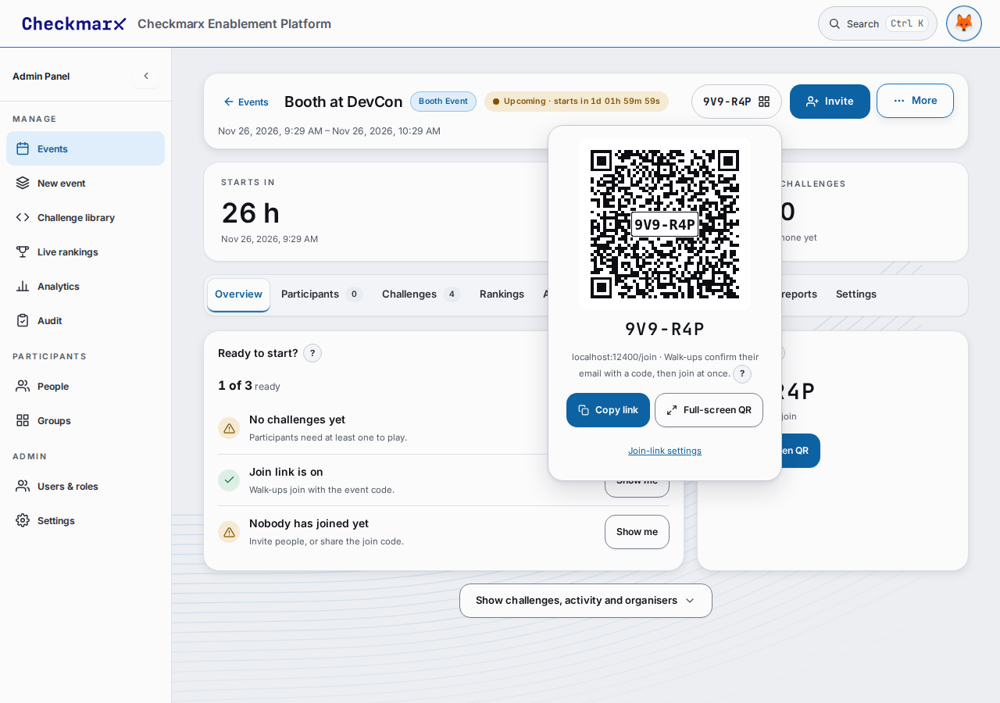
- **Invite** — the one primary button (see [Inviting
  participants](#inviting-participants)). **Approve** joins it while somebody in
  the event is waiting for approval.
- **⋯** — every other door for the event, in one place: **Add challenges**,
  **Clone**, **Export everything** (a ZIP), **Export activity (CSV)** (once it is
  live or ended), **Sign up at the desk**, **Save as template** (administrators),
  **Join-link settings**, **Edit settings**, **History**, **Organisers**, **Email
  delivery** and **Start now** (an upcoming single-session event). The
  irreversible ones come last, after a divider, each behind its own confirmation:
  **Close late entries now** (a finished Booth Event still taking late entries —
  see [Closing late entries early](#closing-late-entries-early)), **End now**
  while it is live, and **Delete event** for a superadmin.

Below the header, a band of live figures led by the countdown (time left with a
bar of how much has gone, the time until the start, or when it ended; **No fixed
deadline** for a running Program whose deadline is five years or more away), then only
the figures that matter now: people playing (answered in the last five minutes)
while it is live, how many joined, the challenges before the start, and the
answers with how many were correct on a ranked event, once there are any. They count up and flash
when they change. Then the event's **sections**, a strip of tabs:

- **Overview** — the event's command centre, refreshed every 15 seconds while it
  is on screen, and built around what you do next:
  - **Before the start**, **Ready to start?** checks the challenges (published
    and visible; the quick questions do not count, so an event holding only
    them has no challenges yet), the join link, who has joined and, on a Competition, the
    sessions. Each item still to do has the button that fixes it (**Add
    challenges**, **Join-link settings**, **Add session**), or **Show me**, which
    takes you to **Invite** or the join code at the top.
  - **While it is live**, a row of what needs you now: people waiting for
    approval, nobody joined yet, challenges participants cannot see, challenges
    nobody has solved yet. It reads **Nothing needs you right now** when that is
    so. Below it, **Progress**: how many of the event's people have solved every
    challenge (the quick questions are not counted) and how many solved each one,
    so you can see where people are stuck (the
    leaderboard itself is under **Rankings**), the **Live feed** of joins and solves once there
    are any, the **Sessions** card with each session's **Start now**, **End now**,
    edit and delete buttons, and, while walk-ups can join, **Full-screen QR** for
    the stand's screen.
  - **After the end**, the final progress and whether the certificates were
    issued and emailed (with **Download top 3 certificates** on that card for a
    ranked event).

  Everything else is behind **Show challenges, activity and organisers**: the
  challenge set, where pressing a challenge opens its difficulty, points, how
  many solved it and whether participants can see it (a quick question says it
  scores no points); before the start, **Solve rate**, a bar per challenge (from
  the start the bars are in **Progress**); **Activity over time**, a chart of
  joins, answers and correct answers since the start; and the organisers. Long
  lists open in place with **Show more**, and **Open Challenges**, **Open
  Analytics** and **Open Certificates** still take you to those sections.
  **Joined**, and every line saying how many people have joined apart from the
  activity chart's Joins and its summary, counts everyone enrolled, like the Events list and the
  **Participants** tab, and follows them at once. The other live figures, the
  chart's joins among them, leave out staff accounts, as in Analytics, and event
  admins (and anyone whose role, like theirs, covers only the events they are
  given), as on the event's leaderboard, and no answer given while
  impersonating counts (nor can anyone join an event while viewing as someone);
  when only people they leave out have joined,
  **Progress** says so (it says **Counting…** for the moment Joined and the
  live figures disagree, just after someone joins or leaves). On an event where staff
  compete, everyone taking part in it is counted, staff and event admins
  included (as on its leaderboard); the quick questions count as answers but
  never as solves. If a refresh fails, the
  row at the top says so, with **Try again**, and the live figures stay those of
  the last refresh. The Overview follows the event
  as it starts, ends or is changed, without leaving and coming back. If you
  compete in the event, its live figures are kept off the Overview while you
  compete (**Joined** and its certificate counts are still shown), and its
  other sections (Rankings, Activity, Analytics, Certificates) stay open to you.
- **Participants** — only the event's own people. Tick **Search everyone on the
  platform** to list every account, each with **Add to event**; untick it to
  narrow back. On a multi-session event the rows of people in other sessions are
  dimmed. See [Participants](#participants).
- **Challenges** — the event's challenges first, then the rest of the library
  dimmed below them, ready to add.

  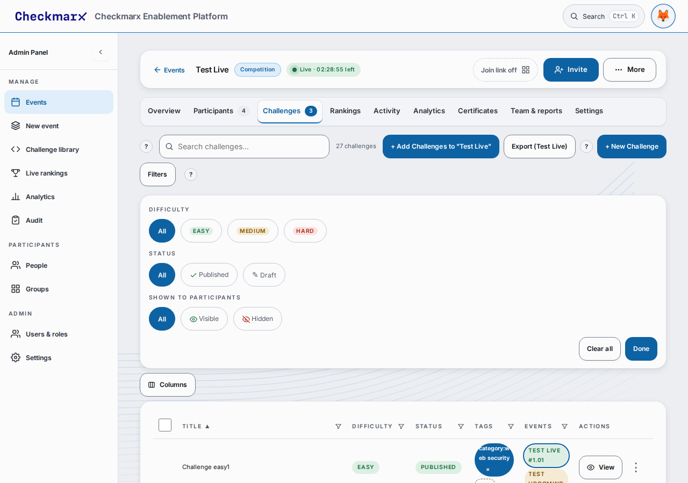
- **Rankings** — its leaderboard (a single session's, if you picked one), the
  **Top three** with their certificates (see [Certificates](#certificates)), and,
  if the group leaderboard is on and at least two non-empty groups are assigned,
  **Group Rankings** below (see [Group Rankings](#group-rankings)).
- **Activity** — its submissions. **Analytics** — its per-challenge figures.
- **Certificates** — the certificates it has issued, and its certificate design
  (see [Certificates](#certificates)).
- **Team & reports** — who receives the event's reports, the lead targets, what
  each role is sent, and the lead list (see [Event team and lead
  reports](#event-team-and-lead-reports)).
- **Settings** — how the event runs, at a glance, with **Edit settings**.
  Its **Look** card picks a look for this event: its join page wears it, and so
  does the app for its participants while they are in the event (theirs returns
  when they leave). Tick **Lock it** to override a participant's own choice
  there. **Save look** records the change on the event's History. Once an event
  has ended, only a superadmin can change its look; everyone else sees it
  read-only, under the note that says so.
  Everything else about the event is in the header's **⋯** menu.

On an event you are competing in, the workspace offers only what *looks* — every
control that would change the event is withheld, and the **⋯** menu opens with
the note *You are competing in this event — you can view it, not change it* (see
[The competitor lock](#the-competitor-lock)).

**The sidebar is for the pages about every event**: **Events**, **New event**,
**Challenge library**, **Live rankings**, **Analytics** and **Audit** under
*Manage*; **People** (participants and event organisers; admin accounts with
**Show admin accounts**) and **Teams** under *Participants*;
**Roles & permissions** and **Settings** under *Admin*. Opening one of those leaves the
event's workspace, so they always show everything you may see.

On a phone the sidebar becomes a section bar at the top of the page, the event's
sections are behind the **Section** button, every table becomes a list of cards,
and nothing scrolls sideways.

### New event: a recommended setup, blank, or a template

Every event starts on one page: **New event** (in the sidebar, or **+ New
Event** on the Events page). Under **Choose a type** there is one card per event
type, each with two buttons: **Recommended setup** starts from that type's
recommended setup (named on the card), and **Start blank** starts empty. Under
**Your templates** are the templates your organisers saved. Whichever you pick,
you get the same create form (see [Creating an event](#creating-an-event)).

The recommended setups come with the platform and carry no challenges: add those
to the event you create:

- **Booth day (8 hours)** — a Booth Event for a full conference day, where
  visitors join by QR code or a short code and play on their phones. **Add the
  qualifying questions** comes ticked, as for every new Booth Event; you can add
  more challenges, and questions of your own, after you create it.
- **Competition (several sessions)** — a ranked two-hour Competition that you
  can run once or in several sessions.
- **Learning program (30 days)** — a self-paced Program open for 30 days, where
  everyone who finishes every challenge earns a completion certificate.

If a type's recommended setup is missing, its card offers **Start blank** only,
and **Restore built-in templates** at the bottom of the page brings it back.

Picking a **recommended setup** or a **template** opens that form already filled in from it: its type,
duration, attempts, answers, sign-up fields and the rest, with a note naming the
template and how many challenges come with it. Change anything you like, then
**Create event**: the event is made with the template's challenges, tags and
join-link settings, your changes are applied on top, and it opens in its
workspace, ready to share. A challenge you may not see is left out and counted,
and a challenge that could not be copied is named with the reason — among them
one held by an event you compete in, which the form shows unticked, marked
**Left out: you compete in an event that holds it**. If one of
your changes is refused after the event was made, the form says so and stays
open as the create that made it: fix the named problem and press **Finish
creating**, which saves your changes to that event and then adds the challenges
you ticked and the Checkmarx One settings, without making a second one. If no
answer comes back for your changes (a dropped connection), the message says they
may not have been saved; press **Finish creating** again, and it first checks
the event: changes that did arrive are not sent twice, and if someone else
changed the event in the meantime it stops and says so rather than overwrite
their change.

An **event admin** cannot start an event from scratch, so their type cards offer
**Recommended setup** only, beside the templates; picking one opens the **Quick spin** panel, which asks just for an
**Event name**, a **Date** and the time it **Opens** (or tick **Opens now**),
with **Add the qualifying questions** (ticked for a Booth Event). A start inside
the hour the clocks skip when they go forward is refused, as the event form
refuses it.

**Making and changing templates is for administrators.** **New template** on the
New event page opens the template editor; each template row's **⋮** menu has
**Edit**, **Duplicate**, **Protect** and **Delete**. A recommended setup is a
built-in template, changed from its type card's **⋮** menu: **Edit recommended
setup**, **Duplicate as a template** and **Reset to default**. Templates are hard
to lose:

- **A recommended setup (a built-in template) cannot be deleted.** Its menu
  offers **Reset to default** instead, which puts back the shipped name,
  settings and type (and empties its challenge list).
- **A protected template cannot be deleted by anyone** until an administrator
  chooses **Unprotect**. Protected templates carry a **Protected** badge.
- **Delete is never final at once.** A deleted template moves to **Recently
  deleted** at the bottom of the page, where one **Restore** button brings it
  back. It is removed for good only after the restore window the page states.
  If a built-in template is missing (deleted before built-ins were protected),
  **Restore built-in templates** recreates it.

The editor groups the settings as **Basics** (name, description,
event type, tags), **Joining** (join link and QR, late entries,
and the sign-up fields), **Play** (how long it runs, attempts per challenge,
staff compete, Checkmarx One accounts), **Scoring & boards**, **Challenges**
(find published challenges and add them; they are listed in the order an event
numbers them, by difficulty and then title, which is the order participants
meet them in) and **Certificates**, with a live **Summary** beside them.
**New template** opens with no event type chosen: pick one, as **Create
template** is refused until you do. An option the chosen type
cannot use is shown switched off, with the reason, and is never saved. The join
link, late entries and Checkmarx One accounts start as the
chosen type sets them for a new event, follow it when you change the type, and
are saved only once you change them, so an event made from the template still
gets its type's own setting. Qualifying questions are not offered as challenges:
an event made from the template gets its own through **Add the qualifying
questions**. Nor can a challenge held by an event you compete in go into a
template, as the template would carry it into events you organise: the picker
shows it with **Cannot be added: you compete in “…”, which holds it** and no
**Add** button, and a template already holding one cannot be saved until you
remove it (its row says **Remove it to save**). Any challenge a save refuses is
named on its own row with **Remove it to save**; changing the event type (or
**Staff compete**) clears that note, and the next save judges the list again. A
role that may change templates but not view the challenge library sees the
template's challenges with **Remove** but no search, and a line saying it
cannot add challenges there; the template keeps the challenges it does not
remove. You can also save a running event as a template from its workspace:
**⋯ → Save as template** keeps its type, settings, tags and challenges (its
planned length, also after **End Now**), never its people, scores, dates or
qualifying questions. A template never holds a Checkmarx One key, so an event
that creates accounts with its own key gives a template with Checkmarx One
accounts off; the dialog and the message that confirms it say so. **Save as
template** refuses a challenge held by an event you compete in, naming it. An event admin can spin up templates but not make or change
them.

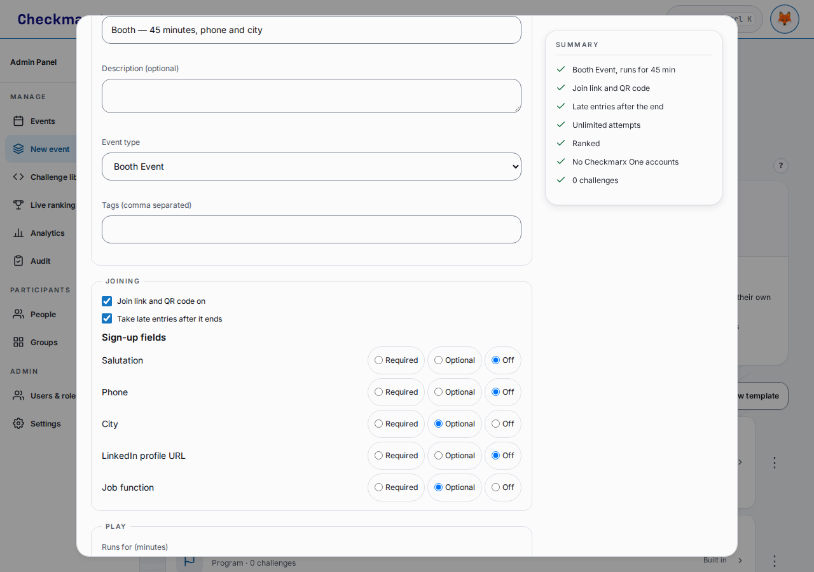

### Cloning an event

**⋯ → Clone** in an event's workspace makes a new event from this one's setup.
The **Clone event** dialog asks for a **Name** and when it **Starts** (your local
time; tomorrow on the hour unless you change it), and says what it copies: the
**settings and the challenges**. Participants, scores and the join link are not
copied, and the new event starts empty. A start inside the hour the clocks skip
when they go forward is refused, as the event form refuses it.

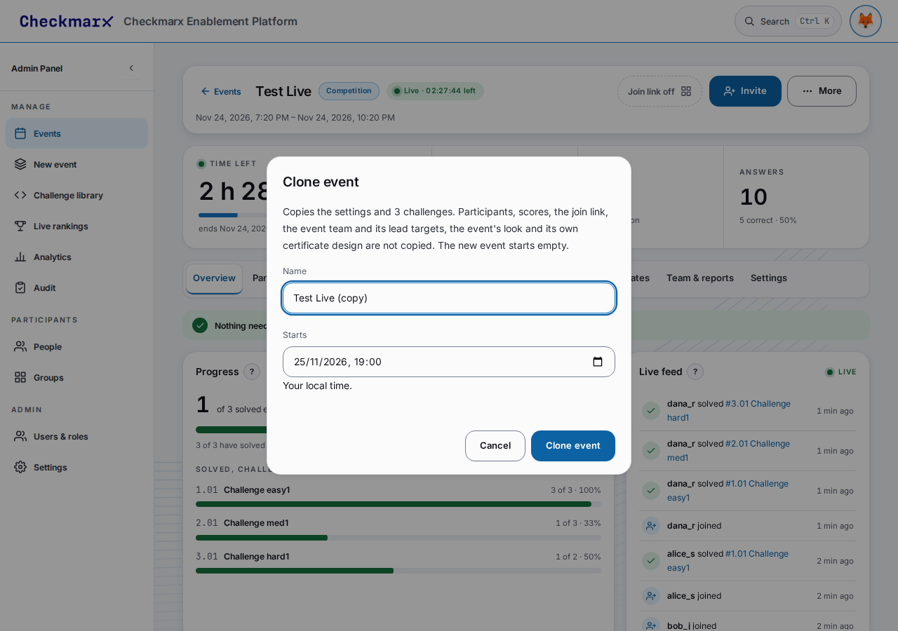

In detail, a clone takes the settings on the event's form, the tags, the same
challenges and — for a Competition — its sessions, the first at the new start and
the rest keeping their spacing; a pinned late-entry deadline keeps its distance
from the end. An
event ended early with **End Now** is copied as it was planned: the length it was
set to run for, not the time it ran, and a pinned late-entry deadline as far
after the copy's end as it was after the planned one. Qualifying questions belong
to their event: when the event had any of the built-in ones, the copy gets fresh
copies of all of them, in their standard wording (a reworded one is not carried
over), never the same ones, and none on an event where staff compete. It never
takes the participants, groups, answers, certificates, history, trusted network
IPs, the event's own Checkmarx One key, its look, its own certificate design
(the copy starts from the platform's), its event team or its lead targets, nor a
late-entry deadline set by **Close late entries now** (the copy takes late
entries for the usual time after its own end), and it gets a **new join link, QR code
and short code**, so signage printed for the old event does not admit anyone to
the new one. Because the key stays behind, a copy of an event that creates
Checkmarx One accounts with its own key has **Checkmarx One accounts off**
(**Don't create CxOne accounts for this event** ticked): otherwise everyone who
joined the copy would get an account in the platform's default tenant instead.
The **Clone event** dialog says so before you press **Clone event**. To turn
them on, untick that box in the copy's settings, and paste the key there too if
the accounts belong in the same tenant as before. It always starts upcoming, and its own History says what it was
cloned from. A challenge the copy does not take — a draft, a qualifying
question you wrote for the old event, an unsealed challenge for an event where
staff compete, one held by an event you compete in — is left out and named with
the reason in the message that confirms the copy, rather than failing it; one you may not see is counted, not
named. The same message names the trusted network IPs, the Checkmarx One
accounts turned off, the Checkmarx One group or a pinned late-entry deadline when
the copy leaves them behind, and any session it could not copy.

The new event opens in its workspace. An event admin can clone an event they
organise and becomes the organiser of the copy. You cannot clone an event you
are competing in.

### Certificates

An event's **Certificates** section lists every certificate it has issued —
holder (named as the certificate prints the name, which is also what the
downloads are called), which certificate (1st, 2nd, 3rd place, participation or completion),
score and whether the holder has been emailed it — with
**PDF** and **PNG** downloads and **Re-send** for the email (one holder at a time,
and it works with the congratulations email switched off; a delivery cut short
by a restart reads **Delivery unknown**, and Re-send is how to be sure). An
email not sent because the holder's account was blocked, denied or no longer
approved reads **Not emailed**, and **Re-send** refuses such a holder with that
reason. A
superadmin also has **Revoke** on each certificate and, on a revoked one,
**Issue again**: a new certificate from the event's current results, with a new
code, while the revoked one keeps saying it was revoked. Certificates never
change by themselves, so this is how a placing is corrected after the event is
revived and its results move. The list shows each certificate's credential code
only to whoever may look a certificate up by its code (a superadmin, or a role
granted **Look up a certificate by its code**), as the code beside its holder is
what that lookup keeps restricted; everyone else finds a certificate's code on
its PDF, one holder at a time, and each download is recorded. Below the list is the
event's **certificate design**: pick a certificate (Gold, Silver, Bronze,
Participation, Completion) to preview it, and change its medal wording, the
wording around it, its colours, which parts are shown (logo, score, date, QR,
certificate ID, pattern, shield, medal) and the **congratulations email** (on or
off, its subject, an extra paragraph, the thank-you paragraph for each
certificate, and the two lines of the LinkedIn post; `{event}` and `{platform}`
fill in, and the post also takes `{achievement}` and `{organisers}`). The post ends
with the certificate's verification link only while the design shows the
certificate ID (the QR is printed only beside it): hide the ID and the post
leaves the link out too, so the code is not published. For the same reason the
**Verification QR** box is greyed out, with a note, while **Certificate ID** is
off. Whatever the
colours, the verification QR prints as dark squares on a light plate, so a phone
can read it: the darker of the background and text colours on a paler version of
the other, or black on white when that would not stand out enough. Wording the certificate cannot print is refused when you save: a script its
fonts lack (Georgian or Devanagari, for example), an emoji, or Latin letters on
one line with Arabic, Hebrew or Thai. The medal headline prints exactly as typed,
so `{platform}` goes in the small line under it instead.
The preview updates as you type; **Save design** keeps it for this event only,
and **Use the platform design** drops the event's own design again. Only
administrators and superadmins change a design; an event admin sees the preview
and the downloads. Only a superadmin can change the design of an event that has
ended: anyone else sees why, with the preview and the downloads. If somebody else
saved the design after you opened it, **Save design** says so and offers their
version rather than putting back what they changed. The **platform design** every event starts from is under **Settings**,
**Branding**: press **Open the certificate designer**; it works the
same way, and an event with its own design keeps it.

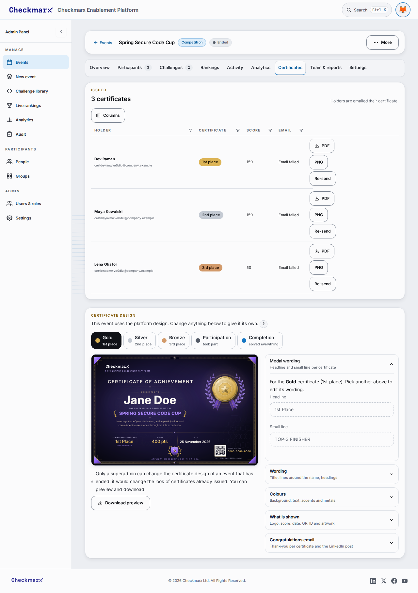

On the **Rankings** section the **Top three** shows the 1st, 2nd and 3rd place
rows that earn a Gold, Silver or Bronze certificate with their certificate:
**Issued PDF** once it has been issued, and before that a **Preview** and
**PNG** of what the design will give them (labelled provisional while the event
runs). A place earns one only with points above zero; a note names any top-three
place that does not, whose holder gets a participation certificate if they
attempted a challenge. A Gold, Silver or Bronze certificate already issued to a
place on zero points or fewer keeps its medal, and the **Top three** lists that
place with it; a superadmin can revoke it. Each place is named, and previewed, as
its certificate prints the name (also what its **PNG** or **Issued PDF** is
called, in whatever script the name is written): an issued certificate's own name, otherwise the
name a certificate issued now would print. Once the event has ended, if the platform
cannot check whether a finisher holds an issued certificate, the download is
refused with a message rather than handing out a preview in its place.

### Creating an event

Click **+ New Event** (or **New event** in the sidebar). The **New event** page
offers one card per type, each with its **Recommended setup** and **Start
blank**, and below them your templates; whichever you pick opens **one form**
that holds everything about the event.

#### Pick a starting point

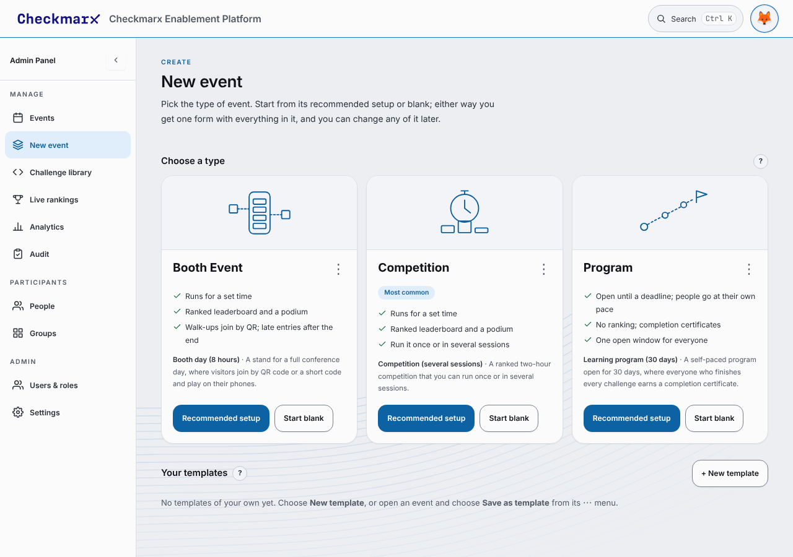

Three type cards, each with a short description of what that type is for:

- **Booth Event** — a few hours, in one room, one session. Phone-solvable
  challenges, no Checkmarx One tenant needed, walk-up sign-up.
- **Competition** — online or hybrid, from a few hours to several days. One
  session or many. Ranked, with certificates and LinkedIn sharing. This is how
  every competition you already have behaves, and it is marked **Most common**.
- **Program** — self-paced learning or certification, running to a deadline. No
  sessions, no leaderboard, no placings. Certificate on full completion only,
  carrying a public verification code printed on the certificate itself.

Nothing is pre-selected: one click chooses the type **and** opens the form.

> **The type can be changed until the event starts.** It is the first field on
> the form, **Event type**: pick another and the form redraws for that type,
> keeping the name, the start, the template and the challenges you ticked; if
> you changed anything else, you are asked first, since the rest goes back to
> the new type's defaults. It decides how the event runs — whether
> it ranks, whether it has sessions, what its certificate attests — so it can be
> changed only while the event is upcoming and has no sessions, on the edit form
> too; see [Changing the event type](#changing-the-event-type).

#### Fill in the form, which shows only what this type uses

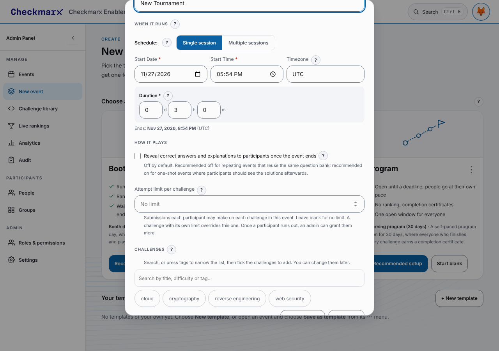

The form opens with the essentials: **Event type**, **Event name**, **When it
runs** (start, timezone, and a duration or a deadline; the end is shown beneath)
and **How it plays** (reveal answers at the end, attempts per challenge). The
settings most events never change are folded into **Advanced settings**: team
leaderboard, staff can compete, time on platform, test / dry run, the sign-up
form, late entries, the venue network, the qualifying questions and Checkmarx
One. Folded or not, its heading line says whether Checkmarx One accounts will
be created (**Checkmarx One accounts: on** or **off**, following the box and the
type you picked), and the **Create** confirmation says it again. Every setting
that is not obvious has a **?** beside it that explains it.
**Create event** makes it; for a blank event, **Create and pick challenges**
goes straight on to the Add challenges dialog.

**Challenges** lets you pick the challenges the event starts with while you
create it. Type in the search box (it matches a challenge's title, difficulty or
any tag, `category:web` and plain `web` alike), or press the **tag chips** under
it: each tag and category in the library is a chip, and pressing several shows
challenges carrying any of them. Tick the ones you want; **Tick all shown** ticks
every challenge on screen, and the count says how many are ticked. Only published
challenges you may use are listed (qualifying questions are not: the event gets
its own through **Add the qualifying questions**), and the platform's own markers
(`needs:` tags, `public-domain`, `test/dry run`) are never chips. The ticked
challenges are added once the event exists. A challenge that does not fit the
event's type (a Booth Event refuses file answers and `needs:` tags), or that is
locked, is left out and named in the message, and the rest are added. From a template, the
template's challenges are already ticked, marked **From the template**, and come
with it; tick more to add them as well.

**Add the qualifying questions** (under Advanced settings) is offered on every
create, from a template too, ticked by default for a Booth Event. It cannot be
combined with **Staff can compete**, whose events hold sealed challenges only:
a qualifying question (an **Any answer** question) can never be sealed, so such
an event asks none.

**The form carries only the settings the type you picked can actually use.** A
Program has no Schedule toggle and no Leaderboard Mode, because it has no
sessions; a Booth Event has no *Record time on platform*, because its window is
too short for the measurement to say anything. This is not the form hiding
things from you — those settings do not exist for that type, and the server
refuses almost all of them if something else tries to set them. Two are simply
inert rather than refused — Leaderboard Mode on a type with no sessions, and the
tie-break basis on a Program — because there are no sessions to rank against
each other and no placings to break ties for.

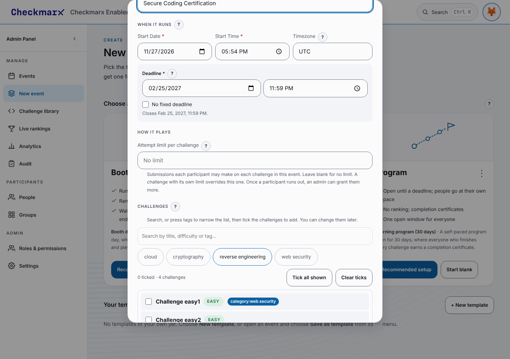

Here is the whole matrix, so you know what to expect before you click:

| Setting | Booth Event | Competition | Program |
|---|:---:|:---:|:---:|
| Name, start date/time, timezone | ● | ● | ● |
| **Schedule** toggle (single / multiple sessions) | — | ● | — |
| **Duration** (the end is shown beneath) | ● | ● | — |
| **Deadline** (with *No fixed deadline*) | — | — | ● |
| **Leaderboard Mode** (per session / global) | — | ● | — |
| **Reveal correct answers** when it ends | ● | ● | — |
| **Group (team) leaderboard** | ● | ● | — |
| **Record time on platform** | — | ● | ● |
| **Break score ties on time spent** | — | ● | — |
| **Staff can compete** | ● | ● | ● |
| **Attempt limit per challenge** | ● | ● | ● |
| **Mark as test / dry run** | ● | ● | ● |
| **Trusted network IPs** | ● | ● | — |
| **Sign-up form** (what a new participant is asked for) | ● | ● | ● |
| **Late entries** | ● | — | — |
| **CxOne integration** | — | ● | ● |

Why the gaps are where they are:

- **Sessions** — only a Competition has them. A Booth Event is one room for one
  afternoon; a Program is rolling enrolment against a deadline. Since neither has
  sessions, neither has a **Leaderboard Mode** either: that setting decides how
  sessions are ranked against each other, and with no sessions it names nothing.
- **Duration vs deadline** — a Booth Event and a Competition run for a *length of
  time* from their start. A Program runs *until a date*, so it asks for a
  deadline and works the duration out itself. **No fixed deadline** is for a
  Program with no real closing date, and it is not literally deadline-free:
  {{platformName}} fills the deadline in with a date ten years out and stores
  that, so the form always shows you the date it recorded. With the box ticked,
  the confirmations you see when you save call it "No fixed deadline (stored as
  …)", naming that date, and Save does not ask you to confirm a deadline more
  than two years away, as it does for one you type yourself. Move the deadline
  forward at any time to extend the Program, or untick the box to set a real
  one. While the deadline is five years or more away, the places that would
  show that date or count down to it say **No fixed deadline** instead: a
  participant's event card (as the end of its dates, with no time left shown;
  one not started yet still counts down to its start), the
  header and a challenge's play bar; the **End** and
  **Duration** columns of the Events list, the event workspace's dates,
  status chip and time tile, and the deadline **Start now** says it keeps; and
  the end in the assignment and invitation emails.
- **Reveal answers**, **group leaderboard** and **tie-breaks** — a Program is not
  ranked, so it has no placings to break ties for and no team board to enable.
  Publishing the answer key on a certification would also let anyone who saw it
  earn a verifiable certificate, so a Program never reveals answers, and its
  participants never see the stored explanation for a challenge either. Where a
  Program needs to teach, put the teaching in the challenge itself.
- **Record time on platform** — refused for a Booth Event. Over a 45-minute
  window there are only nine five-minute blocks, so everyone who stayed the
  course would tie and the number would tell you nothing. A Program may record it
  (it is useful reporting) but cannot use it to break ties, because it does not
  rank. On a Program the number is reported and never ranked, so it is the one
  place it is most likely to be read as evidence about a person. It measures
  presence in the browser rather than effort, and the caveat that goes with that
  is set out with the setting itself, further down this guide.
- **Trusted network IPs** — a Program has no fixed running window, and this
  setting is a rate-limit exemption that is only safe because it expires with the
  event. See [Trusted network IPs](#trusted-network-ips).
- **Late entries** — a Booth Event only: it is the one type somebody walks up
  to. A Competition and a Program are signed up for in advance and run to a
  published end. See
  [Late entries](#late-entries).
- **Sign-up form** — every type. Whoever creates the event chooses what its
  sign-up form asks for. Every event starts from the same short form (name,
  company, job title; City and Job function optional). See [What an event asks
  for at sign-up](#what-an-event-asks-for-at-sign-up).
- **CxOne integration** — offered for all three, but the box arrives **already
  ticked** for a Booth Event and a Program, because neither normally wants a
  Checkmarx One account minted for every attendee. Untick it if yours does.

For a multi-session Competition, add sessions with **+ Add Session** — each has
its own name, start time, timezone and duration — and choose a **Leaderboard
Mode**:

- **Per Session** — each session ranked independently.
- **Global** — everyone competes on one combined leaderboard.

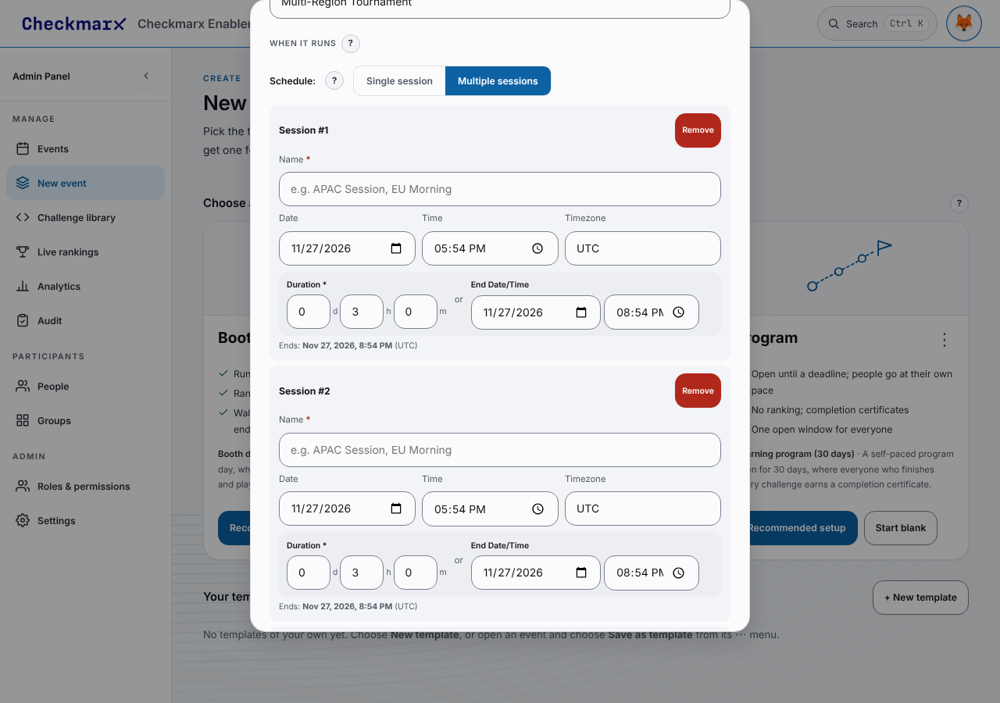

The leaderboard mode locks once any session starts.

**Editing uses the same form.** Opening an existing event goes straight to it,
with **Advanced settings** open and, again, only the settings the event's type
uses. While the event has not started you can change the type
from there — see [Changing the event type](#changing-the-event-type).

### Limiting attempts

An event can cap how many times each participant may submit an answer to each of
its challenges. There are two places to set it, and the more specific one wins:

- **Attempt limit per challenge** on the event form applies to every challenge
  in that event.
- **Attempts** in the challenge editor applies to that one challenge, and
  **overrides whatever its event says**.

Leave both blank for no limit at all, which is the default.

An attempt is a **stored submission**, which is what keeps the number a
participant sees honest: a double-click that re-sends the same answer, or a
submission the platform throttles, never reaches storage and so costs nothing.
**Revealing a hint costs no attempt either** — it already costs points.

A participant watches the budget run down on the challenge itself: *"2 of 3
attempts left"*, then a **Last attempt** warning, then a locked **No attempts
left** panel in place of the answer box. The hint offer goes with the answer
box, because a hint cannot help somebody who can no longer answer, and that
panel tells them to ask an organiser — you are the organiser it means. The count
updates as each wrong answer comes back — including a wrong answer sent a second
time because the reply to the first never arrived on the venue wi-fi: the
participant is told it was already submitted and was not correct, that it was
not counted twice, and how many attempts remain.

**Granting more attempts.** On the **Challenges** tab, the three-dot menu of any
challenge that sits in at least one attempt-limited event carries **Grant
Attempts**. Pick the event, pick the participant, and say how many extra
attempts to add — grants **add to** whatever that participant already has,
rather than setting a total. Any admin can do it.

It is offered on **ended** events on purpose. An event that closed itself
because everyone had either solved everything or run out of attempts cannot be
reopened while that is still true, so granting an attempt is the step that
un-sticks the exhausted participant; extending the event's duration then
reopens it. Grant first, extend second.

### Revealing answers when the event ends

The event form has a **"Reveal correct answers and explanations once
the event ends"** checkbox — **off by default**. Leave it off for
repeating events that reuse the same questions across cohorts (so one group
finishing can't leak the solutions to the next); tick it for one-shot
tournaments. Answers are **always hidden while the event is running**,
whatever the setting, and you can flip it any time while the event is
upcoming or live. Once its end time has passed only a **superadmin** can change
it, because from that point on only a superadmin may edit the event at
all.

**A Program has no such checkbox, and cannot be given one.** Its certificate is
a claim someone shows an employer, so publishing the answer key — which reaches
*every* enrollee, not just those who finished — would let anyone who saw it earn
a verifiable certificate afterwards. Nothing is revealed on a Program at the
end, explanations included, so write anything a learner is meant to take away
into the challenge itself rather than into its explanation.

**A sealed challenge is left out of the reveal, whatever the checkbox says.**
Participants see *Answer not shown* on it, with the reason, and its
explanation and its hint stay hidden as well — a hint a participant paid for
during the event stays theirs. See
[Sealing a challenge answer](#sealing-a-challenge-answer).

### Letting staff compete

Staff — every admin and superadmin, who carry the **staff** tag automatically,
and anyone else you have tagged `staff` — can walk into any event without being
enrolled in it, and are never on its board. That is the right rule for an
organiser checking the room. It is the wrong rule for an internal event where
the organising team *is* the field: a security team's own capture-the-flag, or
a rehearsal for the people who will run the next conference. **Staff can
compete** is the switch for that. It sits on the event form for every event
type and is **off by default**, so nothing changes on an event you do not tick
it on.

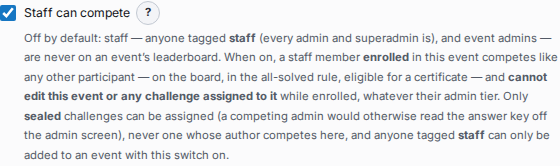

**What changes when it is on.** A staff member who is **enrolled** in the event
— added the way any participant is — competes like any other participant: they
are on the individual and group leaderboards, they count toward the all-solved
rule that can close the event early, they can earn the event's certificate,
and they have rows in its **Export Activity (CSV)** file. Staff who merely
*enter* the event without being enrolled are unchanged: still admitted, still
off the board. **Analytics is not affected either way** — its participant
filter still excludes the `staff` tag by default, so switch that filter to
**All** if you want a competing organiser's activity in the numbers.

An event admin is not tagged `staff` (the role keeps them off the board by
itself), so they can be enrolled in any event; they compete only in one that
lets staff compete, and are locked out of editing it exactly as described
below. Because they are not tagged, none of the staff-only chrome applies to
them: their events page is the single list a participant sees, with no
**Competing** badge, and opening such an event's join link from participant
view enrols them at once, with no **Compete in this event?** question.
(Opening it signed out and then signing in lands any admin-tier account in the
admin panel, enrolled in nothing; the [Event admin guide](event-admin.md#when-staff-compete) spells that
out.)

The switch also changes who and what may go into the event, and when it can
itself be changed — each enforced by {{platformName}} itself rather than only
by the form.

**Staff can only be added to events that let staff compete.** With any other
event open, a staff row is simply not offered **Invite to …** and has no
checkbox. If you reach such an event another way — the selection bar's **Assign
to Events** picker outside an event workspace, or the **Invite** dialog — the staff
members are skipped and the notice afterwards says so: *"N staff enrolment(s)
skipped — staff can only be added to events that let staff compete"*. A bound group's
live sync skips them silently, as it does everyone else it skips; a participant
import counts them among the enrolments it skipped and says why. (A staff
member who already holds a place in such an event — enrolled before they were
tagged — keeps it, and is not reported as skipped.) With the switch on, a
staff row gets the same **Invite to …** item and checkbox as everybody else,
and a bound group enrols its staff members with the rest. Two limits remain. Any organiser can enrol **themselves** (unless they wrote one
of its challenges — below), but enrolling another admin or superadmin account
is a superadmin's job, like every other action on a
privileged account: with such an event open a regular admin is not offered
**Invite to …** on an admin's row, and reaching it through the selection bar or
the **Invite** dialog is skipped with *"N admin account(s) skipped — only a
superadmin can enrol an admin"*. A bound group is the one route that does not
ask: its live sync enrols every member it holds, admin accounts included. The
Teams page and the participant row's group chips guard that route — both refuse
to put an admin account into a group for anyone but a superadmin — and the
**Invite** dialog's **Add to Groups** picker skips the address with *"N admin
account(s) not added to the selected group(s) — only a superadmin can put an
admin into a group"*. Two paths do not ask: a participant grouped by a regular
admin and promoted afterwards keeps the group (a promotion removes nobody from
anything), and an invitation an existing account claims by signing in with
an emailed code applies its groups as-is — the account is enrolling itself. Turning
the switch on afterwards enrols a bound group's staff members
at once, with no need to rebind it. And the built-in superadmin account cannot
be enrolled in anything, because it is not an account on the Participants tab.

A staff member who opens the event's join link meets the same rule from their
side. On an event where staff do not compete they are let in as staff, not
enrolled — and joining from inside {{platformName}} (the link opened from
participant view, or the code typed in) says so in a message; a code requested
from the link's own page lets them in with nothing said. On one where staff compete they are asked
**Compete in this event?** first, with the consequences spelled out — **Join and
compete** enrols them, **Not now** leaves them able to enter as staff and
forgets the link, so to compete later they open it (or type the code) again.
That question is asked by the page they are on, and only of accounts tagged
`staff`. Signing in from such a link's page — with a code or a password —
enrols no staff member by itself: a `staff`-tagged participant is asked the
question once signed in, and an admin-tier account, an event admin included,
lands in the admin panel enrolled in nothing. An event admin — who is not
tagged — who opens the link from participant view is enrolled at once. The one
person no door enrols is the author of a challenge the event holds: joining
from inside {{platformName}} refuses them, naming the challenge, while signing
in from the link's page simply leaves them unenrolled, with nothing said.
Having joined, the self-service **Leave this event** control is offered on the waiting screen only, so once the event is live
the way out is an organiser removing them — an admin-tier competitor can do that
for themselves with **Remove from …** on their own row (see [The competitor
lock](#the-competitor-lock)); a staff member with no admin tier has no
Participants tab, so for them it is an organiser or nothing.

**Only sealed challenges can be assigned, and never one whose author
competes.** A competing admin can still open the Challenges tab, so an
unsealed challenge in the event would hand them the answer key. An event with
the switch on therefore admits only challenges whose answer is **sealed** (see
[Sealing a challenge answer](#sealing-a-challenge-answer)) — which rules out
every *Any answer* challenge, since those cannot be sealed. A sealed answer is
still readable by its author, so a challenge cannot go into an event its author
is enrolled in, and the author of an assigned challenge cannot be enrolled:
whichever you try second is refused, naming the challenge and the person. (A
superadmin's recorded reveal is refused on any challenge held by an event they
compete in, for the same reason.) In practice:

- **Assign Challenges** on the event says so at the top, greys out any
  unsealed challenge that is not already in the event and marks it *Not
  sealed*. If the save still has to be refused — the author rule is decided at
  Save, since the form cannot see who wrote a challenge — a dialog headed
  **Some challenges were not added** names each refused challenge and why. The
  refused ones are left out; every other challenge you ticked is still added
  (or removed), so read the list before assuming the event is unchanged.
- The per-challenge **Assign to Events** dialog greys out such an event for an
  unsealed challenge and marks it *Sealed only*; where the author rule refuses
  the save, nothing changes on any of the ticked events, and the dialog names
  every event that refused, not just the first. The bulk **Assign to
  Events** picker marks such events *Sealed challenges only* but leaves them
  tickable, because your selection may mix sealed and unsealed challenges: the
  unsealed ones are skipped there and the toast counts them — *N not sealed (the
  event lets staff compete)*, *N whose author competes in the event* — while a
  dialog names each refused pair.
- Turning the switch **on** while an unsealed challenge is already assigned is
  refused, and a dialog headed **Seal these challenges first** lists them.
  Seal a new copy of each, or take it out of the event, then try again.
- Turning the switch **on** is refused, too, while somebody already enrolled in
  the event wrote a challenge assigned to it — the ordinary case being an event
  admin, or a participant promoted after enrolling, who authored one of its
  challenges. A dialog headed **Remove these authors first** names each person
  with their challenge(s). Remove the person from the event (**Manage
  Participants**) or take the challenge out of it, then tick again.
- **Unsealing** a challenge is refused while it sits in an event that lets
  staff compete — at any stage of that event, finished included, because every
  kind of end can be undone (a manual end plus an extension, a time-expired
  event extended, a new session, a new assignment) and nothing on the way back
  re-checks the seal. The author's own edit form withholds the **Unseal**
  tick and says why, naming the holding events it can name — an event admin
  sees only the events they organise, and any others are counted (*N events
  outside your events*) rather than named. While none of those events has
  finished — nor any session of one — the remedy is to take the challenge out
  first, or leave the answer sealed; once one of them has finished, or one of
  its sessions has, its challenge list can no longer be changed, so the answer
  stays sealed for as long as the challenge stays assigned — which costs the
  author nothing they hold, since they still read and edit it. An event the
  author does not organise is not theirs to take the challenge out of, so with
  one of those the note names that event's organiser instead.
- Enrolling the author of an assigned challenge is skipped, and a dialog headed
  **Not enrolled — they wrote a challenge in this event** names them and the
  challenge. The **Invite** dialog and the participant import count such a skip
  rather than name it; joining from inside {{platformName}} through the event's
  link refuses the author outright, naming the challenge, and a code requested from the link's page
  leaves them unenrolled with nothing said (above).

Taking an unsealed challenge *out* of such an event is never refused on the
seal's account — it is the remedy — though the ordinary rules still apply: not
once a session of the event has ended, and not by someone competing in it.

**It locks once the event starts.** Flipping it mid-event would add people to
or remove them from the board while it is running, so once the event (or any
of its sessions) has started the checkbox is disabled, with the reason beside
it, and once the event has ended it stays that way: whether staff competed is
part of the result, and any certificates already issued assert it. Decide
before the start. Turning it **off** while the event is still upcoming has a
refusal of its own: with anyone carrying the `staff` tag enrolled it is refused,
and a dialog headed **Remove these staff members first** names them. Remove
them from the event (**Manage Participants**), then untick. (Turning it **on**
has the two refusals listed above — unsealed challenges, and enrolled authors.)

#### The competitor lock

**If you are enrolled in an event that lets staff compete, you cannot edit
it — or any challenge assigned to it — for as long as you are enrolled,
whatever your admin tier.** A competitor who can change the event, its
schedule or its challenges is a competitor who can change the result, so
{{platformName}} treats you as a participant of that event and refuses every
change to it. Superadmins are bound too — the [Superadmin
guide](superadmin.md#the-competitor-lock-binds-you-too) says what that costs
them.

On the **Events** tab the row tells you so: its three-dot menu opens with the
note *You are competing in this event — you can view it, not change it*, and
withholds **Edit**, **Assign Challenges**, **Manage Participants**, **Close late
entries now**, **Start Now**, **End Now** and **Delete**, along with the tag
controls on the row.
What stays is everything that only *looks*: **History**,
**Organisers**, **Email Delivery**, **Export Activity (CSV)** once the event is
live or ended, as on any event, and **Join Link**, which opens **read-only**:
the link, the QR code and the short event code are there to copy and print (an organiser competing in their own event still needs them on the
signage), while its toggle is disabled and **Regenerate link** is
withheld, with a note saying why. Ask another organiser to change those.

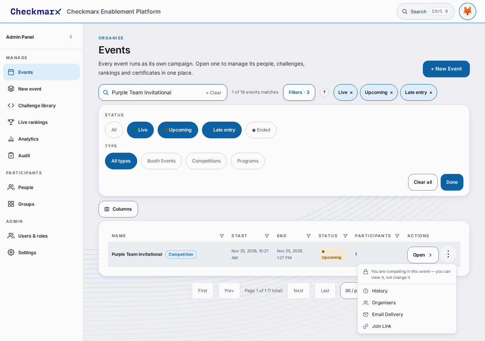

On the **Challenges** tab, every challenge in that event carries the same note
— *You are competing in "…", which holds this challenge — you can view it, not
change it* — and:

- **Edit** is not offered on the row, and a form reached some other way is
  **read-only**, with a note saying why; its formatting buttons are switched
  off, with the same reason under them. The answer, the explanation and the
  **hint** are all withheld from you — a participant pays 30% of the points to
  see a hint, and so would you — and the hint field is simply absent from the
  form. The **JSON export** of challenges withholds the hint from you in the
  same way, marking it withheld rather than empty, so importing that file back
  does not blank a hint you were never shown. Publish, Hide/Show, the tag
  controls, Lock, Recalculate Scores and Delete are withheld too.
- **View** (the participant preview) shows the challenge as your fellow
  competitors see it, with *Withheld — you are competing …* where the hint
  would be, and no answer or explanation.
- **History** lists every version, blanks the answer, explanation and hint out
  of each snapshot, and offers *Not while competing* in place of **Restore**.
- Assigning the challenge to that event, or taking it out, is refused; so is
  adding it to any other event you compete in. Every other event of yours is
  untouched. **Grant Attempts** stays, though the event you compete in is not
  offered inside it; on an event where staff compete, its roster includes the
  enrolled organisers — though granting attempts to an enrolled admin or
  superadmin account is a superadmin's job, so the dialog's roster lists those
  accounts only for a superadmin.

The workspace withholds the same doors: its header carries a **You are
competing** chip, its **⋯** menu offers no **End now** or **Close late entries
now**, nor **Clone**, **Save as template** or **Export everything** (a copy or a
template would carry the event's challenges into an event you organise, and the
export holds every rival's answers), and the Overview's **Sessions** card offers
no session **Start now** or **End now**. Anything reached some other way — an old tab,
a script — is refused by the server with the same message, naming the event.

**The escape hatch is to leave the event.** **Open** the event (still offered),
go to its **Participants** section — **Manage Participants** is withheld with the
rest, and only ever did those two steps for you — and use **Remove from …** on
your own row: removing yourself is the one change to the event you are allowed
**while it has not ended**. Once it has ended nobody can be removed from it —
the single exception is a late entrant (somebody who joined after it ended and
had not started playing before then), while late entries are still open (see
[Removing people during the window](#removing-people-during-the-window)) — so
the lock stays on a finished event you competed in — if you will need to edit,
tag or delete it afterwards, leave it before the end, or ask another organiser —
and once its end time has passed, that organiser is a superadmin, since an
event past its end is theirs alone to edit or tag, and deleting one is theirs at
any time.
The moment you are no longer enrolled, every control comes back — and your
submissions and score are kept, as they are for anyone removed, so you can be
re-added later. If you would rather stay in, ask another organiser to make the
change; the refusal says exactly that — and on a finished event it names only
that route, since leaving is no longer possible.

The lock reaches the event through its groups, too. A group bound to the event
feeds its roster, so while you compete you cannot add or remove members of such
a group, delete it, bind it to the event or unbind it, or invite people into it
— renaming it is fine, and so is any group bound only to events you do not
compete in. Making somebody an event
admin of the event, or removing one, is refused as well. And if you are an
**event admin** competing in an event you do not organise, you are refused on
that ground too: when both apply, inviting, assigning in bulk, granting
attempts and any change to a group bound to the event name your scope rather
than the competing — the outcome is the same. Your own removal from such an
event is refused on neither ground while it has not finished, but with the event
absent from your Events tab there is no row to press **Remove from …** on, so
the way out is one of its organisers —
unless you joined it through its link and it has not started, in which case
**Leave this event** on the waiting screen still works.

**It reaches your rivals' accounts, too.** Anyone enrolled in an event you
compete in is on the board you compete on, so on their row of the Participants
tab — whatever event is open, or none — the actions that would move that
board are withheld with the note *You are competing in "…" alongside … — their
account cannot be changed from here*: **Block** and **Unblock**, **Deny
Approval**, **Approve**, **Verify**, **Impersonate**, **Email sign-in code**,
**Show sign-in code** (a code on your screen would let you sign in as them), the
role menu and **Delete**, and the **×** on a `benchmark` tag (the one tag that
changes a board; every other tag keeps its controls). **Unlock** stays — clearing
a login lockout moves no board — and so do **Edit Profile** and **History**,
except that in **Edit Profile** both email addresses are locked: moving their
address would let you sign in as them. The
same refusal meets a superadmin revoking a
certificate from that event. If you are already impersonating somebody when a
colleague enrols you into an event they compete in, your next change made as
them is refused too; leaving the impersonation still works.

What the lock does not touch: other events, other challenges, groups not bound
to an event you compete in, the Participants tab beyond that event's own roster
and your rivals' rows (where you can only remove yourself, and where the **At
the desk** shortcut is refused while that event is open), Submissions,
Rankings, Analytics, Logs, Settings, and every superadmin action that is not
on that event, its challenges or its participants.

**In participant view** an account tagged `staff` sees two sections on the
events page: **Your Events** — the ones you are enrolled in, with a
**Competing** badge on any that lets staff compete — and **All other events**,
every event you can enter as staff without being enrolled. In an event where you
compete you get every confirmation a participant gets, on entering a live event,
choosing a session and leaving, and none of the staff shortcuts — the
**Switch Session** button a spectator gets is not offered to a competitor, on
any visit. An event admin, being untagged, sees the single list a participant
sees.

### Start times and daylight saving

The start date, time and timezone you enter are a **wall clock in that zone** —
what a participant standing there would read off the wall — and {{platformName}}
converts it to a real instant for you.

Twice a year that conversion has an edge. On the day the clocks **go forward**,
an hour of the day simply does not happen: in New York the clocks jump straight
from 02:00 to 03:00, so there is no such thing as 02:30 that morning. If you
enter a time inside that missing hour, {{platformName}} now **refuses the save**
and tells you so, rather than quietly storing the nearest real instant and
showing you a different time than the one you typed. Pick a time before or after
the change.

On the day the clocks **go back**, the opposite happens and an hour occurs
twice. Both are real times, so this is not refused — {{platformName}} takes the
first (the one before the change). If you specifically need the second, set the
start an hour later and shorten the duration, or run that session in UTC.

---

### What an event asks for at sign-up

Every new account is asked for **first name, last name, company and job title**
(shown as **Always asked** at the top of the list), and its location is detected
from the browser. Each event, whatever its type, decides the rest: five more fields, each with one
three-way switch in the event form under **Sign-up form** — **Required**,
**Optional** or **Off**:

| Field | Out of the box |
|---|---|
| Salutation | Off |
| Phone | Off |
| City | Optional |
| LinkedIn Profile URL | Off |
| Job function | Optional |

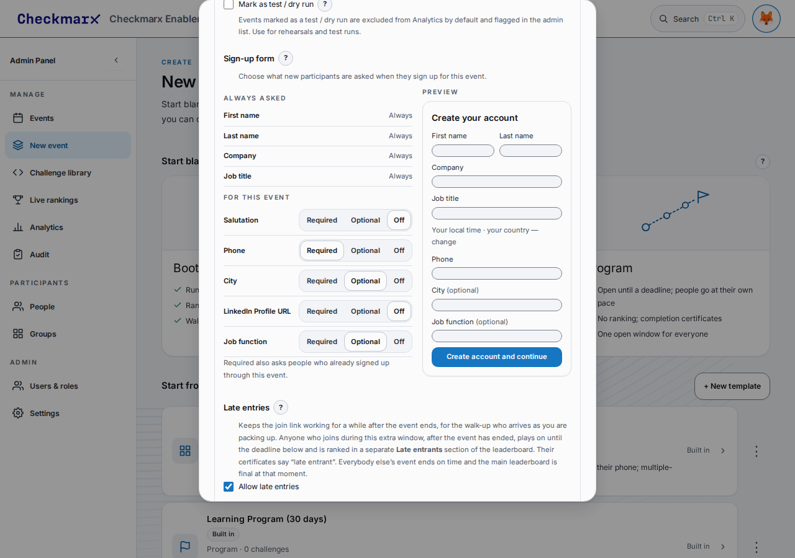

A **Required** field is shown and must be filled in; an **Optional** one is shown
without being demanded; an **Off** one is not on the form at all. The preview
beside the list shows the card a walk-up will see, and changes as you flip the
switches. Every setting here applies to people who sign up through **this
event's** join link, QR code or printed code, and to anybody you create [At the
desk](#at-the-desk) while this event is open. The form never asks for a
password: a new account signs in with a code emailed to it, and its owner may
choose a password later in their own profile.

#### Changing this after people have registered

> **Making a field Required asks for it from people who already signed up** —
> through the link or at the desk.
> The next time they use {{platformName}} they meet a dialog they cannot dismiss
> until they fill it in — and that happens **even if the event has already
> ended**, because the record you were collecting is still incomplete.

That is deliberate: it is how you fix a form you realise, halfway through the
day, was missing something you needed. But it does mean an attendee who signed up
in ten seconds this morning may be asked for two more things this afternoon, so
make a field Required when you genuinely need the data, not to tidy up.

Relaxing a field is always safe — nobody is ever asked for something you have
just made Optional or Off, and nothing already collected is thrown away.

If you **delete** the event, the requirement goes with it: its former attendees
keep their accounts and are asked for nothing further.

### Late entries

**A Booth Event only, and it starts ON.**

Somebody scans the QR on your stand at 16:55 for an event that closes at 17:00.
By the time they have typed their name in and signed in, the event is over: they
hold an account, an enrolment, and no way to play. **Late entries** is the answer
to that person.

With it on, the join link keeps working for a while after the event ends —
**48 hours by default** — and anyone who arrives in that window, after the event
has ended, plays on until the deadline.

#### Who counts as a late entrant

Somebody who joined **after the event ended**, during the late-entry window.
Anyone who joined while the event was live, even a minute before the close, is an
ordinary participant: they are on the main leaderboard, can take a podium place
and get their certificate when the event ends.

Everybody else's event ends on time. A participant who joined an hour earlier and
was mid-challenge at the close is finished when the event is — this is a door for
late arrivals, not an extension for the room. **The main leaderboard is final the
moment the event ends.**

#### The deadline

The **Late-entry deadline** sits under the switch, with an **Automatic** box
ticked. Leave it ticked and the deadline is 48 hours after the event ends, and it
**moves with the end time** — lengthen the event by an hour and the window
moves an hour too, with nothing for you to remember. **You see it move as you type:**
change the start or the duration and the deadline field and the sentence
beneath it both update straight away, so what you are about to save is
always on screen.

Untick it to pin a date and time of your own. A pinned deadline stays exactly
where you put it and no longer follows the end — changing the event's start or
duration leaves it alone. Tick the box again to go back to automatic. Either way the
sentence under the field states the deadline in **bold**, and it follows whatever
you have selected, so what is stored is never a mystery. It must be after the
event ends and within 30 days of it. A pinned deadline waits while **Allow late
entries** is unticked; ticking it again checks the deadline against the end the
event has by then, the 30 days included.

**Both the field and that sentence name the timezone**, and it is the one in the
**Timezone** box at the top of the dialog — the same zone the start is read in
and the end is shown in. Change it there and the deadline label and sentence follow, so
a date you type is never ambiguous about which clock it means.

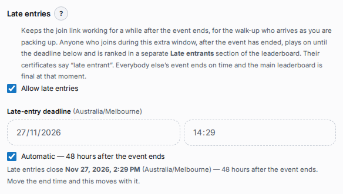

#### Where late entrants show up

- **The leaderboard** grows a **Late entrants** section beneath the main board,
  ranked among themselves by exactly the same rules. Participants see it too,
  under the same viewing rules as the main board.
- **The Events tab** keeps the event in the default view under a **Late entry
  open** badge for as long as the window lasts, instead of dropping it in with
  finished events — so a stand that is still taking walk-ups stays in front of
  you. It has its own filter chip.
- **The Challenges and Participants tabs** keep showing the event's badge on
  every challenge assigned to it and every participant enrolled in it, in the
  same late-entry colour. Both columns hide other finished events.
- **The rankings CSV** gets a **Late Entrant** column. You need it: the file
  flattens both sections into one sheet, so rank 1 appears twice — once for the
  winner and once for the first late entrant.
- **Certificates** they mint say **"late entrant"** — on the image, on the PDF,
  on the public page and on the verification page a third party reads.

While their window is still open a late entrant can collect a **participation**
certificate only. A placing is not settled until their board stops moving, so
placement certificates for late entrants are issued once the window closes. The
button tells them so before they press it — and that collecting early means
keeping the participation one, because a certificate is minted once.

#### Adding people during the window

The join link is not the only way in while the window is open: you can add
people yourself, and every way of doing it offers the event — **Invite to …**
on a participant's row with the event open, the selection bar's
**Assign to "…"**, the bulk **Assign to Events** picker, the **Invite** dialog,
**At the desk**, and binding a group to it from the group's **Events** button.
Wherever the event is listed it carries a **Late entry open** badge, and each
route tells you before anything is saved that the person joins as a **late
entrant** — ranked in the separate Late entrants section and able to play until
the late-entry deadline. The confirmation raised by the row's **Invite to …** and
by the selection bar names that deadline and adds that a late entrant's placing
certificate is available only once late entry closes — and, if the event
reveals its answers at the end, that the answers are already published to
everyone in it, so whoever you add can read them. The email they receive names
the late-entry deadline rather than a start and an end that have already passed.

**Somebody who took part before the end cannot come back as a late entrant.**
If a person submitted an answer, revealed a hint or entered the event while it
was running — even if they have left it or been removed since — adding them now
is skipped, and the confirmation says why: *they took part before the event
ended, so they cannot rejoin it as late entrants*. Letting them back in would let
them play on after the official results were settled. The join link refuses them
too, telling them why, and a group binding simply leaves them out. Somebody who was
in the event before it ended is left exactly as they are — adding them again changes
nothing. Adding a late entrant again works as it would while the event ran: if a
group brought them in, their place becomes their own, so they stay even if they
later leave the group.

A group bound to the event during the window adds its members as late entrants
like any other route, but it does not join the event's team board: the
[Group Rankings](#group-rankings) were settled when the event ended.

#### Removing people during the window

While late entries are open you can remove only **late entrants** — people who
joined after the event ended — and only those who had not started playing before
it ended (a membership brought in by an import can carry activity from before
the end). Everybody who was in it before the end stays, so its final results
cannot change.
With the event open on the Participants tab, every late entrant's event badge
reads **· late entrant**, and only the removable ones offer **Remove from …**.
Everybody else's menu says why not: *In "…" since before it ended* for
somebody who was in it before the end, and *Joined "…" as a late entrant but
started playing before it ended* for a late entrant who had.


A late entrant you remove can be added again while the window is open — nothing
they did happened before the end. One case is refused: a late entrant who
already holds a **placing** certificate for the event (possible only if late
entry closed, they collected it, and the window was then reopened) must have that
certificate revoked by a superadmin first, or a second person could be issued the
same placing. A participation certificate does not stand in the way and is left
as it is. Once the window closes, nobody can be removed from the event at all.

A group works the same way: when a member leaves a group bound to the event, or
the group is unbound or deleted, the members who were in the event only through
the group leave it if they are late entrants you could remove yourself (above),
and stay otherwise, as everybody who was in it before the end does. The event's **History** marks every late addition and removal *(late
entrant)*, and someone who walked up through the join link appears as *Joined …
through its join link*.

#### Turning it off

Untick **Allow late entries** and the event closes completely at its end time,
exactly as events did before this existed. The deadline field disappears with it.

**Decide before the event ends.** Once it has ended, **Allow late entries** is
locked, with the reason beside it: switching it on or off then would move people
between the main leaderboard and the late-entrant section after the results are
final, and certificates already issued assert that order. The **End Now**
confirmation on an event taking late entries reminds you of this: it says how
long late entrants will keep playing, how to end the event with no late window
instead, and that you can close the window early afterwards from the event's
menu.

To shut a window early instead, you do not need a superadmin — see
[Closing late entries early](#closing-late-entries-early).

> **If you also reveal answers when the event ends**, late entrants will be able
> to see them — the answer key is published at the official end, and their window
> runs past it. If late entrants' scores matter to you, leave **Reveal correct
> answers** off on that event.

#### Closing late entries early

While a finished Booth Event is still taking late entries, anyone who runs it —
you, any other administrator, a superadmin, or an organiser of that event — can
close the window at once with **Close late entries now**. It is on the event's
menu on the **Events** list, and in the workspace header's **⋯** menu while the event is open.
It closes the window to the second, not to the minute, and a confirmation first
names the event and the deadline it replaces.

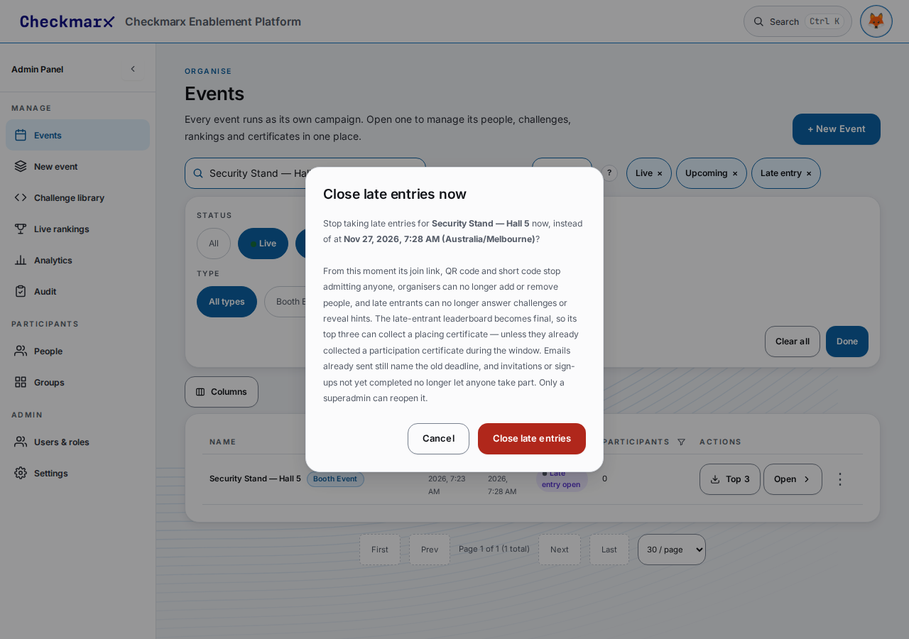

From that moment:

- its **join link, QR code and short code** stop admitting anyone, and you can no
  longer add people to it or remove them from it;
- **late entrants** can no longer answer challenges or reveal hints — their screen
  shows the event as ended within about fifteen seconds;
- the **Late entrants** section of the leaderboard becomes final, so those of its
  top three with points above zero can collect a **placing** certificate — unless
  they already collected a participation certificate while the window was open,
  which they keep;
- nobody moves between the main leaderboard and the late-entrant section, and no
  certificate already issued changes.

Emails already sent — assignment, group and invitation mails — still name the old
deadline; they are not corrected. Invitations and sign-ups that were not completed
before the close no longer let anyone take part.

**Only a superadmin can reopen a window**, by setting a new late-entry deadline in
the event's editor — and a superadmin who later extends the event itself sets
that deadline back to **Automatic**, or to a time after the new end, in the same
save; a save that keeps the closed deadline is refused (the
[Superadmin guide](superadmin.md#running-a-late-entry-window) explains why).
Pressing **Close late entries now** on a window that is already
closed — two organisers at one stand, or a menu opened just before a colleague
closed it — is harmless: you are told it was already closed, and nothing changes.

The option is not offered to anyone who **competes** in the event (when staff can
compete); the menu says why. Once closed, the event leaves the default Events view
and is listed under the **Ended** chip, and its **History** records who closed it
and when, to the second.

---


### Trusted network IPs

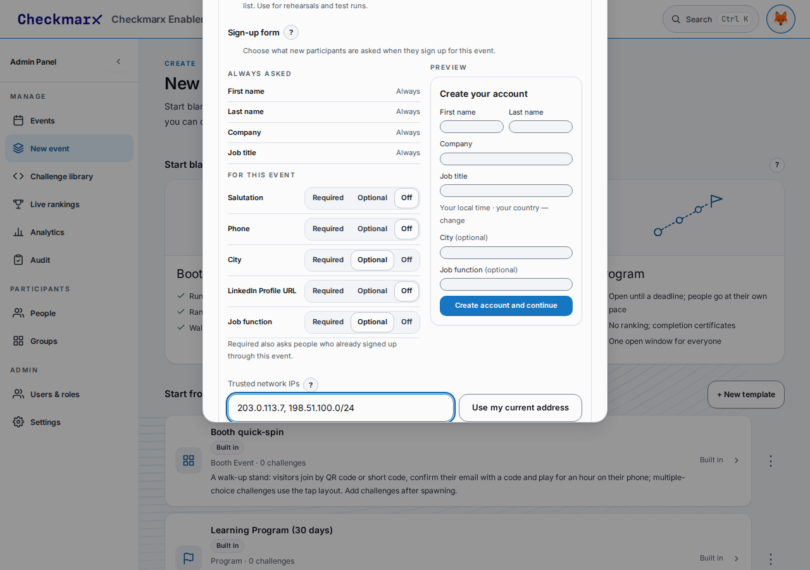

> **Which event types can use this.** A **Booth Event** always can — it is one
> room for one afternoon, which is exactly the situation this exists for. A
> **Competition** can while it has a single session; add sessions and the field
> is disabled with the reason. A **Program** never can, and the field is not on
> its form at all: this is a rate-limit exemption that is only safe because it
> expires when the event does, and a Program can run for years.

At an in-person event everyone is on the same Wi-Fi, so every request
{{platformName}} sees arrives from **one** public address. The platform caps
how much traffic it accepts from a single address, and a room that starts
together looks exactly like one extremely busy client: sign-ins start getting
refused, and if enough requests are refused the address is blocked outright
for 15 minutes — the whole room, at once, with no warning. Newcomers signing up
meet a quieter limit: once about 150 new addresses have asked for a code from
one address within 15 minutes, the rest are sent no email for a while, and the
screen does not say so (it answers every address the same way, so that it never
reveals which addresses have an account).

**Trusted network IPs**, in the event create/edit dialog, tells
{{platformName}} that an address is your venue and not an attacker, and lifts
the limits for it while that event runs.

> **Single-session events only.** The field is refused on an event
> that has sessions, and says so when you save. A multi-session event
> runs across different days and different cohorts, so "the venue's address"
> isn't a property of it — the room changes between sessions. If you need this
> for an event that currently has sessions, run that cohort as its own
> single-session event. For a platform-wide exception that ignores
> event shape entirely, your platform operator can set the
> `RATE_LIMIT_ALLOWLIST_IPS` environment variable instead; that needs server
> access and a restart.

**To set it**

1. Open the event — **+ New Event**, or **Edit** on the row.
2. Type the venue's public address into **Trusted network IPs** — or, standing
   in the venue on its network, press **Use my current address** beside the
   field (see below).
3. Save. Any block already in force on that address is lifted **immediately**,
   so participants can retry straight away.

**Use my current address** asks {{platformName}} which address it sees *you*
at and adds it to the list, once. On the venue's own network that is the
venue's address, the one everyone in the room shares; from your office or at
home it is not, so press it only while you are on the venue's network. It adds
only a public address. If {{platformName}} sees you at a private or loopback
address (`10.x.x.x`, `192.168.x.x`, `127.0.0.1` and the like), it adds nothing
and says so: the platform is then probably reading the address of a proxy in
front of it rather than yours, which also puts every participant on that one
address. Tell whoever runs the server: its `TRUST_PROXY` setting probably
needs correcting. The button is shown to anyone who may edit events; a role
that may only create them types the address instead. An IPv6 address usually
belongs to your own device, so if the one added is IPv6, participants on the
venue's IPv4 network may still arrive from another address — the alert names
it if they are blocked.

Enter up to **10** entries, separated by commas (500 characters in total):

- one address — `203.0.113.7`
- an IPv4 range in CIDR form — `203.0.113.0/24`
- an IPv6 address, which must match **exactly** (ranges are IPv4 only — an
  IPv6 range is refused and tells you so)

An address that isn't a real one is **refused when you save**, rather than
accepted and quietly never matching anything. An IPv6 address is also stored in
its standard short form, so `2001:0DB8:0000:0000:0000:0000:0000:0001` and
`2001:db8::1` are recognised as the same address rather than counting twice
against your ten entries.

Don't know the address? At the venue, **Use my current address** fills it in.
It's also named in the alert you get when a block happens (see
[Alerts](#alerts)), and the **Request log** in [Raw logs](#raw-logs) shows the
address behind every request.

**Three limits worth knowing before you rely on it**

- **Ranges stop at `/16`** — about 65 000 addresses. Anything broader is
  refused, so an over-wide entry can't quietly switch traffic limits off for
  half the internet.
- **Single-session events only.** A multi-session event runs
  across days and cohorts, where "the venue's address" means nothing. Saving
  trusted IPs on an event that has sessions is refused, and so is adding
  a session to an event that already has trusted IPs — clear the list
  first.
- **It expires on its own.** The entry does nothing before the event's
  start time and stops working **2 hours after the event ends** (2 hours
  from when you end it early, if you do). That covers teardown and the final
  leaderboard pull, and leaves nothing you have to remember to undo.

Any admin can set it, and every change is recorded in the event's
**History**, so you can see afterwards who opened the network up and when.

### Editing an event

The Edit dialog adjusts name, schedule, start date/time, timezone, and
duration — or, for a Program, its **deadline**. It is the create form: **Event
type** is its first field (locked with a dashed outline and the reason, once
the type can no longer change), and it shows the same type-scoped set of settings
[described above](#fill-in-the-form-which-shows-only-what-this-type-uses).

If the event changes while the dialog is open (another organiser saves it, or a
session is started or ended), **Save** is refused instead of replacing that
change. Close the dialog and open it again to start from the latest version.

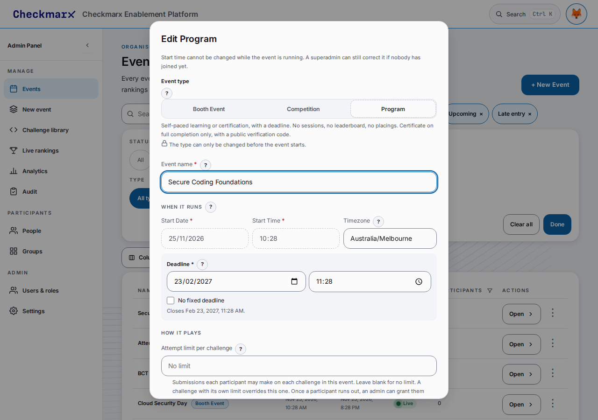

#### Changing the event type

Picked the wrong type? You can change it **until the event starts** — and, for a
superadmin, for as long as the event is still completely empty (see below). Open
**Edit** and pick another **Event type** at the top of the form. You are asked
to confirm, and told which settings the new type turns off; the form then
redraws showing only what the new type uses. Nothing is saved until **Update**.

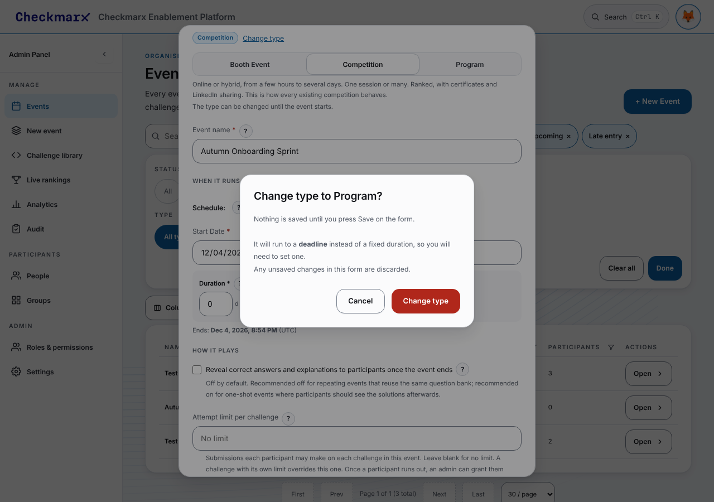

Nothing is saved until you press **Save**. Before the form re-opens you are told
exactly what the change will do:

- **Settings the new type does not support are turned off** — for example a
  Program has no team leaderboard and never reveals answers, a Booth Event
  does not record time on platform, and only a Booth Event takes late entries.
  The main ones, late entries included, are named in the confirmation,
  and every one — including the tie-break basis, which goes off with *Record
  time on platform* — is written to the event's **History**, so the change is
  never silent.
- **The sign-up form is kept.** Every type can ask for the same fields, so the
  fields you made required, optional or off stay as you set them.
- **The schedule is converted, not carried over.** Moving to a Program asks for
  a **deadline**; moving away from one asks for a **duration** and drops the
  deadline. Neither is guessed for you — a Program's duration is worked out from
  its deadline, so it means nothing to a Booth Event, and the other way round.
- **Pending start reminders are cancelled when the new type is a Program.** A
  Program runs to a deadline rather than starting at an appointed moment, so it
  never sends a "starts in an hour" email. Any reminder a participant had
  already asked for is deleted. The count is written to the event's **History**,
  but the participant is not told, so tell them yourself if it matters.

Two things stop the change, and the button simply is not offered, with the
reason shown in its place:

- **The event has started** (or has finished). For an ordinary admin the type is
  then fixed. A **superadmin** has one way back while the event is still
  completely empty: if nobody has joined, submitted an answer, revealed a hint,
  been issued a certificate or is waiting on a reminder, they can move the start
  time into the future (see [Editing an event](#editing-an-event)),
  which returns the event to *upcoming* — and **Event type** can be changed again on
  the next save. Once anything at all has happened in the event, or it has
  ended, the type is fixed for everyone, superadmin included.
- **The event has sessions.** Delete them first — the two types that are not a
  Competition always run as a single session, so a type with sessions could not
  become one of them. Deleting a session is a real decision about people's
  schedules, so the platform will not do it for you as a side effect.

One more refusal you may meet: if a challenge already assigned to the event
**could not be answered at the new type** — a file upload, or one tagged as
needing Checkmarx One or a desktop, at a Booth Event — the change is refused and
the challenge is named. Unassign it, or change the challenge, and try again.

For multi-session events each session has its own row, and what you can
change on it depends on where that session is:

- **Upcoming** — rename it, re-time it, change its duration, or **Remove** it.
- **Live** — rename it and change its duration. Because it has already started,
  its start date and time are locked. The row offers **End Now** in place of
  Remove.
- **Ended** — only the duration can be changed, which is how you revive that
  session.

A session that has started cannot be removed at all. **Remove** is also hidden
while only two sessions remain, since a multi-session event needs at least
two — to go back to one, use the **Schedule** toggle at the top of the form.

> **Re-timing a session moves its reminders.** Every participant who asked for a
> reminder on that session is automatically rescheduled to an hour before the new
> start, and nobody silently loses their reminder. The one narrow exception is a
> reminder whose email was *already going out* at the instant you saved: that
> message cannot be recalled and will quote the old start time, so the
> participant gets a second, corrected reminder at the new time. The same
> applies to changing a single-session event's start time.

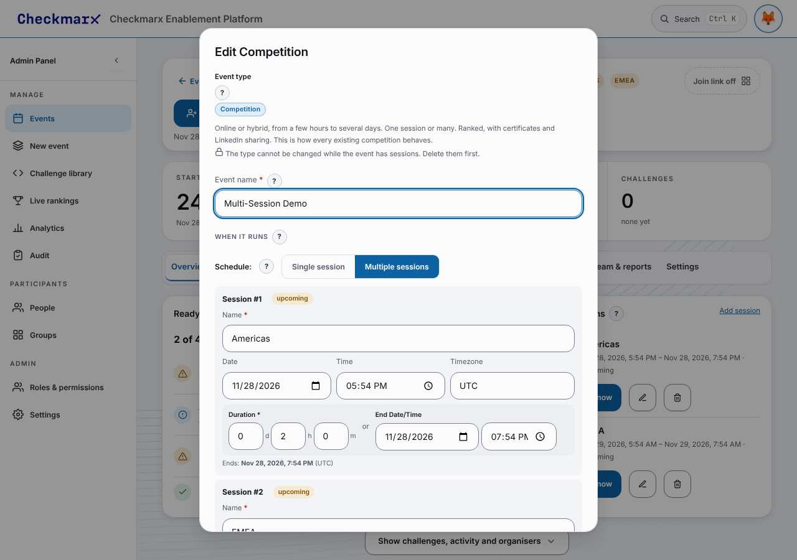

Once an event is **live**, its start time is locked — unless nobody has
touched it yet, in which case a **superadmin** can still correct it. Its
duration stays editable while it runs: shorten a running event to end it
early.

Once an event's **end time has passed**, editing it becomes a
**superadmin** job — the **Edit** action disappears from the row for an ordinary
admin. That includes an event you closed early with **End Now**: ending it
makes its end time the moment you pressed it. For an event that has already
finished, the name and the start time are locked outright even for a
superadmin, but the duration is not, so extending it is what revives the event.
Certificates it has already issued stay as they are (the save's confirmation
says how many): if the new results change someone's placing, a superadmin
revokes that certificate and issues it again from the event's **Certificates**
section.

### Choosing an event's challenges

From the event's three-dot menu on the Events list, click **Assign Challenges**
(**Add challenges** in its workspace's **⋯** menu), or press **Create and pick
challenges** when you create a blank event.

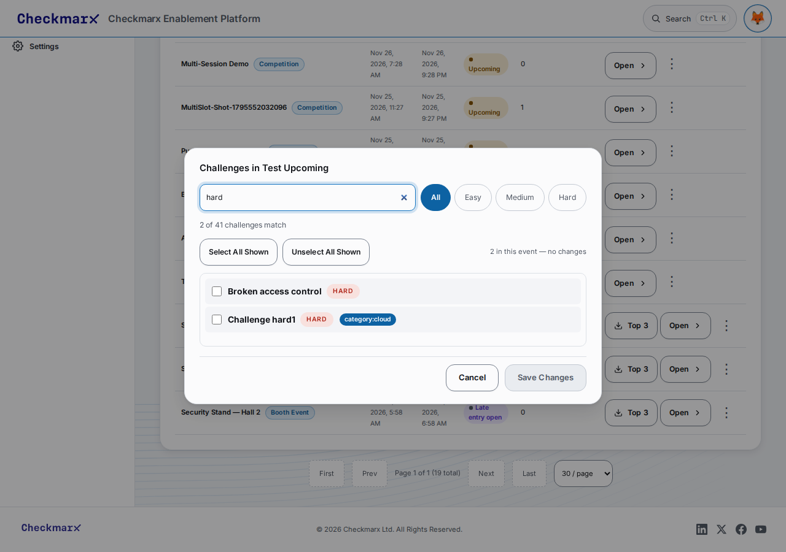

**The ticks show what is in the event right now.** Challenges already
assigned open ticked and are marked *In this event*; the rest open
unticked. Tick to add, untick to remove, then click **Save Changes** — so this
one dialog is where you both add and take away, and it always shows you the
event's actual challenge list.

Use the **search box** and the **Easy / Medium / Hard** filters (they combine)
to narrow the list; your ticks are kept as you change filters, and the counter
above the list tells you what Save is about to do — how many to add and how
many to remove.

**Before anything happens you get a confirmation** with a count for each side
and the challenges named — up to the first 40 on each side, with anything beyond
that shown as a running total. Removing a challenge takes it
off the event for everyone: points already scored on it are kept, but it
stops counting toward the leaderboard and participants can no longer open it.
If the event is live, the confirmation says so — changes take effect
immediately.

> **Select All Shown** and **Unselect All Shown** apply to the challenges
> currently *visible*, which is what the labels say. With a filter active they
> leave everything hidden by that filter exactly as it was.

Three things the dialog will not let you do, and tells you why rather than
failing at Save:

- **A locked challenge** can only be moved by a superadmin, so for everyone
  else its row is greyed out, outlined with dashes and marked *Locked*.
- **An event with a finished session** has a frozen challenge list. The
  dialog says so and Save is disabled. Unassigning it is refused too, for the
  same reason — reopening the event is a superadmin action, and for a
  multi-session event every finished session has to be reopened.
- **An unsealed challenge, on an event that lets staff compete**, is greyed out,
  outlined with dashes and marked *Not sealed* — such an event only admits sealed challenges (see
  [Letting staff compete](#letting-staff-compete)). And if you are competing
  in the event yourself, the dialog is not offered at all.

Assigned challenges that have since been turned back into **drafts** are not
listed here, and this dialog never touches them; a note tells you how many
there are.

### Participants land back where they left off

A participant is asked to choose an event **once**. When they pick one, the
platform remembers it on their account, and their next sign-in takes them
straight in — to the challenges if it is running, or to the countdown screen if
it has not started yet. It follows the account, not the browser, so it survives
a different device, and it applies however they sign in — with an emailed
code or with their password.

This is what you want at a stand, and the night before an event: nobody
has to find the event in a list twice.

**It applies whatever state the event is in and whatever else they are in**, so
you can answer the question when it comes up:

- **A finished event is resumed too.** That is deliberate: reviewing the answers,
  the final standings or a certificate is usually why someone comes back to an
  event that is over. They are told it has ended, once, and can go to the list
  from there.
- **Every kind is resumed**, Programs included.
- **Being in a LIVE event elsewhere changes nothing.** The event they chose wins;
  the platform does not guess that the running one is the one they want.
- **Their own session comes back with it** in a multi-session event — the
  session they picked, not whichever sibling happens to be running.
- **Removing them** from an event clears it, so they are never dropped onto a
  screen they can no longer use. So does deleting it.

A participant turns it off themselves by going back to the event list — the
**Events** item in their top bar. If someone tells you they keep being
put into the wrong event, that is the answer: one click on Events, and
their next sign-in starts on the list.

### Event history

Every change — created, renamed, started, session added, tag attached, ended
— is recorded. Open **History** from the three-dot menu to browse it.

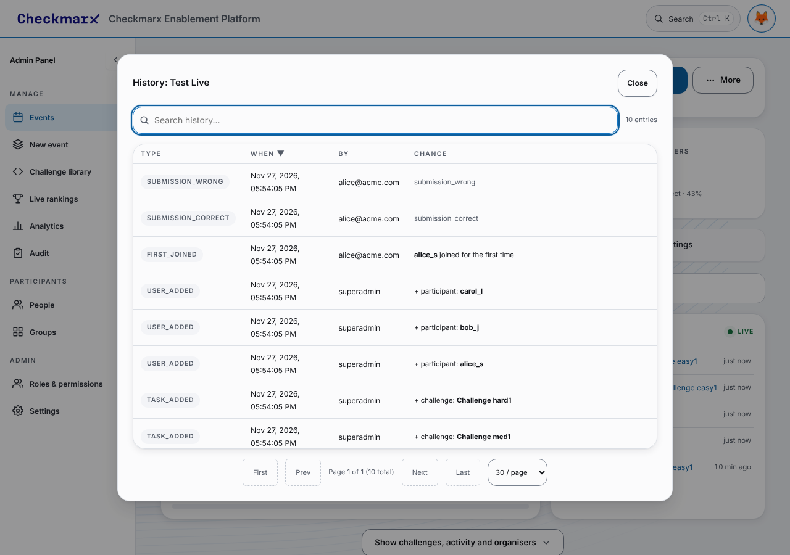

Each entry shows the time, which admin made the change, and the before/after
values — useful for post-mortems or confirming a disputed result.

Each download of a certificate's PDF is recorded too. One made through the
download link in the congratulations email reads *from the email link (may be a
mail scanner)*: mail scanners and link previews open every link in an email,
signed out, just as the holder's own click from it would, so that line alone does
not prove the holder opened it (the PDF is attached to the email anyway). When the
holder was signed in, it reads *from the email link, by its holder*. The **Audit**
page words these downloads the same way.

### Export challenge activity

**⋮ → Export Activity (CSV)** downloads a spreadsheet of how every participant
got on with every challenge in that event. It appears for **live and
ended** events only — nothing has happened yet in one that has not
started.

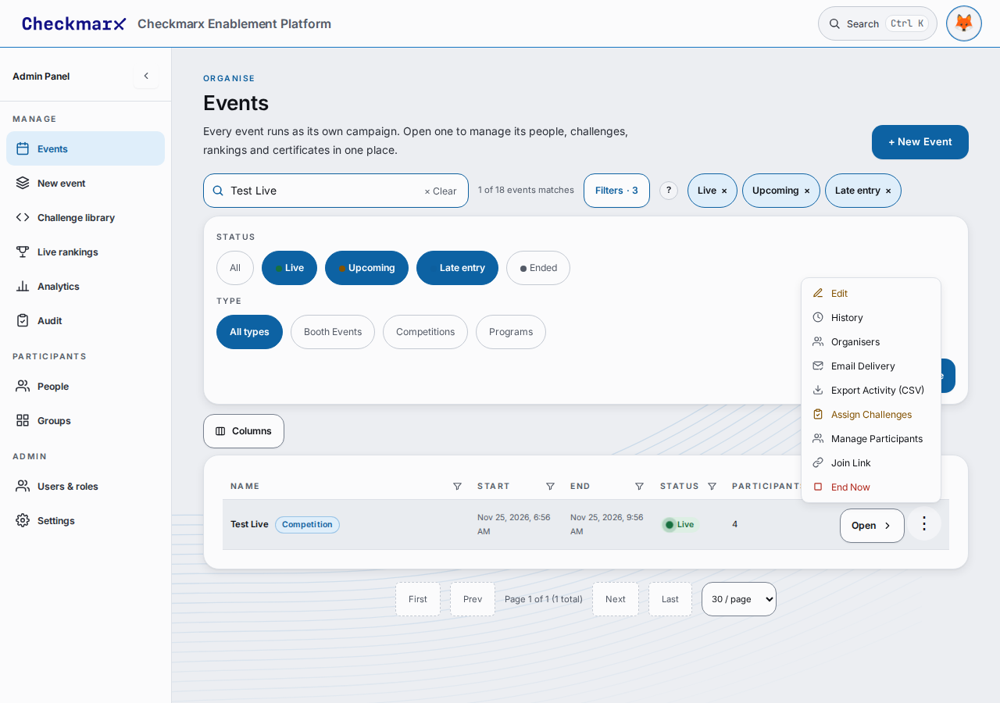

The file has **one row per participant per challenge**, so an event with
40 people and 12 challenges gives 480 rows. Rows are sorted by nickname, then by
**challenge number** — the same order the challenges are in for the people who
sat the event. The columns are:

| Column | Meaning |
| --- | --- |
| Nickname, First Name, Last Name, Company | Who |
| Challenge ID | The challenge's number in *this* event — the `1.02` participants see on their own screen |
| Challenge | Its title |
| Difficulty | `easy`, `medium` or `hard` |
| Points | What the challenge was **worth** — 50 / 100 / 150. Not what this participant scored on it: wrong answers and hints change a score, and none of that changes what the challenge was worth |
| Solved | `Yes` if they have a submission that currently grades as correct |
| Hint Revealed | `Yes` if they opened the hint |
| Incorrect Submissions | How many of their submissions currently grade as incorrect |
| Navigated Away | How many times they left the challenge **before solving it** — moving to another page, switching browser tab, or closing it. Once they solve it, it stops counting |

A participant who never touched a challenge still gets a row for it, reading
`No, No, 0, 0` in the four activity columns — that is what makes the file a
complete grid you can pivot on rather than a list of things that happened.

**What an Any answer participant wrote is not in this file.** For an Any answer
challenge, Solved reads `Yes` for everyone who answered, Incorrect Submissions is
always `0` and Hint Revealed is always `No`. The response text itself comes with
the Participants tab's **Export CSV** while the event is open; see
[Participants](#participants).

A challenge number belongs to a challenge **within one event**, so the
same challenge reused elsewhere has a different number there. That is what makes
this column the right thing to sort on: it is the event's own ordering.

Notes worth knowing before you draw conclusions from it:

- **Organisers are not in the file.** Anyone carrying the `staff` tag is left
  out, which includes every admin, since admins are tagged automatically. The
  exception is an event that lets staff compete: the staff enrolled in it are
  competing, so they get rows like anyone else (see [Letting staff
  compete](#letting-staff-compete)). Participants tagged `benchmark` **are**
  included — a reference score is usually the thing you want to compare against.
- **Every challenge assigned to the event gets rows**, including one you
  have since hidden or unpublished. That is deliberate: a challenge people
  solved before you hid it still has real results, and dropping it would lose
  them.
- **Solved and Incorrect Submissions describe how the answers grade *now*.**
  If you [recalculate a challenge](superadmin.md#recalculating-challenge-scores)
  after fixing its answer, answers that are now right stop counting as wrong —
  and a cell can move the other way too, from `Yes` to `No`, if the correction
  made a previously-accepted answer wrong. That is the same basis the
  leaderboard scored on, so the two always agree.
- **"Navigated Away" counts walking away from a challenge they had not solved.**
  It is the *bounce* signal: how often someone opened this challenge, left it,
  and had not cracked it yet. Solving it does not count, and neither does going
  back afterwards to re-read it — so a challenge everyone solved first time
  reads `0`, and a high number means people kept giving up on it.
  - It **does** count switching to another browser tab and back, which people do
    constantly while working, so read it as attention-switching rather than as
    outright abandonment. Comparing challenges is more useful than reading any
    one number on its own.
- **Actions taken while [impersonating](#impersonating-a-participant) a
  participant** count towards Solved, Hint Revealed and Incorrect, because those
  really did change that participant's score. **Navigated Away does not**, since
  that records who was looking at the screen — and that was you.
- **Navigated Away only goes back two years.** It is drawn from the event log,
  which is trimmed on a retention schedule; the other three columns are kept for
  as long as the event is.

The file is UTF-8 with a byte-order mark, so accented names open correctly in
Excel. Each download is recorded in the audit log, because the file contains
participants' names and companies.

### Full event export

The **full event export** is one ZIP file holding everything about one event, as
a set of CSV files: the participants with every profile field, the challenges,
every submitted answer (with whether it was right, the points it moved and its
attempt number), hints taken, time spent (the solve clock, and time on platform
where the event records it), the final rankings (main board, late entrants and
team board), certificates issued, challenge ratings and how often each person
navigated away. A `README.txt` inside explains the files; **User ID** and
**Challenge Ref** columns join them. It works for an event in any state.

Download it from the event's workspace with **⋯ → Export everything**; the same
file is the admin API route `GET /api/admin/competitions/{id}/export/full` (see
the API reference). The rules:

- **Who is in it.** Everyone enrolled, plus anyone who answered or took a hint
  and was later removed. Staff are left out unless the event lets staff compete;
  benchmark accounts are in, and tagged. The certificates file lists every
  certificate issued in the event, whoever holds it now.
- **Sealed answers stay sealed.** An answer submitted to a sealed challenge reads
  *(sealed …)* unless you wrote that challenge, because it would give the key
  away. No file carries a challenge's answer key, a certificate's link or code,
  or a join link.
- **Spreadsheet-safe.** Any cell starting with `=`, `+`, `-`, `@`, a tab or a
  carriage return gets a leading apostrophe, numbers such as a `-5` penalty
  included, so a spreadsheet shows it as text rather than running it.
- **Who may download it.** Any admin; an event admin for an event they organise.
  Nobody competing in the event can download it, since it holds every rival's
  answers. Each download is recorded in the audit log.

### Self-enrollment links

Inviting participants is one-to-one. A **self-enrollment link** is
one-to-many: a single secret link (and QR code) that lets people add
*themselves* to one event — ideal for an in-person event where you put
a QR code on a screen and let the room scan it.

Open it from the event's **⋮** menu on the Events list → **Join Link**, or, in
the event's workspace, from **Join-link settings** (in the **⋯** menu and at the
foot of the join pill's panel). The join pill itself shows the code and the QR
for your signage — see [The event workspace](#the-event-workspace):

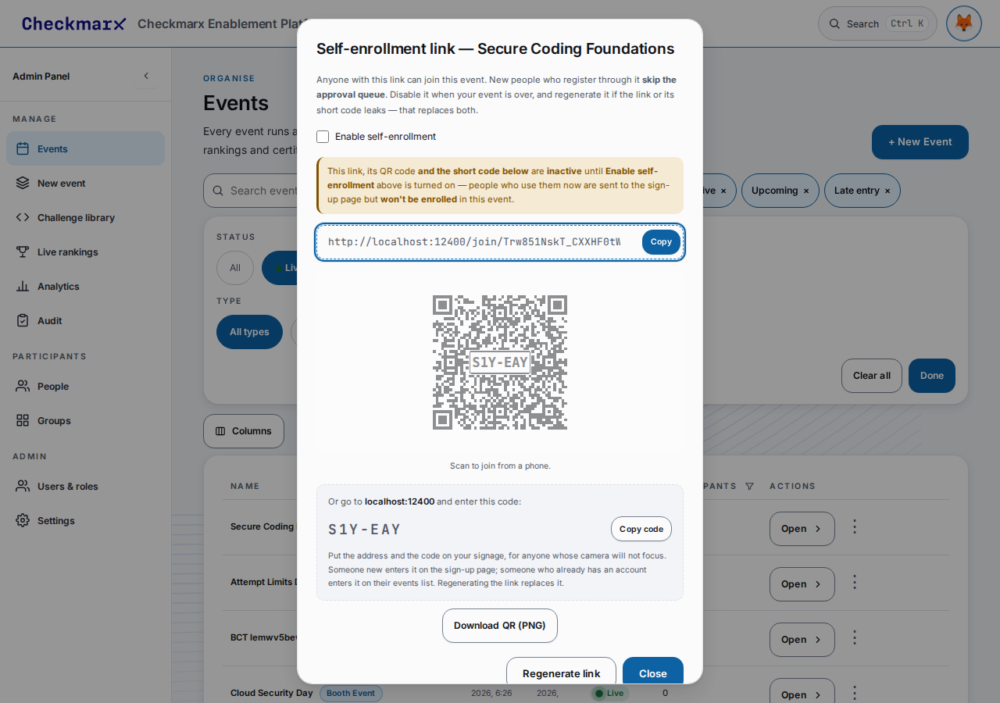

The dialog gives you the controls below — plus two things that are *not*
controls in it, described here because they decide what a walk-up who uses the
link actually meets: **Record time on platform**, which lives on the event
form, and what the sign-up form behind the link asks for.

- **Enable self-enrollment** — the master switch, and where it starts depends on
  the type of event. A **Booth Event** arrives with it **already on**: the QR is
  the whole point of that type, so the link, the QR and the short code are live
  from the moment you create the event, and walk-ups skip the approval queue
  straight away. A **Competition** and a **Program** arrive with it **off** —
  they have a link, but it does nothing until you turn this on. Switching it
  off also unties, for good, the sign-in codes people have already asked for
  through the link: whoever enters one is signed in (or creates their account)
  without that code joining them to your event, even if you have switched the
  link back on by then. While the link is on they can still join through it,
  like anyone who opens it. Once the event
  has ended the link, the QR and the code stop working and the **Join Link**
  item leaves the ⋮ menu — except on a Booth Event still taking
  [late entries](#late-entries). There the item stays, and — while **Enable
  self-enrollment** is on — the link, the QR and the code keep working until the
  late-entry deadline, or until somebody closes late entries early, because your
  signage still needs them: the dialog says so, and says that anyone joining
  through them now is a late entrant. With it off the dialog says instead that
  they will admit late entrants only once it is turned on. Either way, if you can
  close the window it also points you at **Close late entries now** (see [Closing
  late entries early](#closing-late-entries-early)). On a finished event only a superadmin can change the two
  switches — for anyone else they are shown locked, with the reason — while
  **Regenerate link** stays available to you.
  - While it's on, a **Competition won't auto-end early** even if everyone
    currently in has solved everything — because someone could still scan the
    link and join at any second. Turning the switch back off re-arms the rule
    for the *next* completing solve; it does **not** close the event
    retroactively, because if everyone has already finished there is no
    submission left to re-check. Press **End now** when you are done. Time
    limits and manual ending always work.
  - A **Booth Event** and a **Program** never auto-end on all-solved at all,
    switch on or off — a stand stays open for the next walk-up. They run to
    their window or deadline, or until you press **End now**.
  - On a Competition with quick questions, ending early also waits until
    everyone in it has answered them all, so nobody's are cut off; the answer
    that completes the last person ends it, and a changed answer does not.
- **Record time on platform** — a setting on the **event form**, not a
  control in this dialog: open **Edit** on the event to reach it. Off by
  default. When on, the platform counts five-minute blocks in which each
  participant was actually doing something (typing, clicking, scrolling — not
  just leaving a tab open), and the rankings CSV's **Time on Platform** column
  fills in beside **Time to Solve**. That column is always in the file; on an
  event that did not record it the cells are blank, so a blank never reads as a
  measured zero.
  - The two are different numbers and the pair is the point: on a five-day
    event *Time to Solve* reads about 120 hours for everybody, while *Time on
    Platform* might read 35 minutes. Either on its own is misleading.
  - **It measures presence in the browser, not effort.** The count comes from
    activity in the participant's own browser tab, so time spent working outside
    it does not appear: someone who reads the challenge, switches to their IDE
    for forty minutes and comes back to submit banks almost nothing for that
    time. That is the ordinary way people work at a hackathon, so a low number is
    just as likely to mean *they were working elsewhere* as *they were not
    working*. Read it as a signal of engagement, and do not make it the sole
    basis for a decision about an individual — least of all on a Program, where
    it is reported next to a certificate and never ranked.
  - You can also make it the **tie-break** for equal scores, in which case the
    participant who finished on less platform time ranks higher. It only ever
    separates people who **finished everything** — for anyone still going, less
    time on the platform means less work done, not more efficiency.
  - **The tie-break also decides a finisher against a non-finisher.** With it
    on, anyone who finished everything ranks above anyone who did not on the
    same score, whatever their times. With it off, that pair is ordered by time
    to solve, so a fast non-finisher can edge out a slower finisher.
  - **Decide the tie-break before the event goes live.** It is refused once any
    session has started — the ranking would otherwise change under participants
    mid-event — and refused again once the event has ended, because the
    standings are final and any certificates already issued assert that order.
    *Record time on platform* itself stays editable while the event is upcoming
    or live, but not once it has ended.
  - It stops counting for a participant the moment they have finished (or run
    out of attempts on) every challenge, so nobody gains by leaving the
    leaderboard open.
  - Not available on a Booth Event: over a 45-minute window there are only nine
    blocks, so everyone who stayed would tie and the number would say nothing.
- **A short event code** — the Join Link dialog also shows a six-character code
  (`ABC-123`), **with the web address to type it at**. Put *both* on your
  signage, for anyone whose camera will not focus on the QR. It is
  case-insensitive and forgiving about `O`/`0` and `I`/`1`, it never contains
  the letters people misread, and it stops working the moment the event ends,
  you turn self-enrolment off, or you **Regenerate link** (which issues a new
  code) — on a Booth Event taking [late entries](#late-entries), the moment late
  entry closes rather than when the event ends. Turning self-enrolment off only
  *pauses* the code: turning it back on brings back the same code, so if a code
  has leaked, regenerate the link instead.
  - **There is somewhere to enter it on every screen they can land on.** The
    address takes them to the sign-in page, where **Have an event code?** opens
    a small dialog — they type it and press **Find event**, it names the event,
    and **Continue with my email** takes them to the email box, which signs in an
    account or starts a new one, joining the event either way. The events list
    has the same box (**Have an event code?**, with **Join event**), above the
    cards, for anyone already signed in who wants to join another event. Both
    land in the same place.
  - With self-enrolment switched **off**, the link, the QR *and* the code all
    render greyed and dashed in the dialog, with an amber note saying so — so
    you cannot print a code that will not work. The **Copy** buttons keep
    working, so you can prepare the signage before you flip the switch. As
    with **Regenerate link**, sign-in codes already emailed through the link
    no longer join anyone, and someone part-way through the sign-up form
    finishes without joining (waiting for approval if **Require admin approval
    for new accounts** is on, unless they were invited by someone who may
    approve accounts).
- **A shorter sign-up form** — every event decides what its join link asks
  for (see [What an event asks for at
  sign-up](#what-an-event-asks-for-at-sign-up)), and out of the box that is
  as little as possible: **City** and **Job function** are asked but not
  required, and Salutation, Phone and LinkedIn are not on the form. Ten
  mandatory fields on a phone at a stand is the difference between a visitor
  registering and walking away.
  - The form is **tied to the event they registered through**, as that event's
    form stands now. If they later join another event, they are *not* asked for
    the fields their first event left out — but a field you make mandatory on
    that first event is asked of them too.
  - **A work email is still required**, on every kind of event without
    exception. It is the only check standing between a shared link and anyone
    who finds it, so it is never relaxed.
- **Walk-ups sign in with a short code emailed to them** — the sign-up form
  never asks for a password, on any kind of event. A walk-up who registers
  through the link, and somebody you type in **At the desk**, reach the platform
  the same way. (Anyone may later choose a password in their own profile;
  **Email me a code instead** on the sign-in card still works for them.)
  - **They get ONE email, and it is the code**. Entering it proves their
    address; a newcomer then fills in the short sign-up form, which creates the
    account, signs them in and enrols them in your event. Nothing is created
    before that, so a walk-up who never uses the code leaves no account behind.
  - **Somebody who already has an account is never refused.** If they type an
    address that already belongs to an account, they sign in to that account —
    with an emailed code, or with their password if they chose one — nothing on
    their account changes, and signing in joins them to your event. Nobody ends
    up with a second account for the same address.
  - **If their mail is slow or blocked, you are the fallback** while they have
    never signed in: open their row on the Participants tab and use **Show
    sign-in code** to read one off your screen. It sends no email at all. After
    their first sign-in the desk can only email them a code.
  - **If somebody asks for a code and none arrives, their History says why.**
    Open the three-dot menu on their row and choose **History**: a
    *Sign-in code NOT sent* line names the condition — most often
    *recently_sent*, which means either that a code was already emailed in the
    last two minutes (the one in their inbox still works) or that a code you
    showed them at the desk is still live (they should type that one) — or the
    send limit for the code they already hold. The request itself always
    answers the same way on screen, on purpose, so that a mistyped address tells
    a stranger nothing. The other reason you will see is an account that is
    blocked. If there is no line at all, check which address they typed: only
    an account's **primary** address signs in, and an address held only as
    somebody's secondary email is never sent a code. Nor is an account that
    signs in with a password: **Continue** asks for the password, and a code
    goes only when they press **Email me a code instead**.
- **Every walk-up confirms their email with a code, then joins at once** — on
  every event type; nothing in this dialog changes it. If someone's mail is not arriving, **Email sign-in code** on
  the Participants tab sends them a fresh code, and signing in with it verifies
  them; for someone who has never signed in, **Show sign-in code** reads one off
  your screen. A **superadmin** can also use **Verify** to mark them verified
  outright if their mail provider is blocking us.
- The **copyable link** and **QR code** — copy the link into a chat or email,
  or project the QR on a screen. The event's short code is printed in the
  centre of the QR, so anyone whose camera will not read it can type the code
  instead. **Download QR (PNG)** saves a high-resolution image of that same QR,
  code included, so you can print it on a flyer or drop it into slides — no
  need to screenshot the preview.
- **Regenerate link** — replaces the secret **and the short code** together;
  the old link, any printed QR codes and the old code stop working immediately
  (and any browser that remembered the old link forgets it on its next visit),
  and the dialog shows the new code. Sign-in codes already emailed through the
  old link still sign people in, but no longer join them to your event; anyone
  part-way through the sign-up form finishes without joining it, and waits for
  approval if **Require admin approval for new accounts** is on, unless they
  were invited. Reprint your signage afterwards. Use it if the link or the code leaks.

**What the participant sees.** They open the link (or scan the QR) and see
the event they're about to join, then type their work email and the code emailed
to them (or their password, if their account uses one). If they already have an
account they sign in and land straight in it. If they're new, the code is
followed by the short sign-up form, and finishing it signs them in and enrols
them — **skipping the approval queue**. Only a code typed in the browser that
asked for it joins your event: typed anywhere else it signs them in (or lets
them sign up) as an ordinary sign-in, with no enrolment and no approval through
the link, so nobody holding the link can put someone else's account into your
event.

**If they wander off mid-sign-up, the link isn't lost.** Opening the link
once is enough: the browser remembers the pending join for about a month past
the event's scheduled end, so someone who abandons sign-up and later comes back
through the plain homepage — even after closing the browser — lands on the
sign-in page with *your* event named above it. They type their email and enter
the code it brings, and finishing sign-up enrols them, auto-approved, like any
other link visitor. No more stray unapproved accounts to catch, approve, and
assign by hand. The memory lives only in that browser and is checked against
the platform on every visit, so it keeps working for someone returning after
you extended an event past its original end, and stops the moment the event
genuinely finishes: **Regenerate link** or switching self-enrollment off
cancels it everywhere the moment those browsers next load the site.

> **Security — read before you enable.** Anyone with the link can join, and
> people who register through it skip the approval queue. Treat the link like
> a key, and the short code too: share them only with your intended
> audience, disable the link when the event ends, and regenerate it if you
> suspect the link or the code leaked. A company email is
> still required, exactly as in a normal sign-up.

---

## Challenges

The **Challenges** tab lists the challenge **library** (the bank of questions),
whatever events use them.

**A challenge added to an event lives in that event.** Adding a library
challenge to an event gives the event its **own copy** of it — the question,
answer, options, hint, explanation, tags, attachments and seal — and the event
uses that copy from then on. Editing the event's copy (in the event's
**Challenges** section), its answer included, changes that event only; editing
the library challenge changes no event at all, so a later fix to the library is
not carried into an event that already has its copy. Cloning an event, or
making one from a template, gives the new event fresh copies of its own. An
event's own challenge cannot be added to another event: add the library
challenge it was copied from instead. Events made before this change were given
their own copies when the server was upgraded, with their answers, hints and
results moved to them; scores and certificates are unchanged.

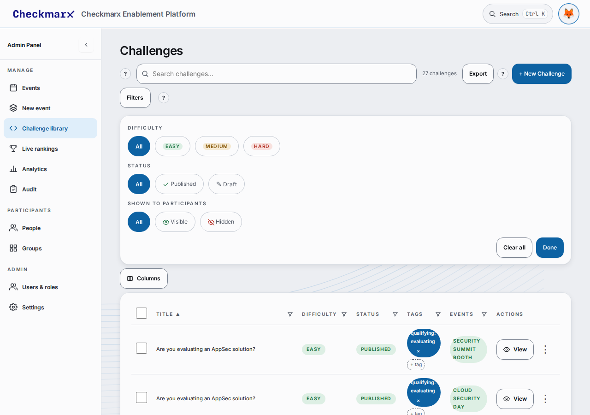

Each row's **Attachments** badge shows how many downloadable bundles the
challenge ships (a dash if none); the column is sortable, handy for
spot-checking which challenges rely on downloadable material.

### Challenges a Booth Event cannot use

A Booth Event is a walk-up at a stand: someone scans a QR with the phone in
their hand and has a couple of minutes. Three kinds of challenge cannot be
answered in that situation, so the platform **refuses to attach them to a
Booth Event** and tells you which one it objected to:

- an answer type of **File** — there is nothing to upload from a borrowed
  phone;
- anything tagged **`needs:cxone`** — Booth Events don't create CxOne
  accounts, so the account the challenge assumes won't exist;
- anything tagged **`needs:desktop`** — an IDE, a terminal, a VPN client.

An **Any answer** challenge is fine at a Booth Event — it asks for nothing a
phone cannot give.

`needs:` is an ordinary tag, so you add and remove it exactly like any other,
and it is **never shown to participants** (only `category:` tags are). Any
`needs:` tag restricts, including one you invent — `needs:burp` will be
refused at a Booth Event without anyone changing the platform.

None of this applies to a Competition or a Program, which can use all three
freely. The refusal also fires the other way round: if a challenge is already
attached to a Booth Event that has not finished yet, you cannot change its answer type to File or
add a `needs:` tag to it until you unassign it from that event — otherwise a
visitor would be looking at something they cannot do.

From this tab you can:
- Export the catalogue to **JSON** — a complete copy you can re-import
  exactly, with two exceptions: a challenge whose answer is **sealed** exports
  without its answer, its explanation or its hint (the hint marked withheld
  rather than empty) for anyone but its author or a superadmin who has revealed
  it, and is refused on import whoever exported it (see
  [Sealing a challenge answer](#sealing-a-challenge-answer)); and a challenge
  held by an event you compete in exports without its hint, marked withheld
  rather than empty, so re-importing the file does not blank the hint (see
  [The competitor lock](#the-competitor-lock)).
- Create or edit a challenge — title, description, difficulty, **attempt
  limit**, **answer type**, correct answer, hint, **explanation**, attachment, and author. The
  **explanation** is the write-up participants see after the event ends
  (how it was meant to be solved). The **answer type** decides what a
  participant submits:
  - **Text** — plain text; matching ignores case and whitespace. A text
    challenge can accept **several** answers — press **+ Accepted answer** under
    the Correct Answer box and any of them counts.
  - **File** — participant uploads a file, graded as a single piece of text
    (case and whitespace ignored). Useful when the answer is too long or
    structured to paste.
  - **JSON** — participant pastes JSON, compared structurally (key order
    doesn't matter, list order does). Invalid JSON always fails.
  - **Multiple choice** — you supply the options and tick the ones that are
    correct; participants pick from a shuffled list. See
    [Creating or editing a challenge](#creating-or-editing-a-challenge)
    below.
  - **Any answer (free response)** — every non-empty answer is accepted,
    exactly as typed. For reflections, feedback and open questions. Such a
    challenge has **no hint** and participants see **no wrong-answer
    warning**; their responses export with the participants CSV (see
    [Participants](#participants)). Given two or more **Options**, it becomes a
    pick-one question: participants choose one, and every option is accepted.
- Toggle a challenge's visibility so it stops appearing in events
  without losing its history.

### Creating or editing a challenge

**+ New Challenge** (or **Edit** from a row's three-dot menu) replaces the
challenge table with an inline form that fits on one screen. Cancel or Save
brings the table back:

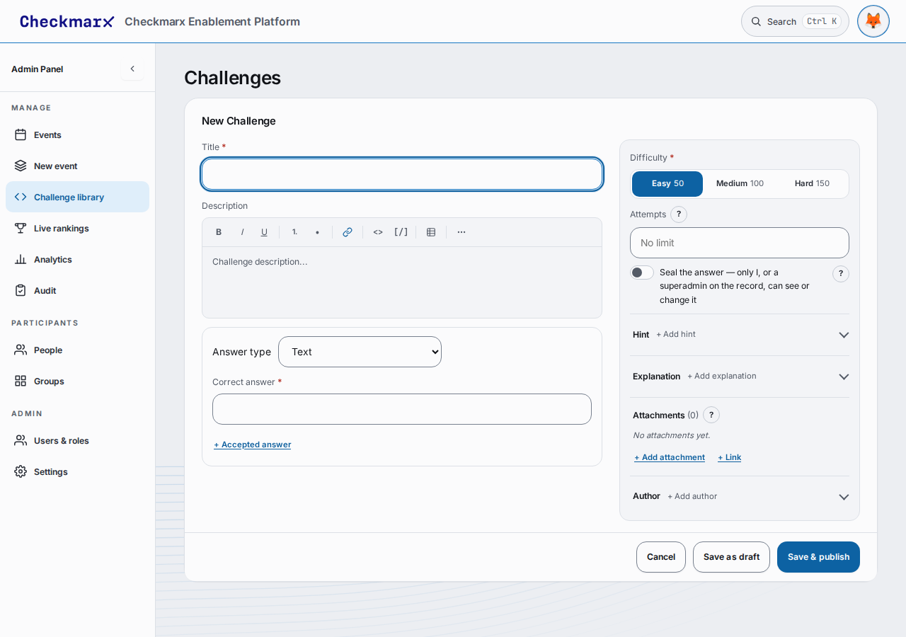

The question is on the left: **Title**, **Description** and the **Answer** —
its type and the correct answer. The settings are on the right: **Difficulty**
(Easy 50, Medium 100 or Hard 150 points), **Attempts**, the seal switch, and
four rows — **Hint**, **Explanation**, **Attachments** (a bundle participants
download — source code, data, logs — or a link) and **Author**. Click a row to
open it in place; closed, a row shows what it holds, or *+ Add …* when it is
empty. A small **?** beside a control explains it. The description's toolbar
keeps the everyday commands in view; **⋯** (More formatting) shows
strikethrough, colours, font, size and clear formatting. On a challenge you
cannot edit, the toolbar is switched off and a line under it says why. On a
phone the form is one column, settings after the question.

The **Cancel** and Save buttons stay pinned to the bottom of the window. On a
**new** challenge, click **Save as draft** to keep it hidden while you work, or
**Save & publish** to make it assignable. On an **existing** challenge the form
offers a single **Save challenge** button instead — publishing is a one-way
step, so there is no *Save as draft* here. To take a published challenge back to
draft, open **History** and restore a version from before it was published.

If someone else changes the challenge while your form is open, **Save
challenge** is refused instead of replacing their change. Close the form and open
it again to start from the latest version.

**Attempts.** Leave it blank — the normal answer — and the challenge is
uncapped, or takes whatever limit its event sets. A number here (1 to 1000)
is the ceiling on how many submissions each participant may make on this
challenge, and it **overrides** the event's own limit wherever the two
disagree. Zero is refused: unpublish the challenge instead. Once a
participant has used up their attempts, an organiser can hand them more —
see **Grant Attempts** below.

**Sealing the answer.** A **new** challenge can be created with its answer
sealed — turn on *Seal the answer — only I, or a superadmin on the record, can
see or change it* (its **?** spells out what that means) and the correct answer, the explanation and the hint stay visible
to your account alone (a participant competing in an event that holds it can
still buy the hint there); the one exception is a superadmin who reveals them,
on the record.
Nobody else can edit, restore or recalculate the challenge either — although
sealing only narrows who may, it does not hand you a right you would not
otherwise have. It can only be chosen while the challenge is being created.
See [Sealing a challenge answer](#sealing-a-challenge-answer).

**Answer types.** A challenge is graded one of five ways. **Text** compares the
participant's answer ignoring case and spacing against one or more accepted
answers. **JSON** checks a deep match, so key order doesn't matter. **File
upload** takes a plain-text file, graded as one piece of text. **Multiple
choice** presents a list of options. **Any answer (free response)** accepts
every non-empty answer, or, given options, any one of them.

**Several accepted answers.** On a Text challenge the **Correct answer** box is
the first accepted answer; **+ Accepted answer** adds a row for each
alternative, and a participant who types any of them — in any case, with any
spacing — solves it. Blank rows and duplicates are dropped when you save.
Reopening the challenge shows the rows again, History shows the alternatives
separated by ` | `, and the participant's Solution box (where answers are
revealed) lists every accepted answer.

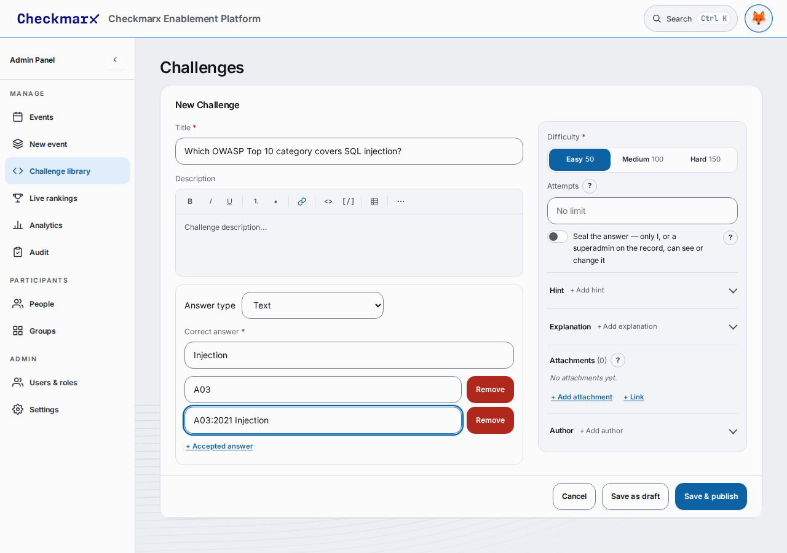

**Any answer (free response).** Choose it when there is no right answer to
check — a reflection, a piece of feedback, an open question. There is no Correct
answer box, and the **Hint** row disappears. Nothing written there is kept:
switching an existing challenge to Any answer **removes its hint and its
accepted answers when you save**, and switching the type back later does not
bring them back — copy them first if you want them. ({{platformName}} stores no
hint on such a challenge by any route, because there is nothing to hint
towards.) What a
participant types is stored exactly as typed (spacing and case preserved), every
non-empty answer is correct, and an empty one is simply refused, so nobody is
ever penalised. Two consequences follow from "every answer is correct": the
challenge is **solved on the first answer** — it counts towards the all-solved
rule that can end an event early, towards the **All Solved** mark and a
completion certificate — and a participant **cannot answer it twice**. In
Analytics everyone who answers it solves it, so its solve rate falls below 100%
only through people who opened it and left without answering; they count as
attempters exactly as on any other challenge. To read the responses, open the
event and use **Export CSV** on its Participants section.

**Options turn it into a pick-one question.** In place of the Correct answer
box is **Options (optional, one per line)**: leave it empty for a free answer,
or type two or more options, one per line (up to 20, each different, at most 300
characters), and participants pick one instead of typing. Every option is
accepted, so the rules above still hold: answered once, never wrong, no hint —
except that a participant can change their answer to a qualifying question with
options until the event ends (see [Event team and lead
reports](#event-team-and-lead-reports)). Participants see the options in the
order you typed them, never shuffled, under **Choose one** with **Submit
Answer**; on a phone at a Booth Event each option is a large tile, and one tap
answers. The option they picked (their latest) is their response in the CSV.
Answers are kept by option, not by wording: a line you edit where it stands
stays the same option, so the answers already given to it follow the new
wording — unless the same save removes an option, when a reworded line is saved
as a new option, since which line replaced which cannot be told.


For a multiple-choice challenge, type each option and tick the ones that are
correct — there's no separate "correct answer" box, because the answer *is* the
set of ticks. Add up to 20 options with **+ Add choice**; two is the minimum.
At twenty the button stops and says that is the most a challenge can have.

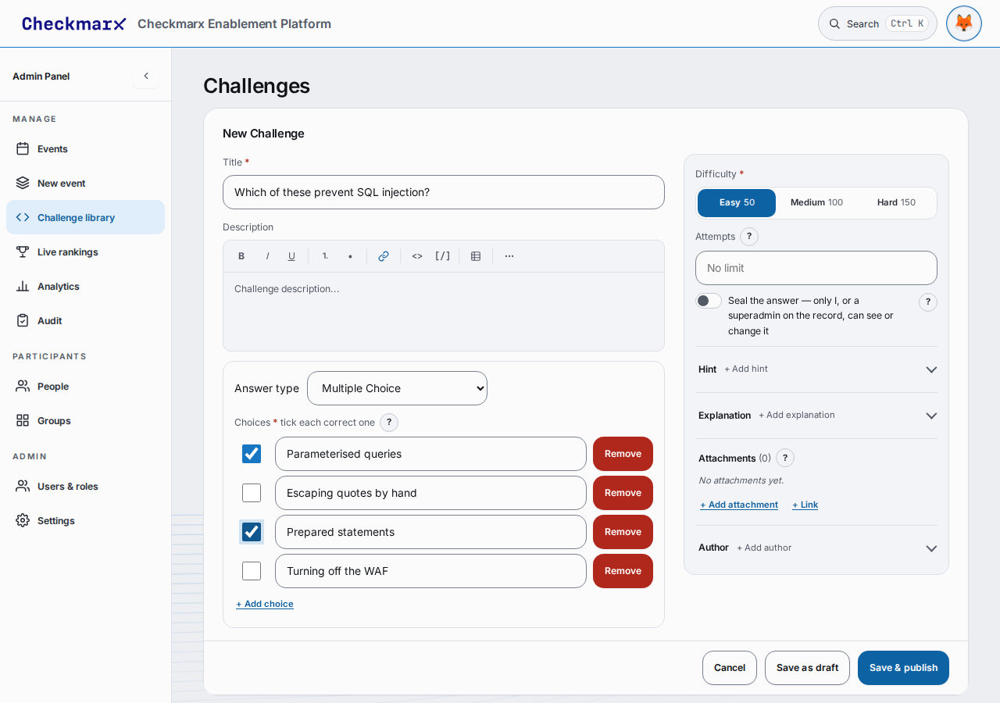

Two things follow automatically from how many you tick:

- **One correct option** — participants see radio buttons and pick exactly one.
- **Two or more** — participants see checkboxes and can pick several. They score
  only if their selection matches your set *exactly*; a partly-right answer is
  wrong and costs the usual 5 points.

At a Booth Event on a phone the options are large lettered tiles instead of
radio buttons or checkboxes — see *Multiple choice at a Booth Event* below.

**The order is shuffled for every participant**, so nobody can share "it's the
third one". The shuffle is stable for each person — refreshing doesn't reorder
the list under them.

**Changing the correct options during an event** is allowed until a session of
an event holding the challenge has ended, and it re-scores nothing on its own.
Participants who already solved it keep the solve and its points, and their
options stop being marked, with a short note saying why, so they are not shown
the new answer while others are still answering. A superadmin can re-score the
earlier answers against the new set with **Recalculate Scores**.

The editor refuses a question that can't work: fewer than two options, no
correct option, *every* option correct (nothing left to get wrong), a duplicate
option, or an empty one. Export and import carry multiple-choice challenges
intact.

Use **View** (or **View as Participant**) to check the question the way a
participant will see it — the options are listed with the correct ones marked.
The answer appears once, on the options themselves; the Solution box below is
just the explanation.

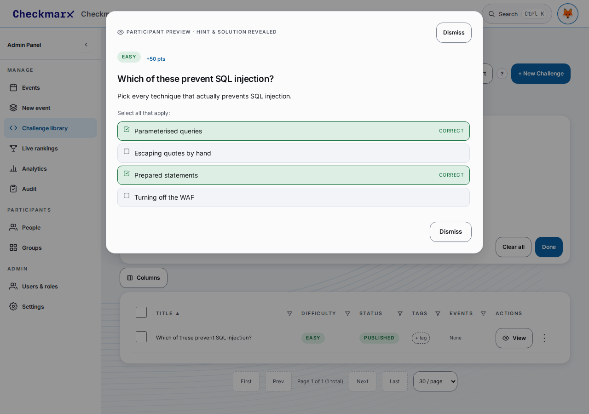

#### Multiple choice at a Booth Event

At a **Booth Event**, a participant who opens a multiple-choice challenge on a
phone (in either orientation), on most tablets held upright, or in a browser
window 600px wide or less gets a layout built for one hand: the question fills
the screen, each option is a large lettered tile, and the usual header, menu and
footer step aside while the question is open — the countdown moves into a bar at
the top beside a **Back** arrow. On a phone held sideways the question sits on
the left and the tiles on the right.

- **A tap opens the usual penalty confirmation**, which names the option they
  picked; nothing is sent until they confirm. Its **Submit answer** button takes
  a moment to respond, so a double-tap cannot submit by accident.
- **A wrong single answer marks that tile** *Not correct*, and it cannot be
  picked again while the question is open (reopening the question clears the
  mark). Attempt limits and the last-attempt warning work exactly as on the
  ordinary layout; a wrong last attempt locks the challenge.
- **With several correct options** participants tick tiles and press **Submit
  answers**. A wrong selection marks no tile.

**What fits on one screen.** A short question with a few short options fits on
a phone without scrolling — four options of about 45 characters fit a typical
phone, though not the smallest. A long question scrolls inside its own area
while the tiles stay put. **More than six options, or any option longer than 90
characters, always scroll the whole screen** — the editor says so above the
options. Keep booth questions and options short and they will fit.

The other event types — and, at a Booth Event, a laptop or desktop at full
width, a tablet held sideways and the largest tablets even upright — keep the
ordinary layout with radio buttons or checkboxes. A challenge the participant
has already solved or can no longer answer is shown on the ordinary card,
read-only, whatever the device. **View as Participant** shows the ordinary
layout too; to see the booth one, open the challenge in a participant account
on a phone, or in a browser window narrowed to 600px or less.

**Code blocks.** **Code Block** on the toolbar turns the selection into a block;
right-click the block to pick its language from a menu —
including **Dockerfile**, Bash, YAML, JSON, PowerShell and the usual programming
languages. Every entry in that menu really is highlighted; there are no
decorative options. Code renders identically wherever it appears: the editor,
the participant's challenge, and **View as Participant**. Code — a block or
inline code — shows exactly the characters typed: `=>`, `==`, `!=`, `--` and
`://` stay separate characters rather than being drawn as one symbol, and the
editor never auto-corrects inside code (Safari and iPads otherwise turn `--`
into an em dash and straight quotes into curly ones).

**Text colour and highlight.** Under **⋯** (More formatting), **Text Color**
and **Highlight** offer named colours: grey, red, orange, yellow, green, cyan,
blue, violet and pink. Each is drawn in a shade made for the look on screen, by
day and at night, so coloured text stays readable for every participant
whatever look and mode they use, and the menu shows each colour as this look
draws it. **✕** takes the colour or the highlight off the selected text. With
nothing selected, the colour you pick applies to what you type next, including
text entered with a phone keyboard or a Chinese, Japanese or Korean input
method. Coloured text you copy, paste or drag within the editor keeps its
named colour. A colour pasted from Word or a web page becomes the nearest named
colour (Word's dark red becomes red, its blue blue, a mid grey grey), and black,
white and colours very close to them are left off, so that text follows the
page's own text colour by day and at night. Colours already in a challenge, and
colours dragged in from another window, are kept as they were, so check how
such text reads by day and at night, or select it and pick a named colour instead.

**Undo.** **Ctrl+Z** (**⌘Z** on a Mac) takes back your typing and formatting as
the browser always has, and also **Inline Code**, **Code Block**, a link you
insert, change or remove, a code language, a colour, and the **Table** menu's
row, column and delete changes, the last first; **Ctrl+Shift+Z** or **Ctrl+Y**
(**⇧⌘Z**) puts them back. Undo one of these straight away: once you type, paste
or apply formatting such as **Bold**, a list, a font or a size after it, Ctrl+Z
takes that back but no longer reaches it.

**Rich text: tables.** The description, explanation and hint fields all use the
same editor, and its toolbar has a **Table** button. Use it to insert a table
(choose rows, columns, and whether the first row is a header) and — once your
cursor is inside a table — to insert or delete rows and columns, or delete the
whole table. The editing items only appear when the cursor is actually in a
table, so the menu never offers an action that would do nothing.

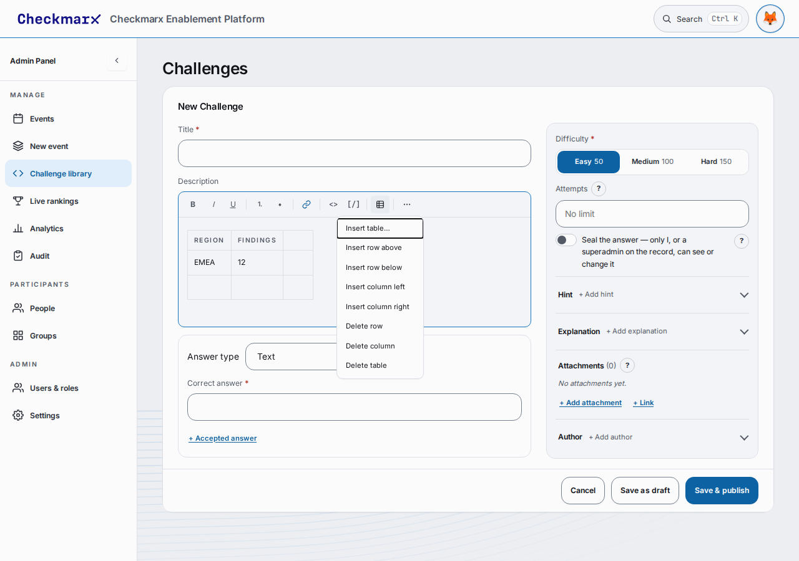

**You can paste tables in.** Copy a table from Word, Excel, Google Docs or a web
page and paste it straight into any of the three fields. The editor keeps the
structure and the formatting that matters — header cells, merged cells,
alignment, cell colours — and strips what doesn't travel: Word's internal
styling, absolute page widths sized for A4, and colours like `windowtext` that
mean nothing outside Word. What you see after pasting is what gets saved, so you
can fix anything up before you click Save. That holds for any paste: bold,
italics, underlining and strikethrough on the text itself are kept, while
alignment, colours and bold or underlining set on a whole paragraph, list item
or table cell go as you paste, as the save would drop them; table cells keep
their alignment and colours (as named colours). Highlighting pasted from Word is not kept: select
the text and use **Highlight**.

A few limits worth knowing. Very wide tables scroll sideways inside the
challenge rather than stretching the page, so they stay readable on a phone.
Images inside a pasted table only survive if they're real web images — a picture
pasted from a local Word file points at your own disk and is dropped rather than
saved as a broken image; add it with the editor's image paste instead. And a
merged cell spanning more than 64 rows or columns is trimmed to 64.

**A pasted picture lives as long as something uses it.** A picture stays while
a challenge, one of its saved versions, a participant's photo or a frozen team
board shows it. Once nothing does (you deleted the only challenge that showed
it, say), the next daily clean-up removes it (never within a week of it being
pasted), and a copy of its address you put in an outside page, an email or a
slide stops working then. Paste a picture you
want to share outside {{platformName}} into that page or email itself.

**About attachments.** Uploads you add in the form are **held back and
invisible to participants until you click Save** — Cancel (or closing the
form) discards them cleanly. Renaming or removing an attachment on an
already-saved challenge takes effect immediately. To bring back a removed
attachment, open **History** and restore a version that included it — the
file stays on disk, so the restore re-links it.

Uploads are capped per admin *and* across the whole platform, so if several
organisers are staging large bundles at once you may see *"Server-wide upload
quota exceeded"* (or, if the space ran out while your file was arriving,
*"Server-wide staging quota exceeded"*). It clears as soon as pending uploads are
saved or discarded — finish or cancel your own drafts, or ask a colleague to
finish theirs, then retry.

**An upload is checked again when it has finished arriving**, not only when it
starts. If your administrator access was taken away while a large file was still
on its way — you were blocked, removed, or moved out of the admin roles — or your
session ended in the meantime — you signed out, signed in somewhere else, switched
between Admin View and Participant View in another tab, a colleague changed your
role, or the session timed out — the upload is refused when it arrives, with a
message saying which: *Your administrator access has ended, so nothing was saved*,
or *Your session ended before this finished, so nothing was saved. Try again —
if you are asked to sign in, do that first.* The second one does not say
why the session ended, because {{platformName}} only knows that it did. Either way
nothing from it is kept.

- Manage **tags** — labels for grouping challenges; they drive the Analytics
  filter and the challenge browser. Tags are **private to admins**, with one
  deliberate exception — see [Categories](#categories) below.
- Assign or un-assign the challenge to specific events.
- View past versions and **restore** an earlier one from the three-dot menu.
- **Grant Attempts** — offered from the three-dot menu where the challenge,
  or an event it is in, carries an attempt limit: hand a named participant
  more tries on it in a chosen event. Grants add to what that participant
  already has rather than replacing it, so two organisers each granting one
  try gives two. It works on an event that has already ended — that is the
  point, since an event closes once everyone has either solved everything or
  run out of attempts — but the grant does not reopen the event by itself: a
  superadmin still has to extend it, and the grant has to come first.

  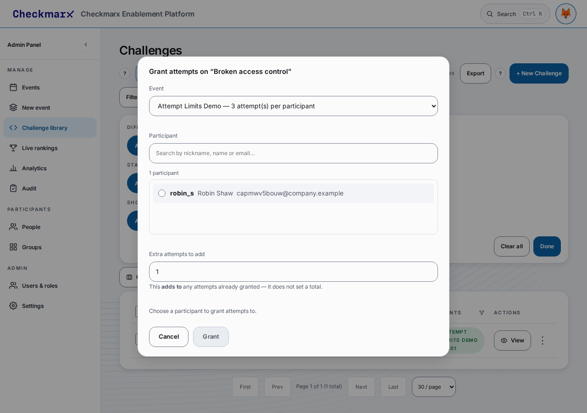

- **View participant feedback** — participants rate each challenge 1–5 stars.
  The table's sortable **Feedback** column shows the average and the number
  of ratings; to read who gave what, open the challenge for **Edit** — a
  **Feedback** section at the foot of the form lists each participant and
  their stars, and a superadmin can remove one rating there or clear them all
  at once. There is no **Edit** entry on a locked challenge, so unlock it
  first if you need the individual ratings.

### Sealing a challenge answer

When you create a challenge you can turn on **Seal the answer — only I, or a superadmin on the record, can see or change it**. The correct answer,
the explanation and the hint are then visible to exactly one account: yours, the
one that created the challenge. Not other event admins, not other
administrators, and not participants — except that a participant competing in an
event that holds it can still buy its hint there, as they could any hint. The one exception is a **superadmin**, who can reveal them to
themselves — never silently: the reveal is an explicit act, confirmed first,
and it is written into the challenge's History and the event log with their
name, so you will see that it happened (see [A superadmin can reveal it, on
the record](#a-superadmin-can-reveal-it-on-the-record) below). Use the seal
when the answer ought not to circulate among the organising team. It is also
what an event where staff compete requires of every challenge in it, for the
same reason — see [Letting staff compete](#letting-staff-compete).

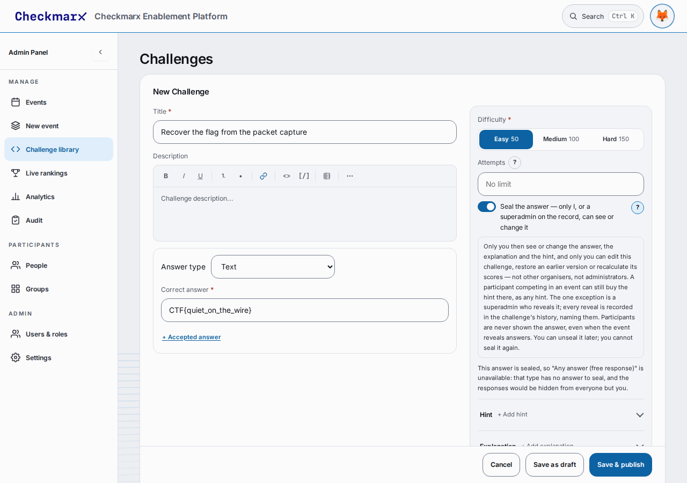

**Sealing needs an answer to seal, so it is unavailable on *Any answer (free
response)*.** That answer type accepts every response, so there is no answer for
a seal to protect — and sealing one would hide the responses themselves from
everyone but you, which is the opposite of what you collect them for. The form
gates it from both ends: choose that answer type and the seal checkbox is
disabled, tick the seal and that answer type is no longer offered, each with a
line saying why. The same applies on an existing sealed challenge — its answer
type can still be changed to any of the others, just not to that one.

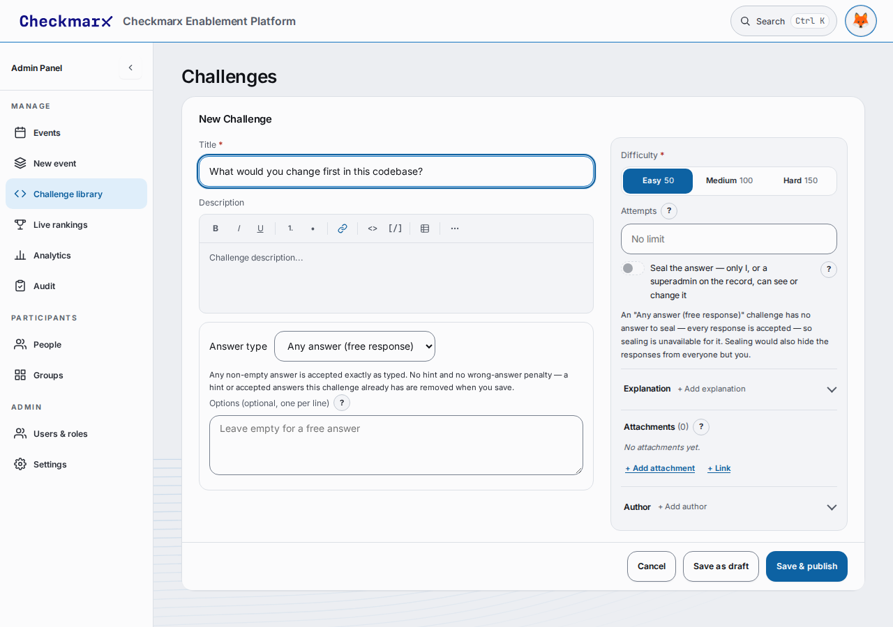

**The hint is sealed with the answer.** Wherever the answer
is withheld the hint is withheld too — the Challenges table, the editor (where
the hint box is hidden rather than shown empty, so a save cannot wipe it), the
preview, the History, the export and the reveal at the end of the event. A
participant who pays 30% of the challenge's points for the hint during the
event still receives it: that is what a hint is for, and a seal does not take
back something they bought. That is a *competing* participant's right, though,
not an administrator's: in your own Participant View you are offered a sealed
challenge's hint only if you are competing in the event, since a hint bought by
somebody who is not on the board would be a free read of a sealed field; and
while you impersonate a participant who paid for it you see *Hint withheld*
where it would be. On a multiple-choice challenge the option **text**
stays visible — that is the question. What is hidden is which of the options
are correct.

**What everybody else gets instead.** Wherever the answer would normally
appear, {{platformName}} withholds it:

- the **Challenges** table, and everything the admin screens build from it;
- the **editor** — there is no **Edit** entry on the row for anybody else,
  and a form reached some other way has an empty Correct Answer box, no hint
  box at all, every field read-only (the text boxes' formatting buttons
  switched off under a line saying why) and no Save button;
- **View as Participant** — the Solution box carries a short note in place of
  the answer, and the hint block says it is withheld rather than showing
  nothing;
- **History** — *every* snapshot in the version log is redacted, not only
  the most recent, so the log cannot be read backwards for the answer;
- the **JSON export** — the answer and explanation come out empty, the hint
  is marked withheld, and the challenge is marked as sealed;
- **Submissions** — an answer somebody submitted to a sealed challenge shows
  as sealed rather than as text, and the search box will not match it either,
  so the stream cannot be used to confirm a guess;
- the **event log and the History entries** — an edit is recorded as
  *(sealed answer changed…)* rather than as the old and the new values, so
  the answer never reaches the log files on disk;
- the **answer reveal at the end of the event**, below.

**Only you can change it — you, or a superadmin who has revealed it.**
Editing the challenge, restoring an earlier version of it and recalculating
its scores are all refused for everybody else. Sealing narrows *who* may do
those things; it never grants you a right you would not otherwise have. You
still need whatever the action normally takes — recalculating scores is a
superadmin job either way, a restore has to clear the usual checks, and a
finished session freezes the scoring fields for you exactly as it does for
anyone else.

**Publishing, hiding and tagging go with it.** Those three change the
challenge as surely as editing it does — publishing or hiding one moves what
every event holding it counts as solved — so on a sealed challenge they are
the author's alone too (or a superadmin's, once they have revealed it), and
the row simply does not offer them to anybody else. Attachments follow,
because they are managed inside the editor. What
stays open to everyone who can see the row is the *use* of it: assigning it
to their own events, taking their own assignment back, granting attempts,
reading its History, lock and unlock — and a superadmin can still delete it.
So a sealed challenge is never stranded in somebody's event: they can
unassign it without its author, and a superadmin can remove it outright.

**A sealed challenge is left out of the answer reveal.** Even on an event
with *Reveal correct answers and explanations once the event ends* ticked,
participants see *Answer not shown* on a sealed challenge, together with the
reason. Its explanation is not shown either, nor its hint (a hint a
participant paid for during the event stays theirs) — so if there is
something a participant is meant to take away afterwards, write it into the
challenge description rather than into the explanation.

**Sealing is a one-way door.** You can only choose it while the challenge is
being created; there is no way to seal one that already exists, and
{{platformName}} refuses if you try. You can **unseal** it later — the editor
offers *Unseal this answer when I save*, to you and to a superadmin who has
revealed the answer — and once you have, that challenge can never be sealed
again. The reason is honest rather than technical: the
answer has already been readable by administrators, and ticking a box cannot
take that back. The one time the editor withholds that tick is while the
challenge sits in an event where staff compete, which admits sealed challenges
only — see [Letting staff compete](#letting-staff-compete) for what the note in
its place says and when the challenge can be taken out.

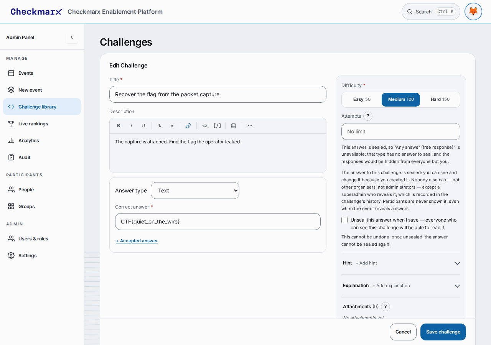

**The built-in superadmin account cannot seal a challenge.** It has no user
record behind it, so there would be no author — the challenge would end up
readable and editable by nobody at all, for ever. The create is refused with
that explanation. Sign in as a named admin account and create it from there.

**Sealed challenges do not migrate.** The challenge import refuses any row
marked as sealed, because an imported challenge would have no author on the
receiving platform — and it refuses it whoever exported the file, your own
export included. The import summary counts those rows as refused, so you know
how many to recreate. Create a sealed challenge fresh on the new platform
instead. An import cannot overwrite somebody else's sealed challenge either,
nor make any sealed challenge, your own included, an **Any answer** challenge
(which has no answer to seal): the summary counts those as not overwritten.

A **Sealed** badge appears in the Status column of the Challenges table for
everyone who can see the row, you included, so it is plain at a glance which
challenges are sealed and which are not.

#### A superadmin can reveal it, on the record

A superadmin is the one person besides you who can read a sealed answer, and
they cannot do it quietly. On a sealed challenge you created, their row menu
offers **Reveal sealed answer**, and the read-only editor a button reading
**Reveal sealed answer and hint**; either opens a confirmation that says the
reveal will be recorded before they press **Reveal and record**. From then on,
for the rest of their session, they see the answer, the explanation and the
hint as you do and can edit, restore, recalculate and unseal the challenge as
you can. The reveal is written into the challenge's **History** as a *Record*
row — a sentence saying which of the sealed answer, explanation and hint (the
ones the challenge has) were revealed to a superadmin, with their name in the
By column and, if they were looking through an organiser's impersonated panel,
whose view they were in — and into the event log. It lasts only for that session: signing out, switching between Admin View
and Participant View, signing in elsewhere, or entering or leaving an impersonation ends it, and a
later reveal is a new record. The record comes first: wherever a sealed answer
or hint would be shown to a superadmin — through the reveal, or in their own
participant view — it is shown only once the record has been written, and if it
cannot be written nothing is shown. A superadmin competing in an event that holds
the challenge cannot reveal it at all, because a competitor may not read the
key of a challenge they are competing on. The [Superadmin
guide](superadmin.md#sealed-answers) describes it from their side.

**What sealing does not do.** It does not hide the challenge, its title or its
description — to a participant a sealed challenge looks and behaves exactly
like any other during the event, the hint they can buy included; only the
reveal at the end leaves the hint out. It does not hide who solved it or what
they scored. And anyone with direct access to the server's database or to its
backups can still read the answer: this is a control over {{platformName}}'s
own screens and exports, not encryption at rest. Treat it as a way of keeping
an answer out of the organising team's ordinary view, not as a secret store.

### Once a session has finished, the challenge is frozen

When any session of an event has ended, that event's results are
final — so {{platformName}} refuses every change to its challenges (the event's
own copies) that could move them. That covers editing the answer, the answer type or the difficulty,
**publishing or unpublishing**, **hiding or showing**, deleting, and overwriting
the challenge through an import (which skips it and tells you how many were
skipped).

It is worth knowing *why* hiding counts, because it is not obvious: a hidden
challenge stops counting toward the total needed for "solved everything". Hide
one after the event and participants who never finished are suddenly recorded as
having finished — which changes the tie-break, and so the final places, without
changing a single point.

If you genuinely need the challenge out of a finished event, the
event has to be **reopened first** — which is a superadmin action, and for
a multi-session event means reopening *every* finished session, not just
one. Unassigning is refused while the freeze holds, so it is not a way round it.
Everything else about the challenge stays editable — its title, description,
hint, explanation and attachments are not scoring fields.

**Recalculating** is the one exception, and it is scoped rather than blocked: it
re-grades the events that are still open and leaves finished ones exactly
as they are, telling you how many submissions it skipped for that reason. So you
can still fix a mis-typed answer for a live event even when the same challenge
was used at an earlier one.

**A sealed answer is a separate restriction, and it stacks with the freeze.**
A challenge created with its answer sealed can only be edited, restored or
recalculated by the author who sealed it — or by a superadmin who has revealed
it, on the record — whether or not any session has finished; and the freeze
above still applies to them like anyone else, so once a session has ended
they cannot change its scoring fields either. See [Sealing a challenge
answer](#sealing-a-challenge-answer).

### Categories

Tags are normally an admin-only device — participants never see them, which is
what makes them safe for workflow labels like `needs-review` or an author's
name. **Categories are the one exception**, and they are opt-in per tag.

Tag a challenge **`category:<name>`** and participants will see *<name>* on that
challenge — on its card in the challenge grid, and again when they open it.

```
category:web          →  participants see    web
category:crypto       →  participants see    crypto
category:web security →  participants see    web security
```

A challenge can carry as many as you like; each appears as its own label. A
challenge with none looks exactly as it always has.

**Things worth knowing**

- **It is an ordinary tag.** Add and remove it the same way, from the same
  dialog. It shows in the tag column, narrows the challenge search, feeds the
  Analytics tag filter, and survives export/import — because it *is* just a tag
  with an agreed name.
- **Only the part after the colon is shown.** Participants never see the word
  "category", the prefix, or any of your other tags.
- **Tags are stored in lower case**, so `category:Web` and `category:web` are
  the same tag and both display as *web*.
- **`category:` on its own does nothing** — a category with no name is ignored
  rather than shown as an empty label.
- **Nothing else changes.** Categories do not affect scoring, ordering,
  visibility or the leaderboard. They are a label, and only a label.

There is no separate list of categories to maintain: the set of categories is
simply whichever `category:` tags exist. To rename one, remove the old tag and
add the new one; to retire one, remove it from the challenges that carry it.

#### The shared pool: `public-domain`

One other tag changes behaviour rather than describing the challenge. Tag a
challenge **`public-domain`** and every **event admin** on the platform may use
it in their own events, even though they did not create it and none of their
events holds it yet. Without the tag an event admin sees only challenges they
created and challenges one of their events already uses, so this is how you
publish a challenge to the shared pool. Participants never see it — it behaves
like any other private tag to them.

**Add it from the `+ tag` control rather than typing it.** The Add Tag dialog
offers `public-domain` as a one-click chip with the explanation beside it,
because the exact spelling is what does the work: **`public domain` with a space
is an ordinary descriptive tag and grants nothing.** It is deliberately not
treated as the same thing — a challenge somebody labelled "public domain" as a
note to themselves should not silently become visible to every organiser on the
platform. Casing does not matter, because tags are stored in lower case.

**Type one of those spellings and the platform now refuses it**, and tells you the
reserved one. Before, it accepted the tag, showed it on the challenge, and shared
nothing — which is indistinguishable from a broken feature and was reported as one
twice. The refusal covers every near miss, including the ones you cannot see: a
non-breaking space, a soft hyphen or a zero-width space pasted from a document
renders *identically* to `public-domain` on screen and would have shared nothing.
The trade is that `public domain` is no longer available as an ordinary
descriptive label; use different words if you meant it literally.

**A challenge in the shared pool is badged `Shared`** in the Status column of the
Challenges table, so you can see at a glance which of your challenges other
organisers can use — without scrolling the table sideways to the Tags column.

**A challenge that already carries one shows a warning triangle and a Fix link**
in its Tags column. Fix applies the real `public-domain` and removes the inert
tag; it asks first, because it puts the challenge in front of every organiser on
the platform.

Remove the tag and the access goes with it, except for events that have already
assigned the challenge — those keep it, as they would any challenge they hold.

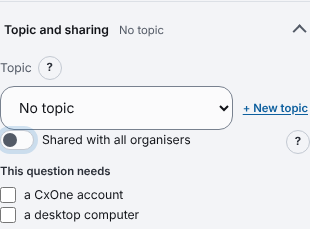

New challenges start as **Draft** — fully editable but invisible to
participants and left out of event assignments. Publish when the
content is ready. When a challenge is assigned to a live event it's
numbered automatically (`1.01`, `1.02`, … grouped by difficulty); numbers
already assigned never change.

### Previewing a challenge as a participant

A row's **View** button (or **View as Participant** in the three-dot menu)
shows the exact view a participant gets after the event ends — hint,
correct answer, and explanation all revealed. For a Text challenge with several
accepted answers the Correct Answer line lists them all, separated by ` | `. An
**Any answer** challenge has neither a hint nor an answer to reveal, so its
preview says *any answer is accepted* in the header and shows a short note in
their place.

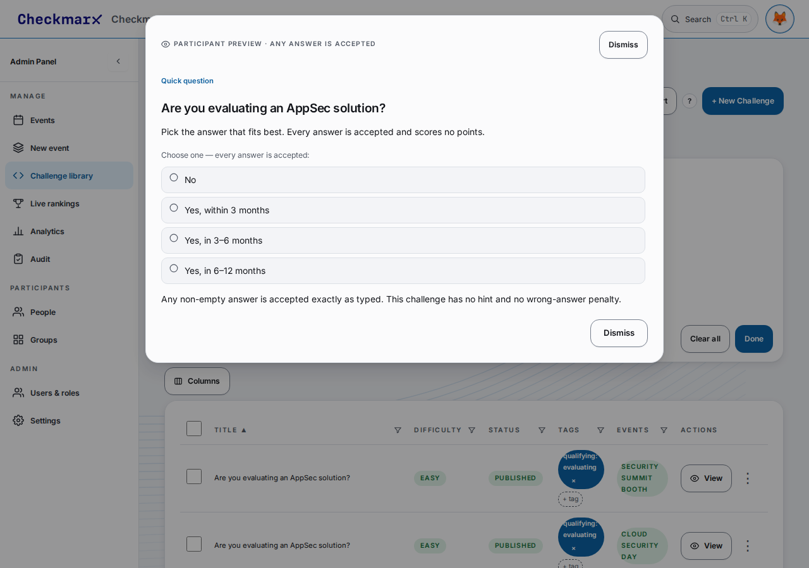

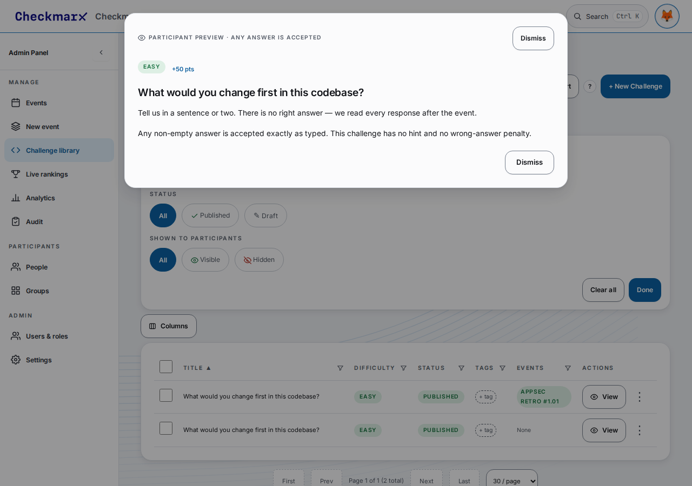

On a challenge whose answer is **sealed**, the preview shows no correct
answer, no explanation and no hint unless you are the author who sealed it or
a superadmin who has revealed it — the Solution box and the hint block each
carry a short note in their place. See
[Sealing a challenge answer](#sealing-a-challenge-answer).

Use it to sanity-check formatting and confirm the answer matches your
grading rules. The preview never counts as a submission and has no side
effects.

### Assigning a challenge to events

From the Challenges tab's three-dot menu, **Assign to Events** picks
one or more events for the current challenge.

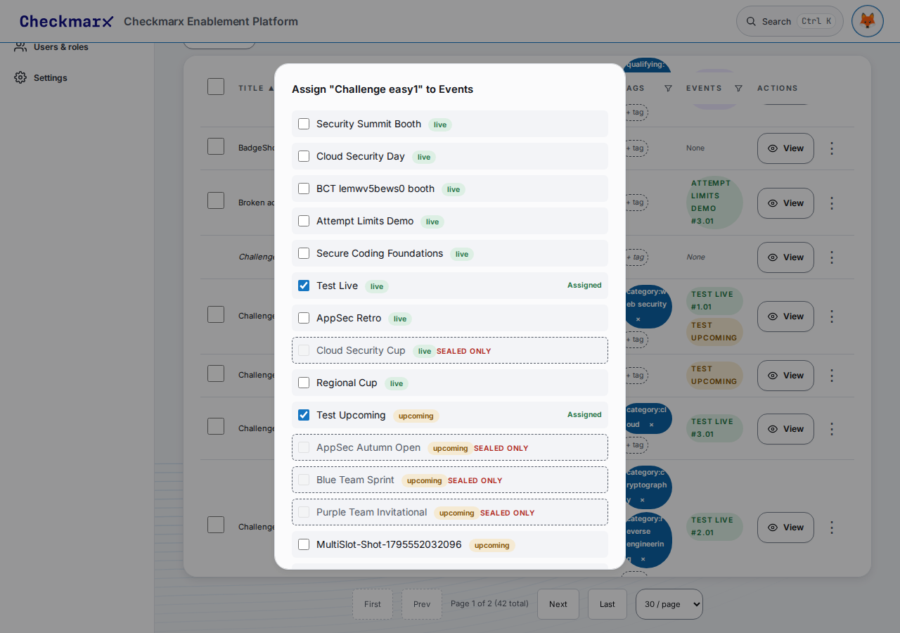

Events that already have this challenge are pre-checked; ticking another event
gives that event its own copy, and unchecking removes the event's copy from it. Ended events are hidden — their assignments are frozen. An event
where staff compete is also disabled for an unsealed challenge (*Sealed only*),
and one you are competing in is disabled outright (*You compete here*) — see
[Letting staff compete](#letting-staff-compete). For a qualifying question, an
event that already asks a question on its topic is disabled too (*Topic already
asked*): an event asks each one once (see [Event team and lead
reports](#event-team-and-lead-reports)).

### Bulk-adding challenges to events

To add **several challenges at once**, tick the checkbox at the start of each
published challenge's row (or the header checkbox to select the whole page — only
published challenges are selectable). An **Assign to Events** button then
appears at the top of the tab **and** in a bar at the bottom (either works):

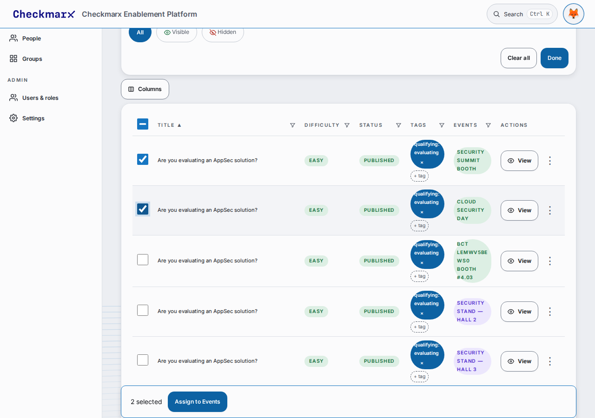

- If you are in an **event's workspace** (see [The event workspace](#the-event-workspace)), the button assigns the selected challenges straight to it — and challenges **already in** that event don't show a checkbox (nothing to add). The moment you tick a challenge, the open event's **+ Add Challenges** picker button gives way to **Assign to Events**, so you only ever see one — clear the selection to bring the picker back.
- Otherwise it opens a picker to choose one or more events.

Assignments are best-effort: drafts, and any challenge already in a chosen
event, are skipped, and ended events are left out — the toast tells
you what went in and what was skipped. A challenge a Booth Event cannot use is
skipped too, but the bulk toast does not name it — so if the count comes back
lower than you expected with no reason listed, open that challenge's own
**Assign to Events** dialog, which names the challenge, says what the objection is — a file answer,
or a `needs:` tag — and names the kind of event that refuses it. It stops short
of naming the event itself, so with two Booth Events ticked you may have to try
them one at a time. On an event that lets staff compete, a challenge whose
answer is not sealed or whose author competes there is skipped as well — the
toast counts those too, and a dialog names them — and an event you are
competing in yourself is greyed out, with a dashed outline, in the picker as *You compete here* (see [Letting staff
compete](#letting-staff-compete)). A qualifying question on a topic the event
already asks is skipped as well, and counted in the toast. The bulk flow here is the challenge-side
mirror of the Participants tab's bulk **Assign to Events**.

### Challenge history

Every **Save** creates a version snapshot, as do publish, visibility toggle,
lock/unlock, tag changes, restore, and import. Open **History** to see each
version with its time, the admin who made the change, and what changed.

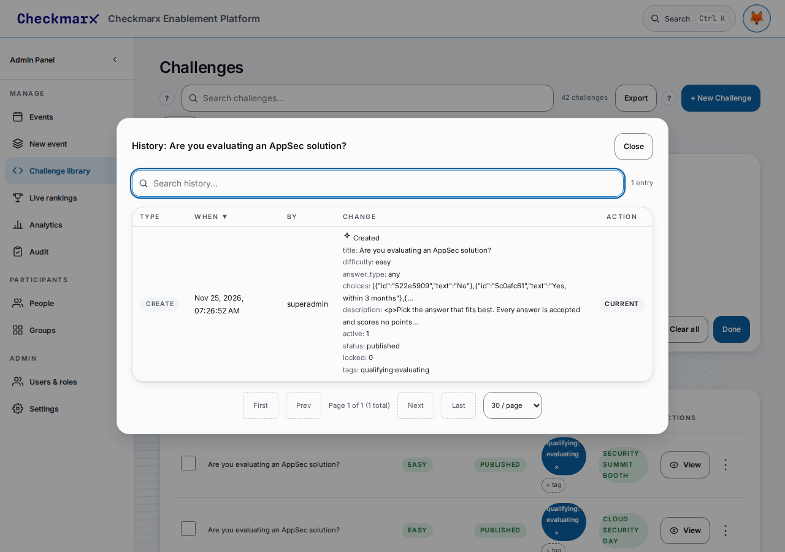

**Restore** rolls a challenge back to a snapshot (itself recorded as a new
entry).

On a challenge with a **sealed** answer every snapshot in the version log is
redacted for everybody but the author (or a superadmin who has revealed it),
and only they can restore one. A superadmin's reveal appears in this log as a
*Record* row — a sentence saying which of the sealed answer, explanation and
hint were revealed to a superadmin, their name in the By column and, when they
were impersonating, whose view they were in — rather than as a version of the
challenge: it has no Restore, never counts as the current version and is never
diffed against. The person whose view it was is named only to a reader who
could see that person anyway; an event admin who shares the challenge but not
an event with them reads *an account outside your events* instead, with no
mention of which view it was. Once that account is deleted, every reader sees
*an account that has since been deleted*.
See [Sealing a challenge answer](#sealing-a-challenge-answer).

---

## Participants

The **People** page (in the sidebar) lists every registered user with their
status (unconfirmed / pending / denied / confirmed / blocked / locked), tags,
event memberships, and recent activity. **Filters** opens the status chips, which
are **multi-select** — combine them (e.g. Pending + Denied to triage everyone
awaiting a decision).

The toolbar holds **Invite** (the one primary button), **At the desk** (see [At
the desk](#at-the-desk)), one **Export ▾** menu (**Export CSV**, **Export JSON**
and, for a superadmin or a custom role given the import permission, **Import
JSON**) and **Columns**. The table shows six
columns by default — **Participant**, **Company**, **Status**, **Score**, **Last
active** and the row's actions; **Columns** adds any of the others (email, title,
location, source, registered, approved and by whom, invited and by whom, role,
first sign-in, events, tags, groups). Your choice is kept in this browser.

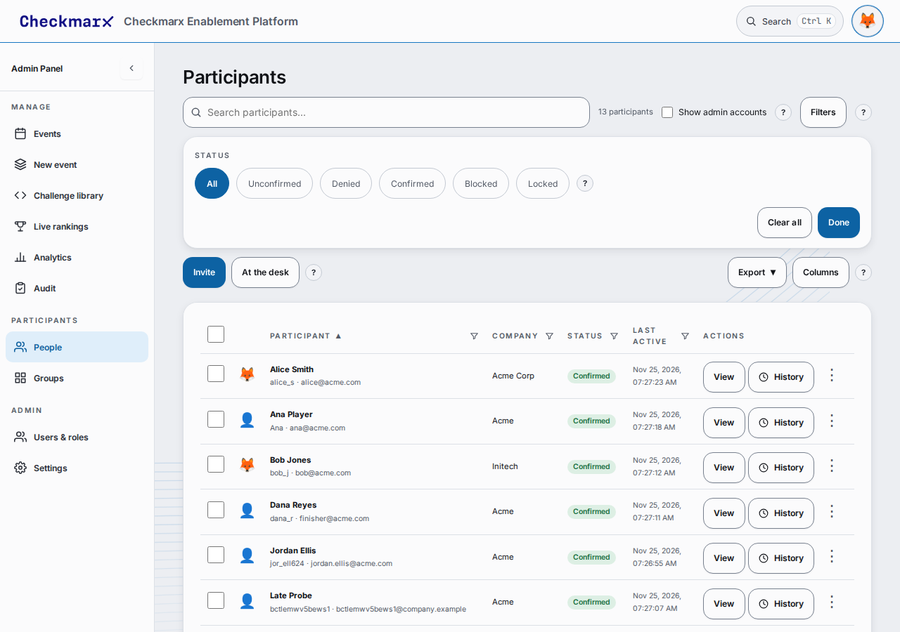

**Inside an event, Participants lists only the event's own people**, and the
count says how many are shown. Tick **Search everyone on the platform** to list
every account instead, still paged and searchable; each approved person not yet
in the event gets an **Add to event** button, so you can add somebody without
leaving the event. A person waiting for approval, or blocked, keeps **Approve**
or **Unblock** instead: no event can take them until then. Untick it to narrow
back. On a multi-session event, rows for people in a different session are
dimmed.

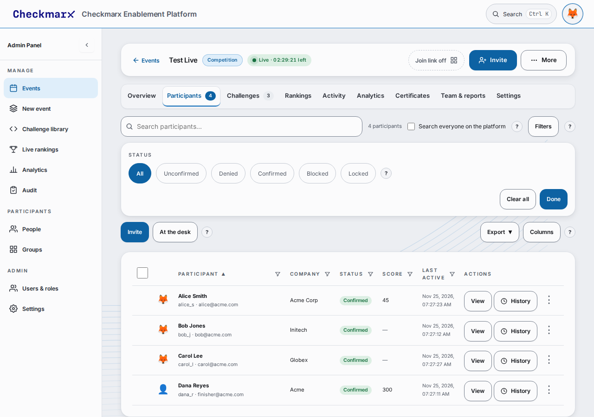

**View** on a row (or **View profile** at the top of its three-dot menu) opens a
compact, read-only profile card: the person's name, nickname and role, their
state (confirmed, verified, approved, blocked, locked), work and location with
their local time, every email address including a change still waiting for
confirmation, phone and LinkedIn when given, tags and groups, their events with
each one's status (and, inside an open event, its score), the certificates they
hold (from ended events, and from a Program while it runs; the six most recent
such events are checked, and the card says so when there are more; a role
without the **See and download certificates, preview designs** permission sees
none), and when they joined, last signed in and who approved them. Its buttons are
the row's own: **Edit profile**, **History**, and **Impersonate** where the row
offers it. An event admin's card lists only the events they organise. On a phone
it opens as a sheet from the bottom of the screen.

From this tab you can:
- Approve, **deny**, block, unlock, or **Email sign-in code**. Approval needs
  the account verified, not blocked, and not locked — if one of those is in
  the way, the row's button offers **Unlock** / **Unblock** first. Marking an
  unverified account **Verified** is a superadmin-only action.

> **"X emails sent" can be provisional.** On a large bulk assign or bulk
> approve, {{platformName}} commits the change first and keeps sending
> notifications in the background. When that happens the confirmation adds
> *"Some emails are still sending — that count is not final."* The assignment
> or approval itself is already saved, so **do not re-run the action to "make
> sure"** — that would send everyone a second copy. A large **invite** works
> the same way but does not say so, so treat its email count as provisional
> too. If you need to confirm delivery, check **Raw logs** on the **Audit** page a minute later.
>
> **One person's email says what happened to it.** **Approve**, **Deny
> Approval**, **Unlock** and **Email sign-in code** each wait a few seconds for
> their one email and tell you whether it was sent, could not be sent, or is
> still being sent. "Could not be sent" after **Email sign-in code** means
> nobody received that code: press it again — a new code goes at once — or, for
> someone who has never signed in, use **Show sign-in code** at the desk. "Still being sent" means the change is saved
> and the email will follow, so do not press it again.

> **What a waiting participant actually sees at sign-in.** A new account is
> approved when it is created (its address was just proven by a code), so the
> approval queue is normally empty. If a superadmin has turned on **Require admin
> approval for new accounts**, a new account waits and the person sees a Pending
> Approval screen, except one that arrives through an open event's join link, QR
> code or event code (its code typed in the browser that asked for it, the link
> still open when the sign-up form is sent) or through an invitation from someone who may approve accounts, which is approved at once; a pending participant entering a correct code (or their correct password) later is told their
> account is waiting for approval; a wrong code or password says only that it was not
> accepted, so a stranger guessing at an address learns nothing.

### Denying applications

Use **Deny Approval** (in a row's menu) for applicants who shouldn't get
access — spam registrations, ineligible domains, off-topic accounts.
Denial emails the applicant that they weren't approved (you can add an
optional reason, included in the email) and blocks the account so they can't
log in. A denied or blocked account is sent no sign-in code — the request
silently does nothing — and a password does not sign it in either, so to restore
access, unblock or approve them first.

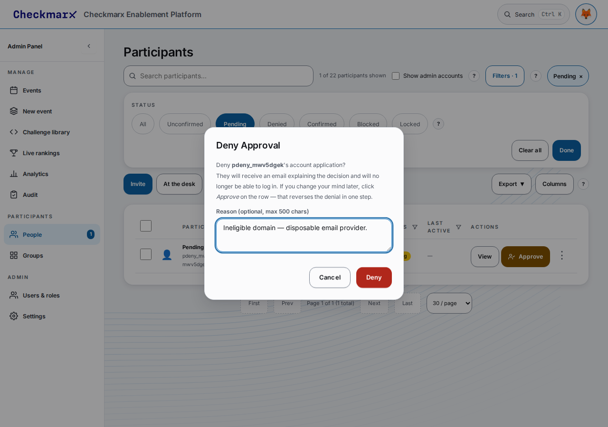

To reverse a denial, click **Approve (reverse denial)** on the row — it
unblocks and confirms them in one step, and they get the standard approval
email. If that account never verified its email — common for the spam
registrations this action exists for — approval is refused, and a superadmin
has to mark it **Verified** first. Once a participant is approved they can't be denied again; to cut off
a confirmed participant, use **Block** (reversible) or, for a superadmin,
**Delete**. **Blocking takes effect immediately, including on work already in
flight**: a file answer that was uploading when you pressed Block is refused
rather than graded, so it stores nothing and costs them no attempt. The same is
true of removing somebody from the event.

- Edit a participant's profile — name, company, work title, job
  function, city, LinkedIn URL, country, timezone, the optional salutation and
  phone, the optional **certificate name** (given + family), and both emails.
  A regular admin can only **fill in** an empty optional field; a superadmin
  can also overwrite or clear one. The **email** fields are the exception: on
  an ordinary participant a regular admin may change an address that is
  already filled in, because address corrections are routine support work. A
  note at the top of the dialog says which of those applies to you.
- Add or remove **tags**. Two carry meaning: **staff** (excluded from public
  leaderboards; can join any event without an assignment; auto-applied
  to admins — on an event that lets staff compete, a staff member who is
  *enrolled* is on the board like anyone else, while entering without enrolment
  is unchanged, see [Letting staff compete](#letting-staff-compete)) and
  **benchmark** (shown separately in the admin leaderboard).
- View a participant's full event history.
- **Remove from / re-add to an event** — submissions, hint reveals, and
  scores are kept, so a re-added participant returns with their original
  score. Once an event has ended nobody can be removed from it, except a late
  entrant (somebody who joined after it ended and had not started playing
  before then), while late entries are still open (see [Removing people during the
  window](#removing-people-during-the-window)). (Someone with no prior activity stays hidden from the leaderboard
  until they log in and enter the event, like a fresh assignment.)
- Select several pending participants and press **Approve** on the selection bar. It
  skips anyone the row's own **Approve** would refuse you, and the result counts
  each with its reason: someone you compete against in an event where
  staff compete, an account only a superadmin approves, and, for an organiser
  limited to some events, anyone not in one of them.
- **Export ▾ → Export CSV / Export JSON** (CSV for spreadsheet review, JSON for
  a complete backup you can re-import exactly — importing takes the import
  permission, which a superadmin holds and only a superadmin can give).
  **Export CSV** writes the people the list shows — every page of them, in the
  list's order, after the search box, the status filters and the column filters
  (and, with an event open, its people, or everyone the list shows once **Search
  everyone on the platform** is ticked; the button names the event only while
  the list holds just its people). **Export people (CSV)** in **Search** opens
  this list first and saves what it shows. When nobody matches it says so
  instead of saving an empty file. **Columns** changes only what the table shows: the
  file always carries every column. Sensitive
  fields — passwords, verification codes and sign-in codes — are never exported,
  and neither is how each person signs in.
  **With an event open**, the CSV also carries one **Response:** column per
  **Any answer** challenge in that event — headed *Response:* followed by the
  challenge's number and title — holding each participant's most recent response
  (blank for anyone who has not answered). Spacing and case are kept as typed;
  the one change is the protection every other free-text cell in the file gets:
  a response starting with `=`, `+`, `-` or `@` is written with a leading
  apostrophe so a spreadsheet reads it as text rather than as a formula. If
  those responses cannot be loaded the export is cancelled with a message rather
  than saved without them. A challenge whose answer is **sealed** gets no
  column at all unless you are the author who sealed it, or a superadmin who
  has revealed it — dropped outright rather than left as a column of blanks,
  which would read as nobody having answered (see [Sealing a challenge
  answer](#sealing-a-challenge-answer)).

> **Import note.** Memberships are matched by **event name**, so an
> export from one server can be imported to another. Any membership whose
> event doesn't exist on the target is reported back, not silently
> dropped.
- **Invite** new participants by email — the **Invite** button on the toolbar
  opens the bulk-invite dialog.

### Inviting participants

Click **Invite**, paste one email per line, and optionally tick events
to auto-assign new accounts on acceptance (an event admin must tick at least
one of their own events — see [Inviting people](event-admin.md#inviting-people)
in the Event admin guide). Existing matching users are
assigned immediately; new emails get an invitation with a signup link. A
personal address (Gmail, Outlook and similar) can start an account only through
that link, so tell such an invitee to open the email rather than type their
address on the sign-in screen. An
account is matched by its **primary** address only: an address that is another
account's **secondary** email is refused and listed in the result, with nothing
sent and nobody enrolled — invite the person by the address they sign in with.
A secondary address is an unconfirmed claim anyone can type into their profile,
so it never signs in, claims an invitation or receives a role.
The dialog lists live and upcoming events, and a Booth Event that has ended but
is still taking [late entries](#late-entries), each badged with where it is
(**Live**, **Upcoming**, **Late entry open**). Tick a late-entry event and a note
says what that means: existing accounts join it as **late entrants**, and a new
invitee joins as one if they register before its late-entry deadline.

> **Inviting an existing account can approve it.** If the address already
> belongs to a *Pending* account — email verified, waiting on your decision —
> the invitation **approves it** and assigns it to the ticked events, so
> you do not have to approve it first. This needs the right to approve
> accounts: if your role may invite but not approve, the account stays
> *Pending* and the result counts it as left unapproved — as it does for an
> account only a superadmin may approve (an admin's, or one whose role can do
> something yours cannot). An account that is blocked or denied is
> left alone; so is one that has not verified its email, or that is locked out
> after too many failed sign-ins, because {{platformName}} will not approve
> those for you. Verify or unlock them, then invite again. An address that
> belongs to a `staff`-tagged account is skipped as well unless the ticked event
> lets staff compete (see [Letting staff compete](#letting-staff-compete)), and
> on an event that does, an admin's address is skipped unless you are a
> superadmin or it is your own, and so is the author of a challenge in that
> event. An organiser limited to some events approves only an account their
> invitation puts into one of those events: if every ticked event skipped it
> (for one of the reasons below), it stays *Pending*, its address stays in the
> box, and the result says it was left waiting for an administrator to approve.
> Their invitation never approves an organiser's or an administrator's account.
> The
> confirmation counts what was invited and assigned **and** what was skipped,
> with the reason for each — blocked, unapproved, staff on an event where staff
> do not compete, an admin account only a superadmin can enrol, a challenge
> author, or somebody who took part in a late-entry event before it ended — and
> an address skipped for one of those reasons is not counted among
> the "already assigned". An admin's address is likewise left out of any group
> you ticked unless you are a superadmin or it is your own, and the
> confirmation counts that separately.

> **An invitation from a role that cannot approve accounts.** While **Require
> admin approval for new accounts** is on, somebody new who signs up through an
> invitation from such a role (a custom role without **Approve and deny
> accounts**, or an inviter who has since lost that permission or whose account
> is gone, blocked or denied) waits for
> approval, and the **Invite** dialog says so to that role. Until an
> administrator approves them they join none of the invited events or groups;
> **People** lists them as *Pending* to administrators and to the organisers of
> the events the invitation names, with **Invited to “…”: waiting for an
> administrator's approval** under the badge, and an organiser limited to their
> own events sees only those events named, with nothing to do on the row but
> **View**. Only an administrator can approve them; once approved, they join the
> invited events and groups the first time they sign in with an emailed code. If
> someone who may approve accounts invites the same address again before then,
> the invitation becomes theirs and the newcomer is approved when they sign up.

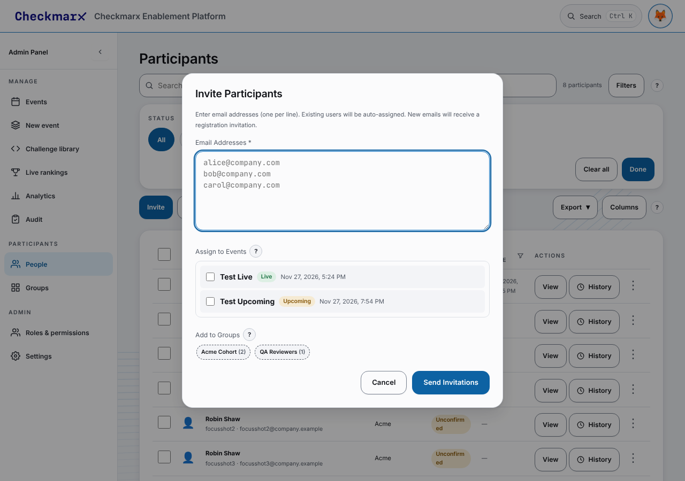

### Searching and filtering

Every list tab (Events, Challenges, Participants, Submissions, Logs)
has a search box at the top. Type and the table narrows live — no Enter, no
Apply button. Click **× Clear** to reset.

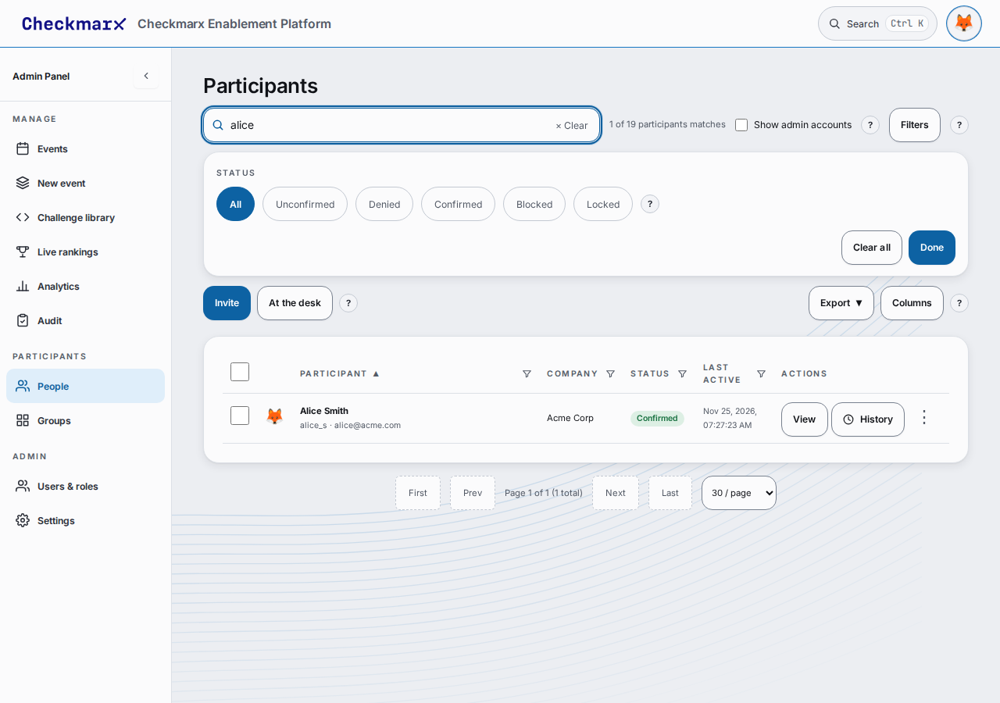

**Beside every search box is a count of what matched** — "3 of 128
participants match" — so you never have to judge from the length of a list
whether your search did anything. With the box empty it shows the size of the
list; when nothing matches it says so in words. The same count appears in the
filter boxes inside dialogs, such as the group **Members** picker and the
group-to-event binder.

Two counts are deliberately more careful than a plain number, because a
confident-looking figure that is only telling you half the story is worse than
no figure at all:

- **Logs** shows a **`+`** (for example "200+ entries match"). The platform
  stops counting once it has walked far enough back through the log files, so
  the number is a floor, not a total.
- **Unsubscribed addresses** loads at most the 1000 most recent, and its count
  says the search covers only those — an address missing from the results may
  still be unsubscribed.

Search is plain, case-insensitive, and matches anywhere in the text, with no
wildcards or operators — whatever you type is matched literally, except on
**Challenges**, where each word is matched on its own and a challenge must match
every word (`web hard` finds a hard challenge tagged `web`). What's searched
depends on the tab:

- **Participants** — name, nickname, both emails, company and work title. It
  also matches **tags**, **group** names and **event** names, plus
  status, role, country, timezone, how they registered and who approved or
  invited them — so `staff`, `pending`, or the name of an event all work as
  search terms.
- **Events** — the name, the event's tags and its sessions' names.
- **Challenges** — the title, difficulty and tags (`web` finds the category
  `category:web`), the answer type, the status, the author, who last changed
  it, and the names of the events it is in.
- **Submissions** — participant, challenge, answer text, event/session,
  and **Activity** type (correct / wrong / hint).
- **Logs** — anything in the entry, including participant names and emails
  (so `alice@acme.com` finds all her activity).

Combine text with the chips under **Filters** beside the box (All / Pending / …
on People, Status and Type on Events, difficulty tiers and Published / Draft in
the Challenge library) to narrow by both text and category at once. Submissions
has no chips, only its search box.

### Editing a profile

The Edit Profile dialog updates any non-locked field on the selected
participant.

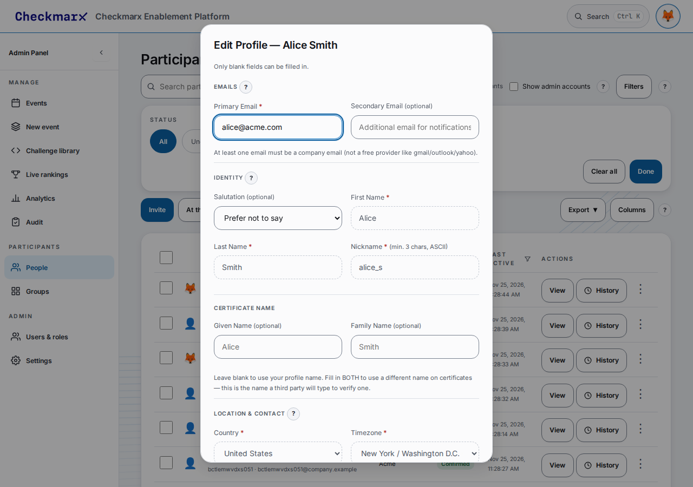

Any **LinkedIn URL** must be a valid web address; invalid values are rejected
on save and the field is highlighted. A note at the top of the dialog says what
you may change — *All fields are editable*, *Only blank fields can be filled
in*, or *Read-only view*. Both Cancel and Save check for changes: an untouched form closes
without prompting; a changed one asks you to confirm. **This dialog shows the
same fields, in the same order, as the participant's own profile editor** — only
what you are allowed to change differs.

**If somebody else changes the same profile while your dialog is open, your
save is refused rather than quietly overwriting theirs.** You are told the
profile changed and asked to reload; reopen the dialog and your edit goes on top
of theirs. The check is only about the profile fields — the participant signing
in, joining an event or being approved in the meantime does not disturb your open
dialog.

**Avatar.** At the bottom of the dialog you can set the participant's avatar:
pick one of the characters or upload a picture (it is scaled down in the browser
before it is sent). It follows the same rule as every other field — as an admin
you can set an avatar for someone who has never chosen one, but only a
superadmin can replace one they picked themselves. When it is locked, a note
under the control says why.

**Certificate name.** The *Given Name* and *Family Name* under **Certificate
name** are optional and matter only for certificates: filled in as a pair they
replace the participant's profile name on every certificate they are issued, and
the family part is the surname a third party types on the public verification
page. Fill in both or neither — a half-filled pair is ignored. This is the field
to correct when someone tells you their certificate names them wrongly. A
certificate prints a Chinese, Japanese or Korean name family name first, with no
space (张伟), from either pair, and a verifier may type that whole name (without
the salutation) or its family part (张), never the given part alone; it leaves off a salutation it cannot print with
the name (a **Dr.** before an Arabic, Hebrew or Thai name), and prints the
nickname for a name it cannot print at all (a Devanagari name, or Latin letters
within an Arabic, Hebrew or Thai one). A certificate already issued with the
nickname keeps printing it, because its verification matches the nickname,
until the name it would print is written in Latin, Greek or Cyrillic letters: on
such a certificate a Certificate name in another script does not take effect.

**Changing the primary email REQUESTS a change; it does not make one.** When you
save, {{platformName}} emails a 48-hour *Confirm New Email Address* link to the
**new** address only, and nothing else moves: the participant keeps their current
address, keeps their verified status, and stays signed in. The address swaps the
moment they open that link. Until then the dialog shows the change as waiting,
so you can tell a save that worked from one that did not.

This is safe to do mid-event — that is the point of it. If the confirmation
email cannot be delivered you are told so, and the request simply stays waiting
(or expires after 48 hours); nothing about the account has changed, so there is
nothing to undo. Saving a different address replaces the waiting one.

**It is a correction, not a way to take an account back.** Because the old
address stays live until the participant confirms, editing the email does not
lock out whoever holds that old mailbox — and it does not cancel an
outstanding sign-in code, which stops working when the
change is confirmed. If you need to act immediately, use **Block** (stops access
at once). Changing the participant's **secondary** address
still applies straight away, and does cancel a live sign-in code on save.

**A password and the way someone signs in are theirs alone.** This dialog never
shows or changes them, whatever your role: each person chooses under their own
**Profile → How you sign in**. Someone who has forgotten their password needs
nothing from you — **Email me a code instead** on the sign-in card always works,
and within ten minutes of signing in with an emailed code they can set a new
password without the old one (a code you read out at the desk does not count). Only the **primary** address signs in; the secondary
address receives copies of some notices but never a code.

### Making somebody an event admin

An **event admin** is an organiser of *specific events*. Inside one of their
events they can do everything you can; outside them they see nothing at all. It
is the right role for a colleague running one stand at a conference, or a partner
running their own track, when you do not want to hand them the whole platform.

To grant it, open the event and use its Overview's **Organisers** card: type part
of the person's name, nickname or email under **Add an organiser** and press their
result (at most eight are shown; type more to narrow, and the card says when there
are more matches), then **Make organiser** to confirm: for a participant it says
that their account becomes an event admin, which signs them out everywhere and
takes them off every leaderboard. A role that may add organisers but not search
people is told so and offered **Remove** only. Administrators are not offered — they already run every event.
Each organiser on the card has **Remove**, which asks first. You can also choose
**Make event admin** on the participant's row with the event open. Their role changes to **Event admin** and their row badges the
events they organise, in the same colours the Events column beside it uses.

**Only current events are badged** — live, upcoming, and any still inside a late
entry window. Finished events are left out on purpose: on a platform that has run
for a while they are the bulk of anybody's list, and they would crowd out the two
you can still act on. An organiser with nothing current shows the **Event admin**
badge and no events, whether their events have finished or they have none — the
role is still theirs either way, and their full history is in the participant's
own History dialog.

Clicking a badge opens that event, exactly as it does in the Events column.

You can also see an event's organisers from the event's own row menu, under
**Organisers**; adding and removing them is done on the Overview's Organisers card
or from the participant's row.

Granting and revoking are **admin and superadmin only** — an event admin cannot
make another one, which is what stops the role spreading on its own.

**Removing their last event does not remove the role.** They stay an event admin
with nothing in scope: every list they open is empty and every action is refused.
That is deliberate — taking the role away is a *superadmin* action, and it would
be wrong for a revoke to perform one as a side effect. To remove the role
outright, a superadmin sets their role back to **Participant**, which also clears
every event they organised.

A few things an event admin can never do, however many events they organise:
create or delete an event, change anybody's role, import data, or open Logs,
Settings, Alerts or platform metrics. They also never appear on a leaderboard —
unless they are enrolled in an event that lets staff compete, where they are
ranked, and locked out of editing it, like any other competitor (see [Letting
staff compete](#letting-staff-compete)).

The full picture is in the [Event admin guide](event-admin.md), which is what
they see when they open help. To see their panel exactly as they see it,
**Impersonate** them from their row and pick their admin view — see
[Impersonating an event admin](#impersonating-an-event-admin).

### What you can do to another admin

Most row actions apply to ordinary participants. On an **admin** or **superadmin**
row, an admin sees a much shorter menu — just **View Profile** and **History** —
with a note saying so:

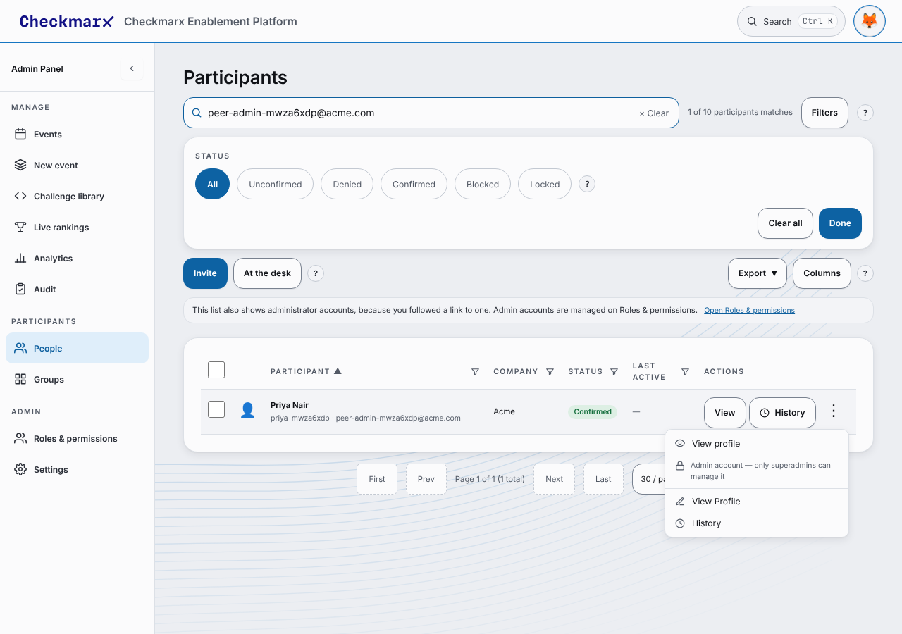

This is deliberate, not a fault. Blocking, emailing a sign-in code, changing a role,
deleting and editing a profile are all reserved for superadmins when the target
is itself an admin. It stops one admin locking a colleague out
mid-event or taking over their account, and it's enforced by {{platformName}}
itself — an admin who bypassed the menu would still be refused. The same holds
for an account with a custom role from **Roles & permissions** that covers every
event, and for one whose role can do something your own role cannot: it gets
the same short menu.

**Impersonating an admin or superadmin is refused for everyone, superadmins
included**, and so is impersonating an account with a custom role from **Users &
roles**: its menu has no **Impersonate** and says why. If you need to act on
another admin's account, ask a superadmin. An
**event admin** is not in that set: you can impersonate one — in their
participant view, or in their own admin panel to see exactly what they see (see
[Impersonating an event admin](#impersonating-an-event-admin)). Their own panel
opens only to an administrator or a superadmin: an account with a custom role,
even one that covers every event and may view people as participants, can see an
event admin's participant view but can neither open their panel nor switch into
it from there.

### Impersonating a participant

Sometimes "it doesn't work for me" is impossible to reproduce from the admin
side. **Impersonate** — in a participant row's three-dot menu — signs you into
the platform *as that participant* so you see precisely what they see: their
event list, their challenges, their hints, their score. For an event admin the
confirmation also asks which of their two views to open — their participant
view, or their admin panel.

If you are an **event admin** rather than a full administrator, one thing differs:
you see only the events *you* organise. Any other events that participant is in —
past, live or upcoming — are hidden, and the event list says so rather than
implying they are in nothing. A full administrator sees their whole list.

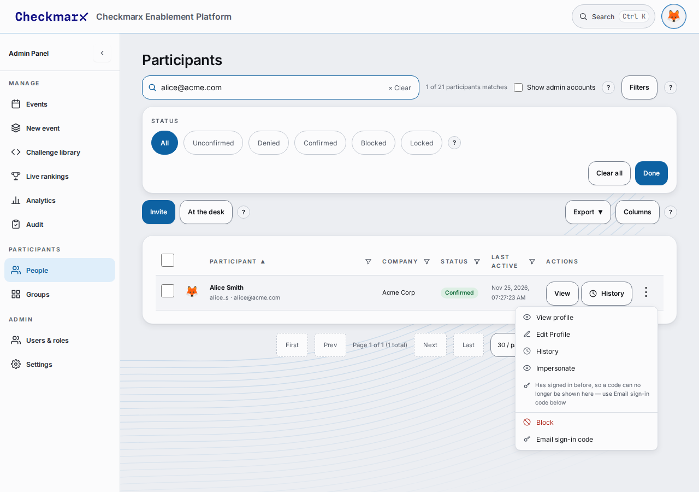

Pick **Impersonate**, confirm, and {{platformName}} reloads into the view you
chose with a banner across the top naming who you are impersonating.


**Exit impersonation** in that banner returns you to the admin panel. The
banner stays on screen the whole time, so you can always get back.

**What you're allowed to do depends on your role:**

- **Admins** get a **read-only** session, with one deliberate exception. You
  can navigate anywhere the participant can — open their events, read
  their challenges, view their leaderboard position — and you can **generate
  their certificate** for them (see below). Anything else that would change
  data (submitting an answer, revealing a hint, editing their profile) is
  refused with a *"This action is not allowed in impersonation mode"* message.
- **Superadmins** may perform every action, because occasionally you need to
  unstick someone — with exceptions that are refused for everyone,
  superadmins included: anything that would sign in as the person or set
  their credential — requesting or redeeming a sign-in code, signing in with a
  password, and changing how the person signs in (their profile does not even
  offer **How you sign in** while you impersonate) — and **joining an event**
  for them, by join link or event code, since that would enrol them and count
  them as joined (the events page says so where its event-code box would be; to
  add them, use **Add to event** in the event's **Participants** section).
  Everything else is allowed, and each
  state-changing action asks *"You're in impersonation mode — are you sure?"*
  first, so nothing happens by accident. Switching between **Admin View** and
  **Participant View** is allowed while impersonating an event admin, and
  keeps you impersonating.

#### Generating a participant's certificate

Certificates are collected by the participant, from their own screen — which is
awkward when someone is standing in front of you and cannot get to theirs. So
**generating** one is the single thing a **read-only** impersonation session is
allowed to change. Sharing it is not; that part stays with superadmins, and the
reason is below.

Impersonate them, open the event, and use whichever offer their screen shows:

- on a **Program**, **Your certificate is ready** at the top of the Challenges
  page, then **Get my certificate**;
- on a **Competition** or **Booth Event**, **Generate or download certificate**
  under the leaderboard (**Generate certificate**, or **View certificate** once
  they hold one, while its code is hidden from you).

You are asked to confirm first, because a certificate is permanent: it carries
the participant's credential code — printed along the foot of the certificate,
beneath the address a verifier checks it at — and only a superadmin can revoke
one. If they already have a certificate for that event, the same button simply
opens it.


**While you view as them, the certificate's code, picture, downloads and link
are hidden**, and the dialog says so, unless you may look certificates up by
their code (a superadmin, or a role granted **Look up a certificate by its
code**): the code beside its holder is what that permission guards. Download it
from the event's **Certificates** section instead; the participant can download
or share it themselves. With that permission, the preview offers **Download
image (PNG)**, **Download certificate (PDF)** — the PDF is the one to email or
file with a training record — and **Copy badge link**.

**You cannot share it to LinkedIn.** That posts to whoever is signed in to
LinkedIn in *your* browser, and on a Program pressing Share is also what makes
the participant's certificate page public — which is their decision to take, not
yours. The button is not offered, and the dialog says so. The participant can
share it themselves at any time, and a superadmin can share it on their behalf.

**Nothing about the certificate is yours to set.** The name on it, the placement,
the score and the date all come from the platform, so generating one for somebody
cannot change what it says. The mint is recorded on the event's **History**
naming you as the impersonating admin — so the record shows that *you* generated
it, not that the participant published themselves.

#### Impersonating an event admin

An event admin has two views — the participant app, and the Event Admin Panel
they organise from — and you can look at either. Choosing **Impersonate** on
their row asks which to open; their panel is the default, because "what does
she actually see on her side?" is the question that usually brings you here.


Inside their panel you see exactly what they see, and nothing more: their
events only, their challenges and participants, and no Logs, Settings or
**+ New Event**, because those are not theirs. You gain nothing beyond what the
organiser has — a superadmin looking through an organiser's panel is still
looking at an organiser's panel. The banner stays across the top, naming both
the person and the view, and **Exit impersonation** is always there.


**Switch to Participant View** and **Switch to Admin View** in the account menu switch between
their two views without ending the impersonation; the banner follows. What you
may do there depends on your role, exactly as on the participant side:

- **Admins** look and change nothing. Every control the panel offers is still
  on screen — it is the organiser's panel — and every change is refused with
  the *"not allowed in impersonation mode"* message.
- **Superadmins** may act, behind the same confirmation, and every change lands
  on the event's or participant's **History** as made by *you*, through the
  organiser's panel — never as the organiser's own act.

Two things are withheld through somebody else's panel, whoever is looking: a
**sealed answer** the organiser wrote is not shown (a seal names a person, not a
tier — see [Sealing a challenge answer](#sealing-a-challenge-answer); as a
superadmin you can reveal it from their panel, behind the same confirmation as
in your own, and the record then names you and the organiser's view you were in),
and the seal control on a new challenge is disabled, with the reason beside it,
because a seal cannot be set on their behalf. Your own sealed challenges stay
readable through their panel — the seal follows you, not the seat. And if you are
yourself enrolled
as a competitor in an event that organiser runs where staff compete, their panel
is refused to you outright — their participant view still opens, and switching up
to the panel from there is refused the same way. The rest of the competitor rule
follows you into the seat too: an event you compete in, a challenge it holds and
a rival on its board are all refused to you through anybody's panel, exactly as
they are from your own.

**What impersonation never does:**

- It doesn't start the participant's clock. Opening their event leaves
  their solve timer, their "first joined" record, and their auto-resume
  event untouched — so looking never costs them time.
- It doesn't sign them out. If they're using {{platformName}} right now, their
  session keeps working.
- It doesn't skew your reporting. Anything done while impersonating is
  excluded from the Analytics tab, so a support session never pollutes
  challenge statistics. That covers **browsing** — moving between challenges
  does not add to their navigated-away figures — and, for a superadmin, both a
  **correct and an incorrect** submitted answer, and a revealed hint. None of
  it counts the participant as having been active, either.

Anything a superadmin *does* change while impersonating is real — a submitted
answer scores, a revealed hint deducts — and appears on the leaderboard like
any other activity, as is a certificate generated by either role. Every
impersonation is recorded: start and end both land in that participant's
**History**, naming the admin who did it, and the activity logs tag each
request with the impersonating admin.

You can't impersonate an admin or superadmin (an event admin you can), or an
account that is blocked, denied, or not yet approved. You **can** impersonate an account that
has not verified its email — that is often exactly the account you need to look
at, and verification governs whether the *participant* can sign in, not whether
you can view their session.

### History dialog

The three-dot menu's **History** opens a page-by-page view of every event
recorded for that participant — logins, scoring, role changes, profile edits,
emails, and more.


The same History dialog exists for events and challenges.

Certificate entries say what happened in words: a certificate issued (and
whether automatically or again after a revocation), downloaded, shared (and
whether from the congratulations email's link, or by someone other than its
holder), revoked with the reason given, each congratulations email (sent,
failed and when it is tried again, or why it was not sent) and a look-up of the
certificate by its code.

An entry whose recorded details cannot be read keeps its date, type and who
acted, and says *The details recorded for this entry could not be read*. Event
admins are not shown such an entry in a participant's History, as it cannot be
told which event it is about.

### Exporting a person's history

The **person export** gathers one participant's data in one file: the
profile, every event they joined and left, every answer, hint and rating, their
certificates, the emails sent to them, their sign-ins, their whole History,
their invitations and their groups, and the record of each time they were taken
out of an event (and whether they came back). It comes as JSON, or as a ZIP with
one CSV file per section (the emails and sign-ins are inside the history file).
It does not include the event team's lead record about them, their time on the
platform or their navigation records; the full event export has time and
navigation for each event.
Passwords, sign-in and reset codes, invitation links and certificate links are
never included, and answers to a sealed challenge you did not write are withheld.
For an event admin the file covers only the events they organise. Unlike the
full event export, competing in an event does not stop you exporting a fellow
competitor's data this way: the event's challenges are all sealed, so their
answers stay withheld. There is no button for this yet; it is
`GET /api/admin/participants/{id}/export/full`. Each download is recorded in the
audit log.

---

## Teams

**Teams** (groups) are named, reusable collections of participants. A participant can
be in many groups, and a group can hold many participants. Use them to
organise people — by company, cohort, region, or any label that helps you run
events — and to act on everyone in a group at once.

### Group Rankings

A **Group Rankings** board (participants see it as **Team Rankings**) can appear on
the **Rankings** tab, ranking whole teams by their members' **average score**, then
average time to solve — so a big team and a small team compete fairly. Anyone entered
on their own shows up alongside the groups. Staff and benchmark players are left out,
as usual.

It's **off by default**. To use it, tick **"Enable group (team) leaderboard"** in the
event's create/edit dialog, then assign **at least two non-empty groups** to the
event. The board stays hidden until both are true — so a single team, or the
feature left off, never shows a half-empty ranking. Turn the setting off any time to
hide it again.


The board has its own **Export CSV** button — see
[Export a leaderboard to CSV](#export-a-leaderboard-to-csv), which covers what
the team file contains and why its penalty columns are labelled *(team total)*.

### One group per event (with the team board on)

Where an event has **Enable group (team) leaderboard** ticked, a person can
only be in **one** group bound to it — the board averages each participant into a
single team, so two teams cannot both claim them. {{platformName}} keeps this for
you on those events:

- Adding a group to one, or a person to a group already on one, is **blocked**
  with a **"Group members clash"** alert saying who clashes and where. Just take
  them out of all but one of those groups.
- **Inviting** someone into a group is blocked the same way. (Inviting a person to a
  event *and* a group still enters them on their own — a group only competes
  as a team once you add it to the event.)
- **Importing** never fails: a clashing group is simply skipped, and the summary
  tells you how many.

**With the team board off there is nothing to keep** — and it is off by default —
so the same bind, add or invite succeeds, and a participant may sit in several
groups on that event. Turning the board on later does **not** re-run the
check, so sort out any overlap before you tick it.

### Managing groups

The **Teams** page lists every group with its member count and how many
events it's bound to. Search by name, sort by any column, and page
through the list — a mature instance accumulates a lot of groups.


From here you can:

- **New Group** — create an empty group by name (names are unique,
  case-insensitive).

  

- **Rename** a group (still unique, case-insensitive).

  

- **Members** — add or remove participants. The dialog has two halves. The
  **current members** list has its own search box, and gains a pager once the
  group grows past 25, so you can find one person in a large cohort. Below it, the
  **add participants** picker searches every participant on the platform by
  name, email, or tag — not just those on screen — so you can pull everyone
  tagged `staff` into a group in one query.

  

- **Events** — bind or unbind the group to events (see below).
  Finished events aren't listed — they're frozen — with one exception: a Booth
  Event still taking late entries is listed, badged **Late entry open**, and
  anyone the group adds to it joins as a late entrant.

  

- **Delete** — removes the group and unbinds it from every event.
  Participant accounts are never deleted, but anyone who was enrolled *only*
  through this group is removed from the upcoming and live events it was
  bound to; ended ones are frozen. The confirmation dialog says the same. A
  Booth Event still taking late entries loses only the group-only members who
  are late entrants you could remove yourself — see [Removing people during the
  window](#removing-people-during-the-window).

Because a group's membership flows into every event it is bound to, a group
bound to an event **you are competing in** is closed to you along with the
event: adding or removing its members, deleting it, binding or unbinding it, and
inviting people into it are all refused, naming the event. Renaming it is not —
see [The competitor lock](#the-competitor-lock).

### Adding participants to a group

Three equivalent ways: the **Groups** column on any Participants row (pick an
existing group or type a new name); select several rows and **Add to Group**;
or a group's **Members** picker. You can also search and filter the
Participants table by group name.

### Inviting people into a group

The **Invite** dialog has an **Add to Groups** picker — existing accounts
join the chosen groups immediately, and brand-new invitees join the moment
they finish registering.

### Assigning a group to an event (live sync)

Binding a group to an event keeps that event's roster **in sync
with the group over time**, not just at the moment you bind it:

- Everyone in the group who is **eligible** is enrolled right away. Members who
  are blocked, not yet approved, or tagged `staff` are skipped, with nothing on
  screen to say so — approve people first, and do not expect a binding to enrol
  the organisers you tagged `staff` unless the event lets staff compete. On an
  event that does, the group's staff members are enrolled with the rest — turn
  the switch on after binding and they are enrolled at that moment — except
  for the author of a challenge the event holds, who is skipped just as silently
  (see [Letting staff compete](#letting-staff-compete)).
- Add someone to the group later and they're enrolled automatically.
- Remove someone (or unbind the group) and they're removed automatically —
  **unless** they were also assigned to the event directly, in which
  case they stay.
- Everyone the sync adds or removes is **emailed** about it — the same
  assignment and access-update notices a manual assign or removal sends. So
  binding or unbinding a 200-person group sends 200 emails; people who have
  unsubscribed from bulk email are skipped.

Bind groups from a group's **Events** button, or from the **Assign to
Events** flow (which also offers a group picker). Live sync respects
the lifecycle: **upcoming and live** events add and remove members as
the group changes (a removed live participant's away time is excluded from
their solve time if they return); **ended** events are frozen — except a Booth
Event still taking late entries, which adds new group members as late entrants
(silently leaving out anyone who took part before the end) and, when a member
leaves, removes them only if they joined late. If you
manually remove someone from an event they're in via a group, that
sticks — re-assign them directly to add them back.

### Groups in Logs and Analytics

**Logs** show a **Groups** column and a **Group** filter that narrows to one
group's members. **Analytics** lets you switch the participant filter between
**Tags** and **Groups**. Groups also travel with the participant export, so
re-importing a saved export keeps who's in which group.

---

## Submissions

An event's **Activity** section (the **Submissions** list) streams every answer
and hint reveal for that event, newest first. Across events, answers and hint
reveals are on the **Audit** page.


Each row shows the participant, the challenge, the answer text, whether it was
correct, the points awarded or deducted, and the time — handy for
investigating disputed submissions or auditing suspicious patterns.

An answer submitted to a challenge whose answer is **sealed** shows as sealed
rather than as text for anyone but the author (or a superadmin who has revealed
it), and the search box will not match it either, so the stream cannot be used
to work out what the answer was. See
[Sealing a challenge answer](#sealing-a-challenge-answer).

**The participant and the challenge on each row are links.** Click the
participant to jump to the **Participants** tab with the list already filtered
to them — their profile, history, tags and impersonation are all one click
further. Click the challenge to jump to **Challenges**, filtered to that
challenge. Any status or difficulty filters you had set, and any column filters,
are cleared first, and the Participants list widens to whoever it would otherwise
leave out — inside an event, everyone on the platform (an organiser's own test
answers come from someone who is not one of its participants); elsewhere, admin
accounts (**Show admin accounts** is ticked) — so what you clicked is always what
you land on. Inside an
event you stay in it: the person or challenge opens in the event's own
**Participants** or **Challenges** section. This works on hint rows as well as
answer rows.

**Sorting covers the whole event, not just the page you are looking at.** Click
a column heading — participant, challenge, result, points, time — and the
platform re-queries and re-orders everything that matches your current search
and event scope, then puts you back on page 1. So sorting by points
descending really does put the largest score change in the event at the top,
not merely the largest one on page 3. Once you have sorted, the pager confirms
it: **Sorted across all matches**.

The board's own default — newest first — covers the whole event too, and the
pager says nothing about it: newest-first is the order the stream is paged in,
so page 1 really does hold the most recent submissions in the event, not merely
the most recent ones it happened to fetch.

Searching and sorting work together: narrow with the search box first, then
sort, and the ordering applies to the matches.

---

## Rankings

The **Rankings** tab shows the leaderboard for the open event. With
no event open it shows **Live Rankings** instead — one board per live
event, side by side.


**Global** mode is one ranking for everyone regardless of session;
**per-session** shows separate rankings side by side. Staff users are
excluded — unless the event lets staff compete, in which case the staff enrolled
in it are ranked like anyone else (see [Letting staff
compete](#letting-staff-compete)); benchmark users appear in a separate section.

**A Program has no leaderboard.** It is not a ranked event — no rank, no
placing — so opening one replaces the board with a **Progress** card that says
why and where to look instead. Points still count: a participant sees each
challenge's points and their total as they answer, but nobody is ranked by
them. Per-participant progress is on the **Analytics** tab, and **Export
Activity (CSV)** on that event's row gives one line per participant per
challenge.

Each row carries the participant's **first name**, **last name**, **company**
and **email** alongside their nickname (first and last name are under
**Columns** until you add them), so you can tell who someone actually is
without leaving the tab. A small copy button sits beside the first name, last
name and email — click it to put that value on your clipboard. It copies the
whole value even when the column is too narrow to show all of it.

An **All Solved** column marks each participant who has finished every
challenge. Click any column heading — place, player, first name, last name,
company, email, score, time to solve, or all solved — to reorder the board, and
click it again to reverse. A participant with no value in a column always sorts
to the bottom, whichever way the arrow points, so the blanks never push the real
entries off the screen. Each table sorts independently, so on the per-session
view you can order one session's board without disturbing the others. Benchmark
participants stay in their own section at the bottom whichever column you sort
by.

**Search the board** with the box above it. It matches the nickname, first name,
last name, company and email, and it covers *every* board on screen at once — so
on the all-live view you can type a name and see which event that person
is in, with the boards that hold no match hidden. The count beside the box tells
you how many participants matched.

### Sharing your screen — hide company and email

Tick **Hide company & email** above the board to take those two columns off it.
Everything else stays: place, player, first name, last name, score, time to
solve and all solved, so the board still reads as standings — it simply stops
showing who somebody works for and how to contact them.


Use it when the board is going on a projector, into a screen share or round the
room on a laptop. Three things follow the toggle so nothing on screen
contradicts it:

- **The search stops matching those two columns.** With them hidden, typing a
  company name finds nobody — a box that matched something you cannot see would
  return rows for no visible reason.
- **A board you had sorted by company or email goes back to the default order**,
  because the heading you would click to undo that sort is no longer there.
- **The columns are not merely covered.** They are not drawn at all, so nothing
  reveals them — not the browser's own Find, not select-and-copy.

Two things deliberately do *not* follow it:

- **The CSV export still contains both columns.** A file whose shape changed
  depending on a checkbox would be unusable to anyone reading two exports side
  by side, so the download is always the full board. The note beside the toggle
  says so.
- **It lasts for as long as the tab is open.** Reload, and the board comes back
  complete. This is a way to present the board, not a restriction on who may see
  what — anyone who can open this tab can untick the box, and the platform still
  sends both values to the browser either way. If somebody should not be able to
  read participants' details at all, that is a question of which role they hold.

**Click a participant's name** to jump to the **Participants** tab with the list
already filtered to them — the quickest route from "this person is stuck at rank
40" to their profile, history or an impersonation session. Any status filter you
had set is cleared first, so the person you clicked is always the row you land
on. On the **Group Rankings** board a group name takes you to the **Teams** page
the same way, and a solo participant to **Participants**.

### Export a leaderboard to CSV

Every board on this tab has its own **Export CSV** button — each card on the
all-live view, each card on the per-session view, the open event's
table, and the **Group Rankings** table. One button, one file, so you can take
away exactly the board you are looking at.

The file carries everything the board shows — place, nickname, first name, last
name, company, email, score, time to solve and all-solved — plus columns that are in the
file only. **Five of them** explain how the score was reached:

| Column | Meaning |
|---|---|
| Incorrect Submissions | How many wrong answers they submitted |
| Points Lost to Incorrect | What those wrong answers cost |
| Hints Revealed | How many hints they opened |
| Points Lost to Hints | What those hints cost |
| Total Points Lost | The two added together |

On a participant's row these add up: **score + total points lost = the points
they earned from solving**. So a participant on 10 who lost 40 actually solved
50 points' worth — which is the thing the board alone cannot tell you.

Two more columns are in the file only: **Time on Platform** and **Time on
Platform (ms)** — the net active time behind the **Record time on platform**
setting. They are always there, and their cells are left **blank** on an event
that does not record it, so a blank is never mistaken for a measured zero.

Time to solve and time on platform each appear twice, once formatted as on
screen and once in raw milliseconds, so you can sort or average the column in a
spreadsheet.

A few things worth knowing:

- **The file is the whole board, not the page.** A long board shows the top 50
  with a *Show all* button; the export always contains every row.
- **It follows your search, your column filters and your sort.** Narrow the
  board to one company — with the search box or a column's filter — or click a
  column heading, and the file matches what you are looking at. A column filter
  reaches every row, not only the 50 on screen. Clear the search box and the
  column filters first if you want everyone.
- **Every column is in the file**, including any you have hidden under
  **Columns**.
- **Benchmark participants are included**, at the bottom, with an empty place
  and a **Benchmark** column marking them — so they stay recognisable once you
  re-sort the file. **Staff are not included** unless the event lets staff
  compete, because otherwise they are not on the board.
- **Nothing is written if there is nothing to write.** If your search matches
  nobody, or the board has not loaded, you get a message saying which — never a
  file with only headings, which is easy to mistake for "nobody scored".

The **Group Rankings** export has its own shape: rank, name, whether the row is
a group or an individual, member count, average score and average time. Its five
penalty columns are each headed **(team total)**, because they are the totals for
everyone in the team while the score beside them is an *average* — so those two
numbers deliberately do not subtract on a group row. A solo participant is a team
of one, so their row does add up exactly as an individual's does.

> An older event whose team board was frozen before these columns
> existed exports its group rows with those five cells empty. They are left
> blank rather than recalculated: the frozen score belongs to the members the
> team had when it ended, and recomputing the penalties today could describe a
> different set of people in the same row.

Exports are taken in your browser from the board already on your screen, so they
are instant and do not appear in the audit log — the same as the participants
and analytics downloads. (The four exports under **Settings → Export** are
produced by the server and *are* recorded.)

---

## Analytics

The **Analytics** tab shows how participants fared with the challenges. For
every participant's interaction with a challenge it tracks four things —
**solved**, **incorrect**, **hint revealed**, and **navigated away** — and
charts them.

**"Navigated away" means they left without solving it.** It is the bounce
signal, so it stops counting once a participant solves the challenge, and
re-opening a solved challenge to re-read it does not add to it either. A
challenge everyone got first time reads zero; a high number means people kept
walking away from it. (Switching browser tab and back does count — read it as
attention-switching, and compare challenges against each other rather than
reading one number on its own.)


The filter bar has three cards — **Scope**, **Challenges**, and
**Participants**:

- **Scope** — Global (all events, optionally within a time window), a
  specific Event, or a Session. In Global mode you can also filter by
  event tags (default: exclude `test/dry run`).

  **If you have an event open, Analytics opens on it.** Entering the
  tab while an event's workspace is open selects that event here
  too, and if you have a session open it narrows to that session — so you
  are not asked to find today's event again in a list of every event you
  have ever run. **With no event open, Analytics asks before it measures.** The first
  time you open the tab it shows a short *Choose what to measure* card with two
  buttons — **Pick an event** and **Show platform-wide** — and runs no query at
  all until you press one: no donut, no stat cards, and the per-challenge table
  (with its search box and Export CSV) stays hidden. Platform-wide is not the
  default because it covers every event ever held apart from those marked
  `test/dry run`, which on a long-lived platform is a great deal of history.
  Once you have chosen a scope inside the tab it is remembered, so a later
  visit with nothing open opens on it rather than asking again. An event the
  tab only took over from a workspace is not kept this way: the sidebar's
  **Analytics** leaves the workspace and asks again.

  

- **Challenges** — pick specific challenges, or filter by difficulty or tag.
  Qualifying questions are left out of Analytics, so neither they nor their
  `qualifying:` tags are offered here.

**Click a challenge's name in the table** to jump to the **Challenges** tab with
the list already filtered to it — the quickest route from "this one has a 12%
solve rate" to editing it. Any difficulty or status filters you had set there are
cleared first, so the challenge you clicked is always the row you land on.
- **Participants** — filter by participant tag (default: exclude `staff`).

Each tag filter has an **All / Exclude / Only** mode — All applies no
filtering, Exclude hides items with the tag, Only shows just them. Pick a
event tagged `test/dry run` and the filter switches to "All" automatically
so its data appears.

The view refreshes as you change filters — no Apply button. A donut chart and
stat cards summarise the totals, and a per-challenge table below shows each
challenge's activity mix, its **unique attempters**, and its **solve rate**.
Difficulty, tags and the separate activity counts (total, incorrect, hints,
navigated away) are under **Columns**.


**Unique attempters** is how many distinct people the challenge saw any activity
from — and it is the solve rate's denominator, which is why it sits immediately
before it. A 43% solve rate over 7 attempters and one over 70 are very different
claims, and the rate alone cannot tell you which you are looking at. Unlike the
four event columns it counts **people, not events**, so it is deliberately left
out of **Total**: someone who submits three wrong answers adds three to Total and
one to this. A challenge nobody opened reads `0` here and `—` for its solve rate,
because no-one attempting it is not the same as no-one succeeding.

The table opens in the order that suits what you are looking at: with a
**event or session** in scope it is sorted by **challenge number**, the
same order participants met the challenges in; **globally** it is sorted by
**challenge name**, because a number belongs to a challenge within one
event and there isn't one to use. Click any column heading to sort by it
instead — your choice then sticks, including when you change scope.

### Picking an event

With the scope set to Event or Session, the picker opens a card grid —
live events first, then upcoming ones (the soonest first), then ended ones
(the most recent first). Analytics is post-hoc, so
this grid holds **every** event ever run; search at the top by **name or
tag** to narrow it, and the count beside the box tells you how many matched.
Each card shows its event's tags, and a tag that did not fit on the card
is still searchable.


### Finding a challenge in the breakdown

The per-challenge table has its own search box — type a challenge number, a
title fragment, a **difficulty** or a tag to narrow it — and pages 25 rows at a
time. On an
instance with a large challenge bank that also keeps the page responsive: each
row draws its own mini activity chart, and only the rows actually on screen are
drawn.

### Exporting the breakdown

**Export CSV**, beside the search box, downloads the table as a spreadsheet.

It writes **everything the current filters leave** — the search box and any
column's filter — not just the page you are looking at: so if the table says
"12 of 240 challenges match", you get 12 rows, and with nothing narrowed you get
all 240. The order is the table's own. The file always has every column —
challenge number, title, difficulty, tags, total activity, the four event
counts, unique attempters and the solve rate, including any you have hidden
under **Columns** — everything but the mini activity bar, which does not travel. The solve
rate is written as a plain number rather than the table's "43%", so it adds up
in a spreadsheet, and is left blank rather than zero when nobody attempted the
challenge.

Two things worth knowing before you open it:

- **In Global scope the Challenge ID column is empty.** There is no number to
  print, for the reason above. Scope to an event if you need it.
- **Tags are complete here.** The table shows the first four and then `+3`;
  the file lists them all, separated by `; `.

For per-participant results rather than per-challenge totals, use
[Export challenge activity](#export-challenge-activity) on the Events tab
— that one is a participant × challenge grid.

### Picking specific challenges

The **Challenges** picker filters to a subset — each challenge is a card with
its title, difficulty, and tags, and the search box at the top matches **any of
them**: part of a title, `hard`, or a tag. The count beside it says how many
matched, and a search that matches nothing says so rather than leaving a blank
grid.

> Challenge *numbers* are not searchable here. A number belongs to a challenge
> **within one event**, so a challenge used in three events has
> three of them — and this picker spans all events. Use the number in the
> per-challenge breakdown table below, which shows one once you have scoped to a
> event or a session.


---

## The Audit page

The **Audit** page, in the sidebar under *Manage*, has two views: the **Audit
trail**, where it always opens, and **Raw logs**. Submissions are there too; an
event's own submissions are its workspace's **Activity** tab.

### Audit trail

Its **Activity** column says what happened in plain words ("Signed in", "Certificate issued"); a record's
**Details** and the **Export CSV** file also give its technical name (the
**Activity key**), and the search matches either. A record whose details cannot
be read says so in its **Details**, and its **Outcome** reads **Unknown**, as
whether it succeeded cannot be told (unless its activity already says it
failed); pick **Unknown** in **Outcome** to list them. The audit trail pages like
**Raw logs**: one page at a time, with **First**, **Prev**, **Next**, **Last**,
jumps of ten pages, a page size and **Go to page** (**Last** and **Go to page**
need an exact count); **Export this page (CSV)** saves the page shown. On a platform with a
long history, a search, an **Actor** or an **Outcome** looks back through the newest
records first: when it stops short of the oldest, the count line says how far
back it searched, **Next** searches further back, and **From** and **To**
search any span of dates at once. Picking an **Event** finds every one of its
records straight away.


### Raw logs

**Raw logs** is the platform's activity and request feed for audit and
incident response: press **Raw logs** beside **Audit trail** to open it. The
same switch sits above the log, so the trail is one press away, and **Audit** stays selected in the sidebar in either
view. **Audit** in the sidebar always opens on the **Audit trail**, whichever
view you used last. The two streams, the search, the sorting and the pager described below
are all in that view, and its first page keeps itself up to date.


Toggle between:
- **Audit log** — audit events, warnings, errors, and the same rows shown in
  the per-entity History dialogs (one central feed).
- **Request log** — every request the platform handled, with the page/action,
  result, how long it took, the visitor's address, and their browser.

The search box matches any text in an entry, including participant names and
emails, and there's a **Group** filter beside it. A hint above the table shows
which dates the current page covers, so there's no date picker to fiddle with.

**Sorting.** Click any column heading. What that does depends on whether you've
narrowed the feed first, and the pager tells you which happened:

- **With a search or group filter applied** — {{platformName}} sorts *every*
  entry that matched, not just the page in front of you, and the pager says
  **"Sorted across all matches"**. This is what lets you filter to one address
  and click **Date & Time** ascending to reach its very first request, which is
  usually the one you want during an investigation.
- **With nothing filtered** — only the rows on screen are reordered, and the
  pager says **"Sorted within this page"**. The whole log can be millions of
  lines, so sorting all of it on every refresh isn't offered; type something in
  the search box and it becomes available.
- A few columns — First, Last, Email, Groups, Actor — are always sorted within
  the page, because {{platformName}} looks those names up as it draws the page
  rather than storing them in the log. The note tells you when that's what
  you're looking at.
- If a search matches more entries than the platform can read in one pass, the
  pager says **"too many matches to rank"**. Narrow the search — add a group,
  or a more specific term — and it can rank the lot.
- Deep into a long result set the pager says **"too deep to rank"**. Ranking
  every match is only offered for the first pages of a result, so use a smaller
  page size, or narrow the search, to bring the page you want inside it.
- If a colleague is running a ranked search at the same moment the pager says
  **"try again shortly"** — only one runs at a time. Click the heading again in
  a moment.

While a sort is active the 15-second auto-refresh pauses (the hint above the
table says so), because new entries have no meaningful place in a ranking.
Click **Date & Time** back to newest-first to resume it.


**Paging.** Choose 50 / 100 / 200 / 500 rows per page, then **First**, **−10**,
**Prev**, **Next**, **+10** and **Last**, plus a **Go to page** box for jumping
straight to a page number. **Last** and the **Go to page** box need an exact
count; without one the total is shown as e.g. `1,240+`, **Last** and the jump
box show a dashed outline (as any page button that does not apply does) and the
box says why rather than sitting there dead. **Next** and **+10**
keep working either way, because "there is another page" is a question that
can be answered without a total.

The **Audit log** pages like the audit trail: its first page is counted (up to
10,000 entries; past that the total shows as `10,000+`, so search or pick a
group for an exact count), later pages hold still as new entries arrive, and
**Next** costs the same however deep you go. A search that stops short of the
whole history says how far back it looked, and **Next** searches further back.
The **Request log** is counted on every page, exactly once you have filtered.

Two sensitive values are blanked out so you can safely share or screenshot a
log entry: the superadmin password shown when the platform starts up, and the
one-time codes in verification links. Everything else — emails,
names, browsers — stays visible, because tracing who-did-what is the point of
this view.

---

## Alerts

Some problems can't wait for you to open the right tab. When one happens,
{{platformName}} puts a notice in front of whichever admin is signed in.

### "An address has been blocked"


{{platformName}} blocks an address that sends a burst of rejected requests —
the signature of someone scanning the site for weaknesses. A busy venue on
shared Wi-Fi can look identical, which is why you get a notice telling you
which address, how many requests, which event was live at the time, and
when the block lifts.

**You are only told about the ambiguous ones.** When the traffic is
unmistakably a scanner, {{platformName}} blocks it and says nothing, because
there is no decision for you to make. Two shapes count as unmistakable:

- requests for files this platform has never had and never could — `/.env`,
  `/wp-admin`, `/phpmyadmin` and their relatives; or
- **sheer scale**: dozens of DIFFERENT paths that do not exist here, at volume,
  while barely touching a real page of the platform. A room of browsers does
  not do that. It is the arm that catches a scanner whose particular dictionary
  matches none of the known-bad names above.

In both cases the block still happens and is still recorded — see [Finding a
block that didn't notify you](#finding-a-block-that-didnt-notify-you) — you are
simply not interrupted about it.

**Anything else reaches you**, and the notice says which way the traffic
leaned, so "this might be your room" and "this is a mixture" read differently.
The one signal that always wins is real traffic: if more than a handful of
those requests reached actual pages of {{platformName}}, you are told, however
much junk came with them. That is deliberate — it is what stops someone burying
a real attack under a pile of nonsense to keep you from hearing about it.

**Decide one thing: is that your venue?**

- **Yes** — open the event it names, put the address into
  [Trusted network IPs](#trusted-network-ips) (in the room, on its network,
  **Use my current address** adds it for you), and save. The block lifts
  immediately and the room can carry on. The entry expires by itself 2 hours
  after the event ends.
- **No, or you don't recognise it** — do nothing. The block is working as
  intended and clears itself in 15 minutes.

If your role cannot change that event (a custom role without event editing, an
event outside the ones you organise, or one you compete in), the notice says so
and asks you to get an administrator who can to save the address, rather than
sending you to a field that would refuse you.

> **Times in the emailed copy are in YOUR timezone**, the one on your own
> profile, and the notice names it — `22 Aug 2026 17:45:00 (Europe/London)` —
> so the deadline for "wait it out or act now" needs no arithmetic. If your
> profile has no timezone set, or an unrecognised one, the email falls back to
> UTC and says so. The in-app notice uses your browser's timezone and names
> that.

If the live event runs as **multiple sessions**, Trusted network IPs
isn't available for it (see the note in
[Trusted network IPs](#trusted-network-ips)) — and the notice tells you that
rather than sending you to a field that will refuse you. In that case the block
still clears itself at the time the notice gives, and the lasting fix is the
`RATE_LIMIT_ALLOWLIST_IPS` environment variable, which your platform operator
sets on the server.

If the address is **already** on that event's trusted list, the notice
says so instead of telling you to add it again — that means the bypass isn't
taking effect, so check that the event has actually started (trusted
networks are inert beforehand and expire 2 hours after the end) and that the
address matches exactly.

**Clearing the notice.** There are two buttons, and they do different things:

- **Dismiss** — available to every admin, and clears the notice from **your**
  screen only. A colleague in the same room still sees it, which is the point:
  one person closing a popup shouldn't hide a room-wide outage from everyone
  else.
- **Dismiss for everyone** — **superadmins only.** It hides the notice for all
  admins and stops the same address raising another one for about an hour. Use
  it once you've decided the traffic really is a scanner rather than your
  venue. A regular admin who tries is refused, and every use is recorded in the
  Logs.

**It clears itself.** The notice only shows while the block is actually in
force, so if the traffic stops it disappears on its own within 15 minutes — no
one has to dismiss it, and you don't need to chase a superadmin to tidy up a
stale banner. If the traffic keeps coming, the address is blocked again and
you're told again. That repeat is the only case where silencing it for
everyone is worth doing.

**Every superadmin is emailed the same explanation too**, whether or not
anyone is signed in. That matters more than it sounds: the block covers the
whole address, and at an in-person event *you are on that address* — so the
notice explaining why the room just lost the platform can be the one thing you
cannot load. The email reaches you regardless, and an overnight event never
fails silently.

**And you can still get in.** A signed-in admin is not blocked, so you can open
the event and add the venue to [Trusted network IPs](#trusted-network-ips)
from inside the room even while everyone else on that Wi-Fi is being refused.
If you are signed *out* when it happens, use a phone on mobile data.

Blocks also land in the **Audit log** of [Raw logs](#raw-logs) as warnings, if
you want the history rather than the popup.

### Finding a block that didn't notify you

Every block is recorded whether or not it raised a notice. In
[Raw logs](#raw-logs), on the **Audit log**, search for `scanner_blocked`. Each entry carries:

- **verdict** — `probe` (unmistakably a scanner; no notice was raised),
  `cohort` (most of the rejected traffic was answered by real pages, so it may
  well be your venue), or `mixed` (mostly requests for things that do not exist
  here, but not enough evidence to call it a scanner outright). `mixed` is
  decided from that ratio alone, so read **routed_4xx** beside it: `mixed` with
  `routed_4xx: 0` means nothing at all reached a real page — either a scanner
  this notice does not recognise, or a client on your network repeatedly asking
  for something that has been removed.
- **probe_4xx / routed_4xx** — how much of the traffic asked for things that
  don't exist, versus how much reached a real page of the platform.
- **sample_paths** — a few of the actual paths it asked for, which is usually
  all you need to recognise a scanner. Any secret in a link is blanked out.
- **threshold_kind** — `probe_early` when it was stopped early for being an
  obvious scanner, `standard` for the ordinary threshold.
- **silence_basis** — why no notice was raised, when none was:
  `signature` (it asked for known-bad files like `/.env` or `/wp-admin`) or
  `scale` (dozens of different paths that do not exist here, at volume, with
  almost nothing reaching a real page). Empty when a notice WAS raised.

If you disagree with a verdict, that is worth telling your platform operator:
the thresholds are deliberately biased towards notifying you when unsure.

---

## Roles & permissions

**Roles & permissions** lists the people who run the platform — every account whose
role is not Participant — with their role, the events a scoped role organises
and when they last signed in (like the other admin tables, with **Columns** and
a sort and filter on each heading), and the **Roles** view lists what each role
may do. As an admin you can read both; adding platform users, changing roles and
creating custom roles is for a superadmin. A custom role may also be scoped to
the events its holders organise, exactly like an event admin; if your own role
is a custom one, the sidebar shows only the pages it allows, a list your role
cannot see is left out of a dialog with a sentence saying so, and a dialog
whose changes your role cannot make opens read-only and says why. **Add user**
is offered only while your role may give some role, and it refuses
an address that is somebody's secondary email, as invitations do: a role goes
only to the address a person signs in with.

A role also sets how its holder signs in until they choose for themselves:
administrator and superadmin roles, and custom roles that act on every event,
sign in with a password; event admins, custom roles scoped to their own events
and participants sign in with an emailed code. Once a person has chosen, a role
change leaves their choice alone.

**People** lists participants and the organisers of events; admin and
superadmin accounts appear there only with **Show admin accounts** ticked.
The sidebar is grouped **Manage** (Events, New event and templates, Challenge
library, Live rankings, Analytics, Audit), **Participants** (People, Groups) and
**Admin** (Roles & permissions, Settings). Submissions and the request logs are inside
**Audit** (see [The Audit page](#the-audit-page)).

Most controls whose purpose is not obvious from their label have a small **?**
beside them: press it for a one- or two-sentence explanation, or turn on
**Show all tips** on the Appearance page to open every one at once.

## Settings

An administrator's **Settings** tab holds the platform **certificate design**,
the **event history retention**, the open **blocked-address alerts**, **Backups &
health** (without the details only a superadmin sees), **Updates** and **About**
(and, read-only, the domains event team reports may go to); everything else on it is
for superadmins and is not shown to you. Each card shows to whoever may use it,
so a custom role sees the cards for the permissions it was given. An event admin
has no Settings tab.
Everything on it is platform-wide rather than event-specific, in a list down its
left side (a **Section** picker on a phone) grouped under **People** (links to
People, Teams and Roles & permissions, and Sign-in), **Records** (a link to the
Audit log, and CxOne API audit) and **System** (General, Branding, Email (SMTP),
Updates, Backups & health, Get help and About).

The one worth knowing about as an organiser is the **platform name**. It is not
just a label — it is what recipients see as the **sender name** on every email
{{platformName}} sends, alongside appearing in the header, in-app help and every
email subject line. So if an invitation needs to go out under a particular event
or company name, that is the setting to ask your superadmin to change, and it
takes effect on the next email with no restart.

The settings you *do* control are per-event and live in the **Edit
Event** dialog — including that event's own CxOne override.
See the [**Superadmin guide →**](superadmin.md#platform-name) for the
platform-wide view.

---

## Next steps

A few destructive operations and platform-wide overrides are reserved for
**superadmins**. If your role needs those, continue to the
[**Superadmin guide →**](superadmin.md).

## At the desk

Two shortcuts for running an event in person, when "check your email" is the
answer that loses the visitor.

- **At the desk** (Participants tab) — creates an account and shows a sign-in
  code straight away. No email is sent at any point, so it works even when mail
  is being greylisted or delayed. A work email is still required. If the
  address already has an account, nothing is created and the message says what
  to do instead: usually **Show sign-in code** on that person's row (or **Email
  sign-in code**, once they have signed in before); an
  organiser or administrator signs in on the sign-in card themselves (with their
  password, or **Email me a code instead**); and an address that is only
  somebody's secondary email never signs anyone in, so ask the person for the
  address they sign in with. **Open the event's
  workspace first**: the new account is enrolled into whichever event is open, and with nothing open you create someone who
  has no event to enter. A Booth Event that has ended but is still taking [late
  entries](#late-entries) can be the open event: the address prompt and the code
  dialog both say the new account joins it as a late entrant, until its
  late-entry deadline. A finished event that is not taking late entries cannot —
  the shortcut says so before it asks for an address, so open another event, or
  leave the event. While the open event is one you are competing in, the
  shortcut is refused with that reason — leave the event to create somebody with
  no event, or ask another organiser (see [The competitor
  lock](#the-competitor-lock)). The account is checked once more just before it
  is created: if your administrator access ended, or you started competing in
  that event, in the meantime, nothing is created and no code is shown. While
  **Require admin approval for new accounts** is on, a role that cannot approve
  accounts cannot use it, as an account made at the desk could not sign in: the
  button says why when you hover over or press it, and so does the event's **⋯**
  menu in place of **Sign up at the desk** — use **Invite** instead, or ask an
  administrator. A
  colleague moving you to another administrator role, or you signing in
  somewhere else, at that moment ends it the same way — you are told *Your
  session ended before this finished, so nothing was saved*; try again. The open event
  also decides what the account is later asked for: it follows the open
  event's sign-up form, as somebody who registered through that event's join
  link does, and as the form stands now rather than when you created it. Besides
  the company, work title, country and timezone every account gives, that is
  whatever you made required on that event (see [What an event asks for
  at sign-up](#what-an-event-asks-for-at-sign-up) — out of the box,
  nothing more), including a field you make required later.
- **Show sign-in code** (participant row menu) — for someone who is already
  registered but has never signed in and cannot get in.

**A code on your screen stays good until it expires.** Ask the person to type
their address on the sign-in card and press **Continue**: that opens the box
they type the code into. Use **Show sign-in code** on their row, before or after
they press **Continue**, and read out what it gives you. While that code — or
the one in the **At the desk** dialog — is live, nothing replaces it by email:
their **Continue** sends no new code, and **Email sign-in code** on their row
says a code shown at the desk is still live and sends nothing.

A code works once, and the clock is set by the **first** code issued for that
account: asking for another replaces it without extending the window, so a
replacement carries only whatever is left of the original ten minutes. Read out
the time the dialog gives you rather than assuming ten. After three emailed
codes inside one window {{platformName}} emails no more until the current one has
expired; **Show sign-in code** still works for someone who has never signed in.

**Show sign-in code** appears only for a participant whose account is approved,
not blocked or denied, and **has never signed in** — never on an organiser's or
administrator's row (their code shown on your screen would be a way to sign in
as them; they sign in themselves, with their password or an emailed code), and
never on the row of somebody you are competing alongside (see [The competitor
lock](#the-competitor-lock)). A code on your screen signs its holder in as that
person, to all of their events, so it is for a first sign-in only: once someone
has signed in, the menu says so and **Email sign-in code**, further down, sends
one to their sign-in address instead. A code you showed stops working if the
person is given an organiser or administrator role, or signs in some other way,
before they use it. If the item is missing for a walk-up, they are usually still
in the approval queue; the menu says so, and **Approve** is one item above it.

**A participant only ever has one live code.** A new code replaces the one
before it, with one exception: an emailed code never replaces a live code shown
at the desk. So **Show sign-in code** always gives a code that works, and pressing
it again replaces the one you read out before. **Email sign-in code** on their
row sends a fresh one to their primary address without you seeing it; a code
emailed less than two minutes ago is left alone, so pressing it twice cannot
cancel the one already in their inbox.

Editing a participant's **secondary** email address leaves a live sign-in code
alone: codes go only to the primary address. Editing their **primary** cancels
nothing when you save it either — that change is only requested, and a live code
is cancelled at the moment the participant confirms it. A superadmin **Verify**
is safe either way — it marks the address confirmed and touches no credential,
so a code you have already read out still works.
