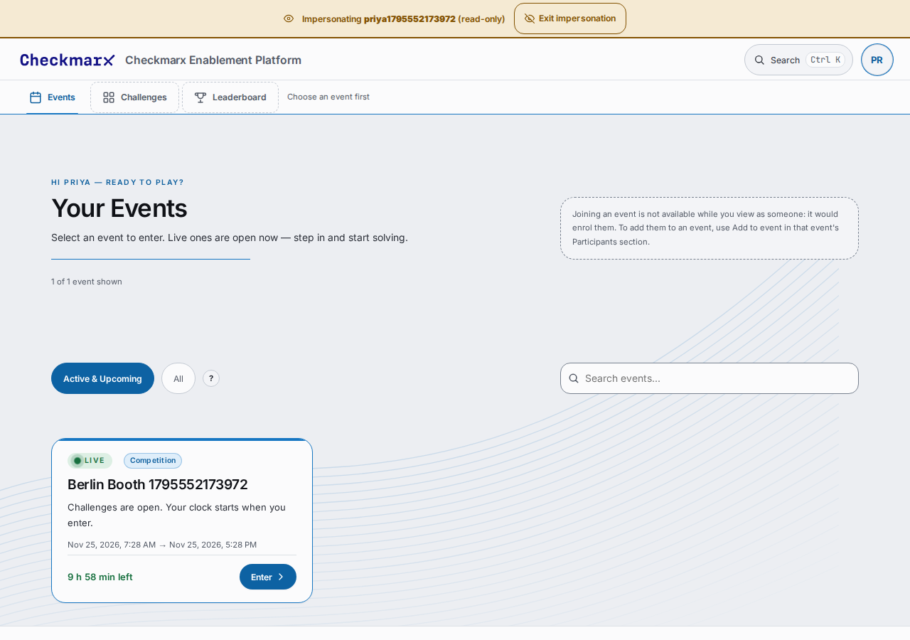
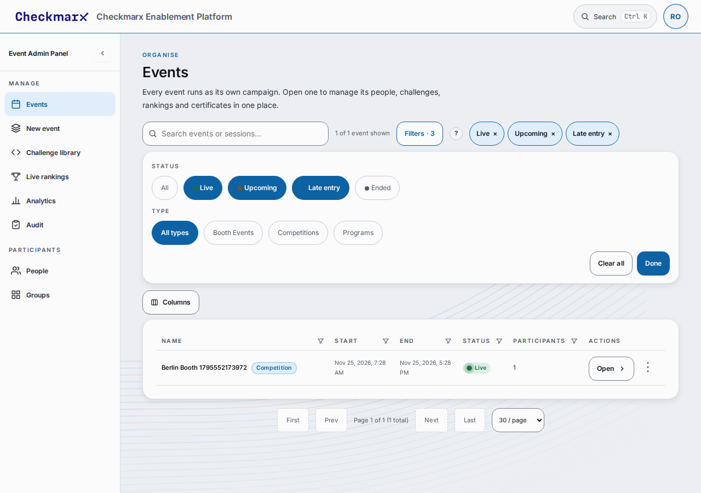
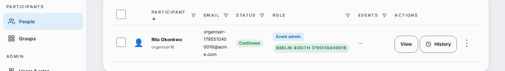
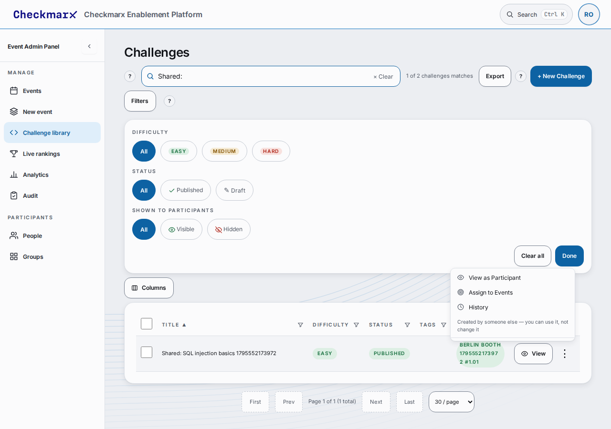
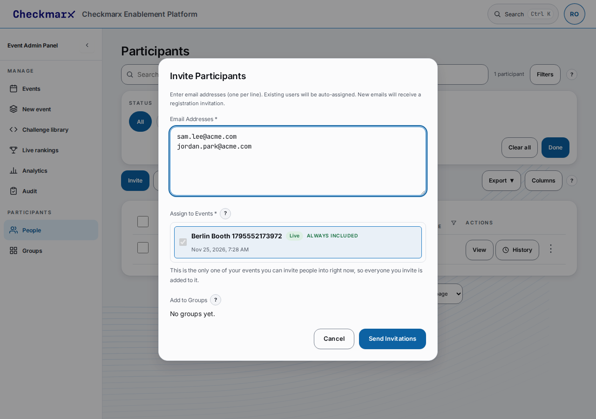
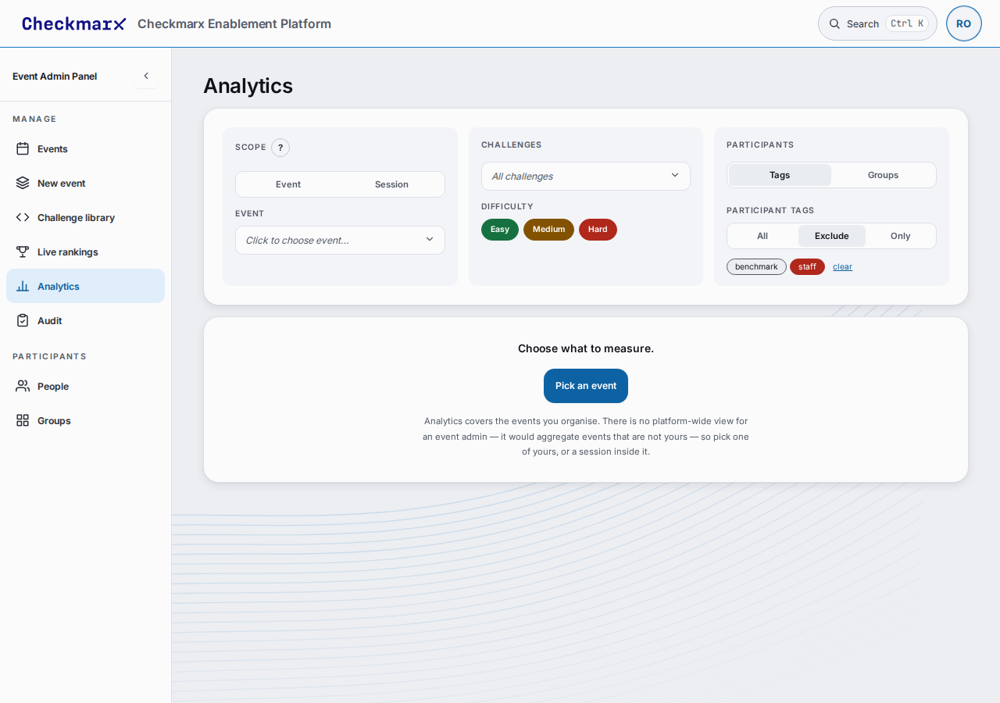

# Event Admin Guide

You are an **event admin** on {{platformName}}: an organiser of *specific
events*. Inside one of your events you can do everything a full administrator
can. Outside them, you cannot see anything at all. You sign in like a
participant: with a short code emailed to you, unless you choose a password
instead (see [How you sign in](#how-you-sign-in)).

That is the whole idea, and it is worth stating plainly before anything else:
**every list you open is already narrowed to your events.** The Events tab shows
only yours. The Participants tab shows only people enrolled in yours (and anyone
who signed up through an invitation to one of yours and is waiting for approval). Rankings,
Submissions and Analytics all start from yours. You are not filtering a bigger
list — the bigger list is not yours to see.

That includes **impersonation**. When you view the platform as one of your
attendees, you see only the events you organise — not the other events that
person may be in, whether those have finished, are running or are still to come.
If you organise none of their events the list is empty and says so, rather than
suggesting they are enrolled in nothing. Their certificate's code and downloads
are hidden there too; download it from the event's **Certificates** section.

Sign in and the admin panel opens automatically. Your account menu — the round
button at the top right — says **Event Admin** under your name, and holds
**Switch to Participant View**, **Appearance**, **Profile**, **Help**, **What's
new** and **Sign out** (the [Admin guide](admin.md#your-account-menu) describes it).

**Search** beside it (or **Ctrl+K**, **⌘K** on a Mac) finds a page, an action,
one of your events or a heading of this guide by typing a few letters (the
[Admin guide](admin.md#search) describes it). It lists only what you may use:
no **Settings**, **Roles & permissions**, **New template** or platform exports, and
only the events you organise. **New event** is there as the page where you start
an event from a template, not as an action that opens a blank one.

## How you sign in

Type your work email on the sign-in card and press **Continue**. Unless you
choose otherwise, you sign in with a one-time code emailed to your **primary**
address — the default for an event admin. A secondary address on your profile
never receives a sign-in code.

To sign in with a password instead, open **Profile** from your account menu,
press **Change how you sign in** under **How you sign in**, choose **My
password** and set one (at least 8 characters). From then on **Continue** opens
a password box on the card, with **Email me a code instead** beneath it — the
emailed code always works, so a forgotten password is never a dead end: sign in
with an emailed code, then set a new password in the same dialog within ten
minutes, with no need for the old one. Changing your password signs you out of every other
browser and device, and we email your primary address whenever a password is set
or changed. Wrong passwords count towards the same lockout as wrong codes. The
[Participant guide](participant.md#how-you-sign-in) walks through the dialog.

The default follows your role, and you keep whatever you choose. If a
superadmin later makes you an administrator and you never chose, your default
becomes a password. At your next sign-in the card says your account has no
password yet: choose **Email me a code instead**, and once you are in you are
asked to set one, or to keep using emailed codes.

## What you will not find

Three things a full administrator has are simply absent for you:

- **Raw logs**, the second view of the **Audit** page: the server's logs
  cover the whole platform (see [The Audit page](#the-audit-page)).
- **Settings** — platform settings apply to every event on it.
- **Roles & permissions** — who runs the platform and what each role may do.

You will also not find **+ New Event**: a blank event is an administrator's to
create. You can still start one yourself, and become its organiser: **New event**
in the sidebar makes one from a template, and **⋯ → Clone** copies one of your
own (see [Exports, cloning and templates](#exports-cloning-and-templates)). For
anything else, ask an administrator to create the event and to add you to it at
the same time.

If you ever meet a message saying something is not available for your role, that
is this boundary, and the message says who *can* do it, or what you can do
instead.

---

## Events

The Events tab lists the events you organise, whatever their status — upcoming,
live, still taking **late entries**, and finished. A finished event stays in your
list because most of the work that follows an event (exports, rankings,
certificates) happens afterwards, though the list opens on everything still
running rather than on those: turn on **Ended** under **Filters** to see them. A Booth Event that has passed its
end time but is still inside its late-entry window reads **Late entry open**
rather than **Ended** and is shown by default, because it is still taking
walk-ups.

**Click an event's name (or Open) to run it from its workspace**: a two-line
header (name, type, live status, dates, sessions and organisers, the join pill
with its QR code and short code, **Invite** and the **⋯** menu), the live
figures led by the countdown, and its own sections — Overview, Participants, Questions, Rankings, Activity,
Analytics, Certificates, Team & reports and Settings. Everything below is done from there; **←
Events** takes you back.
The administrator guide describes the workspace in full ([The event
workspace](admin.md#the-event-workspace)).

Inside one of your events you have the same controls an administrator has:

- edit its name, schedule, timezone and duration
- add, edit and delete its sessions
- set its **Trusted network IPs**, so a room on the venue's Wi-Fi is not
  throttled; standing in the venue on its network, **Use my current address**
  fills in the venue's address (see
  [Trusted network IPs](admin.md#trusted-network-ips))
- tag it
- set its Checkmarx One override
- reveal and regenerate its join link and printed join code (regenerating replaces both)
- **End Now**
- **Close late entries now**, on a finished Booth Event of yours that is still
  taking late entries
- **Export Activity (CSV)**

Two things are reserved for administrators even on your own event: **deleting**
it, and **reopening** one that has ended past its scheduled end.

**A Booth Event of yours that is still taking late entries is still open for
people.** Its row keeps **Manage Participants** and **Join Link**: while the
event's join link is enabled, the link, the QR code and the short code keep working
until the late-entry deadline — if it is off, the dialog says they will admit late
entrants only once it is turned on, which on a finished event only a superadmin can
do, so ask one — and you can add people yourself — by invitation, from the selection bar, at the desk or
through a group — who join as **late entrants** (the [Admin
guide](admin.md#adding-people-during-the-window) describes every route). What
you cannot do once its end time has passed is change its settings: the join link
dialog shows its switch locked (**Regenerate link** still works), and the
**Allow late entries** switch is locked for everyone. **Closing the window early
is yours, though**: **Close late entries now**, on the event's menu or in its
workspace header's **⋯** menu, stops late entries at once, to the second — see
[Closing late entries early](admin.md#closing-late-entries-early). Setting the
late-entry deadline to a particular time, extending the window, or reopening one
that has been closed is a superadmin's job.

### How you appear to an administrator

On the Participants tab an administrator sees your role and badges for the events
you organise — live, upcoming, and any still taking late entries. Events that have
finished are not badged, so what they see is the work you can still be asked
about rather than everything you have ever run. Once none of your events is
current the badges simply go, and your role stays:

An administrator can also view the platform *as you* — your participant view, or
this panel exactly as you see it, events, questions and participants included.
An admin can only look; a superadmin can act, and anything they change is
recorded as theirs, made through your panel, never as your own act. Both the
start and the end of such a session land on your **History**, naming who it
was. One thing stays yours whoever is looking: a [sealed
answer](#sealing-an-answer) you wrote is not shown through your panel — with one
exception, a superadmin who reveals it, and that reveal is recorded on the
question's History, naming them and the view they were in.

### Who else organises this event

The **Organisers** card of the event's Overview (under **Show questions,
activity and organisers**) lists everybody who administers it — useful when you
share a stand with a colleague. You cannot add or
remove an organiser yourself (the card says so where an administrator sees
**Add an organiser**); that is an administrator's decision, and it is what stops
the role spreading on its own.

### When staff compete

Every event has a **Staff can compete** switch on its edit form, off by default,
and on your own events it is yours to set like any other setting — only until the
event starts, though: once it has started the switch is locked, so decide before
the doors open. Turning it on is refused, naming what stands in the way, if the
event holds a question whose answer is not sealed, or a question written by
somebody already enrolled in it — take the question out of the event, or remove
the person, and turn it on again. The [Admin guide](admin.md) describes the
switch in full. This is what it means for *you*.

**Enrolled in an event where staff compete, you are a competitor there.** Being an
organiser still does not enrol you — see [Your own participant
view](#your-own-participant-view) — but if an organiser adds you to such an
event, a group puts you in it, an invitation names you, or you join it through
its link, you are on its leaderboard, you count toward the all-solved rule, and
you can earn its certificate, exactly like everyone else in it. The link enrols
you when you open it while signed in and in participant view, and it enrols you without asking: the
**Compete in this event?** question a staff-tagged user sees first is not put to
an event admin, because you carry no staff tag (unless an administrator has
tagged you **staff** as well, in which case the staff rules in the [Participant
guide](participant.md#if-you-are-staff) apply to you too). So know what an event
allows before you scan its code. Opening the link signed out and then signing in
takes you to the admin panel and enrols you in nothing:
choose **Switch to Participant View** in your account menu and open the link again, or type the event's
printed code into the box on your event list.

**And while you are enrolled, you cannot change that event or its questions.**
This is the same lock every tier meets — administrators and superadmins included
— and it covers every change to the event: its settings, schedule and sessions,
its tags, its join link, ending it, who is in it — which includes a group bound
to it, whose members you cannot change and which you cannot delete while you
compete there — and every question assigned to it. The event's **⋯** menu says
so — **You are competing in this event — you can view it, not change it** — and
keeps only the items that read rather than write: History, Email delivery,
Export activity once the event is live or has finished (as on any event), and
Join-link settings, which opens read-only — the link, the QR code and the
short code are there to copy, while the toggle and Regenerate are withheld with
a note saying why. On the Participants tab, with that event open, only your own row
offers **Remove**, and in every dialog that assigns people or questions to
events the event is greyed out, edged with a dashed line, as *You compete here*. On the Questions tab a
question held by that event carries the same note; **Edit** is not offered on
its row, **View** shows it as your fellow competitors see it with the hint
withheld — a participant pays 30% of the points to see one, and so would you —
and its History offers no Restore. The one change you can still make, while the
event has not finished, is to **remove yourself** from the event, from its
participant list, which lifts the lock at once. Once the event has finished
nobody can be taken out of it — except a late entrant (somebody who joined after
it ended and had not started playing before then), while late entries are still
open, so if that is how you joined you can still remove yourself then —
so the lock on it and on its questions stays:
another organiser makes any change still needed there — and once its end time
has passed, that is a superadmin, since an event past its end is theirs alone
to edit or tag.

If you compete in an event you do not organise, its roster and group doors
answer with the platform's ordinary scope refusals first: assigning people in
bulk, inviting them, granting attempts, and changing or deleting a group bound
to it all tell you the event is not yours to organise — the group controls by
naming the event, as the [Groups](#groups) section describes — rather than that
you are competing in it. A question held by that event is different: wherever
the event sits, changing the question refuses you with the competitor reason,
naming the event, and its row on your Questions tab carries the competing note
just as it would for an event of yours. Your own removal from such an event is
refused on neither ground while it has not finished, but the event is not in
your Events tab, so there is no row to press **Remove** on: ask one of its
organisers to take you out — unless you
joined it through its link and it has not started, in which case **Leave this
event** on the waiting screen still works.

Two things follow from the sealing such an event insists on. Every question in
it is sealed, so a competing organiser cannot read an answer off the admin
screen. And an event where staff compete never holds a question whose author
competes in it — so a question you created cannot be assigned to such an event
while you are enrolled in it, and you cannot be enrolled in one while it holds
one of yours. Where the refusal is one you meet yourself it names the
question: assigning the question lists it, along with everything else refused
in the same request, and the join link names it too; whoever assigns you to the
event is shown your name and the question. An invitation to your address is
reported to whoever sent it only as one person skipped for having written a
question in the event, and a group binding leaves you out without saying so.

**In an ordinary event you are an organiser.** You can still be enrolled in an
event where staff do not compete — to try it as an attendee, or because a group
put you there — and there you are excluded from its board by your role, with
your organiser controls untouched.

**Turning the switch off is not blocked by you.** Switching **Staff can compete**
off on an event with people in it is refused only while somebody tagged
**staff** — an administrator, or a helper an administrator tagged — is enrolled,
and the refusal names them. An enrolled event admin does not block it: you carry
no such tag — unless an administrator has tagged you **staff** as well, when you
count like any other staff member — so switching it off simply takes you back
off the board, as in any ordinary event. Like every other change to the event,
though, it is yours to make only while you are not competing in it.

---

## Questions

The **Question bank** is shared by every organiser, while **a question added to
an event lives in that event**. Adding a bank question to your event (**+ Add
from bank** in its **Questions** section) gives the event its own copy
(question, answer, options, hint, topic, attachments); the event uses that copy,
and you can edit it — its answer included — in your event's **Questions**
section without touching the bank or any other event. A later change to the bank
question does not reach your event's copy. **+ New question** inside the event
makes a question that belongs to the event from the start. Your event's own
questions cannot be added to another event; add the bank question instead — or
press **Save to bank** in an event question's menu, which copies it into the bank
as a new bank question of yours (later changes to either do not reach the other).

The bank is organised by **topic**: filter by one with the **Topic** box, and
file a question under one in its editor's **Topic and sharing** row (**+ New
topic** makes one). Participants see a question's topic as its category. You can
rename or delete topics you made yourself (a topic still holding questions must
be emptied first); an administrator manages the rest. Questions no longer show
tags.

### What you can see

Three kinds of question, and nothing else:

1. **Questions you created.** Yours to edit, publish, hide and share.
2. **Questions used by one of your events** — including ones an administrator
   or a fellow organiser added. You can see them and read them, so you know what
   your participants are being asked, but you cannot change them.
3. **Questions shared with all organisers.** A shared pool anybody organising an
   event can pick from.

**If a shared-pool question looks missing, it is probably further down the
list.** Opening an event does not hide anything — the tab always shows you
everything the three rules above give you. What opening it does is move that
event's own questions to the top and grey out the rest, so on an event holding a
screenful of its own questions the whole shared pool sits below them, on the
next page. Leave the event with **Events** (the back arrow at the top of its
workspace), or use the search box, and it comes back into view.

**A question from the shared pool is badged `Shared`** in the Status column,
beside Published or Draft. That is the quickest way to tell a question you can
see because it is shared from one you can see because an event of yours holds
it.

**A question whose answer has been sealed is badged `Sealed`** in that same
column. Its author chose to keep the correct answer, the explanation and the hint
to themselves, so on somebody else's sealed question those three are the only
parts of it hidden from you — the rest of the question reads as normal. There is
more on this below, from both sides: sealing your own, and meeting somebody
else's.

**You cannot change a question you did not create**, sharing included, so on
those rows Edit is not offered and the menu says why. You can still use the
question in your own events — that is what the shared pool is for.

**The Events column on a question row shows only your own events.** If a
question is also in an event somebody else runs, you see a `+1 elsewhere` chip
instead of that event's name — enough to know the question is in use, without
naming an event that is not yours. The chip is not clickable, because there is
nothing there you could open.

That also means the events column can be a chip and nothing else, on a question
you created that another organiser has taken into their event. It is not unused;
it is in use somewhere you cannot see.

**And you are still warned before editing one.** If a question is live in an
event you do not organise, saving an edit asks you to confirm first and says so —
"in live event(s): 1 event you do not organise" — because your change reaches
those participants immediately even though the event is not named.

**A look-alike shares nothing.** An older question may carry a label that looks
like the shared marker (`public domain` with a space, or an invisible character
pasted in) but shares nothing. Its editor names it beside **Shared with all
organisers**; turning the switch on shares it and removes the look-alike.

### What you can do

- **Create** a question — freely, as many as you like. It is yours.
- **Edit / publish / unpublish / hide / share** — only questions you created
  (and your events' own questions).
- **Assign** any question you can see to any event you organise.
- **Remove from an event** — only questions *you* added to that event. If a
  colleague or an administrator put it there, ask them to take it out. In the
  **Add from bank** dialog those rows are ticked, greyed out and outlined with
  dashes, and hovering
  one says who can remove it; the row menu leaves the option off entirely.

A question you did not create offers no Edit, Publish or Hide, and says why.
If its form is reached some other way, it opens read-only, with no Save button
and its formatting buttons switched off under a line saying you can only edit
questions you created:

Deleting a question outright is an administrator's action, exactly as it is for
a normal admin. Unpublish it or hide it instead — both are yours.

### Sharing a question with other organisers

Turn on **Shared with all organisers** in the **Topic and sharing** row of one
of your own bank questions, and every event admin on the platform can see it and
use it in their events. They still cannot edit it — it stays yours. Turn it off
and it goes back to being private to you and to the events already using it. A
question inside an event has no switch: save it to the bank and share the bank
question.

### Sealing an answer

When you create a question the form offers **Seal the answer — only I, or a
superadmin on the record, can see or change it**. Turn it on and the correct
answer, the explanation and the hint become yours alone: not other organisers,
not administrators. (A participant competing in an event that holds it can still
buy its hint there, as they could any hint.) The one exception is a
**superadmin**, and even for them it is not silent: they can
reveal a sealed answer to themselves only by an explicit act that is recorded in
the question's History and in the event log, naming them — so if it ever
happens, you will see who did it, and when. If they were looking through
somebody else's view at the time, the History names that person too when they
share one of your events, and otherwise says only that it was *an account
outside your events* — not which kind of account, nor which view. If that
account has since been deleted, it says so instead. This is the one restriction on
{{platformName}} that binds *upwards* as well as sideways, which is what makes
it worth having when you are writing a question for a room that includes the
people who run the platform.

What it covers is narrow, and deliberately so. The question itself stays entirely
visible — its title, description, difficulty, points, who solved it and every
score. The **hint** is sealed with the answer: it is withheld
from every other organiser's screens and exports exactly as the answer is. A
participant who gives up 30% of the question's points for it during the event
still receives it — that is what a hint is for, and a seal does not take back
something they bought. On a multiple-choice question the options still show,
because the options are the question; which of them are correct does not.

Participants never see the answer either, and that includes the end of the event.
If your event has **Reveal answers when the event ends** switched on, a sealed
question shows **Answer not shown** with a line saying why, and contributes
neither its explanation nor its hint to the reveal (a hint a participant paid for
during the event stays theirs). Scores, solves and rankings are untouched.

**You cannot seal an *Any answer (free response)* question.** There is no answer
on one to seal — every response is accepted — and sealing would hide the responses
from everyone but you, which is the opposite of why you asked the question. The
form disables sealing when you choose that answer type, and takes that answer type
away once you tick the seal.

Sealing also makes you the only person who can **edit** that question or
**restore an earlier version** of it — the answer is bound up in both. (A
superadmin who has revealed the answer can do both as well, and the reveal is on
the record.) It reaches further than the answer box, so know what you are taking
on: on everybody else's screen the row loses **Publish**, **Hide** and **Edit**
(and with it the sharing switch) as well, and their row menu says the question
is not theirs to change. If a colleague was going to publish it for you, retitle
it or share it with all organisers, that falls to you.

What other organisers and administrators keep is the *use* of it. They can still
read the row, preview it as a participant, assign it to their own events, take
back an assignment they made, grant attempts on it and open its History. A
superadmin can still delete it outright, too — a seal protects the answer, not
the question.

**You can only decide this while the question is being created.** There is no
way to seal an answer afterwards, and the platform will tell you so if you try:
by then it has been readable by administrators, and a setting cannot take that
back. You can go the other way — open your own sealed question and tick
**Unseal this answer when I save** (a superadmin who has revealed the answer is
offered the same tick) — but that is just as final, and it is
refused while the question is in an event where staff compete, whatever stage
that event is at, finished included: such an event admits sealed questions
only, and a finished one can be reopened. The editor withholds the tick while an
event of yours holds the question, and says why, naming the event or events;
where its only such events are ones you do not organise, the tick is offered
and the save is refused instead, and the refusal says how many events you do
not organise stand in the way. While none of those events has finished — nor
any session of one — take the question out of them first (where somebody else
assigned it, ask them to) or leave the answer sealed; once one has finished, or
one of its sessions has, its question list can no longer be changed, so the
answer stays sealed for as long as the question stays assigned — you still
read and edit the question as its author (see [When staff
compete](#when-staff-compete)). Once unsealed the answer is readable by everyone
who can see the question, and it cannot be sealed again.

Two more things before you rely on it. A sealed question **cannot be carried to
another platform**: an import has no way of knowing who its author should be
there, so those rows are refused, and you would create it fresh and seal it
again at the other end. And this is a control over {{platformName}}'s own
screens, exports and logs rather than encryption — anybody with direct access to
the server's database or its backups can still read the answer.

### One thing that will surprise you

If a question you created is held by an event you do not organise (that
event's own copy, written by you, or a qualifying question it shares), you
can still fix its title, description, hint and explanation — but not its
**answer (on a Text question that is every accepted answer, so adding or
removing one counts), answer type, difficulty, choices, attempt limit or
published state**, nor make it a qualifying question or an ordinary question
again (its `qualifying:` tag). An **Any answer** question has no hint to fix — it never
carries one.
Those decide how somebody else's event scores, so changing them from here would
re-grade an event you have no part in.

You will see this rather than be refused after the fact. Opening such a question
for editing leaves the title and the text fields alone and locks the scoring
fields (a dashed outline), with a line above them saying why. **Publish** and **Hide** are not
offered on it at all, and the row menu explains their absence. In its version
**History**, Restore is replaced by *Not yours to restore* — restoring a version
rewrites the answer and difficulty along with everything else, so it counts as a
scoring change even though it looks like an undo.

**A sealed answer is that same rule taken to its limit.** On somebody else's
sealed question you can read the title and the description, assign it to your
own events and watch people solve it — but the correct answer, the explanation
and the hint are shown to you nowhere: not in the list, not in **View as
Participant** (which says the hint is withheld rather than leaving a blank), not
in the question's version **History** (including the versions saved before it
was sealed), and not after the event even if the event reveals answers. There is
no **Edit** on the row, and an administrator cannot lift that for you either — a
seal binds them too. So if you need the answer, or need something in the
question changed, ask whoever created it — or a superadmin, who can reveal the
answer to themselves and then edit the question, the reveal being written into
its History with their name. The `Sealed` badge in the Status column is how to
spot one before you go looking.

### Attempt limits you cannot see

**Grant Attempts** speaks only for the events you organise. If a question is
capped by an event somebody else runs, this dialog will tell you that no event
*you organise* limits attempts on it — which is not the same as saying nobody
does. Ask an administrator if a participant is stuck on a question whose limit
you cannot find.

---

## Participants

You see only people enrolled in one of your events. Everything follows from
that:

- Administrator accounts enrolled in your events (an administrator competing in
  one) are left out of the list. Clicking one on a leaderboard or in the
  submissions shows them for that visit, with a note above the table saying so;
  the next time you open People they are left out again.
- Inside an event, **Show people from your other events** lists the people of
  your other events too (never anybody else's), so you can add one of them with
  **Add to event**.
- The **Events** column on each row lists only *your* events, even if that person
  is also in others.
- The pending-approval badge counts only people waiting for one of your events.
- Somebody who signed up through an invitation to one of your events and is
  still waiting for an administrator's approval is listed too, as *Pending*,
  with **Invited to “…”: waiting for an administrator's approval** naming only
  your events; the badge does not count them. Their row offers only **View**
  (they are in none of your events yet), and only an administrator can approve them: ask one if needed. Once
  approved, they join your event the first time they sign in.
- **Export CSV** covers exactly what the list shows — every page of it, in its
  order, after your search, the status filters and the column filters (and, with
  **Show people from your other events** ticked, those people too) — and, with one of your
  events open, adds one **Response:** column per **Any answer** question in
  that event, holding each participant's response exactly as they typed it
  (blank for anyone who has not answered). That is how you read the free-text
  responses for an event you organise. If those responses cannot be loaded the
  export is cancelled with a message rather than saved without them. An **Any
  answer** question that somebody else has sealed gets no column at all: on that
  kind of question the responses *are* the answer, so they belong to its author,
  and a column of empty cells under its title would read as nobody having
  responded — which is worse than its absence. Ask the author for those. Your own
  sealed questions are not affected: you are the author, so their columns are
  there as usual.

For those people you have the ordinary administrator's row actions: approve,
deny, block and unblock, unlock, email a sign-in code, edit their profile, add
and remove tags, view their History, show a sign-in code (only for someone who
has never signed in: after a first sign-in you can only email one), and **impersonate**
them to see their screen — read-only, and recorded. One exception: on an event
where staff compete that you are enrolled in, the people enrolled beside you
are your rivals, and their row withholds approve, deny, block, unblock, email sign-in code,
show sign-in code, impersonate and the `benchmark` tag with a note saying so
(the [Admin guide](admin.md#the-competitor-lock) has the rule; a rival's
sign-in code, for one, would sign you in as them). Unlock, the profile and
History stay, but the profile's two email addresses are locked for the same
reason. Approving several people at once from the selection bar skips your
rivals too, and says how many it skipped.

**A sign-in code you show at the desk stays valid until it is used or expires.**
The dialog says how long it has: about ten minutes at most, and less when the
account already had a live code (one emailed in the last ten minutes, or one
shown earlier), because a new code keeps that code's time limit. Nothing but
showing another code replaces it: not the person pressing **Continue** on the
sign-in card to type it in, and not **Email sign-in code**, which sends nothing
and tells you the desk code is still live.

You cannot change anybody's role, verify an account by hand, or delete an account. Nor can you make somebody an event admin.

**Removing people from a finished event** is possible only while it is taking
late entries, and then only for **late entrants** — people who joined after it
ended — who had not started playing before it ended: with the event open, every
late entrant's event badge reads
**· late entrant**, and the removable ones' menu offers **Remove from …**, while
everybody who was in it before the end stays, with a note in their menu saying
why: its final results cannot change. A late entrant who
already holds a placing certificate for the event has to have it revoked by a
superadmin first. Once late entry closes, nobody can be removed.

### Inviting people

**Invite** (the **Invite Participants** dialog) and the **At the desk** shortcut
both work, and both require you to name at least one of your events. Inside one
of your events they are the header's **Invite** menu (**Email invitation** and
**Sign up at the desk**); on the People page, its toolbar's **Invite** and **At
the desk**. You are
inviting somebody *into your event* — there is no way to create an account on the
platform that is not attached to one of yours. A Booth Event of yours still
taking late entries counts: it is listed with a **Late entry open** badge, and
anyone added to it joins as a late entrant. A finished event that is not taking
late entries does not — its header offers no **Invite** — so open another of
your events. If you are removed as an organiser of
that event while the at-desk shortcut is creating the account, nothing is created
and no sign-in code is shown.

In the **Invite Participants** dialog, **Assign to Events** is required for you
(its label carries an asterisk) and lists every event of yours that is live,
upcoming or taking late entries. One you compete in is listed too, marked **You
compete here**, but it cannot be ticked: you cannot change who takes part in an
event you are playing (see [When staff compete](#when-staff-compete)). Ticking a
group under **Add to Groups** does not stand in for an event — everyone you
invite joins at least one of yours. What the dialog asks of you depends on how
many events you can tick:

- **Two or more** — tick at least one; a note under the list says so. The event
  you have open starts ticked, and you can untick it. Press
  **Send Invitations** with nothing ticked and nothing is sent: the dialog asks
  you to tick one of your events.
- **Only one** — there is nothing to choose, so it is ticked for you, marked
  **Always included**, and stays ticked. A note under the list says everyone you
  invite is added to it.
- **None** — the dialog says why, and **Send Invitations** is disabled. If none
  of your events is live, upcoming or taking late entries, the reason stands where
  the list would be. If you compete in every one that is, those events are still
  listed, marked **You compete here**, with the reason under them: ask another
  organiser to send the invitations.

If your events cannot be loaded, the dialog does not open, and a message asks you
to check your connection and try again.

Somebody you add **At the desk** with one of your events open follows that
event's sign-up form exactly as somebody who registered through its join link
does — including a field you make mandatory later, which they are asked for the
next time they use {{platformName}}.

The summary after an invitation counts anyone who was left out and says why:
somebody tagged **staff** invited to an event where staff do not compete (they
can enter it without being enrolled), an existing administrator's account
invited to an event where staff *do* compete (only a superadmin can enrol an
administrator as a competitor), the author of a question assigned to that
event, anyone blocked or still awaiting approval, and — on a late-entry event —
anybody who took part in it before it ended, who cannot come back as a late
entrant. Each of those is counted as skipped, not reported as already in the
event. An existing account still waiting for approval is approved by your
invitation only once it puts the account into one of your events: when every
event you ticked skipped it, it stays waiting, its address stays in the box,
and the summary says an administrator approves it. An organiser's or an
administrator's account waiting for approval is never approved by your
invitation. An administrator's account is likewise left out of any group you
ticked — the **Invite** dialog, like the Groups page, puts one into a group only
for a superadmin — and the summary counts that separately. An address that is
somebody's secondary email is refused and listed with the reason (that address
never signs anyone in), so invite the person by the address they sign in with.

---

## Groups

You can create groups, and you see groups you created plus any group bound to one
of your events.

**A new group can start with members, and those people follow the same rule as
everyone else you act on**: they must be participants in one of your events. Seed
it with somebody you do not organise and the group is not created — the refusal
names them, and nothing is written.

**You can delete only groups you created.** A group somebody else made and bound
to your event is theirs.

There is one refusal worth understanding, and it covers deleting as well as
editing. Group membership syncs live into *every* event a group is bound to. So
if a group is bound both to your event and to one you do not organise, you cannot
change its membership — doing so would move people in and out of somebody else's
event — and you cannot delete it either, because deleting a group unbinds it from
every event and takes its members out of each one. The message names the other
event. Either ask an administrator, or make a separate group of your own.

The same shape applies where you *compete*: a group bound to an event you are
competing in is one whose membership you cannot change, and which you cannot
delete, for as long as you are in that event — see [When staff
compete](#when-staff-compete).

A group's **Events** dialog lists a finished Booth Event of yours while it is
still taking late entries, badged **Late entry open**. Bind a group to it and the
group's members join as late entrants — except anyone who took part before the
end, whom it leaves out.

---

## Submissions, Rankings and Analytics

All three start from your events.

- **Submissions** — an event's **Activity** section lists that event's; the
  **Audit** page lists those of all your events. An answer submitted to a
  **sealed** question somebody else
  created reads `sealed` rather than showing what the participant typed, and the
  search box cannot match it either — otherwise searching would be a way of
  working the answer out. Who submitted, when, and whether they were right are all
  still there, and on your own sealed questions you read the answers as usual.
- **Rankings** — an event's **Rankings** section shows that event (or the
  session you picked); **Live rankings** in the sidebar shows the live events
  you organise. A **Program** has no leaderboard: its Rankings section lists each
  learner's **grade** instead (90% Excellent, 80% Very good, 70% Good, 60%
  Satisfactory; under 60% no certificate, and the learner may try again; the
  [Admin guide](admin.md#program-grades) explains how a grade is worked out).
  On a Booth Event or Competition set to **Start each
  participant's clock: When they open their first question** (the default for
  new ones, chosen on the event form's Advanced section before it starts),
  each person's time to solve runs from their first open of a scoring
  question, so somebody who has entered but opened nothing is not on the board
  yet. The administrator guide's *Start each participant's clock* has the rest.
- **Analytics** — pick one of your events or sessions. There is no
  platform-wide option: it would aggregate events that are not yours. Inside an
  event, its **Analytics** section is that event alone (Whole event, or one of
  its sessions), with no event picker. The tag
  and group lists you can filter by are likewise drawn only from participants you
  can see.

Opening an event from the Events tab narrows all three at once, and the
workspace header says which event you are looking at.

### The Audit page

The **Audit** page, in the sidebar under *Manage*, is the trail of your own
events, and it lists the submissions to all of them. It leaves out what belongs
to the raw logs: a visitor's or requester's address and browser, a deleted
person's Checkmarx One account id or email address, and address-block alerts.
A record's **Details** list what was left out. A record whose details cannot be
read says so in its **Details**, and its **Outcome** reads **Unknown** (unless
its activity already says it failed).

### Exports, cloning and templates

- **Full event export** — a ZIP of CSV files with everything about one of your
  events (participants, answers, hints, time, rankings, certificates, ratings;
  for a Program, each learner's grades).
  Answers to a sealed question somebody else wrote stay withheld.
- **Person export** — a participant's profile, memberships, answers, history
  and invitations, covering **only your events**: anything from somebody else's
  events is left out, and so are your event team's lead records.
- **Clone event** — copy one of your events into a new, upcoming one (settings,
  tags, questions, sessions; never people, answers, the join link, the event
  team and its lead targets, the event's look or its own certificate design). You
  become the organiser of the copy. Starting an event from a template works the
  same way, and both need at least one event of your own: if every event you
  organised has been taken away from you, you cannot start a new one. An event with its own Checkmarx One key
  gives a copy with Checkmarx One accounts off (the key is never copied); the
  clone dialog says so.
- **Templates** — you can see the event templates and create an event from one,
  and you become its organiser. Only an administrator can create, change or
  delete a template, or save an event as one. A question you cannot see is left
  out of the event you create and counted, never named: its id and title are
  hidden from you in the template and in the message that confirms the event. A
  question held by an event you compete in is left out of an event you create
  from a template or by cloning, and the message names it with that reason.
  The quick spin offers **Add the qualifying questions**, ticked for a Booth
  Event, except on a template where staff compete: such an event holds sealed
  questions only, and a qualifying question can never be sealed. A start
  inside the hour the clocks skip when they go forward is refused.

They are all in the event's workspace: **⋯ → Export everything** and **⋯ →
Clone**, and **New event** in the sidebar (pick a template, then **Create
event** in its quick spin). The person export is an API route (see the API
reference). While you compete in an event, **Export everything** and **Clone**
are refused to you there; **Export Activity** stays, with the other reads (a
fellow competitor's person export among them: that event's questions are all
sealed, so their answers stay withheld), and its Overview keeps only the live
figures off the page (**Joined** and its certificate counts are still shown).

### Team and reports

Your event's **Team & reports** section is where you name who receives the event's
reports (any role, managers included), set the lead and hot-lead targets, see what
each role is sent, and tick **Contacted** on the lead list once an SDR has reached
someone. **Preview email** shows that role's email as it is sent and **Send now** sends every report
as it stands (another **Send now** waits until those have gone out; **Recent
reports** says whether each reached everyone). Team addresses must be at a domain a superadmin has allowed; you
cannot change that list. Nobody competing in an event can change its team or open
its reports: its targets are then shown, not offered. Each SDR's email lists every
lead's address and attaches a file of their own leads. Only a team member whose
address is an account able to open the event (you, say) gets each email's button;
the others are told the next step in words they can act on without it (to load
the attached file into the CRM, for instance, or to ask you to edit a question).
A lead's other events, where they were first seen and who invited them there,
are named only where the reader may open those events: your report and your
download name only your own events (an earlier event of somebody else's reads
*Another event*), and each email names only the events its recipient's own
account opens, none for an address no account holds. A manager you add is
compared, in their report, only with your own ended events of the same type.
These are internal staff emails, with no unsubscribe link: each one's footer
tells its reader to ask the event's organiser to remove them, which you do here.
Removing someone takes their address out of the event's record of what was sent
(only its domain is kept), and adding the same address back never sends them a
report they already have.
A report that cannot be put together is tried three times in all; after the last,
the event's History says **Team report given up**.

### Certificates

Your event's **Certificates** section lists the certificates it has issued, with
PDF and PNG downloads and a **Re-send** for the congratulations email (every PDF
download is recorded on the event's **History**; one through the email's link
says it *may be a mail scanner*, since those open every link in an email), and shows
the event's certificate design (wording, colours, what is shown, the email) with
a live preview and **Download preview**. You can look at the design but not
change it: only an administrator or a superadmin edits certificate designs. Its
**Rankings** section shows the top three with their certificates (a place earns
Gold, Silver or Bronze only with points above zero; one already issued to a place
on zero points or fewer keeps its medal, and only a superadmin can revoke it). Once a ranked
event of yours has ended, **Download top 3 certificates** on its Overview's
**Certificates** card, or **Top 3** beside **Open** on the Events list, saves the
issued 1st, 2nd and 3rd place certificates as one ZIP (the [Admin
guide](admin.md#events) says what it holds).

---

## Your own participant view

**Switch to Participant View**, in your account menu, shows you the platform as a participant —
but as *yourself*, which means the events **you are enrolled in**, not the ones
you organise. Being an organiser of an event does not enrol you in it, and
neither does signing in through its join link to check it. If you
want to try your own event as an attendee, ask an administrator to add you to it
as a participant, or open its join link from participant view — and if that
event lets staff compete, doing so makes you a competitor in it, with everything
that entails (see [When staff compete](#when-staff-compete)).

If you are enrolled in exactly one event, the switch takes you straight
into it rather than to a one-card list, just as signing in would.

**Switch to Admin View**, in the same menu, flips you back. Your organiser
session is unaffected either way, and the switch is recorded. All the tabs of
one browser share that session, so the switch applies to all of them: another
tab still showing the other view says *This tab is out of date* and sends
nothing more, and **Reload** opens the view now in force. In participant view
the browser is in one event at a time, so opening a different event in another
tab does the same to a tab still showing the first: nothing more is recorded
there until you reload it.

Participant view uses **your own profile**, which is the same one every
participant fills in. If a required detail on it is missing — your company, work
title, country, timezone, or a company email address — you are
asked to complete it first, and you stay in the admin panel until you do.

Your event list has the one section every participant has — the events you are
enrolled in — and nothing on a card there marks an event where staff compete;
that is a setting on the event itself. If an administrator has also tagged you
**staff**, you see instead the two-section list the [Participant
guide](participant.md#if-you-are-staff) describes, **Competing** badge included.

In an ordinary event you never appear on a leaderboard, nor in the live figures
its Overview counts (progress, answers, and the activity chart, its joins
included, and feed): organisers are excluded from scoring, the same way
administrators are. The exception is an event with **Staff can compete**
switched on that you are enrolled in — there you are ranked like everyone else,
and it is an event you cannot change while you are in it. Either way, the
Overview's **Joined** figure counts you once you are enrolled, as do the lines
that say how many people have joined (in an ordinary event the chart's own
joins do not): like the Events list and the **Participants** tab, they count
everyone enrolled.

---

## When something is refused

Every refusal on this platform names what is withheld and who can lift it, or
what you can do instead. If you meet one you think is wrong, the fastest route
is an administrator — they can see everything you can and can tell you in a
moment whether it is a boundary or a mistake.

## Next steps

- [Admin guide](admin.md) — the full description of every tab. Everything in it
  applies to you inside your own events; the parts about creating a blank event,
  platform settings, logs and roles do not.
- [Participant guide](participant.md) — what your attendees see.
