# Participant Guide

Everything you do on {{platformName}} — from creating an account to
climbing the leaderboard.

---

## 1. Sign in — and sign up — with your work email

Open the platform URL. You'll land on one short card: **Sign in**.

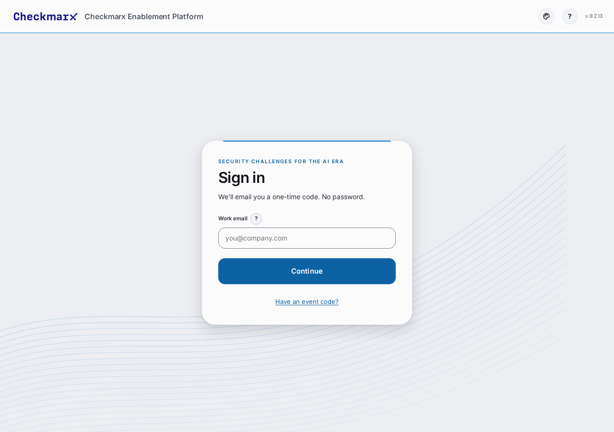

There is no separate sign-up button. Type your **work email** and press
**Continue**. We email you a one-time code; type it into the box that opens and
press **Sign in**.

- **You already have an account?** The code signs you straight in. Type your
  **primary email** — the address your account signs in with. A secondary
  address on your profile never receives a sign-in code, so typing it sends
  nothing.
- **New here?** The same code confirms your address, and a short form opens to
  create your account (see [Register](#2-register)).
- **Chose a password?** If you set your account to sign in with a password,
  **Continue** opens a password box on the same card instead, with **Email me a
  code instead** beneath it. See [Signing in with a
  password](#signing-in-with-a-password).

If you type a personal address (Gmail, Outlook and similar), the card reminds
you to use your work email: a new account needs one. An account whose primary
email is already a personal address can still sign in with it, and an
invitation sent to a personal address opens this card with the address filled
in and no reminder: start from the invitation's link. See [Signing in with an
emailed code](#signing-in-with-an-emailed-code) for the details.

---

## 2. Register

After the code, the sign-up form shows the address you just confirmed and asks
for only a few things:

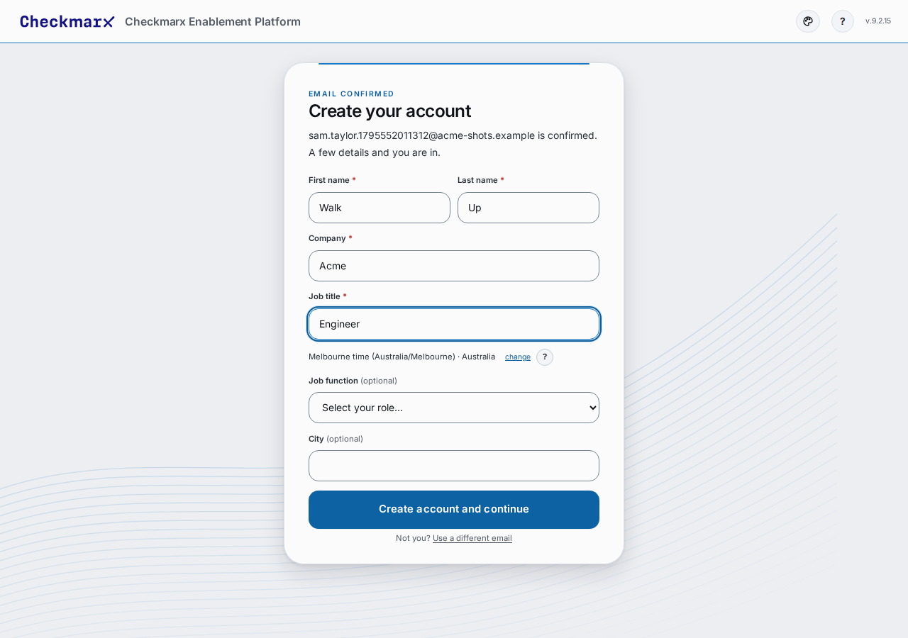

- your **first and last name**, **company** and **job title**;
- your **location** — worked out from your browser and shown as one line, such
  as "Kolkata time (Asia/Kolkata) · India". Press **change** if it is wrong;
- your **job function** and **city**, which you may leave blank;
- anything else **this event** asks for — an event can make those two required
  or leave them off, and can ask for a salutation, a phone number or a LinkedIn
  profile.

Press **Create account and continue** and you are in. A nickname for the
leaderboard is picked for you from your name; change it, and add a photo or a
second email address, later in your profile.

If the platform has been set to have an administrator approve new accounts, you
see a "Pending Approval" message instead, unless you signed up through an
event's join link, QR code or event code still open when you finish signing up
(typing your code in the browser where you asked for it), or through an
invitation from an organiser who may approve accounts: those are approved at once, as is anyone already waiting who
signs in through a join link. Once you are approved, sign in
again with a code.

> **Complete Your Profile.** If any required detail is missing, a message
> asks you to fill it in the next time you sign in, however you sign in, and
> you can't use the app until it's complete. It stays up until every
> required field is filled.

**Different events can ask for different things.** A stand at a conference may
want nothing more than the basics; somewhere else you may be asked for a phone
number or a city. Nothing has gone wrong — the organiser of each event decides
what they need to collect. If an organiser makes a field required after you
signed up, the **Complete Your Profile** message asks for that one thing the next
time you use the site.

---

## Joining via a self-enrollment link

At some events an organiser shares a single **join link** or **QR code**
instead of inviting everyone individually:

1. **Scan the QR code** (or open the link). The sign-in card shows the event
   you're about to join, with whether it is live (or, at a stand still taking
   late entries after its end, **Late entry open**).
2. Type your work email and press **Continue**, then enter the code we email you
   (or your password, if you sign in with one).
3. **Already have an account?** You're added to that event and taken straight
   to it. **New here?** Fill in the short form and you are in — and in the event.
   Type the code in the browser where you asked for it: in any other browser it
   still signs you in (or lets you sign up), but does not join the event, so
   nobody holding the link can put your account into it. If, before you enter
   the code or finish the sign-up form, the organiser switches the link off or
   replaces it, or the event stops taking people, you still sign in (or sign
   up, and the sign-up tells you so), without joining the event; an invitation
   you were sent still counts.

Got interrupted half-way? As long as you come back in the same browser before
the event ends (or, at a stand still taking late entries, before late entry
closes), the site remembers which event you were joining — even after closing
and reopening the browser.

You only need the link once — afterwards the event appears in your normal list
every time you sign in.

### Joining with a short event code

If the QR code will not scan, the signage also carries a **web address and a
six-character code** (`ABC-123`). Open the address and click **Have an event
code?** on the sign-in card. Type the code and press **Find event** — the dialog
names the event so you can check it is the right one — then press **Continue
with my email** and carry on as above.

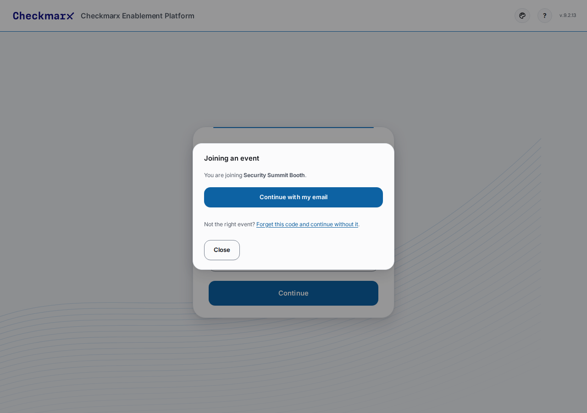

**Scanned the wrong thing?** Choose **Not your event? Continue without it**
under the event's name on the sign-in card (or on the sign-up form), or **Forget
this code and continue without it** in the event-code dialog. The event is
cleared for good — it will not come back the next time you open the site. If we
already emailed you a code, it still signs you in, just without joining that
event (the email still names it).

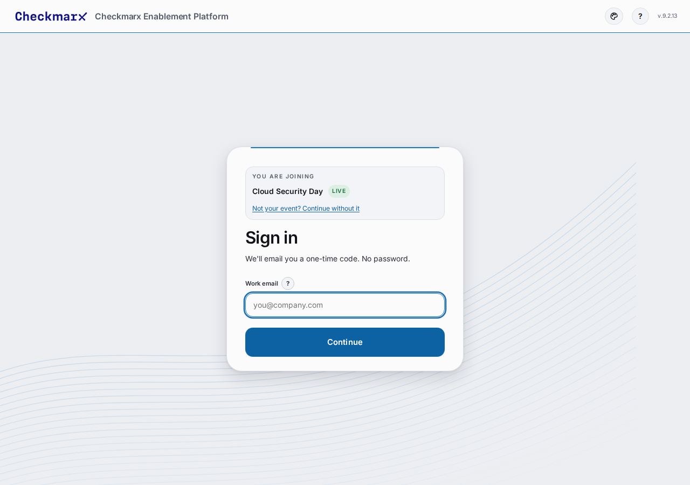

There is also a code box just above your list of events once you are signed in,
for joining a second event later.

The event code is not fussy about capitals, and typing `O` for `0` or `I` for
`1` still finds the right event. It stops working the moment the event
finishes — or, at a stand that is still taking late entries, when late entry
closes.

### Signing in with an emailed code

Type your email on the sign-in card and press **Continue**. The code box opens
and names **exactly which mailbox to look in**. Enter the code and press
**Sign in**. (If your account signs in with a password, the card asks for it
first: choose **Email me a code instead** to get a code.)

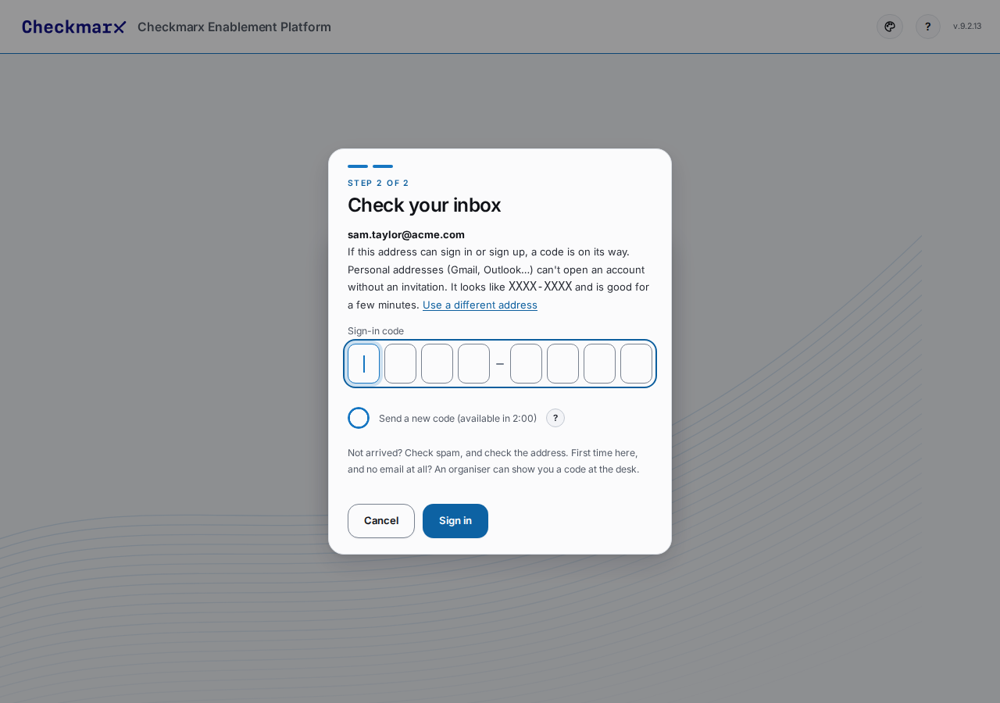

The code looks like `XXXX-XXXX`. Typed the wrong address? Choose **use a
different address** and correct it on the card. Came back to the page with a code
still in your inbox? Press **Continue** with the same address (or **Email me a
code instead**, if the card asks for your password): the code box reopens and
says the code is already on its way, without sending another.

This code is not fussy: capitals or lower case both work, and typing `O` for `0`
or `I` for `1` still works. It expires about **ten minutes** after the first one
was sent. **Send a new code** becomes available two minutes after the last one; a
code sent less than two minutes ago is never replaced, so pressing the button
twice cannot cancel the code already in your inbox.

**There is a limit, and pressing the button again is not the way round it.**
Only a few codes are sent to one account inside that ten-minute window. Past
that the button still looks like it worked — it has to, so that nobody can use
it to find out whose addresses are registered — but no further email goes out.

**Typed a few wrong codes?** Ten wrong codes (or passwords) in five minutes lock
the account for an hour, and we email you to say so. You are not shut out by it: a
**correct** code from a fresh email still signs you in and lifts the lock.

**No code arriving?** First check that you typed your primary email. Then ask an
organiser. If you have **never signed in before**, they can read a code straight
off their own screen for you — it needs no email at all, which is exactly what to
do if your mail is slow or blocked, and it is the right move as soon as the
first code fails to turn up rather than after the third try. To use it, type
your email, press **Continue** and enter that code in the box that opens. Until
it expires (the organiser can tell you how long it has), nothing you press
replaces it, so this does not cancel it with an emailed one. Once you have
signed in before, an organiser can only have a fresh code emailed to you.

### Signing in with a password

Most accounts sign in with an emailed code. If you chose to sign in with a
password instead (see [How you sign in](#how-you-sign-in)), pressing
**Continue** with your email opens a **Password** box on the same card, and the
button becomes **Sign in**.

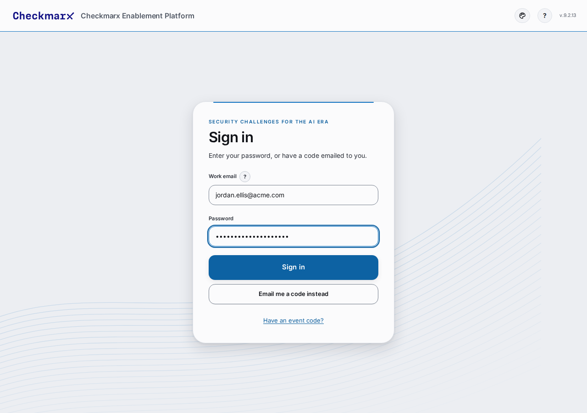

Type your password and press **Sign in**. **Email me a code instead**, beneath
it, always works: choosing a password never takes the emailed code away, so use
it whenever you have forgotten your password or would rather not type it on this
device.

A wrong password only says that it did not sign you in. Wrong passwords count
towards the same limit as wrong codes: ten in five minutes lock the account for
an hour, and we email you to say so. Your **correct** password, or a correct code
from a fresh email, still signs you in and lifts the lock.

If your account is waiting for an organiser's approval, {{platformName}} tells
you so only once the password is correct. If it asks you to confirm your email address
first, choose **Email me a code instead**: entering that code confirms your
address, and your password works from then on.

**Forgotten your password?** Choose **Email me a code instead** and sign in with
the code. Then, within ten minutes, open **Profile → How you sign in** and set a
new password — you are not asked for the old one in that time.

### Verify within 48 hours

Entering an emailed code confirms your address, so this rarely applies. If an
organiser signed you in with a code from their own screen, an amber **"Verify
email"** badge with a countdown may sit next to your name: click it and choose
**Resend verification email**, or simply sign in once with a code from your
inbox. If the 48 hours run out first, you'll be asked to verify before you can
sign in again.

---

## 3. Pick an event

Once you're signed in, you'll see the events you've been invited to —
unless you are in only one, in which case there is nothing to choose and you go
straight into it. That happens every time you sign in, including the first.
Press **Events** in the top bar to reach the list; the platform then
remembers you wanted the list and stops sending you straight in.

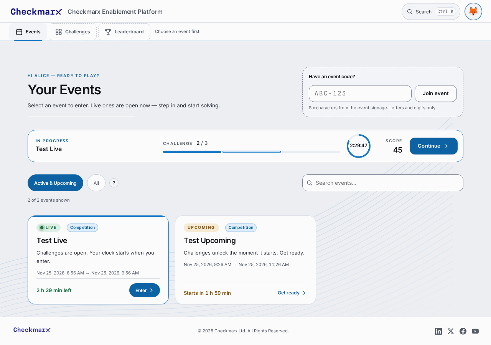

The page greets you by name. Each card shows the name, its status (Live /
Upcoming / Ended), a chip naming the **event type**, and either the start and
end times or, for an event split into several sessions, how many sessions it
has. A live countdown sits below that — "2 h 10 min", or "50 days left" for a
long programme. A Program whose closing date is five years or more away (as it
is when its organisers leave it open) says **No fixed deadline** as the end of
its dates instead, and shows no time left (one that has not started yet still
counts down to its start). A yellow
**test/dry run** badge marks a practice run — it works like any other, except
that it issues no certificates.
Click a card to enter.

**Picking up where you left off.** Above the cards, a **progress strip** shows
up to three live events you have been playing in this browser tab, most recent
first: which challenge you are on (the first one you have neither solved nor run
out of attempts on) — or, once nothing is left to answer, how many you solved —
the time left and your score, with a **Continue** button that takes you straight
back in. Once you have solved every challenge the strip says **All solved**;
once every challenge you have not solved has no attempts left it says
**No attempts left** (an organiser can give you another attempt); an event of
quick questions only says **All answered** once you have answered them all. Once
nothing is left to answer, its button reads **View**; while a quick question is
still open it reads **Continue**. On an event split into
sessions, the time left is your own session's, and once your session has ended
the event leaves the strip, even while later sessions are still to run.

**The three event types differ in ways you will notice.** A **Competition** is
ranked: it has a leaderboard, a running score and placings. A **Booth Event** is
a short walk-up session at a stand (on a phone, its multiple-choice questions are
large tiles you tap). A **Program** is self-paced material running to a
deadline: it has no leaderboard and no placings. Once you have finished every
challenge (solved it or used every attempt) you get a grade, and a grade of 60%
or more earns your certificate straight away rather than when the event
finishes (see *Your grade on a Program*). Its
points still count — each challenge shows what it is worth, and answering one
tells you your total — but the header, the play bar and the progress strip show
no score.

The list starts on **Active & Upcoming**, which hides events that have already
finished, and a line above the cards says how many you have in total. So if it
reads "0 of 3 events shown", your events have simply all ended —
click **All** to see them.

A **search box** above the cards matches the event name, which is worth
knowing once you have taken part in a few events. If you search while the list
is on **Active & Upcoming** and find nothing, the message says so and points at
**All** — the event you are looking for may simply have finished.

If an event has several **sessions** (for different time zones), you'll
pick one first.

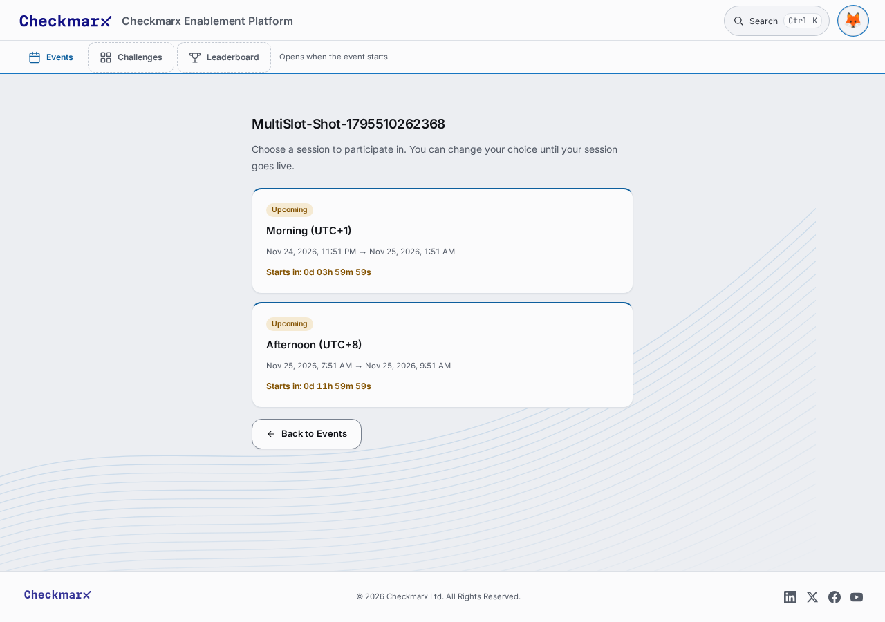

You can change your choice up until the session goes live, after which it's
locked in.

> **Set a reminder.** On an upcoming event, click **Remind me 1 hour before
> start** to get an email an hour before it starts. In an event with several sessions,
> choosing or changing your session clears it; otherwise there is no way to
> cancel one, so only set it if you want the mail. If an organiser moves the
> session, your reminder moves with it — you'll get it an hour before the
> **new** start time, not the old one. If the new start is less than an hour
> away, the email comes straight away and says how long is really left,
> rounded to the nearest minute. The subject line reads "starts in 1 hour"
> when the start is 55 minutes or more away, "starts in 20 minutes" (the real
> number) below that, and "starts in a minute" in the last minute or so. The
> email itself says the same with "about" ("starts in about 20 minutes"). A
> reminder is not sent once the start has passed: if your event or session
> begins before the email can go out (for example while the platform is in
> maintenance), it is not sent at all, and in the last minute before the
> start you can no longer set one.
>
> If you have ever used your mail client's **Unsubscribe** control on one of
> our invitations, reminders or event-access emails, that address is
> opted out of all of them: the reminder is then quietly not sent, even though
> the page still says it is set. Ask an organiser to re-subscribe you — you
> cannot undo it yourself. Verification, sign-in code, lockout and
> password-change emails are never affected.

Click an upcoming event early and you'll see a countdown screen (you
can set the reminder here too):

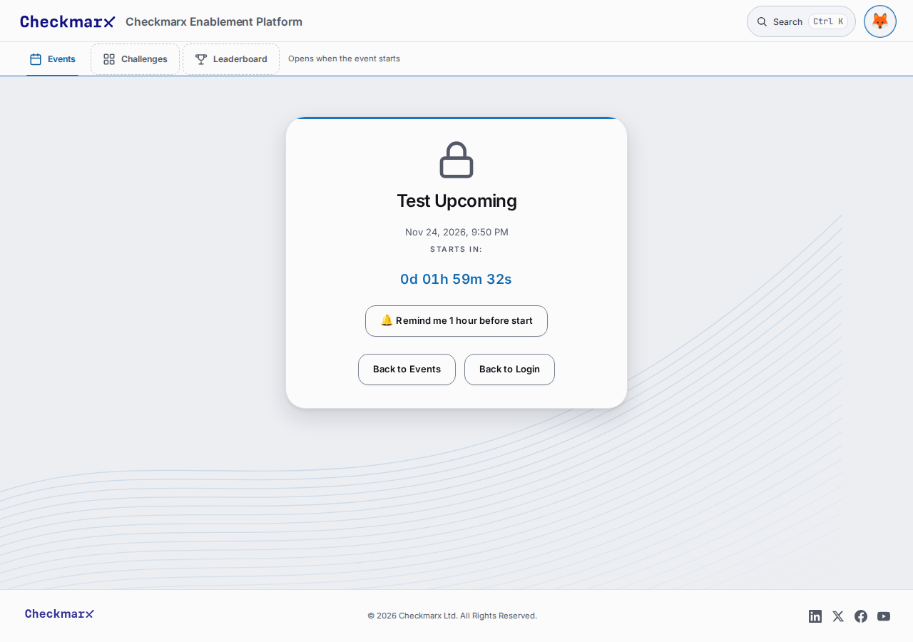

### You only pick once

Once you've chosen an event, the platform remembers it. The next time you sign
in you go **straight there** — into the challenges if it's running, or to the
countdown screen if it hasn't started yet. You don't have to find it in the
list again, and it works across devices, because the choice is stored on your
account rather than in this browser.

It doesn't matter how you sign in — a code from your inbox or from an
organiser's screen, or your password — it takes you back to the same place.

That covers the two ordinary cases: picking tomorrow's event the night
before, and stepping away from a stand mid-event and coming back later.

**To stop it, go back to the event list.** Clicking **Events** in the top
bar (or **Back to Events** from the session picker) tells the platform
you're done with that event for now, and your next sign-in starts on the list
again. **Events** never asks you to confirm, even while an event is live:
nothing else changes — you're still enrolled, your score is untouched, the
clock is not paused or reset, and you can click straight back in.

It doesn't matter what **state** the event is in either. Live, not yet started,
or **finished** — if you didn't go back to the list, that's where you land. A
finished event is often exactly the one you want: the answers, the final
standings, your certificate. And it doesn't matter what **else** you're enrolled
in: a live event somewhere else does not override the event you actually
chose.

Only two things send you to the list instead, and neither is a surprise:

- **You went back to it.** That's the opt-out above, and it's remembered — not
  just for that visit.
- **The event is gone, or an organiser removed you from it.** You land on the
  list rather than on a screen you can no longer use — or, if that leaves you
  with exactly one event, straight into that one.

## The top bar and your account menu

Signed in, the header holds **Search** and one round **account button** with
your initials or picture at the far right; beside them, while you play, sit your
score and the time left. Under the header is **one bar** with **Events**,
**Challenges** and **Leaderboard**, the same on a phone, a tablet and a laptop.
Until you have entered an event, **Challenges** and **Leaderboard** are inactive,
drawn with a dashed edge, and the bar says **Choose an event first**.

**Search** (or **Ctrl+K**, **⌘K** on a Mac) opens one box for everything: type
a few letters and pick a page (**Events**, **Challenges**, **Leaderboard**,
**Profile**, your certificate once you have one), one of **your events** by
name, or a **help topic** — a heading of this guide, which opens right at that
section. **↑** and **↓** move through the results, **Enter** opens one, and
**Esc** or a press outside the box closes it. With nothing typed it shows what
you opened last. On a phone it fills the screen.

The account button opens your **account menu**, a short list (a sheet from the
bottom of the screen on a phone): your name and address, **Appearance**,
**Profile**, **Help** (this guide) and **Sign out**. **Esc**, or a press anywhere
outside it, closes it.

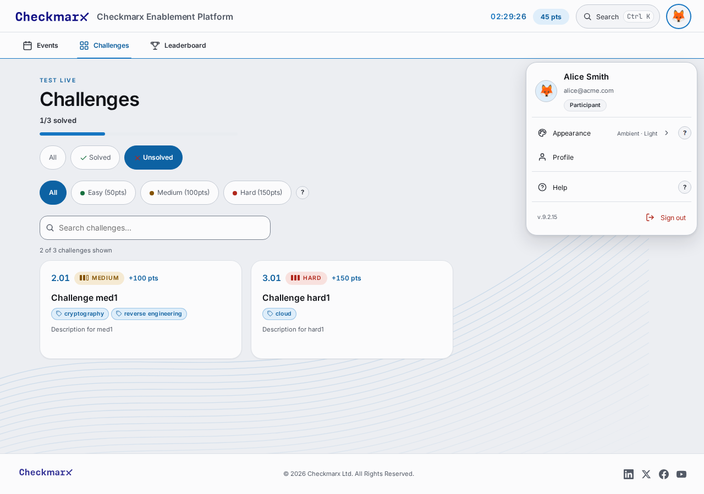

**Appearance.** The **Appearance** row shows what this browser is set to (for
example *Ambient · Auto*) and opens the Appearance page. There, choose
**Auto** (follow your device's light or dark setting), **Light** or **Dark**,
and one of two **looks**, each with a live preview — **Ambient** and
**Signature**. On Ambient you can also pick its accent colour. A look changes
colours and corner shapes, never what anything does. When your organisers have
set the look for everyone, the row says so and the page explains it. **Show all
tips** opens every small **?** note on every page at once. Your choices are kept
in this browser; until you pick a look you get the one your organisers chose for
everyone, or, if they chose none, Ambient following your device's light or dark
setting.

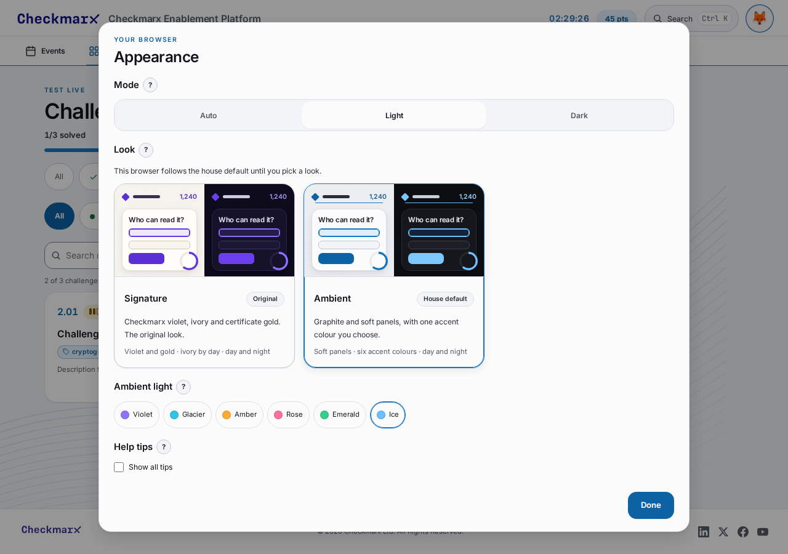

---

## If you are staff

Everyone who runs {{platformName}} — every administrator, and anyone an
administrator has tagged **staff** — can walk into any event to look around,
without being enrolled in it and without appearing on its leaderboard. Some
events go one step further: an organiser can switch on **Staff can compete**,
and in one of those an enrolled staff member is a participant like everybody
else. This section is for you if either applies; if you are not staff, nothing
in it changes what you see.

### Your Events page has two sections

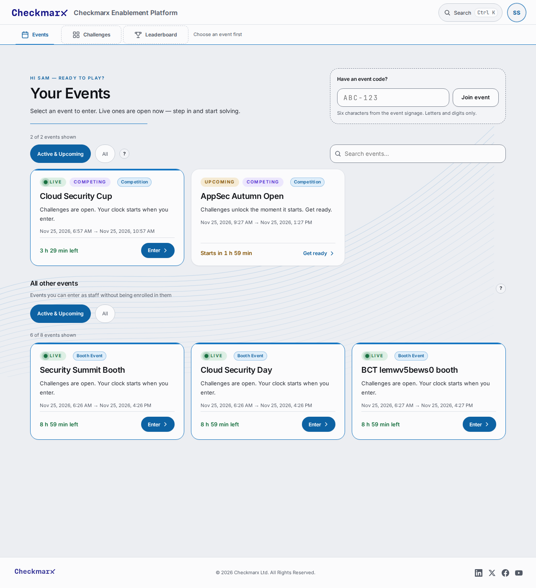

- **Your Events** — the events you hold a place in. Where staff compete, that
  is any event an organiser, a group, an invitation or a join link put you in
  (if your own account is an administrator's, the organiser who adds or invites
  you has to be a superadmin — or you, adding yourself), and the card carries a
  **Competing** badge: you are on that event's board and everything below about
  confirmations applies to you. Where staff do *not*
  compete nobody can add you: an organiser's assign, an invitation and a group
  bound to the event all leave you out — the first two tell the organiser why,
  a group says nothing — and the link lets you in without enrolling you. So a
  card without the badge is an event you were enrolled in before you became
  staff: you can enter it, but you are not on its board.
- **All other events** — every other event on the platform, which you can enter
  as staff without being enrolled in it.

Each section has its own **Active & Upcoming** / **All** buttons, so showing
your own finished events does not also list every finished event on the
platform, and a line above each grid says how many it holds. The **search box**
under the first heading is shared — one search narrows both lists. If you have
not been added to anything, the top section says so and points you at the list
below, rather than reading as though there were no events at all.

### Where you compete, you are asked what a participant is asked

Enter an event where you are competing and every confirmation a participant meets
is put to you too: **Enter Live Event** when you step into one that is running
(or **Switch Event?** when you are coming from another live one), **Join Live
Session** when you pick a session that has already started — after which your
session choice is final, exactly as it is for anyone else. Where staff
do not compete none of those appear, and in an event with several sessions you
keep a **Switch Session** button, because nothing you do there is scored.

### Join links, QR codes and event codes

Scan a join link, or type an event code, for an event where staff compete and you
are asked **Compete in this event?** before anything happens, because joining
enrols you as a competitor — on the board, and, if you are an administrator,
unable to change that event or any challenge in it until you remove yourself
from it. **Join and compete** does exactly that; **Not now** leaves the event
alone and forgets the link, so you are not asked again the next time you open
the site. Signing in from the link's own page never answers that question for
you, whether with a code or with a password — you are signed in and enrolled in
nothing, and the question is asked once you are in. If you wrote one of the event's
challenges you cannot join it as a competitor at all — a challenge's answer is
known to its author — and the refusal names the challenge; ask an organiser to
take it out of the event first.

If you are an administrator, the link and the event code enrol you while you
are in participant view. Opening a link signed out and then signing in
takes you to the admin panel and enrols you in nothing — the question
is not asked then, and the link is not applied later either. Choose
**Switch to Participant View** in your account menu and open the link again, or type the event's printed code
into the box on your event list.

Having joined an event that has not started, you can leave again from the
waiting screen like anyone who came in through a link — see [Leaving an event
you joined yourself](#leaving-an-event-you-joined-yourself). Once the event is
running there is no leave control: ask an organiser to take you out, or, if you
are an administrator (or an event admin, on an event you organise), remove
yourself from the event's participant list, which is the one change to that
event you can still make while you compete in it.
Either route is open only while the event has not finished; once it has, nobody
leaves it, and an administrator who competed in it stays unable to change it or
its challenges — another organiser makes those changes, and once the event's
end time has passed that is a superadmin. If an organiser added
you rather than a link, the waiting screen offers no leave control at all, so
it is one of the other two: ask them, or remove yourself from the participant
list if you are an administrator.

Use the same link on an event where staff do **not** compete and you are taken
into it without being enrolled — a message says so. You are there
as staff, as you would be from **All other events**.

### Landing in your one event

If you have been added to exactly one event, you land in it when you sign in,
exactly as a participant would — even though, as staff, the list would also have
shown you every other event. Press **Events** to reach the list anyway; from
then on your sign-ins start there, as described under
[You only pick once](#you-only-pick-once). If you are an administrator choosing
**Switch to Participant View** in your account menu, the same rule applies: with one
event to your name you arrive inside it, rather than on a one-card list.

---

## 4. Solve challenges

In a live event, click **Challenges** to see the grid.

**The header while you compete.** A countdown shows the time left in your
session, and it turns red in the final minute. On an event running two days or
more, a **Day 2 of 5** chip sits beside it. A Program whose closing date is five
years or more away says **No fixed deadline** there instead, with no day chip.
On a ranked event your running score is shown beside your account button and
keeps itself up to date: about every 15 seconds while you are using the page,
less often while it sits idle (on an open challenge the play bar shows it
instead, so the page says it once). When the clock runs out the countdown is
replaced by the event's name and *Ended*.

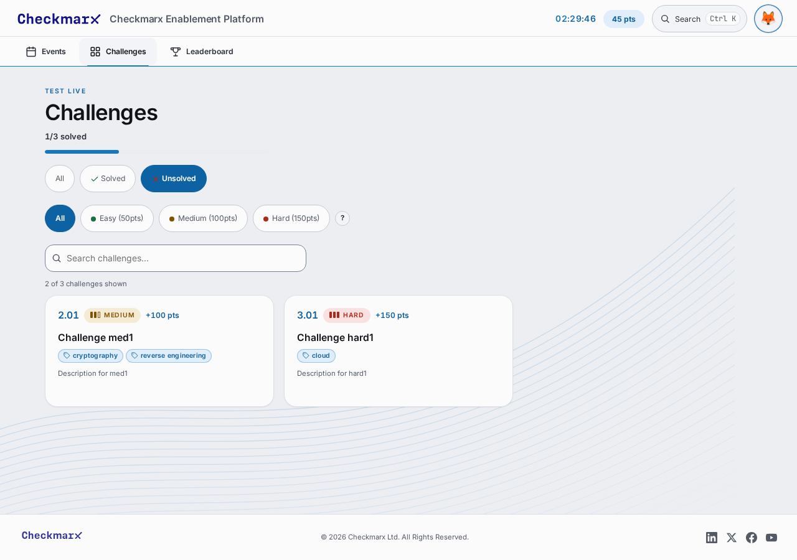

Each card shows difficulty (Easy / Medium / Hard), points, and a short
description. Solved ones get a green checkmark. Click a card to open it.

**A challenge fills the screen**, on a phone and on a laptop alike. Along the top
runs the **play bar**: which challenge you are on (**Challenge 3 / 8**) with a
track of the whole set, a **time ring** that empties as the event runs — it reads
days and hours ("3d 18h") while more than a day is left, a clock ("2:14:07")
under a day, and seconds ("42 s") in the final minute — and, on a ranked event,
your score. A **Program** has no ring (its deadline is usually weeks away): its
play bar says the time left in words instead — **12 days left**, or **No fixed
deadline** when its closing date is five years or more away — on a phone and a
laptop alike, and on a laptop or desktop its countdown stays in the header as
well. If you joined late (see
[Arriving as a booth event is closing](#arriving-as-a-booth-event-is-closing)),
the play bar also says **Late entry** beside the ring. **Back to Challenges**
returns you to the grid.

- **Multiple choice** options are lettered **A**, **B**, **C**… under **Choose
  one** (or **Choose all that apply**). Press the letter on your keyboard to
  pick an option and **Enter** to submit, or click as usual.
- **A correct answer** shows a **Correct** panel in place of the answer box,
  with the points you earned, then a **Challenge Solved!** message whose
  **Continue** takes you back to the challenge list. Open a solved challenge
  again and its panel has a **Next challenge** button that opens the next one
  you have not solved, passing over any you have no attempts left on (or **Back
  to challenges** when none is left). An
  **Any answer** challenge has no wrong answer, so its panel says **Answer
  accepted** instead, and the option you picked (where it offers options) is
  marked in a neutral colour rather than ticked as correct.
- **Reviewing a solved challenge** keeps every option on screen with its letter;
  the right ones are ticked and the others drawn dashed, so you can see what you
  were choosing between.

Some challenges also carry one or more **category labels** — a small tag-shaped
pill such as *web* or *crypto*, shown on the card and again when you open the
challenge. It is the organiser's way of saying what area a challenge belongs to,
so you can tell at a glance which ones are near your strengths. It is optional:
plenty of challenges have none, and it changes nothing about how a challenge is
scored or when it is available.

While an event is running the grid starts on **Unsolved**, so challenges
disappear from it as you solve them. A line above the grid says how many
challenges there are in total, so an empty grid means you have solved
everything rather than that something has gone wrong — click **All** to see
them again. The **solved** count under the **Challenges** heading (and the bar
beneath it) counts the challenges that finish the event, so a **Quick
question** (which scores nothing) is not part of it: solve every scoring
challenge and it reads, say, *5/5 solved*, as the leaderboard's **All Solved**
would.

There is also a **search box** above the grid. It matches the challenge title
and the category label, which is the pair you are most likely to remember —
type `crypto` to see the whole category, or a word from the name to jump
straight to one. It works alongside the filter buttons rather than replacing
them, so you can search within *Unsolved* or within *Hard*. The line above the
grid tells you how many matched, and if nothing does it says so and reminds you
what is being searched. **Clear** puts everything back.

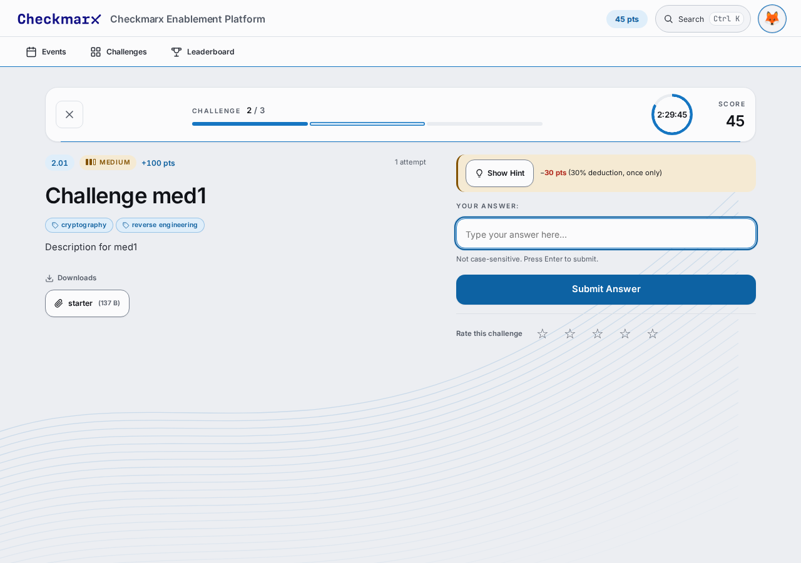

There are five answer types:

- **Text** — type a word or phrase. Case and spacing are ignored, so
  `Paris`, `paris`, and `PARIS` all match. Some challenges accept more than
  one answer, and any of them counts.
- **File** — upload a file; its contents are graded as your answer. Handy
  for long or structured answers.
- **JSON** — paste JSON. The order of keys doesn't matter, but the order of
  items in a list does. Invalid JSON counts as wrong.
- **Multiple choice** — pick from a list. **Radio buttons** mean exactly one
  option is right. **Checkboxes** mean more than one is, and you must select
  *all* of them — getting some right and missing the rest counts as wrong, the
  same as any other incorrect answer. (At a Booth Event on a phone the options
  are large tiles instead — see *Answering on your phone at a Booth Event*
  below.)
- **Any answer** — write whatever you like; there is no right answer to
  check. Anything non-empty is accepted, exactly as you typed it, so there is
  no wrong-answer penalty and no penalty warning before you submit — and no
  hint, because there is nothing to hint towards. It is a single-line box with
  no confirmation step: pressing **Submit Answer**, or **Enter** in the box,
  sends your response at once, spelling and all, and like any solved challenge
  it can be answered only once — so read it over first. What you write is for
  the organisers: they can read every response and export them for the event
  exactly as typed. Some **Any answer** challenges list options under **Choose
  one** instead of a box: every option is accepted, so pick the one that fits
  and press **Submit Answer**. The options keep the order the organiser gave
  them. (At a Booth Event on a phone they are large tiles, and one tap answers,
  as on a Quick question below.) A **Quick question** with options (it shows
  *Quick question* where other challenges show their points) is the one
  exception to answering once: until the event ends you can open it again and
  press **Change answer** to pick another option, and your latest answer is the
  one the organisers see.

On a **multiple-choice** challenge the options are listed in a different order
for every participant, so comparing notes as "it's the third one" won't help
anyone. Your own order stays the same if you refresh.

**Answering on your phone at a Booth Event.** At a Booth Event, a
multiple-choice challenge opened on a phone — or on most tablets held upright —
fills the screen: the question at the top (on a phone held sideways, on the
left) and each option as a large tile, lettered A, B, C, that you tap with your
thumb. While the question is open the usual header, menu and footer step aside;
the countdown moves into the bar at the top, beside a **Back** arrow that
returns you to the challenge list.

- **A tap does not send your answer.** A confirmation names the option you
  picked and reminds you that a wrong answer costs 5 points, so a slip of the
  thumb costs nothing — press **Choose again** to pick another. Its **Submit
  answer** button (it names the letter, for example **Submit answer B**) takes a
  moment to respond, so a double-tap cannot submit by accident.
- **A Quick question is different: one tap answers it.** Every answer is accepted
  and it scores no points, so there is nothing to confirm; you get a thank-you. These
  questions come last in the list, and opening one again shows what you picked.
  **Tapped the wrong one?** Until the event ends, open the question again and
  press **Change answer**: the tiles come back, naming your answer, and one tap
  on another replaces it (**Back** keeps it). On a computer it is the same: the
  options come back with your answer ticked, beside **Keep my answer**. Your
  latest answer is the one the organisers see.
- **A wrong answer marks its tile.** The tile you tried is labelled **Not
  correct** and cannot be picked again while the question is open; reopening
  the question clears the mark. When attempts are limited, the bar says how many
  you have left, and **Last attempt** when it comes to that — a wrong last
  attempt locks the challenge.
- **Several correct options** — tap each one to tick it, then press **Submit
  answers** below the tiles; it says how many you have selected, and its
  confirmation offers **Change selection** to go back. A wrong selection marks
  no tile, because it says nothing about which option was wrong.
- **A long question** scrolls inside its own area, under a **Scroll for more**
  label, while the tiles stay put. **Many or long options** use the same tiles,
  but the whole screen scrolls.

On a laptop or desktop at full width, a tablet held sideways or the largest
tablets, the question looks as described above, with radio buttons or
checkboxes and a **Submit Answer** button. A challenge you have already solved,
or one you can no longer answer, is shown on that ordinary card, read-only, so
you can review it.

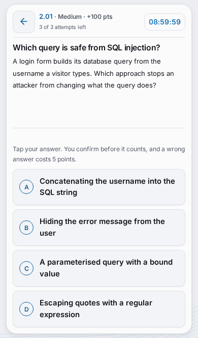

**Reviewing a multiple-choice challenge afterwards.** Once the event ends the challenge stays
readable, and the options stay on screen — you can see exactly what you were
choosing between. If you solved it, or if the organiser turned on answer reveal,
the correct option is marked in place with a **correct** badge — the answer is
shown once, on the option itself. The explanation, where the organiser wrote
one, arrives in a Solution box below only when answer reveal is on: solving a
challenge shows you the marked option, not the explanation. The exception is a
challenge whose author sealed its answer: nothing is marked on it in either case,
and no explanation appears — see **After the event** below.

If an organiser changes which options are correct after you solved a challenge,
the options stop being marked for you and an **Answer changed** note says why.
Your solve and its points still count. The new answer is shown only if the
organiser turns on answer reveal, once the event ends.

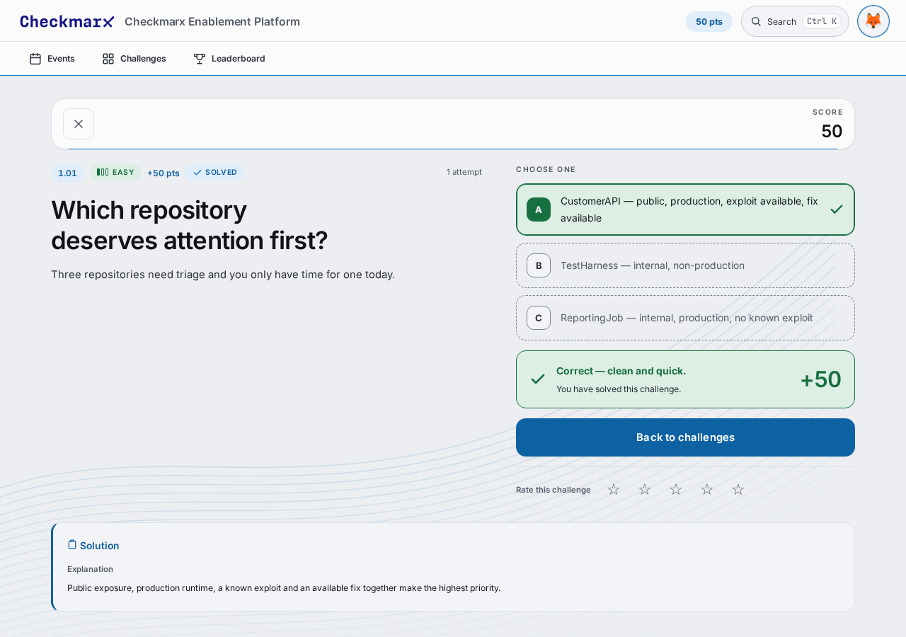

If you didn't solve it and the organiser chose not to reveal answers, you'll
still see the options — but nothing will be marked, because the answer hasn't
been released.

On a ranked event, correct answers score points immediately and a wrong answer
costs 5 points (an **Any answer** challenge cannot be answered wrongly, so it
never asks you to confirm that penalty). You can't re-submit a solved challenge
(a Quick question with options is the exception: you can change its answer
until the event ends).
A challenge shows how many answers you have sent it (**N attempt(s)**), and the
count goes up as soon as each answer is marked — whether or not the event limits
attempts. (The one-screen answer tiles of a Booth Event on a phone leave this count
out; they still say how many attempts you have left when the event sets a limit.)

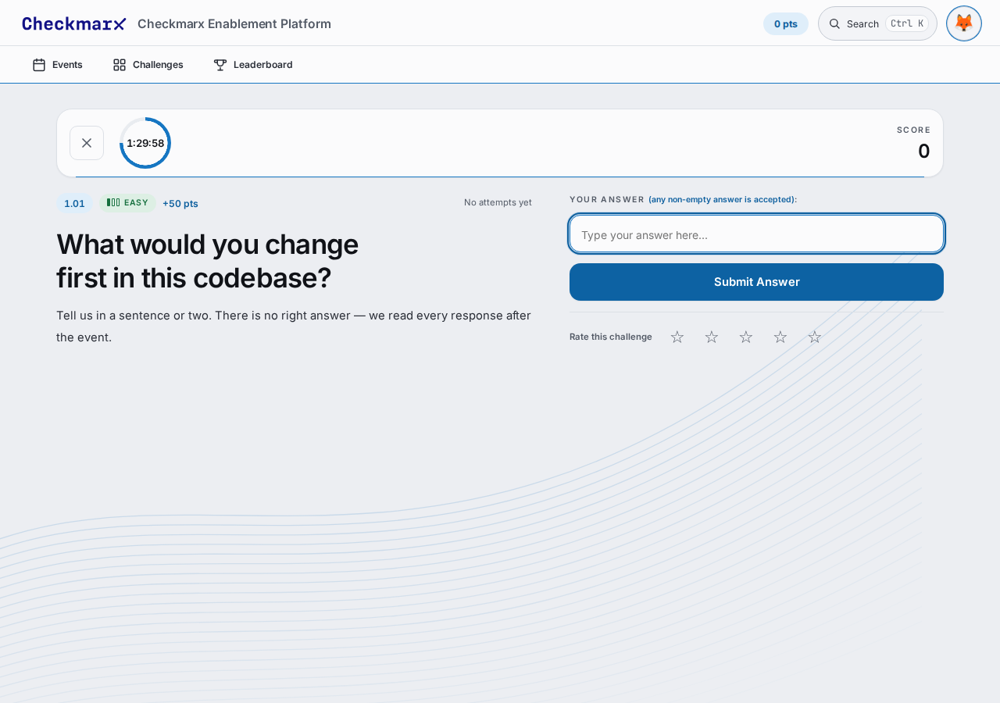

**Some events limit your attempts.** An organiser can cap how many answers you
may submit to any one challenge. The limit can be set on that challenge alone,
or set once on the event so the same per-challenge limit applies to every
challenge in it — it is never a shared budget you spend across the event. Where
a cap applies, the challenge tells you how many attempts you have left on it,
and warns you when you are on your last one; the count updates after each wrong
answer. A challenge that accepts every answer — an **Any answer** challenge, or
a **Quick question** whose options are all accepted — shows no such count,
because no answer to it can be wrong. Revealing a hint never uses one up. If
you send the same **wrong** answer twice in a few seconds — say the connection dropped before the first reply
arrived — it is only counted once: you are told it was already submitted and was
not correct, and, where attempts are limited and you are still on the challenge,
how many you have left. Once they are gone the answer box is replaced by a **No attempts left** panel and nothing
further is accepted; a refused submission costs you no points. **Next
challenge** then passes it over, and its card in the challenge list is marked
**No attempts left**. Ask an organiser if you need another try — they
can grant you more, and the challenge becomes answerable again.

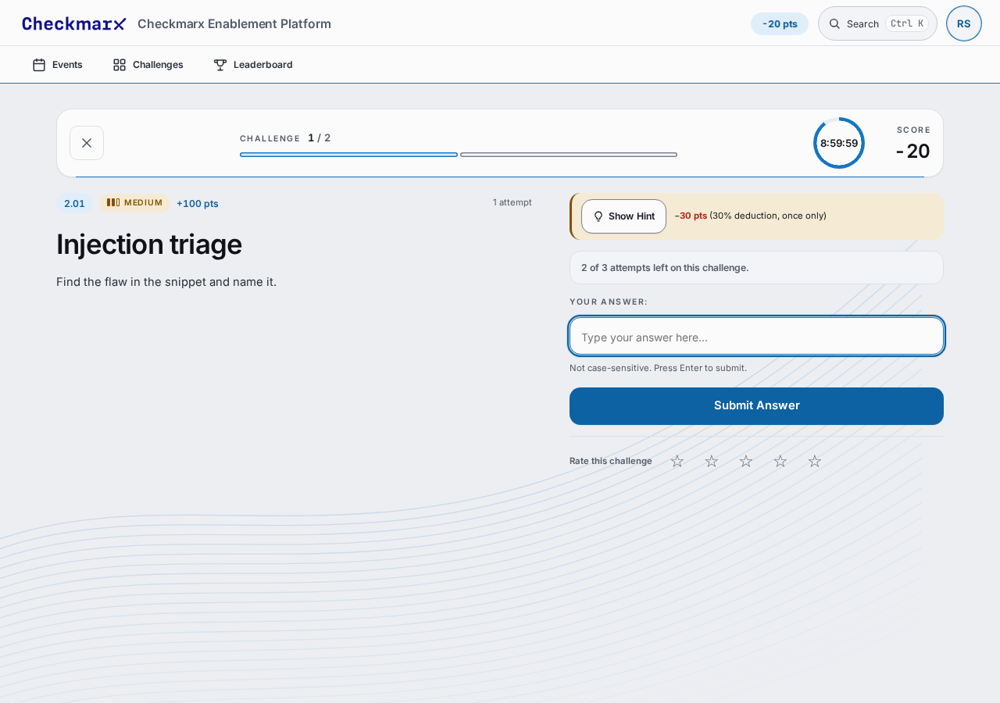

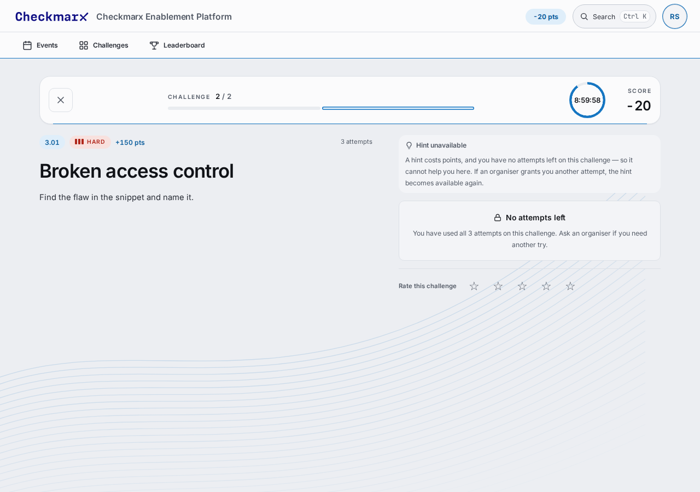

**Attachments.** Some challenges come with files (source code, data, logs).
When they do, a **Downloads** section lists them by name and size, and each one
downloads as a ZIP archive — save them and work on them locally.

You can rate a challenge 1–5 stars whenever it is open — solved or not — and
change your rating later.

**Moving on before an answer comes back.** If you go back to the grid or open
another challenge while an answer, a hint or a rating is still being processed,
you stay where you are — you are not pulled back to the first challenge. The
result of an answer or a rating reaches you as a message naming the challenge it
belongs to (*Incorrect answer on "…"*, a congratulations naming it, a thank-you
for your rating, and so on), and so does a hint that could not be shown. A hint
you paid for is there the next time you open that challenge; if you move on
before you have confirmed what a hint costs, nothing is charged and you can ask
for it again from that challenge. Likewise, if you click one challenge and then
another before the first has opened, the one you clicked last is the one that
opens.

> **Note:** the platform records when you open a challenge and leave without
> solving it. This only helps organisers see which challenges are being
> attempted — it never affects your score.

---

**What joining shares.** When an event has a team receiving its reports, the card
where you join says so: its organisers and their sales and marketing team receive
your name, work email, company, job title and your answers to its quick
questions. Answer **No** to *Would you like someone to follow up with you?* and
you are left out of their follow-up lists; you can change the answer until the
event ends.

## 5. Hints

If a hint is available, you'll see a **Show Hint** button. An **Any answer**
challenge never has one.

Revealing it costs **30% of that challenge's points** and can only be done
once. You're asked to confirm first.

Three cases cost you nothing. Once you have solved a challenge its hint is free,
because there is nothing left to deduct. A quick question scores nothing, so any
hint it has is free too, and you are not asked to confirm. And where a challenge limits your
attempts, the priced button disappears as soon as you run out — a hint could no
longer help you, so it is not sold to you. A hint you had already paid for stays
on screen either way.

---

## 6. Leaderboard

**Not every event has one.** A **Program** is not ranked: your points still
count, but nobody is placed by them, and its certificate depends on solving
everything rather than on where you came. Its **Leaderboard** button stays inactive, drawn with a dashed
edge, and the bar says **This event has no leaderboard**. The rest of this
section is about competitions and booth events.

Click **Leaderboard** for live rankings.

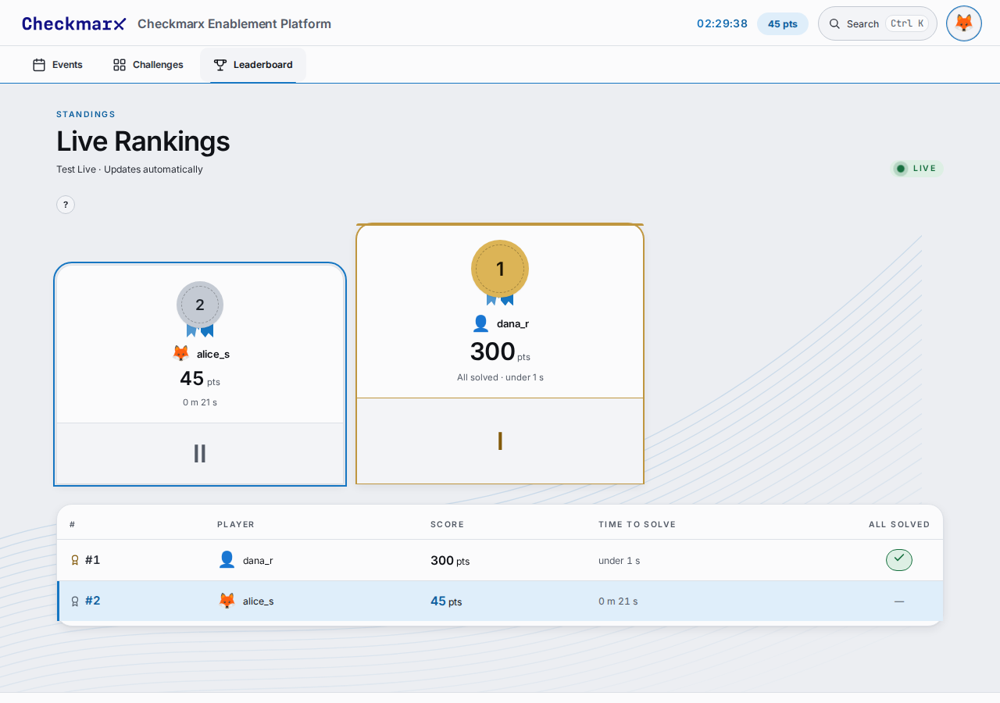

Ranking is by **score** (highest first), then by **finish time** (faster
first) among ties. Your time is measured from **when your clock started** —
see *When your clock starts* below. The top three stand on a **podium**, and the table below
starts at rank 4. Your own row is highlighted, and the board updates by itself:
soon after a score on it changes, and at least once a minute. When the event
ends, an open board turns into the **Final standings** by itself within a
minute, usually much sooner. Once the event has ended, each podium place with
points above zero names the certificate it earns — **Gold**, **Silver** or
**Bronze certificate** (a practice run issues none, so its podium names none).
A place in the top three on zero points or fewer earns a
participation certificate instead, and somebody who never attempted a challenge
earns no certificate, whatever their place.

It shows the **top 20**. If you're outside it, your position appears in a
separate "Your placement" card below the table — so you always see where you
stand without scrolling.

A green **All Solved** badge in the last column marks everyone who has finished
every challenge.

**Sorting.** Click any column heading — place, player, score, time to solve, or
all solved — to reorder the board; click the same heading again to reverse it.
Sorting only rearranges the rows you can already see: it never uncovers
participants outside the top 20, and it never tells you how many people are
taking part. Your own placement card stays put while you sort.

### Team Rankings

If the organizer turned on team scoring and set up at least two teams for your
event, a **Team Rankings** board appears below the individual one. Each team is
ranked by its members' **average score**, and your own team is highlighted. Anyone
playing on their own appears here too, so teams and solo players are ranked side by
side. If you don't see it, the organizer hasn't enabled it for this event.

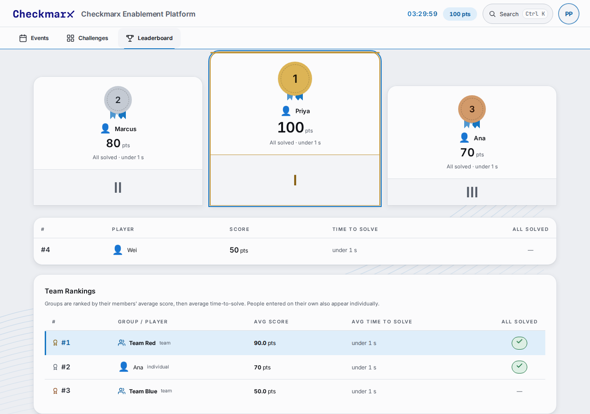

On an event with sessions, the organiser chooses how it is ranked: a winner per
session (you are ranked against your own session, named above the board, and
can't see the others), one overall winner (everyone together), or both (your
session's board, and the **Overall** board below it). Each session can have its
own questions, so your Challenges page shows only your session's. Where the
overall board ranks by **percentages**, it ranks everyone by the share of their
own session's points they earned, and shows the points under it; time still
breaks a tie. A top-three place on either board earns a certificate that names
the board, so with both you can earn two.

---

## 7. Profile

Open your account menu (the round button at the top right) and choose
**Profile** to edit your profile.

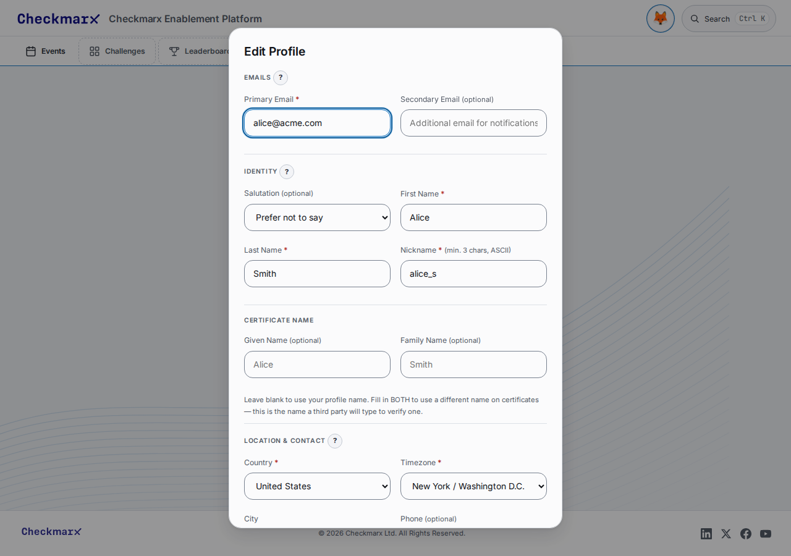

You can update your details, avatar and emails, and change the
optional fields — salutation, phone, city, job function, and the **Certificate
name** pair. To clear an optional field, pick the blank "Prefer not to say"
salutation or empty the box. (If the event you signed up through requires one
of them, you are asked for it again before you carry on.)

**Certificate name.** Two optional boxes, **Given Name** and **Family Name**,
say how your name should be printed on a certificate. Leave both blank and your
ordinary profile name is used; fill in **both** to use a different spelling.
Filling in only one has no effect. The family name is also what anyone verifying
one of your certificates will be asked to type, and a certificate freezes that
name when it is created — so set this before you claim one.

**Changing your avatar.** At the bottom of the editor your current avatar is
shown beside the choices. Pick any of the characters, or upload your own
picture — it is scaled down in your browser before it is sent, so an ordinary
photo from your phone is fine. Choose the first option (the plain grey figure)
to go back to no picture at all. Your choice is saved with the rest of the
form.

> **Changing your sign-in email is confirmed by a link.** We email a
> confirmation to the new address; your current email keeps working and you
> stay signed in until you open that link (within 48 hours). Your secondary
> email changes right away. Every address must be unique across the platform.
>
> **Only your primary email signs you in.** Sign-in codes go to it alone, and
> the sign-in card looks your account up by it. The secondary address never
> signs you in, though some notices — the lockout email, for one — are sent to
> both.

Every field is editable. Any LinkedIn URL you enter must be a valid web
address.

You're only asked to confirm when you've actually changed something.

### How you sign in

The profile's **How you sign in** row says how your account signs in: with a
one-time code emailed to you each time, or with your password. While you have
not chosen, it adds *(The default for your role.)* — for participants and event
admins the default is an emailed code. Press **Change how you sign in** to
choose.

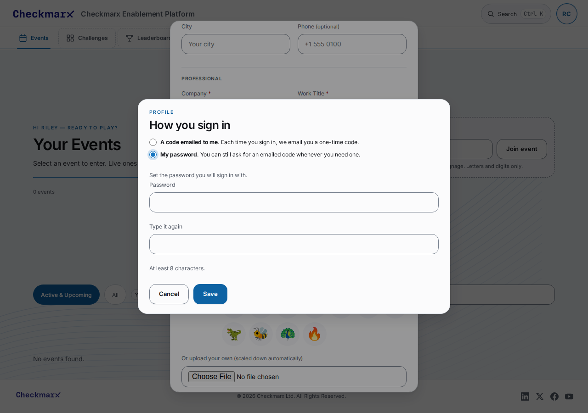

- **A code emailed to me.** Each time you sign in, we email you a one-time code.
  A password you set earlier is kept, unused, in case you switch back.
- **My password.** The sign-in card asks for your password. If none is set yet,
  type one into **Password** and **Type it again**: it is set when you press
  **Save**. You can still ask for an emailed code whenever you need one.

A password needs at least 8 characters, and at most 72 bytes (about 72
characters; fewer with accents or emoji). Your choice is kept on your account,
so it applies on every device.

**Changing your password.** With **My password** chosen, fill in **Current
password**, **New password** and **Type it again**, then press **Save**; leave
the boxes empty to keep the password you have. A wrong current password counts
as a wrong sign-in. Changing your password signs your account out of every other
browser and device. Whenever a password is set or changed we email your primary
address to say so; if that wasn't you, sign in with an emailed code straight
away (**Email me a code instead**), set a new password here, and tell an
organiser.

**Forgotten your password?** On the sign-in card choose **Email me a code
instead** and sign in with the code. For ten minutes after that, **Current
password** is not needed: type the new password twice and press **Save**. After
ten minutes, sign out and sign in with a code again.

---

## If you get signed out

- **Inactivity.** Sessions expire after an hour. About five minutes before,
  a countdown offers **Stay logged in** or **Logout now**; any mouse,
  keyboard, scroll, or touch activity also keeps you on. After the timeout,
  click **OK** to return to the login page.
- **Signed in elsewhere.** Only one session per account is allowed. If your
  account signs in from another browser or device, this session closes and a
  pop-up shows your name (or email), the other browser's IP address and the
  time. If it wasn't you, tell an organiser straight away. If you sign in with
  emailed codes, also make sure nobody else can get into your email — your
  sign-in codes are sent there. If you sign in with a password, sign in with an
  emailed code (**Email me a code instead**) and change your password under
  **Profile → How you sign in**.
- **Your password was changed.** Changing your password on one device signs
  your account out everywhere else; there, the pop-up just says you were signed
  out.
- **The platform was updated.** If this happens while you're signed in, a
  message asks you to sign in again — nothing is lost.

If your session is ended for any other reason, the pop-up just says you were
signed out.

**More than one tab.** All the tabs of one browser share one session. Signing
in again in one tab leaves the others working.
Signing out in one tab signs them all out, and the others say *You signed out
in another tab of this browser* rather than blaming inactivity. If
someone signs in as a different account in another tab of the same browser,
your tab says *This tab is out of date* and sends nothing more; **Reload** opens
whichever account is signed in now.

A browser is in **one event at a time**. If you open a different event in
another tab, or go back to the event list there, a tab still showing the first
event says *This tab is out of date* the next time it checks in or you act in
it, and anything you just did there — an answer, a hint — is not recorded and
costs nothing. **Reload** shows the event you opened, or the event list.

An answer or certificate that is still on its way when your
session ends is not saved, and costs nothing. The page tells you so: sign in if
you're asked to, then try again.

If your account is waiting for an organiser's approval, {{platformName}} tells
you so once you enter a **correct** sign-in code or password.

**Too many wrong codes or passwords** lock the account for an hour and send you
an email saying so. You are not shut out by it: a **correct** code from a fresh
email, or your correct password, clears the lock and signs you straight in. That
matters because anyone can trigger the lock by guessing at your address — so the
lock never stands between you and your own account, and the email is your signal
that someone was trying. What keeps guessers out is the limit on how fast codes
and passwords can be tried.

A brief network problem is *not* one of these. If your connection drops or
the server is momentarily busy, {{platformName}} retries quietly and you stay
where you are — you will not be sent back to the event list, and your
place in the event is unaffected.

If a challenge suddenly refuses your answer with "locked — no longer
accepting submissions", an organiser has frozen it (usually to fix
something mid-event). Move on — your points on it are already counted.

---

## After the event

When your session ends, you'll see your results. If other sessions are still
running, the correct answers stay hidden until they all finish (this stops
answer sharing between time zones). Once everything ends, **if the organiser
chose to reveal answers**, you can review the correct answers and explanations
for every challenge. A text challenge that accepted more than one answer lists
every accepted answer in its Solution box, separated by `|` — any one of them
would have counted. Many organisers leave that off — often because the same
question bank is reused at the next event — in which case a challenge you solved
still shows its own answer **if it was multiple choice** — the correct option
stays marked on it — while a text, JSON or file challenge shows you nothing at
all, and an **Any answer** challenge has no answer key to show. Anything you did
not solve stays unmarked either way. On a **Program**
answers are never revealed.

A few challenges never publish their answer at all, whatever the organiser chose:
the person who wrote a challenge can seal its answer, which keeps the answer and
the explanation private to them (a superadmin can reveal them, and every such
reveal is recorded). Its hint is sealed too, except that you can still buy it
during an event you are competing in, as you could any hint. A sealed challenge shows **Answer not shown** in place
of its Solution box, with a line saying why — in an event that reveals answers,
and also on a multiple-choice challenge you solved in an event that does not,
where the correct option would otherwise have stayed marked for you. Its hint is
not shown at the end either — though a hint you paid for during the event stays
yours, on screen exactly as before. Nothing has gone wrong and there is nothing
for you to do: your score, your place and whether you solved it are exactly as
they were.

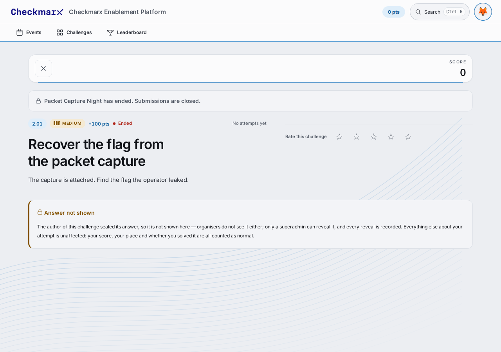

---

## Arriving as a booth event is closing

Some **booth events** — the ones you walk up to at a stand — keep their join link
working for a while after they officially end, so that somebody who scans the QR
code as the organisers are packing up is not left with an account and nothing to
do: the sign-in card then says **Late entry open** rather than **Ended**. If you
join **after the event has ended**, during that extra window, you are
a **late entrant**. Anyone who joined while it was still running, even a minute
before the close, is an ordinary participant.

What that means for you:

- **You can still play.** The header shows a countdown to the late deadline and a
  **Late entry** chip beside it, so you can see how long you have; with a
  challenge open, the play bar's ring counts it down and says **Late entry** too.
  The challenges work exactly as they do during the event.
- **The organisers can close it early.** If they do, answers and hints are
  refused from that moment, and within about fifteen seconds the countdown stops,
  the **Late entry** chip goes and your screen shows the event as ended. Nothing
  you scored is lost, and the **Late entrants** ranking becomes final at that
  moment, as it would have at the deadline.
- **You are ranked separately.** The leaderboard grows a **Late entrants**
  section beneath the main board, and you are ranked there against the other late
  arrivals by exactly the same rules — score first, then time.
- **Your certificate says so.** It carries "late entrant" on the image, on the
  PDF and on its verification page. While the window is still open you can
  collect a **participation** certificate; if you place in the top three of the
  late entrants with points above zero, that certificate is issued after the
  window closes. Collecting
  early means keeping the participation one, so the button tells you before you
  press it.

If you joined an event normally and were still working when it ended, none of
this applies to you — the event finished, and its leaderboard is final. This is a
door for people who arrived after the end, not extra time for everybody.

You don't have to use the QR code to get in: during the window an organiser can
also add you — directly, by invitation, at their desk, or through a group — and
you join as a late entrant in the same way. Any email telling you so names the
late-entry deadline, so you know how long you have — unless the organisers
close late entry early, which that email cannot tell you.

**If you took part before the end, you can't come back as a late entrant.**
Somebody who played the event while it was running — answered a challenge,
revealed a hint, or entered it — and then left or was removed cannot rejoin it
through its link during the window. You'll see *You took part in "…" before it
ended, so you cannot rejoin it as a late entrant — its results are final*, and
the site stops remembering that link, so it won't ask you again. Your results
from the event itself are unchanged.

Not every booth event runs one, and no competition or program does. If the event
you joined has a window open, its card in your event list says **Late entry
open** beside **Ended**.

---

## Share your badge on LinkedIn

When you have earned one, you can post a badge to your LinkedIn feed. There are
three kinds:

- **Placement badge** — finish in the **top 3** of a competition or a booth
  event with **points above zero** and your badge shows your placement (1st /
  2nd / 3rd) and score. It becomes available once the event has fully ended.
  Like every badge, it needs you to have **attempted at least one challenge**:
  nobody gets a placement badge for doing nothing.
- **Participation badge** — same events, same timing: if you took part but
  didn't place top 3, or placed in the top three on zero points or fewer, you
  still get a badge as long as you **attempted at least one challenge**
  (submitted an answer or revealed a hint). An enrolled no-show who never opened
  a challenge doesn't get one. A Gold, Silver or Bronze certificate already
  issued to a top-three place on zero points or fewer keeps its medal: what a
  certificate attests is fixed when it is issued.
- **Completion certificate** — on a **Program**, your certificate carries your
  **grade**, and you earn it the moment you have finished every challenge
  assigned to you (solved it, or used up its attempts) with **60% or more**. You
  do not wait for the programme's deadline. See *Your grade on a Program* below.

### Your grade on a Program

A Program is not a competition: there is no leaderboard, and everyone is graded
on their own performance. Your grade is the points you hold out of the most the
Program's challenges can give (Easy 50, Medium 100, Hard 150 each). Every wrong
answer (5 points) and every hint you reveal (30% of the challenge's points)
counts against it, and it never goes below 0%. Quick questions score nothing and
are left out of it.

| Grade | Band |
|---|---|
| 90% or more | **Excellent** |
| 80% to under 90% | **Very good** |
| 70% to under 80% | **Good** |
| 60% to under 70% | **Satisfactory** |
| under 60% | no certificate: **try the quiz again** |

**The Program tells you where you stand.** The top of the **Challenges** page
shows your grade so far (*Where you stand: 45%*). It counts once you have
finished every challenge. At 60% or more your certificate is ready, printed with
your band and percentage (for example **Very good**, **85%**), and it is emailed
to you. Under 60% there is no certificate: the page says **try the quiz again**
and offers **Try again**.

**Try again** starts every challenge afresh and counts your grade again from
zero; this is attempt 2 (then 3, and so on), and the page tells you what your
last attempt ended on. Your earlier answers are kept in your history, not
deleted, and your answers to Quick questions stay as they are. You can try again
only while the Program is running, and only while your grade is under 60%: once
you have passed, your certificate is issued with that grade and there is nothing
to take again.

For a competition or a booth event, open the **Leaderboard** for the finished
event: if you're eligible, a **Your certificate** card appears with a small
rendition of it, your rank and points, and **Get my certificate**. Once you hold
it, the card's gold button becomes **Download certificate** (the PDF), with
**Share on LinkedIn** and **Image (PNG)** beside it, your certificate's code and
the day it was emailed to you. If the organisers have revoked your certificate,
the card says so and offers nothing to download or share. A Program has no
leaderboard, so its certificate
is offered at the top of the **Challenges** page instead — **Your certificate is
ready**, then **Get my certificate**. Either route opens a preview carrying your
placement (or "took part", or your Program grade), the event name and date, and
your display name. The **Challenges** page offers it for every other event too,
and once you hold it shows **Your certificate** with **View certificate**.

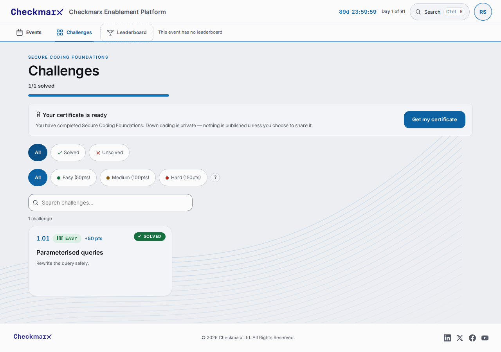

**Your certificate is also emailed to you.** When an event ends (on a Program:
when you finish it), everyone who earned a certificate is sent one email
congratulating them — on a top-three placing, on taking part, or on completing
— with the certificate PDF attached and a link to download it again. You get it
whether or not you have already collected the certificate yourself, and only
once. If you joined late, the email waits until late entry has closed, so that
it can carry your final placing. If you unsubscribed from event emails, it is
not sent — your certificate is still there to collect. The organisers can
switch these emails off for an event.

**The email has a "Copy my LinkedIn post" button.** It opens a page — no
sign-in needed — with a short, two-line post about your certificate and, when
your certificate shows its code, the link anyone can use to verify it. Edit it if you like, then press **Copy post & open
LinkedIn**: the post is copied and LinkedIn opens, ready for you to paste it. To
tag **Checkmarx** and the organisers, type **@** in LinkedIn and pick them from
its suggestions (a link cannot create real tags). The button works **once** and
for **seven days**; after that, sign in and use the same button on your
certificate.

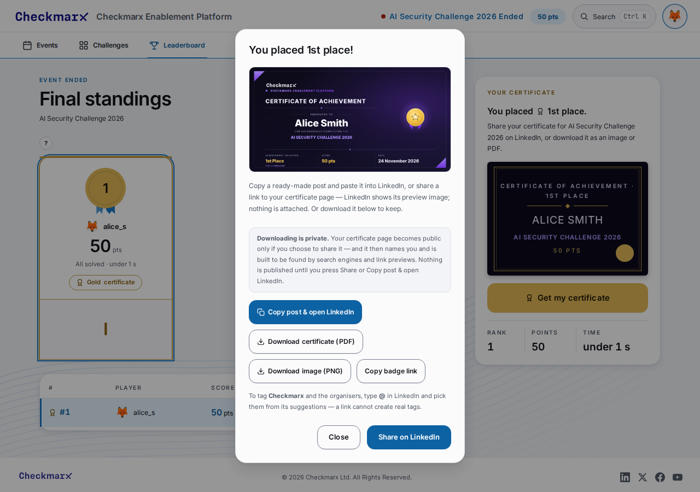

From the preview you can **Copy post & open LinkedIn** (copies your post and
opens LinkedIn's composer, where you paste it), **Share on LinkedIn** (opens
LinkedIn with a link to your certificate page — LinkedIn shows its preview
image; nothing is attached), **Copy badge link**, **Download image (PNG)**, or
**Download certificate (PDF)** — the PDF is a single A4 landscape
page, which is the one to attach to an email or keep with your training records.

**Nothing is published until you share.** Downloading the image or the PDF
publishes nothing, and the copied link does not open for anyone else until you
have pressed **Share on LinkedIn** or **Copy post & open LinkedIn** at least once
(or used the email's one-time post page) — so copy the link after sharing, not
before. This is true of every certificate, whichever kind of event
it came from. Once you do share, the page names you and is built to be found by
search engines and link previews, which is the point of it. Certificates created
before this rule existed keep the page they already had.

**Your certificate has a code, and anyone can check it.** A certificate carries
a 12-character code — for example `ABCD-EFGH-JKMN`. It is **printed along the
foot of the certificate itself**, beneath the address to check it at, so whoever
you hand the PDF to has everything they need without asking you for anything; it
is also shown beside the issue date on the **Challenges** page of that event, for
when you want to quote it in a message. Give it to an employer along with
your surname and they can confirm the certificate on the platform's
`/credential` page: no account and no sign-in, and capitals, hyphens, apostrophes
and accents do not matter. Letters an employer's keyboard may not have do not
matter either — **Løvland** is found by typing *Lovland*, **Łukasz** by *Lukasz*,
**Þorsteinn** by *Thorsteinn*, **Đorđević** by *Dordevic*. A surname written in
another script is matched by its own spelling. If an organiser ever revokes a certificate, that page says so
rather than simply failing. Certificates created before the code existed have
none, print no verification line, and cannot be checked this way.

**Your badge names you.** The image, the certificate and the public link all
carry your salutation, first name and last name — it is a record of what you did,
so it should read like one. A name written in Chinese, Japanese or Korean is
printed family name first, with no space, as it is written (**张伟**, **田中太郎**,
**김민준**); a verifier types the whole name as printed (**张伟**), without a
salutation printed before it, or only the family name, the part printed first
(**张**). Your name is read from your
profile every time a certificate is drawn, so correcting your name — or setting a **Certificate
name** — updates the image, the PDF and the public page of certificates you
already hold. One thing does not follow: the family name a verifier is matched
against is frozen when the certificate is created, so after a rename its
`/credential` page shows your new name, still expects the old family name, and
notes that the name has changed. Decide on a **Certificate name** before you
claim a certificate — an issued one cannot be re-issued under a new spelling.
The score, the grade and the date on one are fixed when it is created and never
move. A Program's certificate is dated the day you finished: your last answer to
a scored challenge. A Quick question you answer or change later does not change it.
The certificate prints names
in Latin, Greek and Cyrillic, and in Arabic, Hebrew, Thai, Chinese, Japanese and
Korean. When your salutation is all that stops your name being printed — a
**Dr.** before an Arabic, Hebrew or Thai name — the certificate leaves the
salutation off and prints your name, and the certificate's dialog says so. If your name uses another script
(Devanagari, used for Hindi, among them, which the certificate cannot print
yet), or mixes Latin letters into an Arabic, Hebrew or Thai name, your nickname
is printed instead, and a **Certificate name** is how to change that. A
certificate already issued with your nickname keeps it, because its verification
expects the nickname, until your name (or **Certificate name**) is written in
Latin, Greek or Cyrillic letters.
Nothing ever shows your email
or any private details, and practice runs don't generate one.

## Leaving an event you joined yourself

If you joined an event through a link, a QR code or an event code, you can leave
it again: open the event and use **Leave this event** on the waiting screen —
the screen you see while the event has not yet started. Once it is running there
is no leave control, so ask an organiser to take you out.

- Anything you have already solved is **kept**. If you re-join later your score
  and your solved challenges come back with you.
- If an **organiser added you** to an event, you will not see this option. Ask
  them to remove you instead.
- An event that has already finished cannot be left.

## When your clock starts

Your **time to solve** — what separates you from someone with the same score —
is measured from a starting moment, and on most events that moment is **when you
open your first challenge**, not when the event began or when you arrived. The
challenge list says so:

> Your time to solve starts when you open your first challenge, not when you arrive.

So arriving late, waiting in the lobby, or reading the list of challenges costs
you nothing. Your clock starts the first time you open a challenge that scores
points (answering one, or asking for a hint, before you have opened anything
also starts it). The **Quick questions** at the end of the list do not start
it. Until your clock has started you are not on the leaderboard yet. Opening
more challenges, leaving and coming back, or being removed from the event and
added again never restarts it.

The countdown at the top still shows how long the **event** has left: your own
clock does not change when the event ends.

Some events — every event set up before this rule, and any whose organiser
chose so — start your clock **when you enter the event** instead, and say
nothing about it on the list.

## Time on platform

Some events record how much time you spend on the platform. Where they do, you
will see it said on the event itself:

> This event records how much time you spend on the platform.

It counts five-minute blocks in which you were actually doing something —
typing, clicking, scrolling. Leaving a tab open in the background does not count,
and neither does anything you do after you have finished every challenge, so
there is nothing to gain by staying logged in. On an event that starts your clock
at your first challenge, nothing counts before you open one either.

Organisers use it to tell a five-day event apart from five days of elapsed time.
On some events it also breaks a tie between equal scores, in which case finishing
with less time on the platform ranks higher — but only between people who
finished everything.
