# Superadmin Guide

This guide covers features only **superadmins** see — destructive
operations and overrides that regular admins can't reach. For everything
else, see the [Admin guide](admin.md).

If you are a promoted superadmin, you sign in like any administrator (see the
[Admin guide](admin.md)): type your work email on the sign-in card, press
**Continue**, and enter your **password** — the default for your role — or
choose **Email me a code instead**, which always works. If you have not set a
password yet, sign in with a code and you are asked to set one (or to keep
using emailed codes). **Profile → How you sign in** changes either later.

The **built-in superadmin** account is different. It is not an account on the
Participants tab: it has no email address and no code, and signs in only with a
password, so that someone can always get in when email is down. It gets a new
random password every time the platform restarts. Whoever runs the platform can
find the current password in the startup output or in a protected file inside
the data folder.

To sign in with it, use the ordinary sign-in card: type the account's
**username** (`superadmin` until you change it, any capitalisation) into the
**Work email** box and press **Continue**. A password box appears, with no
**Email me a code instead** button; enter the password and press **Sign in**.
There is no separate sign-in address for it. The card answers anything that is
not an email address the same way, and a wrong username gets the same refusal
as a wrong password, so nothing on the sign-in screen shows or confirms the
username.

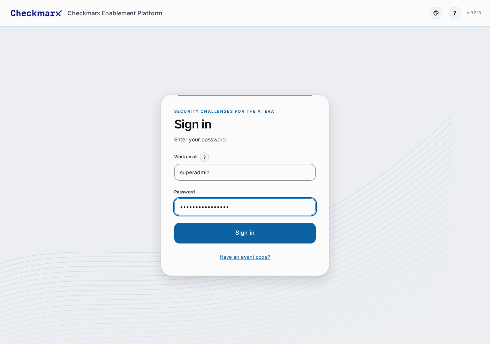

> **Change the username.** Signed in as the built-in account, open **Settings →
> Break-glass account**, type a new username (3–64 characters, no spaces and no
> `@`, and not any account's email address) and press **Save username**. You stay
> signed in; from your next sign-in only the new username works, and the old one
> is refused like any other wrong guess. Only the built-in account sees this card —
> a promoted superadmin does not, and cannot change it — and the username is never
> in the settings export. If the new username is forgotten, whoever runs the platform
> can read it from the platform's database, or reset it to `superadmin` there (the
> README, *First-Time Setup*, says how).

> **Automatic rotation.** The password is also regenerated after 10 failed
> superadmin sign-ins within 15 minutes, so a persistent guesser can't keep
> trying — and these rotations are themselves capped at about 6 per hour, so
> an attacker can't keep you chasing a new one. When it happens you'll see a
> log entry noting the superadmin password was rotated, and the new password
> appears when the platform starts up and in the password file — update your
> copy then.

Only one browser can be signed in to the built-in account at a time. Signing
in from another one signs the first out, and its popup says from which
address and when. If that wasn't you, restart the platform (or ask whoever
runs it to): that gives the account a new password and signs everyone out.
Then check who can read the password file.

You can also promote any verified, approved participant to superadmin; they
then have the same powers as the built-in account, and sign in with their own
password or an emailed code, never with the built-in account's password.

---

## Roles & permissions and custom roles

**Roles & permissions** (sidebar) lists everyone who can open the admin panel — every
account whose role is not Participant — with their role, the events a scoped
role organises, and when they last signed in. From there you:

- **Add user** — creates an account holding the role you pick. With an
  administrator or superadmin role (or a custom role that acts on every event)
  it signs in with a password, so its first sign-in is with an emailed code,
  after which it is asked to set one; with a role scoped to its own events it
  signs in with an emailed code. Any valid address works, a personal one
  (Gmail, Outlook and similar) included, say for a contractor; the account's
  History records that it skipped the work-address rule. An address that
  already has an account keeps it: you are offered to give that account the
  role instead. An address that is
  somebody's **secondary** email is refused — use the person's own sign-in
  (primary) address: a secondary is an unconfirmed claim anyone can make, so it
  never receives a role.
- **Change role** on any row, including back to **Participant**, which removes
  them from the list (and from every event they organised, for a scoped role).
  If you compete alongside someone in an event where staff can compete, their
  row says so instead: another organiser changes their role.
- **Events** on a scoped role's row chooses which events they organise.

The **Roles** view lists the four built-in roles — Participant, Event admin,
Admin, Superadmin — which never change, and the **custom roles** you create.
**New role** asks for a name, what the role **acts on** (only the events its
holders are made organisers of, or every event; fixed once created) and a
permission matrix grouped by area. A permission that cannot be given says why
beside it: some belong to the built-in roles only (revealing a sealed answer,
seeding performance data, the break-glass account, and the Checkmarx One
defaults and account removals — the platform's key covers every event, so it
stays a superadmin's), and some can be given only by a superadmin. Some reach
beyond any one event — the raw request and application logs, the operational
alerts, platform settings, metrics, data retention, test email and the
unsubscribe list, exporting every event or the settings, imports, event
templates, certificate designs, Roles & permissions, deleting accounts, creating
events from scratch and adding organisers — so only a role that acts on every
event can hold them: the matrix offers them only while **every event** is
chosen. Everything else a role scoped to its events holds works on its own
events only: it deletes, verifies, revokes or looks up a certificate only
there, and changes a challenge's scoring (recalculate, lock, delete, or make it
a qualifying question) only when every event using it is one of its own. Such
a role creates events by cloning one or starting from a template, as an event
admin does. Each Settings card shows to a
role holding what that card uses, and the **Audit** page shows each kind of
record only to a role that may read the same records elsewhere — event and
session records need *See events*, people's histories *See participants*,
platform settings changes *See platform settings*, challenge versions *See
challenges*, and logged events that name no event *See the raw request and
application logs*. A role without that last permission also sees the logged
events of its events without the details that belong to the raw logs: a
visitor's or requester's address and browser (someone checking a certificate,
say, or asking for a code through an event's join link), a deleted person's
Checkmarx One account id or email address, and address-block alerts, which it
is not shown at all; a record's **Details** list what was left out. An edit reaches every holder within a few seconds. A role
somebody holds cannot be deleted — move them first.

The rule that keeps this safe: **nobody gives or takes away more than their own
role holds.** Only a superadmin can give a role with a superadmin-only
permission, or change the role of an account that can do more than the person
changing it, and a role allowed to delete accounts cannot delete an administrator,
a superadmin or anyone whose role can do more than its own. Accounts that hold a
custom role cannot be viewed as a participant.

Admins can see Roles & permissions but cannot change anything on it; event admins do
not see it.

## Role promotion

Role changes are made on **Roles & permissions** (above). The participant row's
three-dot menu in People still offers **Promote to Admin** or
**Promote to Superadmin** for a participant, and demoting uses the same menu.

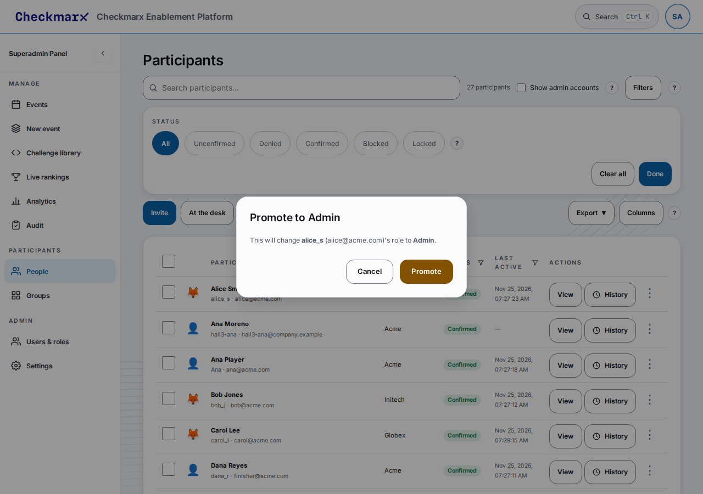

A role change immediately signs the target out everywhere — they sign in
again for the new role to take effect. That reaches work already in progress
too: an attachment upload or an import they had started is refused when it
finishes arriving, and nothing from it is saved. The **staff** tag is applied
automatically on promotion (and removed on demotion to participant), so the
role change also keeps them off public leaderboards without any manual
tagging (unless they are enrolled in an event that lets staff compete — see
[The competitor lock binds you too](#the-competitor-lock-binds-you-too)).

A new role also brings its own way of signing in, unless the person has chosen
one for themselves (a choice they made is kept). Promoted to admin or
superadmin, they are shown a password box at their next sign-in; with no
password yet, they choose **Email me a code instead** and are then asked to set
one. Moved to event admin or participant, they sign in with an emailed code.

### Event admins

There is a fourth role, **Event admin**: an organiser scoped to specific events.
It is granted per event from the participant's row (**Make event admin**) or from
the event's **Organisers** list, and any admin can do that — see the
[Admin guide](admin.md) for what the role can and cannot do.

Two parts of it are yours alone:

- **Demoting one back to a participant.** Setting their role to **Participant**
  also clears every event they organised, in the same step, and the confirmation
  tells you how many that was. Removing their events one at a time deliberately
  does *not* demote them — that would make a role change happen as a side effect
  of an action any admin can take.
- **Promoting one straight to admin or superadmin**, which widens them from a
  few events to the whole platform.

Event admins are kept off leaderboards by their **role**, not by the staff tag
(unless they are enrolled in an event that lets staff compete — see [The
competitor lock binds you too](#the-competitor-lock-binds-you-too)). That
matters: the staff tag also lets an account enter any event without
being assigned to it, and would make their participant view list every event on
the platform — the opposite of what the role is for. So do not add `staff` to an
event admin to "make sure"; it is already handled, and adding it would widen
them.

---

## Editing privileged users' profiles

A regular admin opening a **normal participant's** profile can only fill in
fields that are **empty** — anything that already holds a value is locked,
shown with a dashed outline, and the dialog says so ("Only blank fields can be
filled in."). Only a superadmin can overwrite or clear a populated field — with one exception: the
**primary and secondary email** of a normal participant stay editable for a
regular admin whether or not they already hold a value, because "please change
my address" is routine support. Two restrictions go further still:

- **Every field on an admin or superadmin account.** A regular admin opening a
  privileged colleague's profile gets a read-only view with no Save button at
  all, and the platform refuses the save outright ("Only superadmins can edit
  admin or superadmin accounts") even if they work around the form. Nothing is
  editable for them, not even a blank field. That closes the email-hijack route
  into another admin's account — rewrite the address, then have a sign-in
  code sent there — and stops one admin quietly editing a colleague's record.

This is enforced on the server, not just in the form, so it holds even for
someone technical who tries to work around the form.

---

## Correcting a live event's start time

Once an event is live its start time is locked for regular admins, always. As
a superadmin you can still correct it, but only while **nothing has happened
in the event**: nobody enrolled, nothing submitted, no hint revealed, nobody
removed, no challenge opened, no certificate issued, no time on platform
recorded, no start reminder pending, nobody with the event selected, and no
sign-up in flight through its join link. The case this exists for is an event that went
live on a mistyped date with nobody in it.

Moving the start into the future puts the event back to **upcoming**, which
also re-opens the settings that lock the moment an event starts — its event
type, its leaderboard mode and its time basis. Moving it far enough backwards
that the event's end would land in the past is refused separately, however
pristine the event: ending an event is what **End Now** is for. If anyone has
touched the event, the save is refused and names what it found; end the event
instead.

A **multi-session** event is refused whatever its footprint: its schedule
comes from its sessions, so edit the session times there.

---

## Deleting an event

The three-dot menu on an event row includes **Delete**. After you
confirm, it removes the event and everything attached to it —
assignments, tags, per-event CxOne override, sessions, events,
submissions, and reminders — in one all-or-nothing operation. Regular admins
don't see this option, and the platform refuses it for them.

**A live event can only be deleted while nothing has happened in it** — the
same footprint check as the start-time correction above, and for the same
reason: the delete cascades, so it isn't something to do to an event people
are inside. The moment anyone has joined, submitted, revealed a hint, opened a
challenge, earned a certificate or been marked absent, Delete is refused and
names what it found. End the event first, then delete it. A live
**multi-session** event is refused whatever its footprint.

A live event nobody has touched *can* be deleted, which is the quick way to
remove one you have just created on the wrong date. Upcoming and ended events
are always deletable — unless you are competing in them, see [The competitor
lock binds you too](#the-competitor-lock-binds-you-too).

## Tagging ended events

Regular admins can add or remove tags on live and upcoming events, but
once an event has **ended** its tags freeze for them — only a superadmin
can change tags on an ended event. This keeps post-event
reclassification (e.g. marking one `test/dry run` after the fact to exclude it
from Analytics) under your control — a superadmin who competed in the event
excepted, as the next section explains.

---

## Running a late-entry window

A Booth Event taking [late entries](admin.md#late-entries) has already ended,
so while its window is open the parts of it reserved for a superadmin after an
event's end are yours, and three of them matter:

- **The late-entry deadline.** Closing the window early does not need you:
  every organiser — any admin, and an event admin on their own events — has
  **Close late entries now** on the event's menu and in its workspace's **⋯**
  menu, and it closes the window to the second (see [Closing late entries
  early](admin.md#closing-late-entries-early)). The **late-entry deadline** field
  in the event's editor is still yours alone, because editing an event past its
  end time is: use it to close the window at a particular time, to extend it, or
  to reopen one somebody closed. Reopening resumes late play, so the late-entrant
  board can move again under a placing certificate already collected (the third
  point below). **To extend the event itself after its late entries were closed
  early**, set the deadline back to **Automatic** — or to a time after the new
  end — in the same save: the close pinned the deadline to the moment it
  happened, and a save that leaves it before the event's new end is refused. The
  **Allow late entries** switch stays locked once the event has ended — for you as
  for everyone, because switching it would move people between the main board and
  the late-entrant section after the results are final. Turning off **Enable
  self-enrollment** in the **Join Link** dialog stops only the link, the QR and
  the code; organisers can still add people until the deadline.
- **The Join Link dialog's switch.** **Enable self-enrollment** is shown locked
  to other admins on a finished event, with a note saying only a superadmin can
  change it now; you can.
  **Regenerate link** stays available to everyone.
- **A late entrant holding a placing certificate.** Placing certificates for
  late entrants are issued once the window closes. If you then move the deadline
  later again, anyone who already collected one cannot be removed from the event
  until you revoke that certificate — the refusal says so — or a second person
  could be issued the same placing.

---

## The competitor lock binds you too

An event with **Staff can compete** ticked treats everyone enrolled in it —
every organiser, whatever their tier — as a participant of that event, and
refuses them every change to it — the [Admin
guide](admin.md#letting-staff-compete) has the whole of it. Three parts are
yours to know about:

- **It binds superadmins.** If you are enrolled in such an event you cannot
  edit it, end it early, close its late entries early, change its tags or
  **delete** it, and on every challenge assigned to it **Lock**, **Recalculate
  Scores** and **Delete** are withheld along with **Edit**; the challenge row
  says *You are competing in "…", which holds this challenge — you can view it,
  not change it*, and
  the event's own row says *You are competing in this event — you can view it,
  not change it*. Clearing participants' **feedback** on such a challenge is
  refused too — and so is every action on a fellow competitor's **account**
  that would move the board: **Block**, **Deny Approval**, **Approve**,
  **Verify**, **Impersonate**, **Email sign-in code**, **Show sign-in code**, a
  role change, **Delete**, the `benchmark` tag, and revoking one of that event's
  certificates. Each is
  withheld on their row with a note naming the event; **Unlock**, the profile
  dialog and History stay. There is no superadmin override, and that is the
  point: a competitor who can change the result is what the lock exists to
  prevent, and the tier that can do the most is the one it matters most for. Remove yourself
  from the event (open it, then **Remove from …** on your own row of its
  Participants section) and everything comes back; nothing you scored is lost, so
  you can be re-added afterwards. That removal is allowed until the event ends
  — after that nobody can be removed from it (bar a late entrant, somebody who
  joined after it ended and had not started playing before then, while late
  entries are still open, see the [Admin
  guide](admin.md#removing-people-during-the-window)), so only another
  superadmin can change, tag or delete a finished event you competed in. Leave
  before the end if you will need to.
- **Only a superadmin can enrol an admin — or grant one attempts.** Adding an
  admin or superadmin account to such an event is managing a privileged
  account, so a regular admin is not offered **Invite to …** on that row, and
  the selection bar and the **Invite** dialog skip it with *only a superadmin
  can enrol an admin*. A bound group is the exception that needs no skip: its
  live sync enrols every member it holds — the Teams page and the **Invite**
  dialog put an admin account into a group only for a superadmin. Any organiser
  may enrol themselves. The same rule reaches **Grant Attempts**: on such an
  event an enrolled admin or superadmin can run out of attempts like anyone
  else, and only a superadmin can grant them more — a regular admin's roster in
  that dialog does not list them. The **built-in superadmin account cannot be
  enrolled in anything** — it is not an account on the Participants tab, so
  there is nothing to enrol — which is also why it can never be locked out of
  an event this way.
- **The imports respect it without refusing the file.** A participant import
  run while you compete in an event skips every enrolment into that event
  except your own, drops a group association whose group is bound to that
  event, and skips every absence record into it (an absence record of your own
  is skipped into any event where staff compete, whether or not you compete
  there), and skips overwriting the account of anybody you compete alongside
  (the overwrite would block, verify, approve or re-role them, or change their
  benchmark tag, which the Participants screen refuses); a challenge import
  skips overwriting a challenge
  held by an event you compete in. Each is counted in the summary by reason, in the same way those
  imports report every other row they leave alone (see [Importing
  participants](#importing-participants)).

The switch itself is an ordinary admin setting, and its locks bind you too: it
is disabled once the event has started, and stays so once it has ended, with no
superadmin flag to lift either — and its refusals while the event is still
upcoming (unsealed challenges assigned, an enrolled author, staff enrolled
when turning it off) name the rows for you exactly as they do for any admin.

---

## Recalculating challenge scores

If you change a challenge's correct answer or difficulty **after**
participants have submitted, their already-submitted answers aren't re-graded
automatically — they keep the points they earned at the time. **Recalculate
Scores** (in the three-dot menu) re-grades those submissions against the
current rules and rescales any hint deductions to the new difficulty's cost
(Easy 15, Medium 30, Hard 45 points). On a text challenge that gained an
accepted answer, earlier guesses matching it flip to correct; on a challenge
switched to **Any answer**, every earlier non-empty guess becomes correct. A
pick-one question (an Any answer challenge with options) is graded the same way,
so adding, rewording or removing an option never turns an earlier answer wrong.

> **Important — recalculate only touches events that are still open.**
> An event whose session has ended has **frozen** final standings, and
> recalculate deliberately leaves its submissions exactly as they are. So if a
> challenge is used only in finished events, recalculate changes nothing
> and tells you how many submissions it skipped for that reason ("*N left
> frozen*"). **Fix an answer key while the event is still live** — that
> is the window in which recalculate can act. It still moves the leaderboard,
> so announce the re-grade so nobody is surprised that a challenge they
> remember solving is now marked wrong.

Running it again with the same rules gives the same result, so it's safe to
click again if you're unsure the first run finished. There's no preview — the
change applies immediately. To undo, restore the challenge to its earlier
version (which puts the old grading rules back) and recalculate again.
Regular admins don't see this option. On a challenge whose answer is **sealed**
it is not offered until the answer is yours to read — because you created the
challenge, or because you have revealed it on the record: re-grading rewrites
every stored submission against the answer key. See [Sealed
answers](#sealed-answers).

**If a session using the challenge is running right now, you're asked a second
time.** {{platformName}} stops with *"A session is LIVE right now"* and only
proceeds once you confirm again. That second dialog is the normal path, not an
edge case — the advice above is to fix an answer key while the event is
still live — and it is the only warning that scores are about to move under
people who are still playing.

**A re-grade can strand somebody on an event that limits attempts.** Flipping
a correct answer to incorrect can leave a participant with no attempts left
and no correct answer. The result message names who that happened to;
**Grant Attempts** on the same challenge's three-dot menu is how you give them
another try.

To re-grade a challenge in an event that has **already finished**, you
must reopen that event first, recalculate, then let it end again —
reopening is the only thing that unfreezes a finished event's scores.
For a single-session event that means extending its duration so it is
live again — and if it is a Booth Event whose late entries were closed early,
set its late-entry deadline back to **Automatic**, or to a time after the new
end, in that same save; keeping the closed deadline gets the extension refused
(see [Running a late-entry window](#running-a-late-entry-window)). For a **multi-session** event the
freeze is per session: one finished session freezes the whole event's
submissions, extending the event's duration does nothing at all, and you
have to reopen *every* finished session.

**Multiple-choice challenges.** Re-grading a multiple-choice challenge grades
each submission against the option IDs the participant actually picked, rather
than against the readable record of their choice ("Paris | Rome").

One case it deliberately refuses to guess at: an older submission stored without
those option IDs is matched back to the options by their **text**, so if you
have since renamed an option, that submission cannot be identified. Those rows
are left exactly as they are rather than re-graded on a guess, and the result
tells you how many were skipped.

---

## Locking and unlocking a challenge

Locking freezes a challenge's grading. A locked challenge:

- Refuses new submissions and hint reveals — participants see "locked — no
  longer accepting submissions".
- Blocks all admin edits (any field), version restores **and Recalculate
  Scores** — the Recalculate item disappears from the three-dot menu while the
  lock holds. Only a superadmin can change any of it, and only after
  unlocking. A challenge form opened on it some other way is read-only, its
  formatting buttons off under a line saying it is locked.

Unlocking is the same three-dot menu entry, and both lock and unlock are
recorded in the challenge's History so you can trace when it flipped and who
did it. Use Lock when you decide mid-event that a challenge needs a tweak but
can't risk changing it live — lock first, announce the freeze, edit after.

---

## Sealed answers

A challenge can be created with its answer **sealed**. The person creating it
turns on *"Seal the answer — only I, or a superadmin on the record, can see or change it"* on the create
form, and from that moment the correct answer, the explanation and the hint
reach exactly one account: the one that created the challenge — apart from a
participant competing in an event that holds it, who can still buy the hint
there, as they could any hint. Those rows carry
a **Sealed** badge in the Status column, so you can tell which they are.

**This is the one control on the platform you cannot override quietly.** There
is no superadmin flag that lifts a seal; what you have instead is a **reveal** —
an explicit act that shows you the sealed answer and is written down where the
author will see it (see [Revealing a sealed answer](#revealing-a-sealed-answer)
below). Until you have revealed it, on a sealed challenge somebody else created
you cannot:

- **read the answer, the explanation or the hint** anywhere — not in the
  Challenges list, not in the editor, not in **View as Participant** (which says
  the hint is withheld rather than leaving a blank), and not in the Challenges
  export;
- **read them in the challenge's History either.** The blanking is applied when
  you look, not when the seal was set, so versions saved *before* it was sealed
  are covered too;
- **edit the challenge.** **Edit** is not offered on the row at all, and the
  save is refused outright if the form is reached some other way;
- **restore an earlier version.** The challenge's History offers *Not yours to
  restore* where the button would be;
- **recalculate its scores.** **Recalculate Scores** is not offered on the row
  until the answer is yours to read, and is refused if reached some other way.

It is held back from the record as well as from the screens. A submitted answer
to a sealed challenge shows as *sealed* in an event's **Activity** section and is
withheld on the **Audit** page, and neither search box will match it, so it
can't be used to confirm a guess. When
the author edits the answer, History records *"(sealed answer changed…)"* rather
than the old and new values, so the answer never reaches the log files at all.
And when an event ends with **Reveal answers when the event ends** switched on, a
sealed challenge shows *"Answer not shown"* and says why — its explanation and
its hint are held back with it.

The **hint** is sealed with the answer. A participant who
pays 30% of the challenge's points for it during the event still receives it —
that is what a hint is for — but on the admin screens, in the export and in the
reveal at the end of the event it is withheld exactly as the answer is. On a
multiple-choice challenge the option text still shows, because that is the
question — only which options are correct is withheld.

### What you can still do

Running events with a sealed challenge is unaffected. You can still preview it,
**assign it to events** and take it out of them, **grant attempts** on it, open
its **History**, and **lock or unlock** it. You can also **delete it outright** —
sealing doesn't protect a challenge from deletion, so it can be removed even
though its answer can't be read. The ordinary refusals still apply: see
[Deleting a challenge](#deleting-a-challenge).

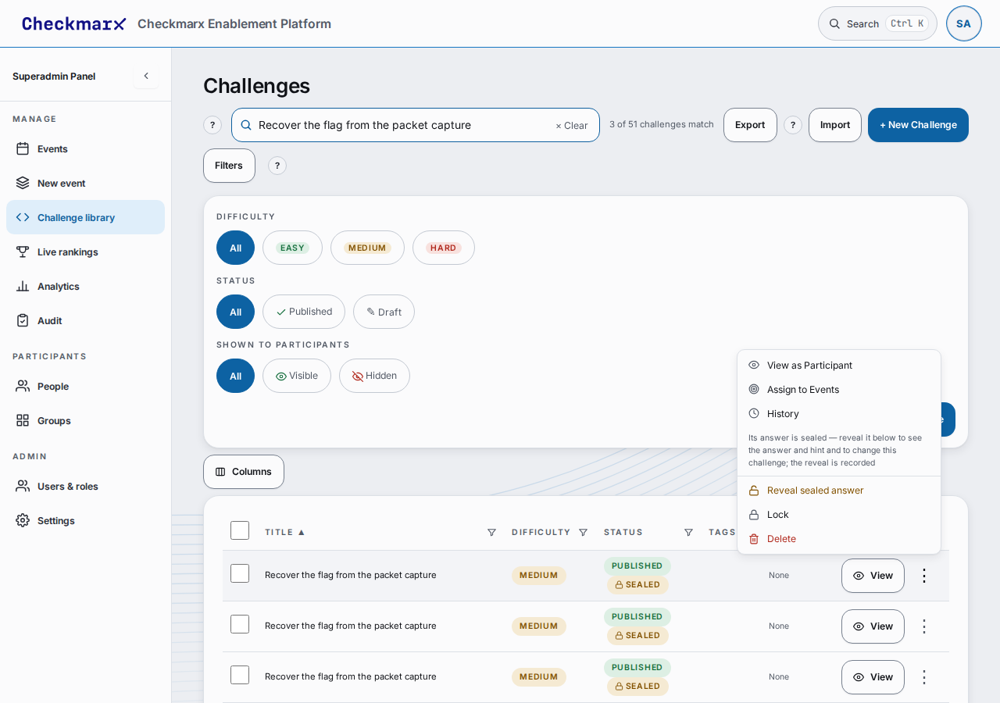

What you don't get, until you reveal it, is anything that counts as *changing*
the challenge. The controls for **Publish**, **Hide**/**Show**, **Edit** and
adding or removing its tags all hang off the same question — may I change this
challenge? — and on a sealed challenge the answer is the author's name, or a
superadmin who has revealed it, so those controls aren't shown to anyone else.
Attachments go with them, because they are managed inside the editor. If one of
them is what you need, the author is the person to ask — their address is on the
*create* entry in the challenge's **History** — or you reveal the answer
yourself and accept that the record says so.

**Sealing is unavailable on *Any answer (free response)*.** That answer type
accepts every response and stores no answer at all, so there would be nothing for
a seal to protect — and it would hide the responses from everyone but the author,
which is what such a challenge exists to gather. The create, the save and a
version restore all refuse the combination, and the challenge editor takes the
option away rather than letting anyone reach a save that fails.

Sealing is a **one-way door**. It can only be chosen when the challenge is
created. The author can unseal it later, with **Unseal this answer when I save**
in the editor — and so can you, once you have revealed the answer — withheld only
while the challenge sits in an event where staff compete, which admits sealed
challenges alone (see [The competitor lock binds
you too](#the-competitor-lock-binds-you-too)) — but nobody can seal it again:
{{platformName}} refuses, and says why. The answer has already been on
administrators' screens, in exports and in the challenge's history by then, and
a tick-box can't take that back.

Two consequences of "only the author, or a superadmin on the record" are yours
to know about:

- **The built-in superadmin account can't seal a challenge** — the one thing a
  promoted superadmin can do that it cannot. It isn't one of the accounts on the
  Participants tab, so there would be no author at all, and the answer would be
  readable and editable by nobody, for ever. The create is refused with that
  explanation — sign in with a named admin account and create it there.
- **Sealed challenges don't travel.** A challenge import refuses any row marked
  sealed and reports how many it skipped, because an imported challenge has no
  author on the receiving platform. Recreate it there instead. An import won't
  overwrite an existing sealed challenge somebody else created, either — unless
  you have revealed its answer, in which case it is treated as yours.

### Revealing a sealed answer

On a sealed challenge you did not create, the row's three-dot menu offers
**Reveal sealed answer**, and the read-only challenge editor carries a button
reading **Reveal sealed answer and hint** beside the note explaining the seal.
Both open the same confirmation, headed *Reveal sealed answer*, which says
plainly that the reveal will be recorded; its button reads **Reveal and record**.
Press it and the answer, the explanation and the hint are yours to see for the
rest of this session — the challenge list reloads with them on the row, an open
editor becomes editable — and so is everything the author can do: edit the
challenge, publish or hide it, tag it, restore an earlier version, recalculate
its scores, read the answers submitted to it (in an event's **Activity**
section and on the **Audit** page), and
**unseal** it with the same *Unseal this answer when I save* tick the author is
offered (subject to the same refusal while it sits in an event where staff
compete).

The reveal is not silent, and that is the whole design:

- The challenge's **History** gains a row marked **Record** in place of a
  Restore button — a sentence saying which of the sealed answer, explanation
  and hint were revealed to a superadmin (only the ones the challenge actually
  has), with your name in the By column. It is a
  record, not a version: it
  cannot be restored, never counts as the current version, and the next edit is
  diffed against the version before it, not against the record.
- The **event log** records it too, under your name.
- If you revealed it while impersonating an event admin in their panel, both
  say so — the record names you *and* the organiser whose view you were in. The
  reveal's own confirmation comes first, and then the usual *are you sure? This
  will change real data* confirmation that every change made through somebody
  else's panel gets. Inside an organiser's panel the reveal lifts the seal and
  nothing else: whether you can then **edit** the challenge still follows that
  organiser's own rules, so a challenge a co-organiser created stays read-only
  there.
- The person whose view you were in is named in the History only to a reader
  who could see that person anyway — another administrator, or an event admin
  who shares an event with them. Any other organiser who can open the
  challenge's History sees that you were impersonating *an account outside
  their events*, without the name; the event log keeps the full detail.

A reveal lasts for the session you made it in, and no longer: signing out,
switching between **Admin View** and **Participant View**, signing in
elsewhere, and entering or leaving an impersonation all end it, and revealing the challenge again
afterwards writes a new record. It is per challenge — revealing one sealed
challenge shows you nothing about another.

Two things it does not do. It does not unseal the challenge for anybody else —
other administrators and event admins still see it sealed, and a regular admin
is never offered the reveal at all, not even while impersonating the author. And
it is refused outright if you are **competing** in an event that holds the
challenge: a competitor may not read the key of a challenge they are competing
on, whatever their tier (see [The competitor lock binds you
too](#the-competitor-lock-binds-you-too)). While the event is still running you
can remove yourself from it first; once it has ended that is refused (unless you
joined it as a late entrant, after it ended, had not started playing before
then, and late entries are still open),
so you stay a
competitor there and the reveal stays refused — any change to the challenge then
has to be made by another organiser.

In your own **Participant View**, and while impersonating a participant, there
is no reveal button: a sealed challenge's answer, explanation and hint are shown
to you wherever its author would see them, and each time one is shown to you
the same record is written — unless you are **competing** in an event that
holds the challenge, in which case nothing sealed is shown to you here either.
A hint you bought as a competing participant is yours like anybody else's and
is not recorded as a reveal.

**No record, no reveal.** The record is written *before* anything sealed is put
in front of you, and if it cannot be written — the platform's database briefly
unable to take the write, say — nothing sealed is shown. The challenge says so
in place of the answer or the hint, asking you to open it again to retry, and a
hint you tried to reveal that way costs no points. The same holds for the
**Reveal sealed answer** button in the admin panel: if the record cannot be
written, the reveal fails and nothing is revealed.

A regular admin in either view sees neither the answer nor the hint, unless
they buy the hint as a participant competing in the event. In their own
Participant View they are not offered the hint for points otherwise — a hint bought by someone who is not on the
board would be a free read of a sealed field — and while impersonating a
participant who paid for it they see *Hint withheld* where the hint would be:
the hint was the participant's to buy, not the admin's to read.

### Where the limit really is

Two honest points, because between them they decide what you do when somebody
genuinely needs a sealed answer back.

**Deleting or demoting the author doesn't release it.** You can still delete
their account, or set their role back to participant, with all the usual
consequences — but the challenge stays sealed, and the author it names is then
somebody who can no longer reach it. It is not stranded, though: a
superadmin can still reveal the answer on the record and then unseal or edit
the challenge. Even so, ask an author to unseal a challenge *before* you take
their access away, not after — a reveal is a recorded act, not a quiet tidy-up.

**A seal covers {{platformName}}'s own screens, exports and logs — it is not
encryption.** The answer sits in the platform's database like any other answer,
so whoever administers the server can read it there, or in a backup. Within the
platform, the recorded reveal is the way back: a superadmin who has to recover a
sealed answer and can't ask its author reveals it, and the record of having
done so is the price. It also sets the boundary of what a seal is worth — it
keeps an answer from colleagues who might compete or coach, which is what
authors seal for, and not from the people who run the platform underneath it,
who are shown it only by an act that leaves their name behind.

---

## Deleting a participant

The three-dot menu on a participant row includes **Delete**.

If the participant is **currently inside a live event** — or playing a
finished Booth Event as a late entrant while its late entries are still open —
the delete confirmation says so before you commit to anything — naming the
event, and whether they are in it as a late entrant (and, for a late entrant who
had started playing before the event ended, that they cannot be removed from it
instead, so the first choice below is not open for them) — and
{{platformName}} then stops and tells you which one again — deleting them right then ends their session and
takes their submissions, hints and score out of an event other people are
still running. You get two choices:

- **Remove them from that event first**, where that event lets you (the gentler
  one — their account survives and the event is undisturbed), then delete.
- **Delete anyway.** Confirm the second dialog and it goes through in one step.
  This is deliberately available: the account you most often need to remove
  mid-event is a test registration someone made through a join link, and hunting
  through the event to detach it first is time you may not have. The
  override is recorded in Logs, so a deletion that interrupted a live
  event is always distinguishable from an ordinary one.

Deleting a participant removes everything attached to them in one
all-or-nothing operation — memberships, submissions, revealed hints,
challenge ratings, reminders, and tags — though an audit line still goes to
Logs so the deletion stays traceable. Regular admins don't see this option.
A superadmin also can't delete — or demote — **their own** account: the role
actions aren't offered on your own row, and the platform refuses a
self-demotion outright. To step down, ask another superadmin to demote you to
participant. A role change keeps your audit trail intact where a deletion
would not.

**The Checkmarx One accounts {{platformName}} created for them are removed too.**
If the platform itself created a Checkmarx One account for the participant, and
has a record of doing so, deleting them schedules that account's removal from the
customer's tenant. The **Delete User** confirmation says so when there is one,
and the message afterwards says how many removals were scheduled. Anyone who can
delete people is told the same, a custom role holding **Delete accounts**
included; as only a superadmin sees **Checkmarx One account removals**, such a
role's message says a superadmin follows the removal up there. An account
still being set up at the moment you delete them stops there, with no group
access granted, and an account that setup had just created is removed straight
away (or, if the tenant refuses, retried in the background and listed under
[Checkmarx One account removals](#checkmarx-one-account-removals)) — unless, in
that moment, someone else with the same email address was linked to it. Then
the account is theirs and stays. It also stays when a set-up record of someone
still on the platform names the account but cannot be read: it is then held for
your decision under
[Checkmarx One account removals](#checkmarx-one-account-removals).

Once the removal has started, someone signing up with that address is not linked
to the account being removed: their Checkmarx One set-up waits, tries again by
itself and gets a new account (or the old one, if the tenant refused to remove
it). Their History shows *not set up yet* while it waits. If it still cannot
finish, History says it was not retried automatically: assign them to the event
again, while it still accepts participants, to try once more. And if someone was
linked to an account the platform has since removed, the link is cleared, their
History says so, and a new account is set up for them.

The same message also counts what is **not** removed, each only when there is
one:

- An account that **already existed** in the tenant — one the setup found and
  linked to them rather than made — is **left in place**. The tenant's
  administrator decides about it.
- An account the platform **created but has no record of** — made before the
  platform kept a record, or by a create that never said which account it made —
  cannot be removed automatically, because nothing tells the platform which
  account in the tenant it is. The message asks you to remove it in the tenant
  by hand.
- A Checkmarx One **set-up record** of theirs that **cannot be read** (damaged
  by a hand edit to the database, or by a restore from a damaged copy): the
  platform cannot tell which account, if any, it names, so the message asks you
  to check the tenant for an account of theirs. The **Audit** page's record of
  the deletion keeps their address.

These counts come from the participant's Checkmarx One set-up records; one older
than the retention period (730 days by default) has been purged and is no longer
counted. An account the platform holds a record of is still removed, whatever its
age.

**The automatic removal of unverified accounts does the same.** When
{{platformName}} removes an account never verified within 48 hours, the
Checkmarx One accounts it created for that person are removed as if you had
deleted them. No message is shown, so the counts above are kept on the **Audit**
page's record of the removal (*Unconfirmed account removed*); an account to
remove by hand, or a record that cannot be read, is also written to the app log
as a warning.

Most removals finish on their own; the ones that cannot, or that the platform will
not carry out without your say-so, are listed under [Checkmarx One account
removals](#checkmarx-one-account-removals).

---

## Deleting a challenge

Challenges are deletable from the Challenges tab three-dot menu. The platform
asks for confirmation and then refuses, naming which of four things it found:
the challenge is assigned to an event that is running right now; it is
assigned to an event where a **session has finished**; somebody has
**submitted** an answer to it; or somebody has **revealed its hint** — which
can be true even when there are no submissions at all.

> **Not by hiding it, either.** Hiding such a challenge with the visibility
> toggle would change the very thing the
> refusal protects: a hidden challenge stops counting toward the "solved
> everything" total, so participants who had *not* finished a completed
> event would be retroactively counted as having done so — which can reorder
> the final places without altering anyone's score. Hiding, unpublishing and
> any **scoring** edit — the correct answer (on a Text challenge, every
> accepted answer: adding or removing one counts), the answer type, the
> difficulty — are all refused on a finished event. Everything else about the
> challenge stays editable: its title, description, hint (where the type has
> one — an Any answer challenge never does), explanation and
> attachments are not scoring fields. To take a challenge out
> of one, **reopen the event first** — and for a multi-session event
> that means reopening every finished session, not just one. Unassigning is
> refused while the freeze holds, so it is not a way round it.

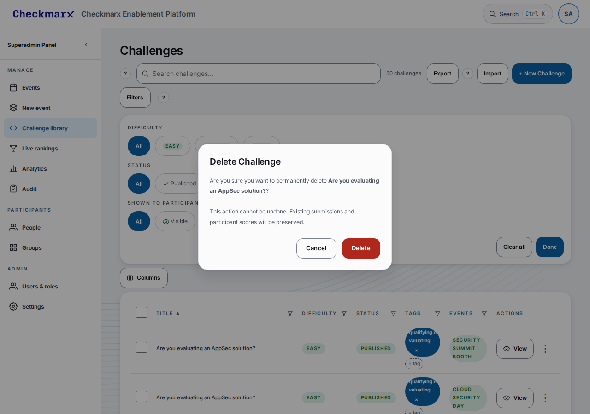

Deletion removes everything attached to the challenge — assignments, tags,
ratings, edit history, and recorded activity — in one operation, but an audit
entry stays in Logs so you can still trace who deleted it and when. If you are
competing in an event that holds the challenge, **Delete** is not offered at all
— see [The competitor lock binds you too](#the-competitor-lock-binds-you-too).

---

## Manual verify

Verifying a participant by hand is a **superadmin-only recovery action** for
users who can't receive the verification email (messages bouncing, a spam
filter eating them, a typo in the address).

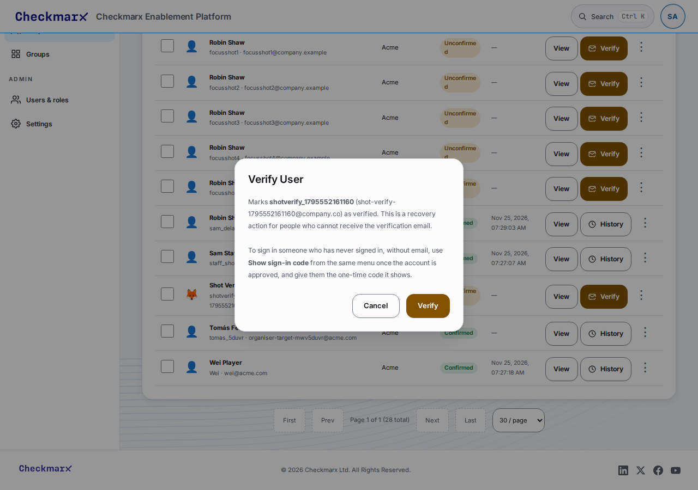

One account state it refuses: a participant you have **denied**. Verify
answers *"User has been denied — click Approve"* instead, because Approve
reverses the denial in one step — it clears the denial, unblocks them and
approves them — where a bare verify would leave the account verified and
denied at the same time.

> **Usually you don't need it at all.** Entering an emailed sign-in code
> verifies an account, so a participant whose mail does arrive verifies
> themselves the first time they sign in. For someone standing in front of you
> who has never signed in,
> **Show sign-in code** on the same three-dot menu is quicker: it hands you a
> code on your own screen and needs no email. An account an organiser created at
> the desk arrives already verified, so Verify never appears on its row at all.
> The verify confirmation itself shows nothing but a "User verified!"
> notification.

Regular admins don't see this option — the recovery workflow hands a
credential over by hand, so it's intentionally reserved for superadmins.

---

## Acting on a participant's behalf while impersonating

[Impersonation](admin.md#impersonating-a-participant) is available to every
admin, but the two roles get different powers inside it.

An admin's impersonation session is **read-only** apart from one thing — they
may [generate the participant's certificate](admin.md#generating-a-participants-certificate),
which is often the whole reason an organiser needs to be in there. Yours is not
read-only at all: as a superadmin you may take almost any action the participant
could, which is what makes impersonation a repair tool rather than just a
viewer. Use it when someone is genuinely stuck — a submission that won't go
through, a profile field they can't correct themselves.

**Sharing a certificate to LinkedIn is yours alone**, and is the half of the
certificate flow an admin does not get. Pressing Share posts to whoever is
signed in to LinkedIn in the browser doing the pressing, and on a **Program** it
is also what makes the participant's certificate page public — so it stays with
the role that already carries every other outward-facing decision. An admin who
needs a certificate published can generate it and ask you. You also keep the
certificate's code, picture, downloads and link while you view as its holder;
other admins see them there only if their role is granted **Look up a
certificate by its code**, and otherwise download it from the event's
**Certificates** section.

Because those actions are real, every state-changing one asks *"You're in
impersonation mode — are you sure?"* before it goes through. Answer no and
nothing happens.

**Credential actions stay blocked even for you**, and you'll get the *"not
allowed in impersonation mode"* refusal if you try them: **requesting or
redeeming an emailed sign-in code**, **signing in with a password**, and
**changing how the participant signs in** (their password or their sign-in
method; their profile does not even offer **How you sign in** while you
impersonate). Doing any of them from inside an impersonation session would leave you
able to sign in as that participant afterwards with nothing attributing it to
you. Fix a credential problem from the participant's own row instead: **Email
sign-in code** (or **Show sign-in code**, for someone who has never signed in);
a password is only ever set by its owner. Switching between
**Admin View** and **Participant View** while impersonating an event admin is
allowed, and keeps the impersonation.

**Joining an event for them is refused too**, for every admin: a join link or
event code used while you view as someone would enrol them and count them as
having joined, which they never chose. The events page shows why in place of its
**Have an event code?** box. To put them in an event, use **Add to event** in
that event's **Participants** section.

### Impersonating an event admin in their panel

An [event admin](admin.md#making-somebody-an-event-admin) can be impersonated in
either of their views, and the confirmation asks which — their participant
view, or their **Event Admin Panel**. Inside the panel, every action it offers
is yours to take, behind the same *"are you sure?"* confirmation, and every
change lands on the event's or participant's **History** naming *you* as the
person who made it through the organiser's panel — never as the organiser's own
act. You never get more than they have: their events only, their challenges and
participants, and no Logs, Settings or **+ New Event**, because a superadmin
looking through an organiser's panel is still looking at an organiser's panel.
An admin sees the same panel read-only.

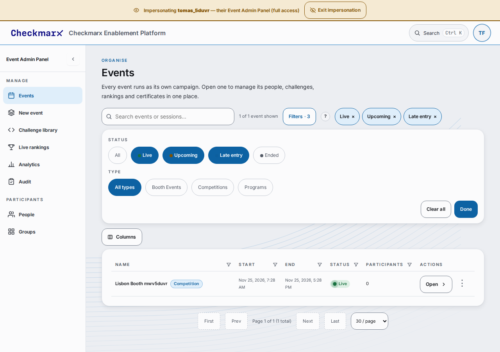

A **sealed answer** the organiser wrote is not shown through their panel — not
on the challenge list, its history, the exports, an event's **Activity**
section or the **Audit** page —
until you reveal it from there: the row menu offers **Reveal sealed answer**
exactly as in your own panel, behind the reveal's own confirmation and then
the *this will change real data* one, and the record names you and the
organiser's view you were in. The reveal lasts only while you stay in that view.
A seal cannot be set on their behalf — a seal names a person, not a tier. Your
own sealed challenges stay readable through it, for the same reason. And if you
are yourself competing in an event that organiser runs where staff compete,
their panel is refused to you (their participant view still opens, and switching
up from it is refused the same way): through their hands you could otherwise
change the board you compete on. The whole of [the competitor
lock](#the-competitor-lock-binds-you-too) follows you into their panel: an event
you compete in, a challenge it holds and a fellow competitor's account are
refused through anybody's panel exactly as they are from your own — whichever
event the organiser runs.

> **Revoking someone mid-impersonation takes effect immediately.** If you demote
> or block an admin while they are impersonating a participant, their session
> ends there and then: they are signed out, and a change they had already
> started — an answer file still uploading, a certificate being generated — is
> refused, with nothing from it saved. You do not have to wait for their session
> to expire. A change that reaches their account another way, such as a
> participant import, is caught when they next save something — they drop to
> read-only if they merely lost superadmin, or are signed out if they lost admin
> access altogether — and a change already on its way is held to the same rule.
> The participant is held to it too: if their own account is blocked or deleted
> while such a change is on its way, nothing from it is saved and you are
> returned to your own view.

What you change **counts**: an answer you submit scores for that participant,
a hint you reveal deducts their points, and both show up on the leaderboard.
The one thing that doesn't follow is reporting — impersonated activity is left
out of Analytics, so a repair session never distorts challenge statistics.

Everything is attributed. The participant's **History** records when the
impersonation started and ended and names you, and each request in between is
tagged with your account in the logs. Treat it as you would any other
credential-level action: use it to fix a real problem, not as a shortcut for
work the participant should do themselves.

Impersonating another admin or superadmin is refused for everyone, including
you. An event admin is not in that set.

---

## Signing someone in when their email is broken

There is no password-reset link: a password is replaced by its owner, after
signing in with a code. When a participant's mail is not arriving:

- **They are standing in front of you and have never signed in** — use **Show
  sign-in code** on their row. The code appears on your own screen, single-use,
  for a few minutes; read it to them. It needs no email at all, and nothing
  emailed replaces it while it is live. (Participants only, only once the
  account is approved, and never for somebody you compete alongside. After a
  first sign-in the desk can only email a code.)
- **Anyone else** — fix the address if it is wrong, then use **Email sign-in
  code** on their row, which sends a fresh code to their primary address. A code
  emailed less than two minutes ago, or a code shown at the desk that is still
  live, is never replaced, so pressing it twice does nothing harmful.

A participant who chose to sign in with a password needs no email while they
remember it, once their address is verified (an account still unverified after
its 48 hours is told to sign in with an emailed code first). One who has
forgotten it signs in with an emailed code and within ten minutes sets a new
one under **Profile → How you sign in**, without the old one.

If mail is down for everyone, an account that signs in with a password it has
set still signs in with it. Everyone else needs a code: a participant standing
in front of an organiser who has never signed in can be given one with **Show
sign-in code**; anyone else waits until mail is back. The built-in superadmin always gets in with the
password from the data folder, on the ordinary sign-in card; that account never
needs email.

---

## Importing participants

Bulk-import participants from a JSON file with **Import JSON**, in the
**Export ▾** menu on the **People** toolbar (it is there for you, and for a
custom role you give the import permission; a regular admin does not have it).

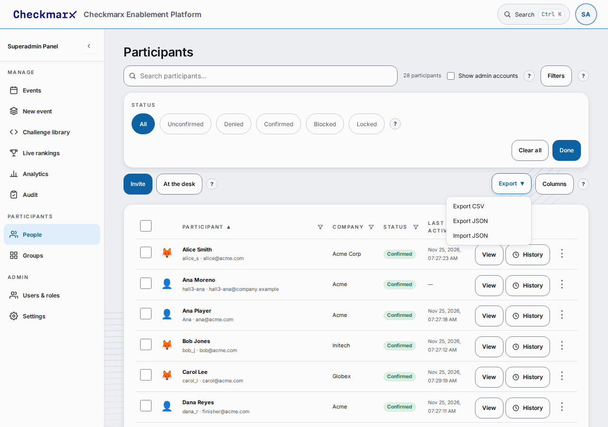

The platform parses the file, shows you a preview, and lets you resolve any
conflicts (a nickname or email already in use) row by row — overwrite,
rename, or skip.

The preview has a search box and pages a large file 100 rows at a time. **The
header checkbox applies to what the search is showing**, not to the whole
file: search `@acme.com`, tick it, and you select those rows only — the rest
of the file keeps whatever it had. That is what lets you go group by group
through a big export. Clear the search to see and select everything again;
the counter beside the box always reads `N of TOTAL selected` for the whole
file, so you can tell at a glance what the import will actually write. Every email must look like a real address, nicknames collide
regardless of case (`Alice_S` and `alice_s` are the same), and one address
can't be both the primary and secondary email on the same row. A row whose
names, company, job title, city, country, job function, salutation, phone
or certificate name holds a control character (a line break, a tab, an escape
code) is not imported, new or overwrite, and the summary counts it. A row whose
avatar is a link to a picture this platform does not hold (only a hand-edited
file has one: an export carries the pictures themselves) keeps the account's
current avatar, or gives a new account the default one, and the summary counts
it. **Export JSON**,
in the same menu, makes an "export → edit in a spreadsheet → re-import" cycle
work cleanly. The same import/export exists for challenges.

**An import is checked again just before it writes.** If your access is taken
away while a large file is being processed — you are blocked, removed, or
moved to a role that cannot import (the admin role cannot) — or your session ends in
the meantime, the import is refused and nothing from it is written. Each row it
writes is read again at that moment too: a challenge locked while the file was
being checked is skipped rather than overwritten (and one unlocked meanwhile is
overwritten, attachments included), a challenge or participant deleted
meanwhile is skipped rather than failing the import, and a nickname someone
registered meanwhile stops the import at that row with a message naming it.

**An import that fails part-way keeps what it already wrote.** Participant rows
are committed in batches of a hundred, so the database is never locked for the
whole file — which means a row the platform refuses stops the import at that
batch and leaves every earlier batch saved. The error tells
you how far it got (imported, overwritten and skipped) and the Participants table
reloads, so you can see the result rather than being told the whole thing
failed. Fix the file and re-run it: rows that already landed simply come back as
conflicts on the next preview, so re-running is safe. The **challenge** import
behaves differently — it is a single transaction, so a failure there rolls the
whole file back, pictures pasted into the challenges included. A row it cannot
store does not fail the file, though: it is
**skipped** and counted in the summary. That covers a challenge with an invalid
difficulty or answer type, a multiple-choice challenge whose options do not
work, an **Any answer** challenge that carries a hint (the type never stores
one — clear it in the file), and a **Text** challenge whose accepted answers
are all blank. A Text challenge's accepted-answer list is tidied on the way in
exactly as the editor tidies it: blank lines and duplicates are dropped.

**A large import pauses the platform while it writes.** The challenge import
cleans each challenge's text (description, explanation and hint) before it
starts writing, answering everyone else's requests meanwhile, but the writing
itself holds the platform: about three seconds for 10 000 challenges, and one
to two seconds for 5 000 participants, on a fast server. Import a large file
outside an event's live hours.

**A value the platform cannot store stops the file, not the batch.** Every field
the import writes is checked before anything is written, including the ones you
rarely edit by hand — the role, the created / login / lockout timestamps, the
approval, denial and invitation columns. If one of them holds something that is
not text (a list or an object left behind by a spreadsheet export, say), the
whole file is refused with the row number, before a single account is created.
That is deliberate: those values reach the database directly, so accepting them
and failing half way through is the outcome worth avoiding.

**Passwords and sign-in choices do not travel.** The file carries neither, so
each new account signs in the way its role does by default and has no password
yet — an imported administrator signs in with an emailed code the first time and
is then asked to set one. An overwrite leaves an existing account's password and
sign-in method as they were.

**An unrecognised role is ignored rather than stored.** An import accepts a
role this platform has: a built-in one (participant, event admin, admin,
superadmin) or a custom role from **Roles & permissions** (an export carries its id).
Anything else in a `role` field — a custom role from another platform, say — is
skipped and counted, and the toast tells you how many: a **new** account
imports as a participant, and an **existing** one keeps whatever role it
already has — so a bad file can never quietly demote one of your admins. Roles
it does recognise still apply as normal.

**Someone importing with a custom role gets no further than their role.** A role
you give the import permission can import files too, but a row that would give
a role theirs could not give, or overwrite an account only a superadmin may
manage (an administrator's, or one whose role can do something theirs cannot),
is skipped and counted, and the toast says how many. Import those rows yourself.

**An event enrolment the file names is skipped rather than forced, and the
toast says why.** Each participant row may carry the events that person was
enrolled in on the platform the file came from. An enrolment is skipped, and
counted by reason in the summary, when the event does not exist here; when it is
a `staff`-tagged account going into an event where staff do not compete; when
that person wrote a challenge assigned to an event that lets staff compete; and
when it is into an event **you are competing in** yourself — the competitor
lock's import door (see [The competitor lock binds you
too](#the-competitor-lock-binds-you-too)). Your own row is never skipped;
into any event where staff compete it lands without the file's time-of-entry
(and into one you already compete in it changes nothing): your solve clock
starts when you first enter the event while it is running (or at your first
submission or hint there, if that came earlier), since a chosen anchor would be
a chosen placing. The file's **absence records** — a participant's spells out of an
event, which are subtracted from their solve clock — are skipped by reason in
the same summary: one naming an event or session that does not exist here, one
into an event you compete in, and any of your own into an event where staff
compete (whether or not you compete there). And a **group
association** whose group is bound to an event you compete in is dropped and
counted, because that group live-syncs a row into the event. The **challenge**
import has the matching rule: an overwrite of a challenge held by an event you
compete in is skipped and counted, exactly as an overwrite of somebody else's
sealed challenge is, and so is an overwrite the qualifying-question rules refuse:
one that would make an event ask a qualifying topic twice, or move or remove the
options of a qualifying question somebody has answered (the summary names each).
Each event holds its own copy of the built-in qualifying questions under the same
title, and a file names a challenge by its title alone, so an overwrite that could
mean more than one of them (or two rows of the file overwriting one title) is
skipped and counted rather than applied to one: edit the question in its event, or
choose **Add New**. A row that adds a `qualifying:` tag that is not
`qualifying:<key>` (1–40 lowercase letters, digits, - or _) is skipped too; one the
challenge already carries is kept.
An overwrite that would make a sealed challenge an **Any answer** challenge is
skipped and counted too: the seal would stay over an answer type with no answer
to seal.
And an overwrite of the account of anybody you compete
alongside is skipped whole and counted: it would change their account in ways
the Participants screen refuses you (block, verify, approve, role, the
benchmark tag), so another organiser imports that row.

---

## Certificate design

**Settings → Certificate design → Open the certificate designer** is the
platform's certificate: the wording,
the medal wording of each certificate (Gold, Silver, Bronze, Participation,
Completion), the colours, which parts are shown, and the congratulations email
(on or off, its subject, an extra paragraph, a thank-you paragraph per
certificate and the LinkedIn post). Pick a certificate to preview
it; the preview follows every change before you save. Wording the certificate cannot print is refused when you save: a script its
fonts lack (Georgian or Devanagari, for example), an emoji, or Latin letters on
one line with Arabic, Hebrew or Thai. The medal headline prints exactly as typed,
so `{platform}` goes in the small line under it instead. Events use this design
unless an administrator gives one its own (the event's **Certificates** section;
its organisers can preview that design but not change it);
**Reset to defaults** returns the platform design to the built-in one and leaves
events with their own design alone. You are the only one who can change an
ended event's own design; the platform design, which any administrator can
edit, still reaches an ended event that has none of its own. Either way a design
changes already-issued certificates the next time they are downloaded, their
wording and which details they show included; what they attest stays as issued,
and the verification page keeps it.

What an issued certificate attests does not move with the design or the rules:
a Gold, Silver or Bronze certificate already issued to a top-three place on zero
points or fewer keeps its medal, and one issued with the nickname because the
certificate could not draw the holder's name keeps printing the nickname, which
its verification matches, until their name is written in Latin, Greek or
Cyrillic letters. The event's **Certificates** list shows you each certificate's
credential code, as it does a role granted **Look up a certificate by its code**;
other admins see the list without it. You can revoke any certificate (**Revoke** on the event's
**Certificates** list); its verification page then says it was revoked, and its
holder cannot replace it themselves. On a revoked certificate, **Issue again**
issues a new one from the event's current results, with a new code, and emails
it if the event's congratulations email is on. Use it after reviving an event
whose placings moved: a revive never changes a certificate already issued, and
Issue again waits until the event has ended (and its late entries have closed),
so the placing it prints is final.

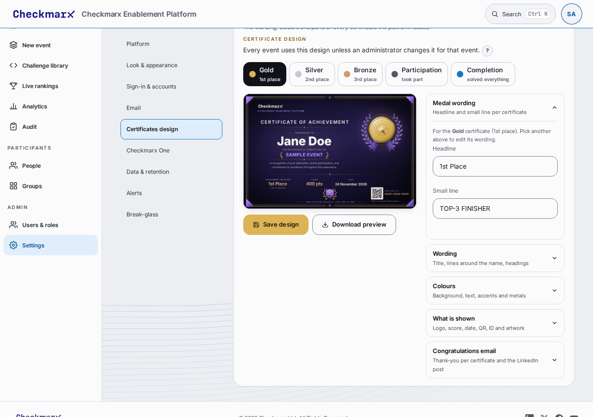

## Requiring approval for new accounts

A new account is approved the moment it is created, because its owner has just
proven the address with an emailed code. Tick **Require admin approval for new
accounts** under **Settings → Sign-in** to change that: from then on a new account
waits in the approval queue and sees a "Pending Approval" message until an
organiser approves it. People who sign up through an open event's join link, QR
code or event code (typing their code in the browser where they asked for it,
the link still open when they send the sign-up form) never wait: the organiser already opened that event to them,
and someone already waiting who signs in through one is approved then too.
Nor does anyone who signs up with an address an invitation was sent to, whether
they followed the invitation's link or typed the address on the sign-in screen,
unless the invitation came from a role that cannot approve accounts (a custom
role without **Approve and deny accounts**): then they wait, listed as *Pending* to you and to the
organisers of the invited events, and join those events the first time they
sign in after you approve them. Such a role cannot use **At the desk** while the
switch is on, as an account made there could not sign in; it is told why. While the switch is on, each event's workspace
shows an **Approve** button and a waiting-for-approval row whenever somebody in
that event is waiting.

## The organisation's default look

The **Appearance page** (account menu → **Appearance**) has one section that
only you, and a custom role allowed to change the platform look, see:
**Organisation default**. Pick a **Default look** and press **Save
default**: every browser that has not picked a look of its own gets it, signed in
or not. With none set, the house default applies: **Ambient**, following each device's light or dark setting. The change is
recorded in the settings history.

### The platform look (Settings)

**Settings → Branding → Platform look** sets the whole starting appearance: the **Look**,
the **Mode** (or leave it to each browser, which follows its device until they choose) and, for Ambient, the
**Light colour**. The app uses it from its very first moment, the sign-in page
included, and so do the help page (which opens in its own tab), the pages
opened from email links (confirming an address, changing it, sharing a
certificate) and the public certificate page (with the page shown when a
certificate link does not work). The email pages and the public certificate
pages have one colour scheme of their own, so they follow only its light or dark
mode and its lock. Pages that run no
script (the certificate check, unsubscribing) keep their fixed appearance.

- **Save** keeps everybody's own choices: a person who picked a look in
  Appearance keeps it.
- **Apply to everyone now** saves and also replaces the choices people made
  before it, on each browser's next load. They can choose again afterwards.
- **Lock look for participants** keeps participants and signed-out visitors on
  the platform look, and on its **Mode** when you set one; their Appearance
  controls say so instead of offering a choice. Signed out, the look picker
  then offers only the mode and says the look is set; with a **Mode** set as
  well there is nothing left to choose, so the sign-in screen shows no
  appearance control at all. Admins and organisers keep their own.

Each change is recorded in the settings history.

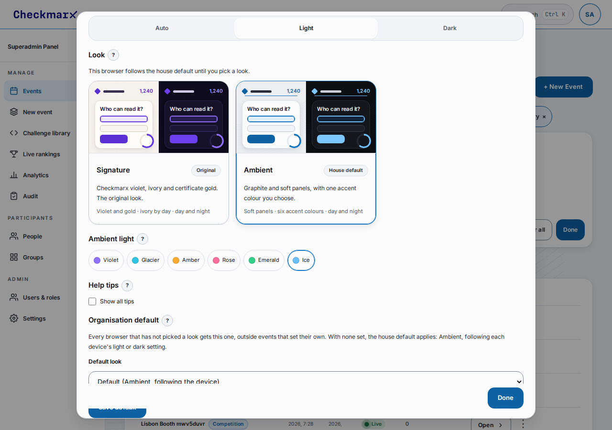

## The Settings page

Settings is two panes: the list on the left, grouped under **People**,
**Records** and **System**, and the chosen section on the right (on a phone, a
**Section** picker above it).

- **People**: **People**, **Teams** and **Roles & permissions** open those
  pages; **Sign-in** holds approval for new accounts and, only in the built-in
  account's own session, the **Break-glass account**.
- **Records**: **Audit log** opens the Audit page; **CxOne API audit** opens the
  Audit log searching for Checkmarx One activity, and lists the Checkmarx One
  accounts waiting to be removed for deleted participants.
- **System**: **General** (the platform name, the default Checkmarx One
  integration, how long event history is kept and when it was last swept, and
  open blocked-address alerts, each with **Review**), **Branding** (the platform
  look and the certificate design), **Email (SMTP)** (the mail relay's last
  check, **Send test email**, the unsubscribe list and the [event team report
  domains](#event-team-report-domains)), **Updates** (the running version and
  **What's new**; a server set up with the Podman installer checks daily for
  a new signed release image and restarts on it, any other deployment updates
  however its operator set it up), **Backups & health** (the database's start-up checks,
  maintenance mode, the mail relay, free disk space and how long the server has
  run; a superadmin also sees the database's size, the Node.js version and when
  the server started; a server set up with the Podman installer tries to back
  up its database before each start (a failed backup does not stop it), any
  other deployment has whatever backups its operator set up, and this page
  cannot list them), **Get help** (opens the guides) and
  **About** (the version and the typefaces certificates use).

The history sweep also reports how many unused pictures it removed, or that it
held their clean-up because the database failed a start-up check or maintenance
was on; a picture is unused once no challenge or saved version, account photo,
frozen team board or older certificate shows it, and the next daily sweep
removes it (never within a week of it being stored), links to it from outside
the platform included; the **Audit** page's record of each sweep lists the
pictures it removed, so one can be restored from a backup. Each setting is one
row with its own **?** for the longer explanation, and each form has its own
Save. The section you last opened is remembered in this browser.

Each card shows to whoever may use it: a regular admin sees the **Certificate
design**, the event team report domains (read-only), event history retention,
the blocked-address alerts and **Backups & health**; a custom role sees the cards for the permissions you gave it.

## Platform name

**Settings → General** is where the platform is named, and **only a superadmin (or a
custom role you give both *See platform settings* and *Change platform settings*)
can change it** — a regular admin does not see that section at all.

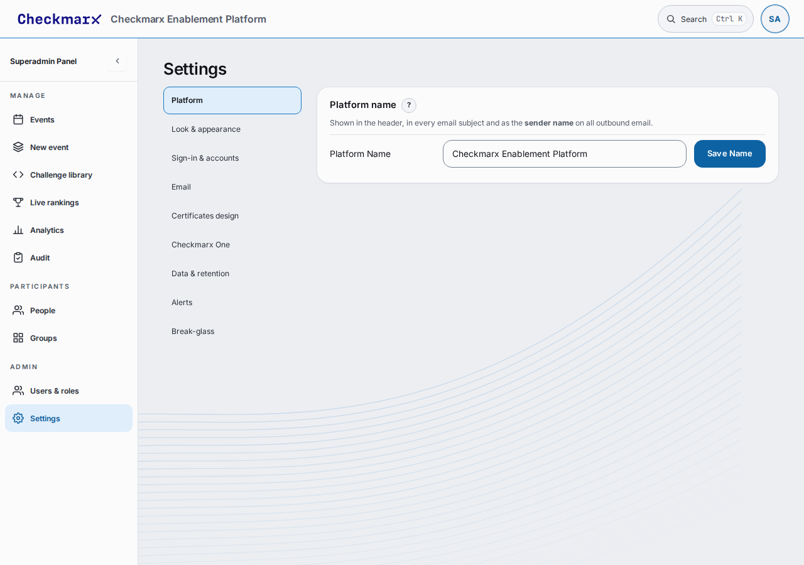

The name is more load-bearing than it looks. It appears in the header and the
in-app help, in the subject line of every participant-facing email, on the
public achievement-badge page — and it is the **sender name recipients see in
their inbox** on
every email the platform sends: invitations, verification, sign-in codes,
reminders, the lot.

What it does **not** change is the sender *address*. That is fixed by the
operator in the `EMAIL_FROM` environment variable, on a domain the deployment
actually controls, because it is the identity SPF is checked against and the
address bounces come back to. So renaming the platform changes

```
From: Old Name <no-reply@yourdomain.com>
```

to

```
From: New Name <no-reply@yourdomain.com>
```

and nothing else — it cannot affect deliverability. A rename applies to the very
next email sent; there is no restart and no cache to clear.

Two practical notes. Line breaks and other control characters are refused with an
explanatory error rather than being silently accepted, because a pasted line
break would otherwise mangle every email subject the platform sends. Ordinary
punctuation is fine — commas, quotes, ampersands and brackets all work, and are
quoted correctly in the header. And if a rename lands while a large invitation or
reminder batch is already going out, the messages still in that batch keep the
old name in their subject and body; only new batches pick the new one up.

---

## Default CxOne integration

**Settings → General** holds the platform-wide CxOne credentials.

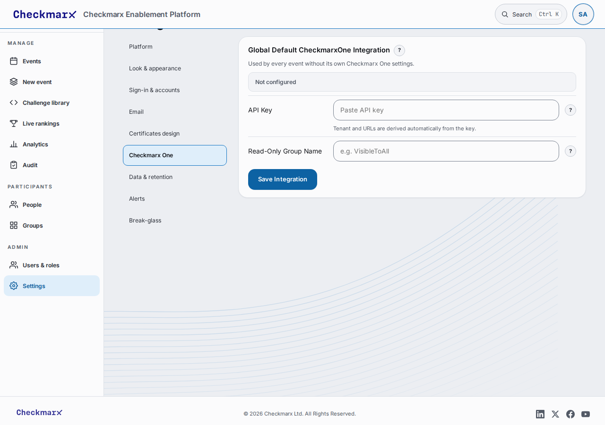

Set the default API key and group name once and every new event
inherits them. **This global default is superadmin-only** — regular admins
can't change the platform-wide credentials in the Settings tab.

To remove a deleted participant's account from the tenant by itself, the
platform also needs its key to be able to **view the tenant's clients** (in the
tenant, the key's client holds the view-clients role). That is how it proves it
can see every role the tenant could have given the account. Without it, each
removal waits for your decision under **Checkmarx One account removals**.

The group name is matched exactly first and then ignoring case, so a
capitalisation slip still finds the right group and is recorded in the
participant's History rather than silently leaving them without access.
Two Checkmarx One groups differing only in case are never guessed between.

**Per-event overrides are different**: they live in the **Edit
Event** dialog and are available to **any admin**. A regular admin can
set a specific event's own API key and/or group name to override the
global default just for that event (and can clear it again). Only the
global default above is restricted to superadmins.

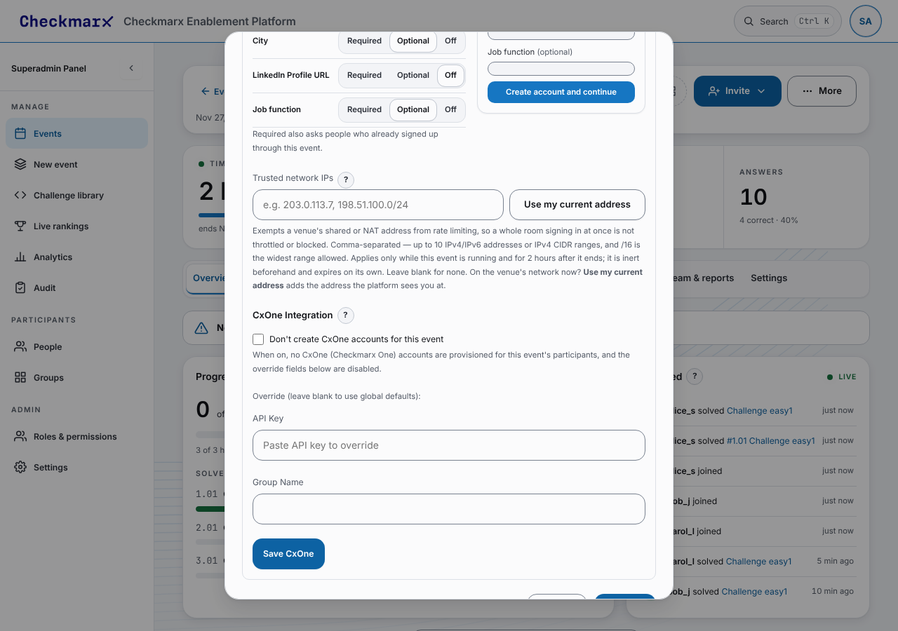

Leave an override blank to inherit the default; set a key and/or group to
override. The **Remove CxOne** button clears an override and restores
inheritance. An incorrectly formatted API key is rejected with a clear message before
anything is stored, so you won't end up with a broken integration that only
fails later. Deleting the default credentials makes events fall back to
their own value, or to no integration if neither is set.

### Opt an event out of CxOne accounts

The **Don't create CxOne accounts for this event** checkbox (top of the
CxOne section) is **pre-set from the event type**: it arrives clear on a
Competition — every participant added gets a CxOne account provisioned — and
already ticked on a Booth Event and a Program, neither of which normally wants a
Checkmarx One account minted for every attendee. The create dialog says which way
it has been pre-set for the type you chose. Tick it when an event
shouldn't touch CxOne at all (a dry run, an external event, a practice
round): no accounts are created for its participants through any path
(assignment, self-enrollment, invitation, or group sync). Ticking it also
disables the override fields above, since there's nothing to configure when no
accounts will be created. Whichever way the box starts out, you can change it at
any time from the **Edit Event** dialog.

---

## Checkmarx One account removals

When you [delete a participant](#deleting-a-participant), {{platformName}}
removes the Checkmarx One accounts it created for them from the customer's
tenant. Most removals need nobody. The ones that do — because the platform could
not carry them out, or will not without your say-so — are listed on the
**Checkmarx One account removals** card in the Settings tab, each with what to do
about it. Only a superadmin sees the card. It appears once an event or the
platform default has a Checkmarx One key, or there is something to list; when
nothing is waiting it says *No Checkmarx One accounts are waiting to be
removed*.

While any entry needs you, a banner across the top of the admin panel says so —
*3 Checkmarx One accounts need your decision.* — and its **Review removals**
button takes you straight to the card. Entries the platform is still retrying on
its own are listed on the card but not counted in the banner.

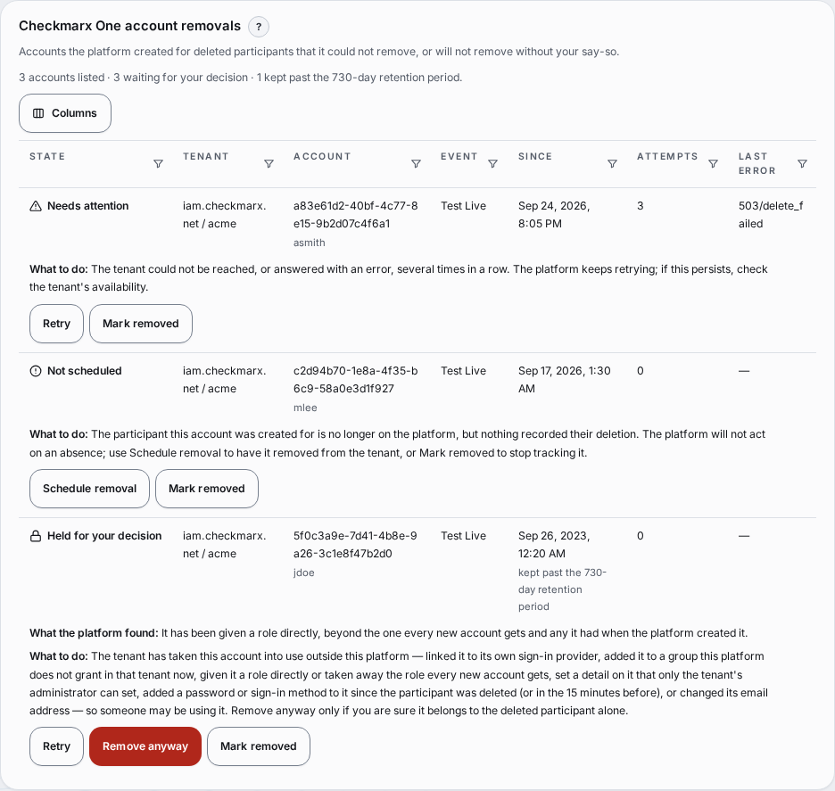

Each entry shows the **State**; the **Tenant** the account was created in (with
*not confirmed* beneath it while the platform cannot yet be sure which tenant it
is); the **Account** — its id, with the username it was created under; the
**Event** it was created for (or *Global default key* when it came from the
platform-wide credentials, *A deleted event* when that event is gone); **Since**
— when its removal was scheduled; **Attempts**, with the time of the next try
while it is retrying; and the **Last error** the tenant answered with. Beneath
them, **What to do** explains, in a sentence, why this entry is here.

No entry leaves the card because of its age. An entry stays until the account
is removed, passes to a participant still on the platform, or you mark it
removed, however long that takes: the record is the only way left to finish
removing the account from the tenant. An entry whose removal was scheduled
longer ago than the platform's data-retention period (730 days, unless your
deployment sets another) says *kept past the 730-day retention period* under
**Since**, and the line above the list says how many there are.

### States

- **Retrying** — the removal is scheduled and has not gone through yet: the
  tenant could not be reached, or answered with an error. The platform tries
  again on its own, leaving longer between tries each time. Nothing for you to
  do yet.
- **Needs attention** — the removal has failed three times, or kept failing for
  a day, or failed for a reason that waiting will not fix: no key the platform
  holds reaches that tenant, the tenant refused the key, the key is not allowed
  to read or remove users, the key may read the account but not its roles or
  sign-in credentials, or no tenant the platform can reach has the account.
  The platform keeps trying; *What to do* says what to add or fix.
- **Given up** — after 30 days of failing, the platform stops trying. Remove the
  account in the tenant by hand, then **Mark removed** — or **Retry** to start
  again.
- **Held for your decision** — the platform will not remove this account without
  your say-so. The reasons are below.
- **Not scheduled** — the participant is no longer on the platform, but nothing
  recorded their deletion (they were removed some other way than **Delete**), so
  the platform will not act on the absence by itself. **Schedule removal**
  schedules the removal, once you confirm that the account will be removed from
  the customer's tenant; **Mark removed** stops tracking it.
- **In progress** — the platform is working on this account right now. It offers
  no buttons until it has finished; check back in a minute.

### Why an account is held

- **The tenant has taken the account into use outside {{platformName}}**, so
  someone may be using it. An account whose owner is still on the platform
  passes to them before any of this is checked (see below): passing it on
  removes nothing. Otherwise, any one of these is enough:
  - it is linked to one of the tenant's own sign-in providers — normal in a
    tenant that signs its people in through single sign-on;
  - its email address in the tenant is no longer the one the platform created
    it with. The platform keeps only a fingerprint of that address, never the
    address itself, so an account it has no fingerprint for — one found in the
    platform's history, for instance — skips this one check;
  - it belongs to a group the platform could not have granted **in that
    tenant**: anything other than the groups the platform itself hands out
    there — the default Checkmarx One group, where the platform's default key or
    an event with no group of its own sets up accounts in that tenant, and the
    groups configured on the events that set up accounts in that tenant. A group configured
    on an event that sets up accounts in a **different** tenant does not count,
    even if the names match — in this tenant, a group of that name is the
    customer's own. The tenant's own default groups, which every new account
    joins, do not count. An account in so many groups that the platform cannot
    see them all at once is held too. If you have since renamed an event's
    group, pointed the event at another tenant's key, deleted the event, or
    moved the platform's default key to another tenant, an account given the old
    group is held for the same reason;
  - it has been given a role directly — a role set on the account itself in
    the tenant's sign-in (identity) settings, not one it has through a group —
    other than the one role every new account gets and any it already had when
    the platform created it; or that one role has been taken away from it;
  - it carries a detail (a user attribute) that only the tenant's administrator
    can set. Its language choice, details the tenant lets people fill in
    themselves, and anything it carried when the platform created it do not
    count. If the tenant will not tell the platform which details only its
    administrator can set, any other detail holds the account, and the entry
    says the platform could not check it;
  - a password or another way of signing in was added to it after the
    participant was deleted, or in the 15 minutes before: the tenant's clock
    and the platform's cannot be compared more closely than that, so one added
    by the participant just before their deletion holds the account too.

  The entry says **What the platform found**: which of these held it. The
  participant's own use of the account is not enough to hold it: a password,
  a second sign-in step or a passkey it already had, a pending action such as
  verifying its email, a verified address, or the account being disabled or
  locked out. Roles given in Checkmarx One's own Access Management (for the
  tenant, an application or a project) are not checked: whether they show among
  the roles set in the sign-in settings has not been measured.

  **Remove anyway** only if you are sure the account belonged to the deleted
  participant alone. It overrules every sign that the tenant has put the
  account to use, including one the platform could not see: it then skips the
  check that its key sees every role.
- **The platform cannot see which roles the tenant has given the account** —
  everything it can see is clean and the account would be removed, but its key
  cannot prove it sees every role an account can carry, because it cannot view
  the tenant's clients. (An account that passes to a participant still on the
  platform, below, never waits for this.) Let the
  key's client view them (the view-clients role), then **Retry**. Or **Remove
  anyway** if you are sure the account belonged to the deleted participant
  alone; the platform still holds it if it then finds a role given to it
  directly.
- **A participant still on the platform uses the account's email address** — as
  their primary address, a secondary one, or a change they have not yet
  confirmed — so it may be theirs. The account passes to them, and leaves the
  list, only when it is their **confirmed primary** address, their first and
  last names match the account's, and nobody else on the platform uses that
  address; any other holder keeps it held. The platform checks again weekly.
  **Remove anyway** only if you are sure it belonged to the deleted participant
  alone.
- **A participant still on the platform has a Checkmarx One set-up record that
  names the account, but the record cannot be read** — it may be the record that
  makes the account theirs, and nothing can say. The platform neither removes the
  account nor gives it to them on that record, and holds it until you decide. A
  record that can be read, or a participant linked to the account, still decides
  it: the account passes to them. **Remove anyway** only if you are sure it
  belonged to the deleted participant alone; if a participant who owns it is
  found when the platform looks again, it still passes to them instead.
- **The platform cannot confirm this installation created it** — it was found in
  the platform's history rather than recorded when it was made, or it was
  recorded by a different installation (a copied or restored database). **Remove
  anyway** once you are sure this installation made it, or should now look after
  it.
- **The tenant's own record of the account does not match the one the platform
  created** — its creation time or its username differs. This is the one hold
  you cannot overrule: the platform never removes such an account, and offers no
  **Remove anyway**. Check it in the tenant, remove it by hand if it is yours,
  then **Mark removed**.

### What the buttons do

- **Retry** — tries again now, starting the count of attempts over. On a held
  entry the platform checks the reason again, and holds it again if it still
  applies.
- **Schedule removal** — offered instead of **Retry** on a **Not scheduled**
  entry, because nothing has decided to remove that account yet. It asks you to
  confirm that the platform will remove the account from the customer's tenant,
  which cannot be undone once it runs — or, if a participant still on the
  platform turns out to own it, pass it to them instead and remove nothing.
- **Remove anyway** — offered only on a hold you may overrule. Its confirmation
  quotes the reason the platform is holding the account, and removing it cannot
  be undone. If a participant who owns the account has joined the platform
  since it was held — linked to it, or with its email address as their
  confirmed primary address and the same names — it passes to them instead and
  nothing is removed. It overrules only **that** reason: if the account is held for a
  different one by the time you confirm — another superadmin approved it first
  and the platform then found a new reason to hold it — your confirmation is
  refused with *This account changed after you read it*, and the list shows
  the new reason for you to decide on.
- **Mark removed** — the platform stops tracking the account and will not try to
  remove it again. Its confirmation asks you to make sure the account has been
  removed in the customer's tenant first.

Each of these is recorded in Logs under your name.

Only the account itself is ever removed: the tenant's projects, scans and
everything else in it are never touched. An account that already existed in the
tenant — one the platform found and linked rather than made — is never removed.
Nor is one the platform made but has no record of: remove that one in the tenant
by hand. Nor, finally, is one that still belongs to a participant on the
platform. Someone whose set-up reaches an account while its removal is under way
is not linked to it, and gets an account of their own (see [Deleting a
participant](#deleting-a-participant)).

---

## Unsubscribe list

Participants can opt out of bulk emails (invitations, reminders,
event-assignment and event-removal notices) via the one-click
**Unsubscribe** control their mail client shows on such messages — it comes from
a `List-Unsubscribe` header rather than a link inside the message body, so there
is nothing to look for in the text of the email itself. They still receive essential emails —
account verification, sign-in codes, security alerts (a password set or changed,
a locked account) **and approval notices**.

> **Approval notices reach an opted-out account either way.** Approving
> one participant and approving a batch send the same mail and behave the same
> way, and that mail is delivered rather than withheld: an approval is how
> someone learns the account they asked for is usable, and nobody should have to
> re-subscribe to find that out.

The **Unsubscribe list** under **Settings → Email (SMTP)** (superadmins only) shows each
opted-out address, the date, and the reason. Click **Remove** on a row to
re-enable delivery for someone who has since consented again.

The list shows the 1000 most recent opt-outs. If there are more than that,
a notice above the list says so and gives the real total — **an address
missing from the list is not proof it can still be emailed**. The **Search addresses** box above the list
narrows it as you type, matching on the address and on the reason — but it
searches only the addresses that were loaded, and it says so whenever the list is
truncated. If you cannot find an address while that notice is showing, confirm it
another way: attempt the action that would email them; the send is skipped for
opted-out recipients and recorded as such in that participant's history.

**Inviting an opted-out address.** The invitation row is still created,
but no email goes out — and the result dialog says so in those words, under
*"unsubscribed (not emailed)"*, separately from genuine delivery failures. It
deliberately offers **no registration link** for that address: handing one over
would be routing around the person's own opt-out. If they have since consented,
remove them from this list and re-send; otherwise reach them another way. The
withheld send is recorded in the audit log as `email_suppressed`, rather than as
the usual per-send record — an invitee has no participant row to hang one on.

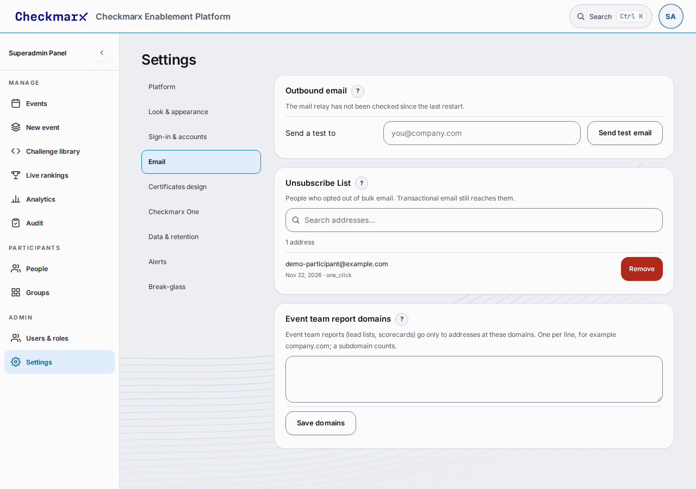

---

## Event team report domains

An event's **Team & reports** section mails lead lists and scorecards to the
people its organisers name (see the [Admin
guide](admin.md#event-team-and-lead-reports)). Those reports carry participants'
details, so they go only to addresses at the domains you list under **Settings →
Email → Event team report domains**: one per line, for example `company.com`, up
to 50. A subdomain counts, so `company.com` also admits `emea.company.com`.
**Save domains** keeps the list, and each change is recorded in the settings
history.

- **The list starts empty, and while it is empty nobody can add a team member to
  any event**, whatever their role: they are told to ask a superadmin to add the
  domain under Settings, Email. Fill it in before organisers start naming their
  teams.
- **It is asked again at every send.** Remove a domain and the reports stop going
  to addresses there from the next send, members already on a team included:
  their row in the event's team says *domain no longer allowed: not sent*.
- Administrators see the list read-only; an event's organisers see the domains
  their team may use in its **Team & reports** section.

---

## Silencing a blocked-address alert

When {{platformName}} blocks an address for scanner-like traffic, every
signed-in admin gets a notice about it — see
[Alerts](admin.md#alerts) for what it means and how to act on it.

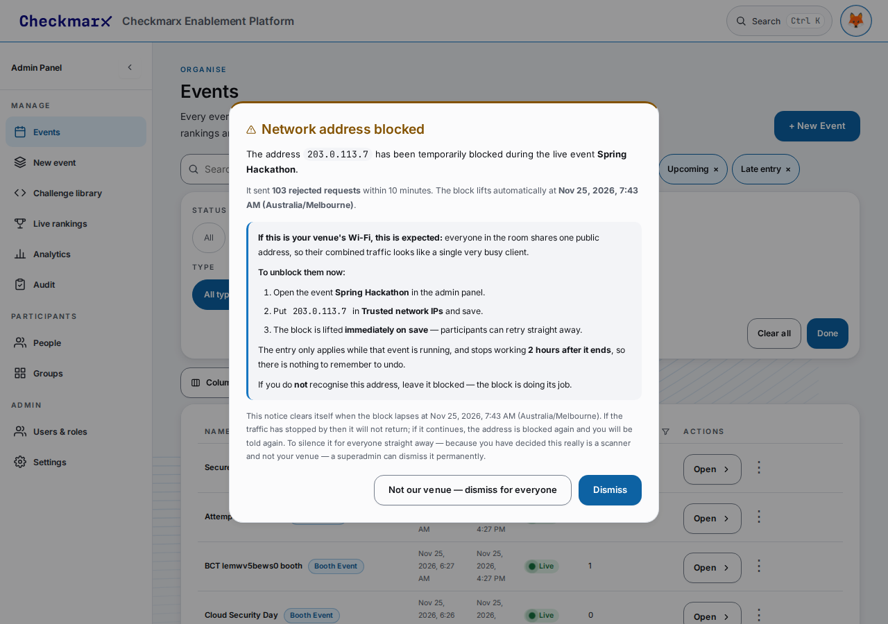

Any admin can **Dismiss** that notice, but only for themselves. **Dismiss for
everyone** is yours alone — it is the left-hand button, labelled **Not our venue
— dismiss for everyone**, and it appears only when a superadmin is signed in. It hides the notice from every admin and stops the
same address raising another one for about an hour — in effect, ruling that
the traffic is a genuine scanner rather than a venue full of participants.

That's why it's restricted. A regular admin who clears the popup only clears
their own view, so a colleague still standing in the room can act on it; if one
person could silence it platform-wide, a room-wide outage would vanish from the
screens of the people able to fix it. Regular admins who try are refused, and
your dismissal is recorded in Logs with your account against it.

Use it when an address keeps coming back after you've established it isn't
yours. You don't need it for tidiness — an alert stops showing by itself once
the 15-minute block lapses.

**You will need this rarely.** {{platformName}} classifies the traffic before it
decides whether to say anything, and an unmistakable scanner — one walking
`/.env`, `/wp-admin`, `/phpmyadmin` and the like — is blocked without any notice
at all. So the notices that do reach you are the genuinely ambiguous ones, and
"dismiss for everyone" is for the case where the classifier was too cautious: an
address that keeps raising a notice you have already judged to be a scanner. Every
block, silent or not, is still in the Logs — see
[Finding a block that didn't notify you](admin.md#finding-a-block-that-didnt-notify-you).

**Every superadmin is emailed the same notice whenever a block raises one**,
whether or not an admin happens to be signed in — so keep your address current. A
signed-in admin session only decides which surface is recorded as the primary
channel; it does not hold the email back. That is deliberate: the block covers
the whole address, and at an in-person event you are usually *on* it, so the
in-app notice explaining the outage can be the one page you cannot load.

---

## Unredacted logs

For regular admins **Raw logs** (on the **Audit** page) blanks out the superadmin password shown when
the platform starts up, so a normal admin can't accidentally share it by
scrolling. Superadmins see it **without** the blanking, because recovering from a
deleted password file needs the real value.

The one-time codes in verification links are blanked for **everyone**,
including you: they are stripped before the line is ever written, so they cannot
be recovered from Raw logs, from a log backup or from a log shipper. To
rescue a user whose email never arrived, see [Signing someone in when their
email is broken](#signing-someone-in-when-their-email-is-broken).

A [sealed](#sealed-answers) challenge's answer is kept out of the logs by that
same mechanism: an edit to it is written as a note that the sealed answer
changed, never as the old and new values, so there is nothing in the
unredacted view for you to read. A superadmin's reveal of one is logged here
too, by name — the act, never the answer. Outside the platform's database, the
only copy is one its author has deliberately exported.

Treat the Logs view as credential-handling when you're on it: don't paste
entries into tickets, and don't screen-share this tab without checking the
visible rows first.

One practical note for audit work: once you narrow Raw logs with a search
or a group filter, the total becomes exact (on the Audit log, up to 10,000
matching entries) and the ordering covers every entry that matched rather than
the page in front of you — so **Last**, **±10** and **Go to page** all become
live, and a sweep can actually be finished. A search that stops short of the
whole history says how far back it looked, and **Next** searches further back.
See [Raw logs](admin.md#raw-logs).

---

[← Back to the Admin guide](admin.md)
